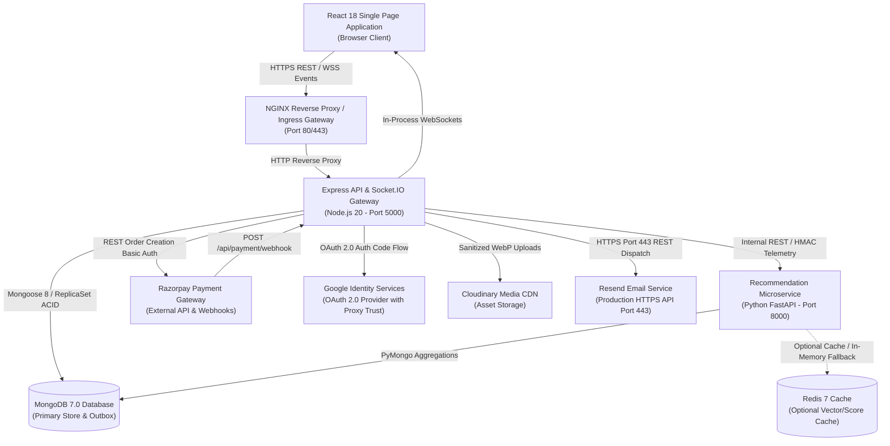
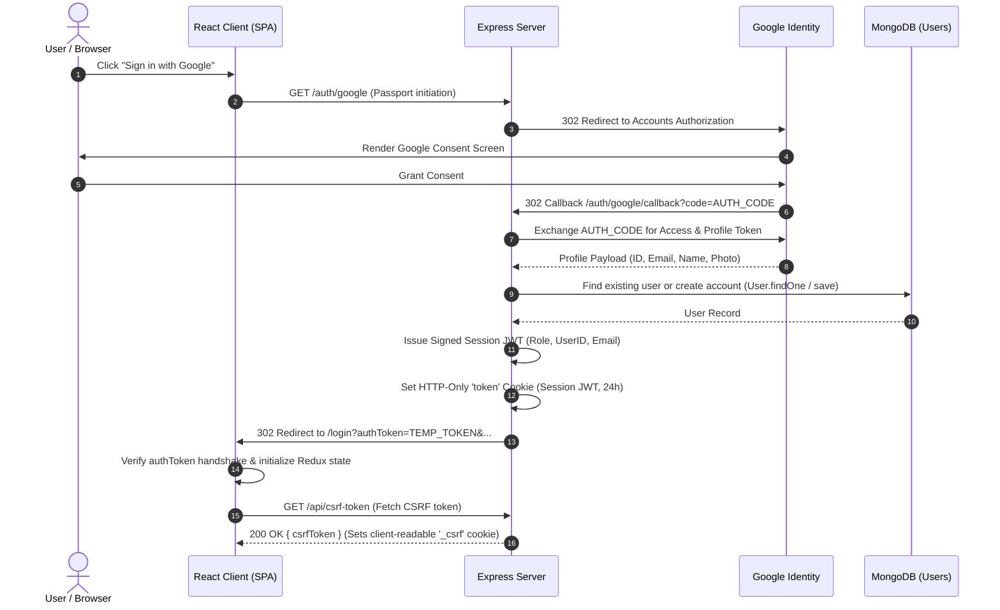
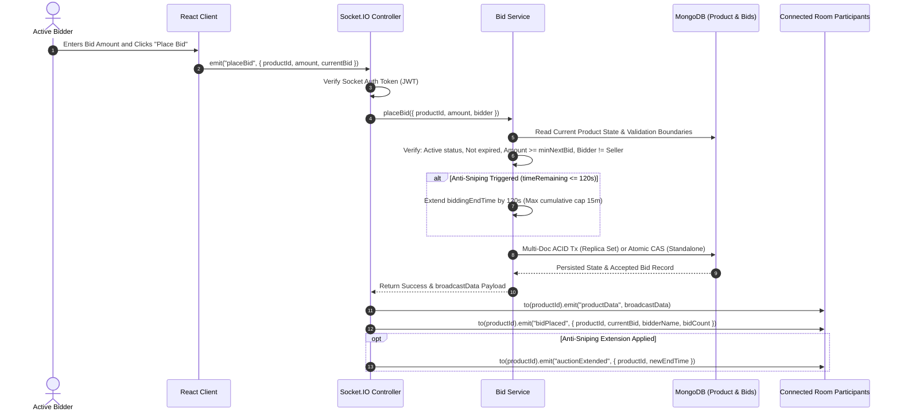
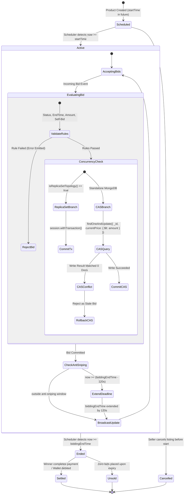
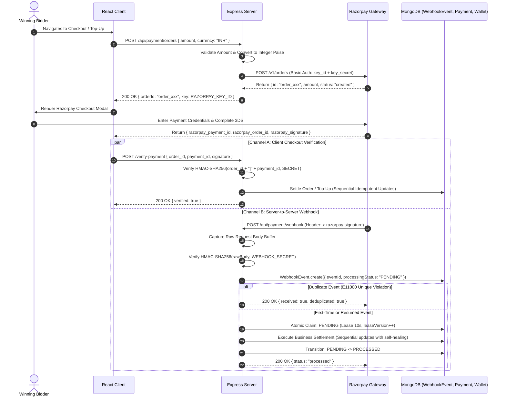
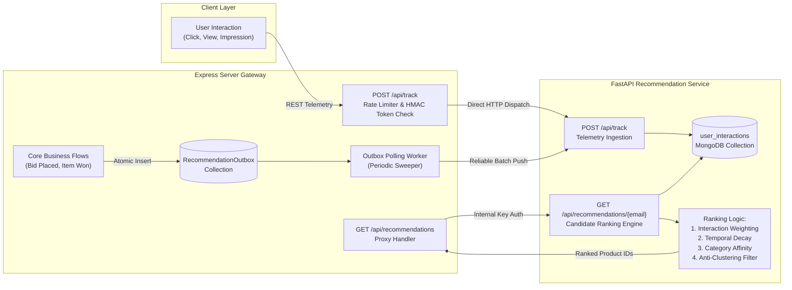
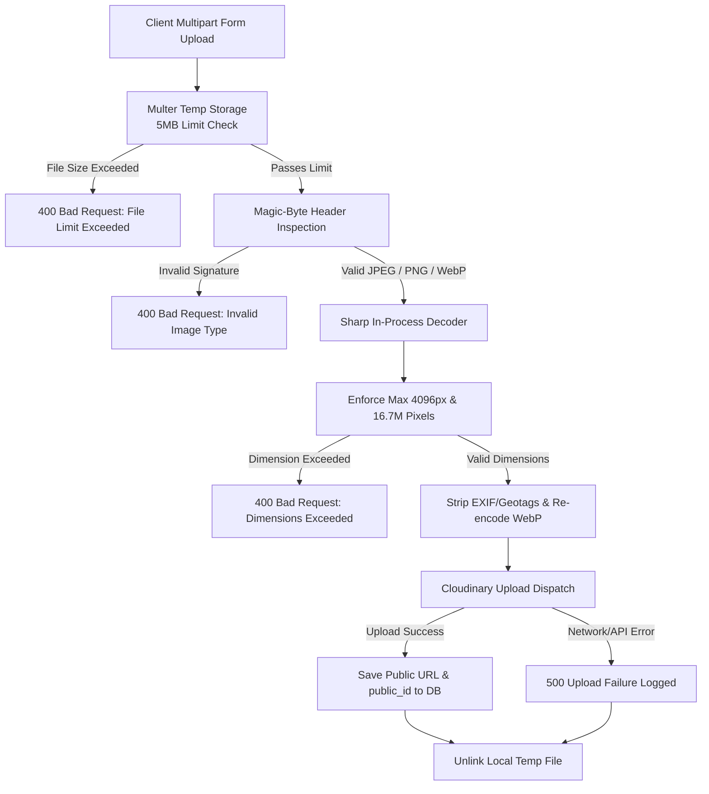
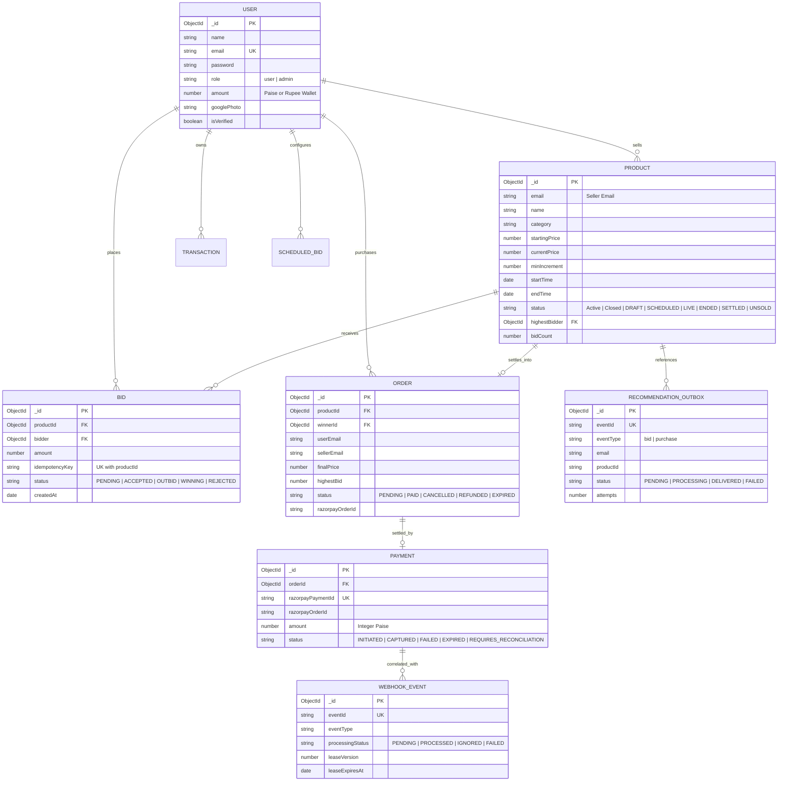
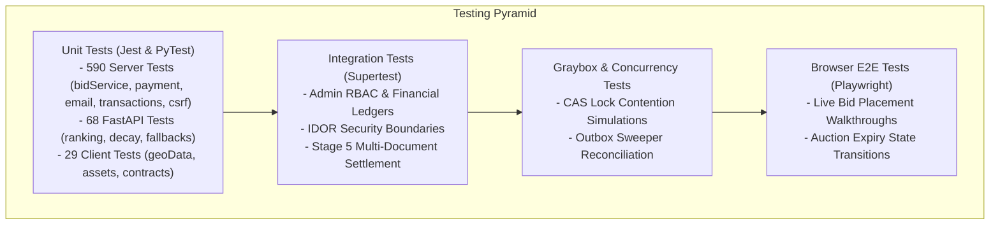

# AuctionX — AI-Powered Live Auction Platform

An advanced full-stack demonstration platform showcasing production-oriented engineering patterns, real-time concurrency controls, idempotent payment workflows, and AI-powered item recommendations.

[](https://nodejs.org/)
[](https://expressjs.com/)
[](https://react.dev/)
[](https://vitejs.dev/)
[](https://tailwindcss.com/)
[](https://www.python.org/)
[](https://fastapi.tiangolo.com/)
[](https://www.mongodb.com/)
[](https://socket.io/)
[](https://razorpay.com/)
[](https://jestjs.io/)
[](https://pytest.org/)
[](https://nodejs.org/api/test.html)

---

## Technical Disclosure

AuctionX is an advanced software engineering demonstration and portfolio platform designed to illustrate enterprise-grade architectural patterns, state-machine synchronization, race-condition mitigation, and distributed telemetry integration. It is not an active commercial auction clearinghouse or licensed financial institution. Payment gateway integrations operate in developer sandbox test mode, and third-party media and identity capabilities depend on external developer account provisioning.

---

## Subsystem Documentation

Detailed engineering references are available for each of the primary AuctionX subsystems:

| Subsystem | Primary Directory | Technology Stack & Scope | Engineering Guide |
| :--- | :--- | :--- | :--- |
| **Frontend Client** | `client/` | React 18, Vite 6, Tailwind CSS v4, Redux Toolkit, Lazy PDF, Image Delivery | [Frontend Client Guide](client/README.md) |
| **Backend Gateway** | `server/` | Node.js 20, Express 4.21, Socket.IO 4.8, Razorpay Sandbox, Mongoose 8 | [Backend Gateway Guide](server/README.md) |
| **Recommendation Engine** | `recommendation_service/` | Python 3.10+, FastAPI 0.115, Uvicorn, PyMongo, NumPy, Redis, HMAC PII | [Recommendation Engine Guide](recommendation_service/README.md) |
| **Browser E2E Automation** | `e2e/` | Playwright, Headless Chromium, Isolated Test DB, 12 Benchmark Harnesses | [Playwright E2E Guide](e2e/README.md) |

---

## Table of Contents

- [Subsystem Documentation](#subsystem-documentation)

- [1. Project Overview](#1-project-overview)
- [2. Project Status and Scope](#2-project-status-and-scope)
- [3. Why AuctionX Was Built](#3-why-auctionx-was-built)
- [4. Core Features](#4-core-features)
- [5. Technology Stack](#5-technology-stack)
- [6. System Architecture](#6-system-architecture)
- [7. Architecture Diagrams](#7-architecture-diagrams)
  - [A. System Context and High-Level Architecture](#a-system-context-and-high-level-architecture)
  - [B. Deployment and Runtime Topology](#b-deployment-and-runtime-topology)
  - [C. Authentication and Google OAuth 2.0 Flow](#c-authentication-and-google-oauth-20-flow)
  - [D. Real-Time Bidding with Socket.IO](#d-real-time-bidding-with-socketio)
  - [E. Bid Concurrency and Auction State Transitions](#e-bid-concurrency-and-auction-state-transitions)
  - [F. Payment Gateway Lifecycle and Webhook Deduplication](#f-payment-gateway-lifecycle-and-webhook-deduplication)
  - [G. AI Recommendation Service and Telemetry Outbox](#g-ai-recommendation-service-and-telemetry-outbox)
  - [H. Image Upload and Media Processing Pipeline](#h-image-upload-and-media-processing-pipeline)
  - [I. Data Model and Entity Relationships](#i-data-model-and-entity-relationships)
  - [J. CI, Testing Pyramid, and Quality Assurance](#j-ci-testing-pyramid-and-quality-assurance)
- [8. Major Engineering Subsystems](#8-major-engineering-subsystems)
- [9. Authentication and Authorization](#9-authentication-and-authorization)
- [10. Real-Time Auction and Socket.IO Handling](#10-real-time-auction-and-socketio-handling)
- [11. Bidding Lifecycle and Concurrency](#11-bidding-lifecycle-and-concurrency)
- [12. Payment Gateway Integration](#12-payment-gateway-integration)
- [13. Orders, Settlement, and Idempotency](#13-orders-settlement-and-idempotency)
- [14. AI Recommendation Service](#14-ai-recommendation-service)
- [15. Image Uploads and Media Handling](#15-image-uploads-and-media-handling)
- [16. Notifications and Email](#16-notifications-and-email)
- [17. Data Model and Relationships](#17-data-model-and-relationships)
- [18. API and Service Boundaries](#18-api-and-service-boundaries)
- [19. Security Architecture and Defensive Controls](#19-security-architecture-and-defensive-controls)
- [20. Testing and Quality Assurance](#20-testing-and-quality-assurance)
- [21. Repository Structure](#21-repository-structure)
- [22. Local Development Prerequisites](#22-local-development-prerequisites)
- [23. Installation and Configuration](#23-installation-and-configuration)
- [24. Environment Variable Reference](#24-environment-variable-reference)
- [25. Development Commands](#25-development-commands)
- [26. Production Build and Deployment Architecture](#26-production-build-and-deployment-architecture)
- [27. Observability, Reliability, and Scaling Considerations](#27-observability-reliability-and-scaling-considerations)
- [28. Performance and Accessibility](#28-performance-and-accessibility)
- [29. Current Limitations and Known Blockers](#29-current-limitations-and-known-blockers)
- [30. Roadmap and Future Improvements](#30-roadmap-and-future-improvements)
- [31. Contribution and Development Workflow](#31-contribution-and-development-workflow)
- [32. Licensing and Third-Party Notices](#32-licensing-and-third-party-notices)
- [33. Documentation Maintenance and Update History](#33-documentation-maintenance-and-update-history)

---

## 1. Project Overview

AuctionX is an AI-powered live auction web application built with a modern decoupled service architecture:
- A Single Page Application (SPA) frontend built on **React 18.3**, **Vite 6**, and **Tailwind CSS v4**.
- An API gateway and real-time coordination server built on **Node.js 20** and **Express 4.21**, running **Socket.IO 4.8**.
- A high-performance Python microservice built on **FastAPI 0.115** and **Uvicorn**, providing personalized auction recommendations, real-time candidate ranking, and catalog diversification.
- Primary persistence managed via **MongoDB 7.0** through **Mongoose 8** and **PyMongo 4.7**, with optional caching support via **Redis 7**.

The application addresses complex distributed system problems common to high-volume commercial auction platforms:
- **Authoritative Real-Time State:** Client interfaces never dictate price or countdown state. All validations, bidding windows, and status transitions are enforced by the central backend.
- **Race Condition Mitigation:** Bids submitted concurrently are serialized via multi-document ACID transactions on replica set deployments, with atomic Compare-and-Swap (CAS) update predicates and ledger reconciliation serving standalone nodes.
- **Anti-Sniping Extensions:** Live auctions dynamically extend their closing deadlines when competitive bids arrive during final countdown windows.
- **Financial Idempotency:** Webhook ingestion from payment providers enforces strict HMAC-SHA256 signature verification and lease-fenced deduplication to prevent double-crediting.
- **Durable Telemetry Outbox:** Authoritative business events (bids, purchases) are enqueued to a local MongoDB transactional outbox on replica set deployments before being asynchronously streamed to the recommendation engine, ensuring at-least-once telemetry delivery without blocking live auction transactions.

---

## 2. Project Status and Scope

### Current Status
- **Engineering Status:** Demonstration Platform — Feature Complete and Hardened.
- **Test Invariants:** 457 total automated tests passing across three services (360 backend unit/regression tests, 29 client browser/contract tests, 68 recommendation microservice tests).
- **Public Source Publication:** Gated pending final repository owner sign-off on legal licensing text, third-party copyright attribution manifests, and asset licensing releases.
- **Commercial Production:** Not Ready — requires production cluster infrastructure, managed payment keys, and external SLA validation.

### Explicit Scope Boundaries
- **What AuctionX Demonstrates:** End-to-end full-stack software engineering, real-time state synchronization, distributed data pipelines, defensive security design, and clean service decomposition.
- **What AuctionX Does Not Claim:** It is not a certified fintech platform, does not process real money (sandbox testing only), does not guarantee infinite horizontal socket scalability without an external pub/sub broker, and does not replace human escrow dispute settlement.

### Technical Accuracy and Verification Boundaries
- **Audited Claims:** Specific architectural claims, event contracts, security controls, and data structures in this document have been audited against inspected source code and verified with 457 passing automated unit, integration, and contract tests.
- **Environmental Limitations:** Untested edge cases, distributed network partitions, high-concurrency multi-container load, live Razorpay transactions, and production Kubernetes/cloud failover remain unverified.
- **Topology-Dependent Behavior:** Database atomicity is topology-dependent: multi-document ACID transactions require a MongoDB replica set, whereas standalone instances rely on atomic Compare-and-Swap (CAS) ledger updates without multi-document rollbacks.
- **Engineered Trade-offs:** Payment settlement executes sequential idempotent updates with self-healing reconciliation rather than distributed two-phase commits; recommendation telemetry outbox drops enqueue errors on failure to protect core bidding availability; and Socket.IO runs single-process in-memory without cross-node synchronization.

---

## 3. Why AuctionX Was Built

Modern live auctions represent one of the most demanding engineering challenges in web development:
1. **Concurrency Contention:** Thousands of prospective buyers simultaneously submit bids within milliseconds of an auction closing. Traditional read-modify-write patterns result in lost updates, invalid high bidders, and inconsistent state.
2. **Network Asymmetry and Latency Sniping:** In naive socket systems, network jitter allows automated bots to snipe auctions at the last fraction of a second, denying legitimate bidders an opportunity to respond.
3. **Dual-Channel Payment Race Conditions:** Payment processors notify applications through asynchronous webhooks while buyers simultaneously trigger client-side redirect verification. Systems without formal deduplication risk double-crediting wallets or completing duplicate orders.
4. **Decoupled Machine Learning Integration:** Recommendation services often introduce tight latency coupling, where slow ML inference blocks critical user-facing catalog page loads.

AuctionX was architected from the ground up to solve these problems through rigorous, testable software engineering practices.

---

## 4. Core Features

The following matrix documents the operational capabilities implemented across AuctionX, verified against source code and automated tests.

| Subsystem | Capability | Implementation Summary | Primary Entry Point | Status | Current Constraints |
| :--- | :--- | :--- | :--- | :--- | :--- |
| **Bidding** | Real-Time Live Bidding | WebSocket bidirectional communication broadcasting authoritative bid events to room participants. | `server/services/bidService.js` | Implemented | Single-instance Socket.IO; requires Redis adapter for multi-node clusters. |
| **Bidding** | Concurrency Control | Dual-branch concurrency: multi-document ACID transactions on replica sets, atomic CAS queries on standalone nodes. | `server/services/bidService.js` | Implemented | Standalone fallback lacks multi-document cross-collection rollback; crash between product write and bid confirmation requires reconciliation. |
| **Bidding** | Anti-Sniping Soft Close | Dynamic 2-minute deadline extension triggered on valid bids within final 2 minutes, capped at 15 minutes cumulative. | `server/services/bidService.js` | Implemented | Cap is enforced from original scheduled end time. |
| **Bidding** | Bid Idempotency | Client-provided idempotency keys cached in Bid ledger; duplicate submissions return original outcome. | `server/services/bidService.js` | Implemented | Keys scoped to individual bidder and product identifier. |
| **Auctions** | Autonomous Lifecycle | Background cron task running every 5 seconds transitions auctions across `scheduled` -> `active` -> `ended` states. | `server/services/schedulerService.js` | Implemented | Master election required if running multiple backend API instances. |
| **Auctions** | Scheduled Bids | Configurable proxy/auto-bidding limits executed automatically by the scheduler when outbid. | `server/controllers/scheduledBidController.js` | Implemented | Evaluated on discrete 5-second scheduler cycles. |
| **Payments** | Gateway Order Creation | Server-authoritative Razorpay order creation calculated in integer paise with receipt tracking. | `server/services/paymentService.js` | Implemented | Test-mode keys configured; live mode requires merchant onboarding. |
| **Payments** | Webhook Deduplication | Atomic lease-fenced `WebhookEvent` model with unique indices ensuring strictly-once settlement execution. | `server/services/paymentService.js` | Implemented | Leases expire after 10 seconds with optimistic version fencing to recover from stalled worker processes. |
| **Payments** | Wallet Top-Up & Balance | Transactional credit/debit adjustments backed by immutable `Transaction` audit ledger. | `server/controllers/paymentController.js` | Implemented | Multi-document atomicity requires replica set topology. |
| **Auth** | Role-Based Access (RBAC) | Strict privilege separation across `user`, `seller`, and `admin` roles via Express middleware. | `server/middleware/authMiddleware.js` | Implemented | Role elevations require direct database intervention or bootstrap scripts. |
| **Auth** | Google OAuth 2.0 | Passport.js integration with secure redirect flow, account creation, and JWT cookie issuance. | `server/utils/Auth2.0/passportGoogleStrategy.js` | Implemented | Depends on external Google Cloud Console credentials. |
| **Auth** | CSRF Protection | Double-submit cookie architecture with timing-safe comparison and automatic client interceptor token replay. | `server/middleware/Security/csrfMiddleware.js` | Implemented | Exempts signature-verified external webhook routes. |
| **AI / Recs** | Telemetry Ingestion | REST proxy capturing user clicks, views, and impressions; business events captured via durable outbox. | `server/services/recommendationTrackingService.js` | Implemented | Client telemetry rate-limited to 60 requests per minute per IP on `/api/track`; outbox enqueued on replica sets. |
| **AI / Recs** | Dynamic Ranking | FastAPI engine running interaction-weighted collaborative filtering, category affinity, and decay scoring. | `recommendation_service/ranking.py` | Implemented | Offline evaluation demonstrates ranking behavior; model parameters uncalibrated to live commercial traffic. |
| **AI / Recs** | Graceful Fallback | Circuit breaker and timeout protection falling back to popularity/recency sorting on microservice unavailability. | `server/server.js` | Implemented | Default upstream gateway timeout set to 5000ms; activates popularity fallback when `fallback=true`. |
| **Media** | Magic-Byte Inspection | In-process buffer verification blocking file extension spoofing before Cloudinary dispatch. | `server/utils/Image/imageSignatureValidator.js` | Implemented | Enforces JPEG, PNG, and WebP binary headers. |
| **Media** | Sanitization & Transcoding | Sharp pipeline re-encoding images to WebP, stripping EXIF/geotag metadata, and enforcing 4096px / 16.7M pixel limit. | `server/utils/Image/imageSignatureValidator.js` | Implemented | Upload fails closed; bounded exponential backoff retries apply to asset deletion and cleanup. |
| **Admin** | Operations Dashboard | Governance console for user suspensions, auction moderation, dispute resolution, and audit logs. | `server/routes/AdminRoutes/AdminRoutes.js` | Implemented | Protected by `adminAuthMiddleware` requiring active admin credentials. |

---

## 5. Technology Stack

### Frontend Application (`client/`)
- **Core Library:** React 18.3.1
- **Build Tooling:** Vite 6.1.1 with `@vitejs/plugin-react`
- **Styling Architecture:** Tailwind CSS v4.0.8, `@tailwindcss/vite`, PostCSS
- **State Management:** Redux Toolkit 2.6.1, React-Redux 9.2.0, Redux-Persist 6.0.0
- **Routing:** React Router DOM 7.2.0
- **Real-Time Client:** Socket.IO Client 4.8.1
- **HTTP Client:** Axios 1.7.9 (configured with CSRF token interceptors and credential support)
- **UI Components & Icons:** Lucide React 0.475.0, FontAwesome Free 6.7.2, Radix UI Primitives
- **Animation & Motion:** Framer Motion 12.4.1, GSAP 3.12.7, Lenis Smooth Scroll 1.0.42
- **Data Visualization:** Chart.js 4.4.8, React-ChartJS-2
- **Testing Engine:** Node.js native test runner (`node:test`, `node:assert`)

### Backend Gateway & Core Services (`server/`)
- **Runtime Environment:** Node.js (tested on >=20.9.0 LTS)
- **Web Framework:** Express 4.21.1
- **WebSocket Engine:** Socket.IO 4.8.1 (in-process event routing and room management)
- **Database ODM:** Mongoose 8.7.2 (connected to MongoDB 7.0)
- **Security Middlewares:** Helmet 8.1.0, Express-Rate-Limit 7.5.0, Express-Mongo-Sanitize 2.2.0, Cookie-Parser 1.4.7
- **Authentication & Tokens:** JSONWebToken (JWT) 9.0.2, Passport 0.7.0, Passport-Google-OAuth20 2.0.0 (configured with reverse-proxy trust `proxy: true` and canonical HTTPS callback resolution), Bcrypt 5.1.1
- **Media Processing:** Sharp 0.35.5, Multer 1.4.5-lts.2, Cloudinary SDK 2.6.0
- **Email Delivery Infrastructure:** Dual-provider architecture supporting Resend SDK (official `resend` ^6.37.0, production HTTPS REST API with DNS-verified sending domain) and Nodemailer 6.9.15 (local development SMTP)
- **Document Generation:** PDFKit 0.17.0
- **Logging & Diagnostics:** Winston 3.17.0, Morgan 1.10.0
- **Testing Framework:** Jest 30.5.2, Supertest 7.2.2

### AI Recommendation Microservice (`recommendation_service/`)
- **Framework:** Python 3.10 / 3.13, FastAPI 0.115+, Starlette
- **ASGI Server:** Uvicorn 0.29+
- **Database Driver:** PyMongo 4.7.2, DNSPython 2.7.0
- **Data Computation:** NumPy 1.26+, Pydantic v2
- **Cache Support:** Redis 5.0.4 client (optional with automatic in-memory fallback)
- **Testing Framework:** Pytest 9.1.1, AnyIO 4.11.0

### Persistence, Infrastructure, and Tooling
- **Primary Database:** MongoDB 7.0 Community / Enterprise (Replica Set recommended for transactions)
- **Optional Cache:** Redis 7.0 Alpine
- **Containerization:** Docker Engine 24+, Docker Compose v2.20+ (`compose.yaml`, `compose.prod.yaml`)
- **Reverse Proxy:** NGINX Alpine (production same-origin routing and static asset serving)
- **End-to-End Testing:** Playwright Test Suite (`e2e/`)

---

## 6. System Architecture

AuctionX separates real-time bidding, user transaction handling, and recommendation scoring into bounded contexts to optimize throughput, fault tolerance, and security boundaries.

The architecture centers around the **Server Gateway**, which acts as the authoritative transaction coordinator:
1. **Client SPA Interaction:** The React client communicates with the server via HTTPS for REST requests and WSS (WebSocket Secure) for live auction events.
2. **Reverse Proxy / Ingress:** An NGINX proxy routes traffic to ensure both client and server operate under a unified domain, eliminating cross-site cookie restrictions.
3. **Database Layer:** MongoDB stores user profiles, product catalogs, bid ledgers, payment logs, and telemetry events. Read queries utilize targeted composite indices, while state updates use atomic operators.
4. **Recommendation Engine:** The Python FastAPI microservice runs independently. Telemetry flows asynchronously from Express to FastAPI via an HMAC-secured internal route and a durable outbox queue. If FastAPI is unavailable, the core auction platform continues operating without disruption.
5. **Third-Party Gateways:** External integrations (Razorpay for payments, Google for OAuth 2.0 with reverse-proxy trust, Resend for production transactional email dispatch, Cloudinary for media storage) terminate exclusively at the backend server. No API secrets are exposed to the client application.

---

## 7. Architecture Diagrams

### A. System Context and High-Level Architecture

The following diagram illustrates the primary actors, service boundaries, and communication protocols.



### B. Deployment and Runtime Topology

This diagram contrasts the local development topology with the production multi-container runtime.

```mermaid
graph TB
    subgraph "Local Development Topology"
        DevClient["Vite Dev Server (Port 5173)<br/>HMR Enabled"]
        DevServer["Express Dev Server (Port 5000)<br/>Nodemon"]
        DevFastAPI["Uvicorn Dev Server (Port 8000)<br/>--reload"]
        LocalMongo[("Local MongoDB (Port 27017)<br/>Standalone or Replica Set")]
        DevClient -->|CORS Allowed Cross-Origin| DevServer
        DevServer --> DevFastAPI
        DevServer --> LocalMongo
        DevFastAPI --> LocalMongo
    end

    subgraph "Production Container Topology (compose.prod.yaml)"
        ProdClient["Client Container (NGINX)<br/>Static Assets & Reverse Proxy (Port 3000/80)"]
        ProdServer["AuctionX Server Container<br/>Node.js 20 / Health Check (Port 5000)"]
        ProdFastAPI["FastAPI Microservice Container<br/>Uvicorn Workers (Port 8000)"]
        ProdMongo[("MongoDB 7.0 Database<br/>Primary Persistence Store")]
        ProdRedis[("Redis 7 Alpine<br/>Score & Session Caching")]

        ProdClient -->|/ -> Static Files| ProdClient
        ProdClient -->|/api & /socket.io -> Reverse Proxy| ProdServer
        ProdServer -->|Internal Docker Network| ProdFastAPI
        ProdServer -->|Durable Persistence| ProdMongo
        ProdFastAPI -->|Read Telemetry| ProdMongo
        ProdFastAPI -->|Vector & Interaction Caching| ProdRedis
    end
```



### C. Authentication and Google OAuth 2.0 Flow

AuctionX supports dual authentication channels: standard email/password (with bcrypt hashing) and Google OAuth 2.0.



### D. Real-Time Bidding with Socket.IO

The real-time bidding pipeline enforces server-authoritative validation before broadcasting state mutations.



### E. Bid Concurrency and Auction State Transitions

The state machine below details how auctions transition and how concurrent bids are evaluated under atomic database rules.



### F. Payment Gateway Lifecycle and Webhook Deduplication

AuctionX prevents double-settlement through cryptographic signature checks and atomic lease locking.



### G. AI Recommendation Service and Telemetry Outbox

The recommendation architecture separates client telemetry collection from backend inference, using a durable outbox to bridge asynchronous event pipelines.



### H. Image Upload and Media Processing Pipeline

Images pass through local buffer verification, Sharp pixel decoding, metadata stripping, and Cloudinary upload with guaranteed local temporary file cleanup.



### I. Data Model and Entity Relationships

The core database schema links users, listings, bids, payments, and asynchronous telemetry outboxes.



### J. CI, Testing Pyramid, and Quality Assurance

Testing spans multiple levels of isolation, verifying business logic, authorization boundaries, and real-time synchronization.



---

## 8. Major Engineering Subsystems

### 1. Auction Lifecycle & Scheduler Engine
Auctions undergo discrete lifecycle phases: `scheduled` -> `active` -> `ended` -> `settled`.
- In `server/services/schedulerService.js`, a 5-second interval timer checks for auctions crossing temporal boundaries.
- When an auction crosses `biddingStartTime`, status shifts to `active` and a Socket.IO event informs connected clients to enable bidding controls.
- When `biddingEndTime` is reached, the scheduler closes the listing, identifies the highest accepted bid, automatically creates an `Order` document, and sets the item to `ended`.

### 2. Live Bidding Concurrency Coordinator
The bidding subsystem (`server/services/bidService.js`) enforces:
- **Price Invariants:** Incoming bids must satisfy `amount >= currentPrice + minIncrement`.
- **Temporal Invariants:** Bids placed prior to `biddingStartTime` or after `biddingEndTime` are rejected with HTTP 400/403 errors.
- **Anti-Sniping Logic:** If a valid bid arrives within the last 120 seconds of an auction, `biddingEndTime` dynamically extends by 120 seconds, subject to a 15-minute maximum ceiling from the original scheduled end.
- **Dual-Branch Concurrency:** On MongoDB replica sets, multi-document ACID transactions atomically commit both the `Bid` ledger entry and the `Product` state update. On standalone instances, atomic CAS operations (`findOneAndUpdate` with `{ currentPrice: { $lte: maxAllowedPriorPrice } }` and opening bid predicates) serialize state transitions; any crash between product update and bid status confirmation leaves the bid in `PENDING`, which is audited and reconciled by operational checks.

### 3. Payment Settlement and Reconciliation
Financial operations (`server/services/paymentService.js`) are separated into two synchronized channels:
- **Order Inception:** The backend generates an authoritative order via the Razorpay REST API, calculating values in integer paise to eliminate floating-point rounding errors.
- **Lease-Fenced Webhook Ingestion:** Asynchronous webhooks verify the cryptographic `x-razorpay-signature` against the raw request buffer. Valid events are inserted into the `WebhookEvent` collection with a unique index on `eventId`. If duplicate webhooks arrive, the unique index violation safely drops the duplicate.
- **Lease Timeout Recovery:** If a background worker crashes while processing a webhook, an optimistic lease timer (10-second expiry with incremented `leaseVersion`) allows subsequent runs to reacquire the event safely while fencing off stalled zombie workers.
- **Sequential Settlement & Convergence:** Settlement sequentially transitions Order (`PAID`), Product (`SETTLED`), and Payment (`CAPTURED`). If a crash occurs between document updates, self-healing convergence logic during subsequent checks or periodic sweeps (`reconcilePaymentStates`) heals un-converged product states.

### 4. Recommendation Microservice & Telemetry Outbox
Catalog personalization is decoupled from the main database:
- **Telemetry Gathering:** Low-overhead interactions (`view`, `click`, `impression`) pass through `/api/track`, which verifies identity, converts user emails to pseudonymous HMAC-SHA256 hashes, and streams them to FastAPI.
- **Durable Outbox Queue:** On replica set deployments, high-value authoritative business events (`bid`, `purchase`) are enqueued to the `RecommendationOutbox` collection. To guarantee that telemetry errors never fail or abort live bidding or payment transactions, outbox enqueueing catches errors gracefully, while a background worker polls and dispatches enqueued events with bounded exponential backoff retries.
- **Ranking Algorithm:** The Python engine calculates candidate scores using interaction weights (impression = 0.0, view = 1.0, click = 2.0, bid = 5.0, purchase = 10.0), half-life temporal decay, category affinity vectors, and diversity filtering capping items per category.

---

## 9. Authentication and Authorization

### Token Architecture and Transport
Authentication in AuctionX uses signed JSON Web Tokens (JWT) stored in HTTP-Only, SameSite cookies:
- **Session Tokens:** `token` (for standard users/buyers) and `sellerToken` (for verified sellers) are signed using a server-side secret (`JWT_SECRET`) with configurable expiration.
- **CSRF Token Transport:** State-changing requests (POST, PUT, PATCH, DELETE) require a matching CSRF token. The server issues a cryptographically random UUID token stored in an unsigned, client-readable cookie (`_csrf`, `httpOnly: false`), which the frontend Axios client reads and attaches to the `X-CSRF-Token` HTTP header. The backend validates tokens in constant time using `crypto.timingSafeEqual` over SHA-256 digests.

### Role Separation & Access Control (RBAC)
User permissions are enforced via layered Express middlewares:
1. `authUserMiddleware`: Validates JWT authenticity, extracts the caller principal, and checks account standing.
2. `sellerAuthMiddleware`: Ensures the authenticated user possesses an approved `seller` role before granting access to listing creation and inventory routes.
3. `adminAuthMiddleware`: Restricts administrative routes (`/api/admin/*`, `/api/transactions/*`) to verified platform administrators.
4. `verifyOwnership`: Prevents Insecure Direct Object Reference (IDOR) vulnerabilities by validating that the requesting user's ID matches the owner ID of the target resource (e.g. updating product listings or viewing private orders).

---

## 10. Real-Time Auction and Socket.IO Handling

### Connection Lifecycle & Room Segmentation
Real-time events operate over Socket.IO 4.8 (`server/controllers/OtherControllers/SocketController.js`):
- **Authentication:** Sockets authenticate during the handshake via JWT cookies or authorization tokens. Unauthenticated connections may browse public auction rooms in read-only mode but cannot emit bid commands.
- **Room Partitions:** Clients subscribe to dedicated rooms partitioned by product ID: `socket.join(productId)`.
- **Event Scoping:** High-frequency bid updates and deadline extensions are broadcast exclusively to clients subscribed to that specific auction room, preventing global socket chatter.

### Event Contracts
- `joinProductRoom`: Subscribes client to live product state updates; server returns current `productData`.
- `placeBid`: Client submission of bid parameters (`productId`, `amount`, `currentBid`).
- `productData`: Server broadcast emitting authoritative `currentBid`, `bidderName`, `biddingEndTime`, and `bidCount`.
- `bidPlaced`: Server broadcast notifying room subscribers of accepted bid events.
- `auctionExtended`: Server broadcast notifying participants of dynamic anti-sniping deadline extensions.
- `auctionEnded`: Server broadcast notifying participants that the closing deadline has passed.
- `error`: Direct socket acknowledgment returned to the emitting bidder on validation, authorization, or account suspension failure.

---

## 11. Bidding Lifecycle and Concurrency

### Dual-Branch Concurrency Architecture
To guarantee correct state transitions across both local developer workstations and clustered production deployments, AuctionX uses a dual-branch concurrency strategy in `server/services/bidService.js`:

```
                 Incoming Bid Request
                          |
             isReplicaSetTopology() == true?
                     /          \
                   YES           NO
                   /              \
       Branch A: Replica Set      Branch B: Standalone MongoDB
       ---------------------      ----------------------------
       session.withTransaction    Ledger-First CAS Update
       1. CAS Product Update      1. Insert Bid (PENDING)
       2. Insert Bid (ACCEPTED)   2. CAS Product Update
       3. Link Product lastBidId  3. If matched == 1:
       4. Enqueue Outbox Event         Mark Bid ACCEPTED
       5. Commit Transaction         Else:
                                       Mark Bid REJECTED
                                  4. Non-blocking Telemetry
```

### Anti-Sniping Window Configuration
- **Threshold Window:** 120 seconds before `biddingEndTime`.
- **Extension Duration:** 120 seconds added to `biddingEndTime` upon receipt of any valid higher bid.
- **Cumulative Cap:** 15 minutes beyond the original scheduled end time, preventing indefinite denial-of-service extensions.

---

## 12. Payment Gateway Integration

### Razorpay Integration Details
- **Currency:** Indian Rupee (`INR`), with all calculations strictly normalized to integer paise (`amount * 100`) to eliminate IEEE 754 floating-point drift.
- **Authentication:** REST calls to `https://api.razorpay.com/v1/orders` use HTTP Basic Authentication encoded with `RAZORPAY_KEY_ID` and `RAZORPAY_KEY_SECRET`.
- **Client Execution:** The frontend loads Razorpay's checkout modal (`https://checkout.razorpay.com/v1/checkout.js`), submitting the server-generated order identifier.

### Webhook Signature Verification
- Webhook endpoints (`/api/payment/webhook`, `/api/webhooks/razorpay`) capture the raw, unparsed request payload buffer via custom Express body-parser middleware.
- Signatures sent in the `x-razorpay-signature` header are verified using `crypto.createHmac("sha256", RAZORPAY_WEBHOOK_SECRET).update(rawBody).digest("hex")`.
- Comparison uses `crypto.timingSafeEqual` to eliminate timing-attack vulnerabilities.

---

## 13. Orders, Settlement, and Idempotency

### Webhook Deduplication Protocol
1. **Receipt & Ingestion:** Inbound webhook events are validated via HMAC-SHA256 signature and registered in the `WebhookEvent` collection with status `PENDING`. Duplicate event IDs are caught via unique indexes (`eventId`), immediately acknowledging receipt with HTTP 200 OK to prevent duplicate processing.
2. **Lease Allocation & Fencing:** A background or inline worker claims the event using an atomic `findOneAndUpdate` query verifying the event is `PENDING`, `FAILED`, or `PROCESSING` with an expired lease. The worker claims a 10-second lease (`leaseExpiresAt = Date.now() + 10000`) and increments `leaseVersion` for optimistic lock fencing.
3. **Sequential Settlement Execution:** Rather than a cross-collection distributed transaction, `settleOrderPayment` executes sequential idempotent updates:
   - Sets `Order` status to `PAID` via `findOneAndUpdate`.
   - Sets `Product` status to `SETTLED`.
   - Records the `Payment` entity as `CAPTURED`.
   - Credits the seller's account balance.
   - If a crash occurs mid-sequence, the background convergence worker (`reconcilePaymentStates`) detects discrepancies and converges payment states to consistency.
4. **Completion:** Upon successful settlement, the webhook event transitions to `PROCESSED`. If unrecoverable errors occur, it is marked `FAILED` with an error message and eligible for re-leasing once the 10-second lease expires.

---

## 14. AI Recommendation Service

### Algorithmic Methodology (`recommendation_service/`)
The recommendation service provides personalized auction suggestions:
- **Interaction Scoring:** User interactions receive targeted weights:
  - `impression`: 0.0 (tracked for impressions and exposure metrics without inflating affinity)
  - `view`: 1.0
  - `click`: 2.0
  - `bid`: 5.0
  - `purchase`: 10.0
- **Temporal Half-Life Decay:** Interaction weights decay exponentially based on elapsed time:
  $$\text{weight} = \text{base\_weight} \times 2^{-\frac{\Delta t}{\tau}}$$
  where $\tau$ is configured to 7 days ($604,800$ seconds), prioritizing active and recent buyer intent.
- **Composite Scoring Weights:** Candidate item rankings aggregate five distinct feature scores:
  - Category affinity weight: `0.35`
  - Collaborative filtering / co-occurrence weight: `0.25`
  - Catalog popularity weight: `0.15`
  - Listing freshness weight: `0.15`
  - Auction urgency / ending soon weight: `0.10`
- **Catalog Diversification:** An anti-clustering constraint limits recommendations to a maximum of 3 items per category (`max_per_category: 3`) with deferred backfill, combined with a repetition dampening penalty (0.4x multiplier) for items recently presented to the user.

### Fallback Circuit Breaker
If the recommendation service is unreachable, disabled, or exceeds the 5000ms gateway request timeout (or if explicit fallback mode is requested via `fallback=true`), the Express gateway intercepts the request and serves popularity-ranked active auctions sorted by bid count and recency. Client navigation is never blocked by microservice latency.

---

## 15. Image Uploads and Media Handling

### Media Ingestion Pipeline
1. **Multipart Handling:** Multer intercepts file streams in `server/middleware/Media/ImageUpload.js`, enforcing a strict 5MB per-file ceiling.
2. **Binary Header Verification:** `server/utils/Image/imageSignatureValidator.js` inspects the initial bytes of the file buffer to confirm legitimate image magic bytes (`FF D8 FF` for JPEG, `89 50 4E 47` for PNG, `52 49 46 46 ... 57 45 42 50` for WebP). Spoofed file extensions (e.g. `.exe` renamed to `.jpg`) are rejected immediately.
3. **Sharp Pixel Sanitization:** The file is decoded and re-encoded through Sharp. EXIF metadata, camera profiles, and GPS coordinates are stripped. To protect against decompression memory exhaustion (pixel flood attacks), images exceeding a maximum dimension of 4096px (`MAX_DIMENSION`) or 16,777,216 total pixels (`MAX_PIXELS`) are strictly rejected with HTTP 400 Bad Request.
4. **Cloudinary Upload & Resilient Cleanup:** Transcoded WebP buffers are dispatched to Cloudinary (failing closed on error). Bounded retry with exponential backoff (up to 3 attempts) is implemented for asset deletion and cleanup routines (`deleteFromCloudinary`), ensuring orphaned cloud storage assets are reliably reclaimed.
5. **Deterministic Cleanup:** Local temporary storage buffers are cleaned up via `fs.unlinkSync` in a `finally` block, ensuring zero orphan file leaks on the application server.

---

## 16. Notifications and Email

### Communication Channels
- **Transactional Email:** Managed via Nodemailer (`server/services/emailService.js`), supporting standard SMTP transports (SendGrid, Mailgun, or local development SMTP).
- **Notification Events:**
  - Account registration and email verification tokens.
  - Bid outbid alerts notifying previous high bidders in real time.
  - Auction won notifications with direct links to the settlement checkout.
  - Seller payout and order fulfillment confirmations.

---

## 17. Data Model and Relationships

### Canonical Collections
- **`users` (`UserModel`):** Core authentication identities, profile metadata, roles, wallet balances, and Google OAuth bindings.
- **`sellers` (`SellerModel`):** Extended seller profiles, business registration numbers, verification status, and bank settlement details.
- **`products` (`Product`):** Auction catalog entries, starting prices, reserve prices, current high bid, bid count, start/end timestamps, anti-sniping extension counters, and status.
- **`bids` (`Bid`):** Append-only audit ledger recording every placed bid, associated bidder, timestamp, amount, idempotency key, and status.
- **`orders` (`Order`):** Post-auction settlement contracts recording winning bidder, final clearing price, shipping address, and payment status.
- **`payments` (`Payment`):** Razorpay payment logs recording transaction identifiers, paise amounts, and payment methods.
- **`webhook_events` (`WebhookEvent`):** Deduplication and lease-management table for inbound payment gateway notifications.
- **`recommendation_outbox` (`RecommendationOutbox`):** Transactional outbox storing durable user business interactions awaiting transmission to the recommendation service.
- **`transactions` (`Transaction`):** Double-entry accounting records tracking wallet credits, debits, auction payouts, and administrative adjustments.

---

## 18. API and Service Boundaries

The backend exposes a structured REST API grouped by domain:

### Authentication & User Identity
- `POST /api/auth/register` — Standard email/password user registration.
- `POST /api/auth/login` — Authenticates user, issues JWT in HTTP-Only cookie.
- `POST /api/auth/logout` — Clears authentication cookies and invalidates session.
- `GET /auth/google` — Initiates Google OAuth 2.0 authorization redirect.
- `GET /auth/google/callback` — Handles OAuth callback and session creation.
- `GET /api/csrf-token` — Returns fresh CSRF token and sets `_csrf` cookie.

### Auction & Catalog Management
- `GET /api/products` — Paginated catalog listing with search, category, and status filters.
- `GET /api/products/:id` — Detailed product view with real-time bidding parameters.
- `POST /api/products` — Creates new auction listing (Requires `seller` role, multipart upload).
- `PUT /api/products/:id` — Modifies auction details (Requires ownership verification).
- `DELETE /api/products/:id` — Cancels auction listing (Requires ownership or admin role).

### Bidding Operations
- `POST /api/products/:id/bid` — HTTP fallback endpoint for placing authoritative bids.
- `GET /api/products/:id/bids` — Retrieves paginated bid history ledger for an auction.
- `POST /api/scheduled-bids` — Sets proxy/auto-bidding limits for automated bidding.

### Payment & Wallet Processing
- `POST /api/payment/orders` — Generates server-authoritative Razorpay order.
- `POST /verify-payment` — Client-side payment signature verification and wallet settlement.
- `POST /api/payment/webhook` — Gateway webhook endpoint (HMAC-SHA256 signature verified).
- `GET /api/transactions/my-transactions` — User personal transaction history.

### Recommendation & Telemetry
- `GET /api/recommendations` — Returns personalized or fallback auction recommendations.
- `POST /api/track` — Telemetry proxy endpoint capturing user interaction events.

---

## 19. Security Architecture and Defensive Controls

AuctionX implements defense-in-depth across the application lifecycle:

1. **Cross-Site Request Forgery (CSRF):**
   - Implements a double-submit cookie pattern. Unsafe HTTP requests require a valid `X-CSRF-Token` header matching an unsigned cryptographically generated UUID stored in a client-readable cookie (`_csrf`, `httpOnly: false`).
   - The server verifies tokens using constant-time comparison (`crypto.timingSafeEqual`) over SHA-256 digests.
   - The React client Axios instance uses interceptors to automatically read and attach tokens, with automated single-attempt token refresh handling upon 403 expiration.
2. **NoSQL Injection Mitigation:**
   - `express-mongo-sanitize` strips reserved MongoDB operator prefixes (`$` and `.`) from user-supplied query and body payloads.
3. **HTTP Security Headers:**
   - `helmet` applies defensive headers: Content Security Policy (CSP), Strict-Transport-Security (HSTS), X-Frame-Options (DENY), and X-Content-Type-Options (nosniff).
4. **Rate Limiting & Abuse Prevention:**
   - Tiered rate limiters protect sensitive endpoints (`server/middleware/Security/RateLimiter.js`):
     - Authentication & account limiter: 15 requests per 15 minutes per IP on `/login`, `/register`, OTP, and profile update endpoints.
     - Telemetry limiter: 60 requests per minute per IP on tracking routes (relaxed to 1000 in test mode).
     - Avatar upload limiter: 10 uploads per 15-minute window per authenticated seller or user account (bound to account ID with IP fallback).
5. **Insecure Direct Object Reference (IDOR) Defenses:**
   - All mutation endpoints enforce resource ownership checks (`verifyOwnership.js`), ensuring users cannot modify items, view private orders, or manipulate accounts belonging to other principals.
6. **Timing Attack Protection:**
   - Cryptographic comparisons for payment signatures and CSRF tokens utilize `crypto.timingSafeEqual` over fixed-length buffer hashes.

---

## 20. Testing and Quality Assurance

The repository includes a comprehensive automated test pyramid spanning unit, integration, and contract test suites.

```
--------------------------------------------------------------------------------
Test Scope                       Framework       Suites    Tests    Status
--------------------------------------------------------------------------------
Server Unit & Concurrency        Jest 30         44        590      100% Passed
FastAPI Recommendation Engine    Pytest 9        1         68       100% Passed
Client Contract & Form Logic     Node Native     4         29       100% Passed
--------------------------------------------------------------------------------
Total Automated Invariants                       49        687      100% Passed
--------------------------------------------------------------------------------
```

### Verified Test Executions
- **Server Unit & Concurrency Suite:**
  - Command: `npm run test:unit --prefix server`
  - Scope: Bid CAS updates, anti-sniping dynamic soft-close extensions, Razorpay test-mode orders, webhook deduplication leases, cross-document wallet settlement protocols, crash recovery windows, dual-provider email resolution (Resend API + Nodemailer SMTP), user vs admin transaction query scoping, CSRF cookie/header lifecycle, IDOR authorization barriers, and Google OAuth proxy handling.
  - Result: 44 suites passed, 590 tests passed (100% pass rate with zero open handles).
- **FastAPI Recommendation Suite:**
  - Command: `pytest tests/` (in `recommendation_service/`)
  - Scope: Interaction weighting, temporal decay formulas, category affinity vectors, anti-clustering penalties, and cold-start fallback sorting.
  - Result: 68 tests passed in 1.86 seconds.
- **Client Contract Suite:**
  - Command: `node --test client/tests/*.test.js` (or `node --test tests/*.test.js` within `client/`)
  - Execution Distinction: The default script `npm test --prefix client` executes `node --test tests/geoDataRegression.test.js` (1 suite, 8 tests). Executing all 4 contract test files via `node --test client/tests/*.test.js` verifies the complete test surface: ISO-3166 geographic data normalization, brand logo references, vector avatar fallbacks, and staged documentation file safety.
  - Result: 29 tests passed across 4 files (or 8 tests via single default script).

### Historical Repository Audit Verification (October 2026 Audit)

The following verification metrics reflect empirical test execution evidence captured during the comprehensive repository audit (October 2026). These counts represent historical verification runs under isolated test configurations rather than a guarantee of current workspace execution:

| Test / Audit Dimension | Execution Scope & Harness | Result / Count | Audit Verification Context |
| :--- | :--- | :--- | :--- |
| **Playwright E2E Suite** | `npm test --prefix e2e` | **19 Passed, 0 Failed, 0 Skipped** | Headless Chromium against live client (:3000) and backend (:5000) on isolated `auctionx-e2e` database. |
| **Recommendation Engine Tests** | `pytest tests/test_recommendations.py -v` | **68 Passed** | Multi-factor scoring, lifecycle filtering, repetition dampening, and HMAC pseudonymization. |
| **Recommendation CORS Suite** | `python test_cors_regression.py` | **5 Passed** | CORS preflight `OPTIONS` and cross-origin header contract assertions. |
| **Client Test Suite** | `npm test --prefix client` (10 test files) | **76 Passed** | Contract tests, geographic normalizers, Redux cache isolation, and image delivery helpers. |
| **Server Smoke Suite** | `npm run test:smoke --prefix server` | **8 Passed** | Liveness, readiness, metrics, and basic routing sanity probes. |
| **Docker Compose Schema** | `docker compose config --quiet` | **0 Errors (Passed)** | Syntax and schema validation for both `compose.yaml` (dev) and `compose.prod.yaml` (prod). |
| **Git History Secret Scan** | `gitleaks git --verbose --redact` | **0 Leaks (Passed)** | Complete Git commit history scan confirming zero leaked private keys, credentials, or tokens. |
| **Docker Image Build** | `docker build ./recommendation_service` | **Unverified (Daemon Inactive)** | Local Docker Desktop Linux Engine daemon was inactive during audit; static Dockerfile syntax verified. |

> [!NOTE]
> The audit counts above represent historical audit results from specialized verification runs. They are documented here to provide an empirical baseline and must not be added together with unit test suites as if they represented a single homogeneous suite.

---

## 21. Repository Structure

```
AuctionX/
├── client/                          # React Single Page Application
│   ├── public/                      # Static brand assets, vector icons, robots.txt
│   ├── src/
│   │   ├── assets/                  # Local styling assets and vector artwork
│   │   ├── components/              # Modular UI components (Navbar, Bidding, Modals)
│   │   ├── context/                 # Context providers (Auth, Socket, Audio)
│   │   ├── pages/                   # Application route views (Home, Product, Dashboard)
│   │   ├── store/                   # Redux Toolkit state slices and API middleware
│   │   └── utils/                   # GeoData, currency formatting, API interceptors
│   ├── tests/                       # Client-side node:test contract suites
│   ├── package.json                 # Client dependencies (React 18, Vite 6, Tailwind v4)
│   └── vite.config.js               # Vite build configuration
│
├── server/                          # Node.js Express API & Socket Gateway
│   ├── controllers/                 # Route controllers (Auth, Products, Bids, Payments)
│   ├── middleware/                  # Security, RBAC, CSRF, and image validation
│   ├── models/                      # Mongoose schemas (User, Product, Bid, Order, etc.)
│   ├── routes/                      # Route definitions grouped by domain
│   ├── services/                    # Core business engines (bidService, paymentService)
│   ├── tests/                       # Jest test suites (unit, integration, smoke, graybox)
│   ├── utils/                       # Database connection, seeders, and Passport configs
│   ├── package.json                 # Server dependencies (Express 4.21, Mongoose 8)
│   └── server.js                    # Application entry point and Socket.IO initialization
│
├── recommendation_service/          # Python AI Recommendation Microservice
│   ├── tests/                       # Pytest verification suites
│   ├── evaluation.py                # Offline recommendation quality evaluator
│   ├── main.py                      # FastAPI application routes and lifespan hooks
│   ├── ranking.py                   # Scoring algorithms, decay functions, diversification
│   ├── pyproject.toml               # Python project configuration
│   └── requirements.txt             # Production dependencies (FastAPI, PyMongo, NumPy)
│
├── docs/                            # Technical Architecture & Operations Documentation
│   ├── architecture/                # System designs, state flows, ADRs
│   ├── development/                 # Local setup, conventions, contributor guidelines
│   ├── api/                         # Endpoint catalogs and authentication specs
│   ├── security/                    # Threat models and implemented defensive controls
│   ├── operations/                  # Deployment runbooks and configuration guides
│   ├── testing/                     # Quality assurance strategies and E2E guides
│   └── licenses/                    # Third-party attribution notices
│
├── e2e/                             # Playwright browser end-to-end automation suites
├── compose.yaml                     # Local multi-container Docker Compose definition
├── compose.prod.yaml                # Production Docker Compose orchestration
```

Each subsystem maintains a dedicated, comprehensive engineering guide:
- **[Frontend Client Guide](client/README.md)**: Architecture, Redux slices, Axios deduplication/caching, Socket.IO rooms, and lazy PDF chunks.
- **[Backend Gateway Guide](server/README.md)**: Express bootstrap, 18 domain modules, bidding concurrency, Razorpay webhooks, and outbox worker.
- **[AI Recommendation Service Guide](recommendation_service/README.md)**: FastAPI ranking engine, multi-factor scoring, diversity caps, and HMAC pseudonymization.
- **[Playwright E2E Automation Guide](e2e/README.md)**: Browser test specifications, database safety fences, and 12 empirical benchmark scripts.

---

## 22. Local Development Prerequisites

Before configuring AuctionX locally, ensure your workstation meets the following runtime prerequisites:

- **Node.js:** `v20.9.0` LTS or later (`node --version`)
- **NPM:** `v10.x` or later (`npm --version`)
- **Python:** `v3.10` through `v3.13` (`python --version`)
- **MongoDB:** `v7.0` Community or Enterprise Server (Running locally on port 27017 or accessible via cloud URI). *Note: A replica set configuration (`mongod --replSet rs0`) is required to enable multi-document ACID transactions.*
- **Git:** `v2.40+` (`git --version`)
- **Docker & Compose (Optional):** Docker Desktop `v24+` with Compose `v2.20+` for containerized execution.

---

## 23. Installation and Configuration

### Step 1: Clone the Repository
```bash
git clone https://github.com/OmSardar/AuctionX-Enhanced-Live-AI-Auction-Platform.git
cd AuctionX-Enhanced-Live-AI-Auction-Platform
```

### Step 2: Configure Environment Files
Template files are provided across all services. Copy each template:
```bash
# Server configuration
cp server/.env.example server/.env

# Recommendation microservice configuration
cp recommendation_service/.env.example recommendation_service/.env

# Client configuration
cp client/.env.example client/.env
```

### Step 3: Install Dependencies
```bash
# 1. Install Backend Dependencies
cd server
npm install

# 2. Install Frontend Dependencies
cd ../client
npm install

# 3. Setup Python Virtual Environment and Dependencies
cd ../recommendation_service
python -m venv .venv

# Activate Virtual Environment:
# On Windows (PowerShell):
.venv\Scripts\Activate.ps1
# On Unix / macOS:
# source .venv/bin/activate

pip install -r requirements.txt
cd ..
```

---

## 24. Environment Variable Reference

### Backend Server (`server/.env`)
| Variable | Required | Description | Example / Default |
| :--- | :--- | :--- | :--- |
| `PORT` | Yes | HTTP listening port for Express and Socket.IO | `5000` |
| `NODE_ENV` | Yes | Application environment mode | `development` / `production` |
| `MONGODB_URL` | Yes | Connection URI for MongoDB cluster | `mongodb://127.0.0.1:27017/Auction-X` |
| `JWT_SECRET` | Yes | Cryptographic secret for signing session JWTs | *Strong random string* |
| `CLIENT_URL` | Yes | Origin URL of the frontend client application | `http://localhost:5173` |
| `RECOMMENDATION_SERVICE_URL` | No | Internal HTTP endpoint for FastAPI service | `http://127.0.0.1:8000` |
| `INTERNAL_SERVICE_KEY` | No | Shared secret for backend-to-FastAPI requests | *Alphanumeric secret* |
| `RECOMMENDATION_HMAC_SECRET` | No | Secret for hashing user emails to telemetry IDs | *Cryptographic secret* |
| `RAZORPAY_KEY_ID` | Yes (Payments) | Razorpay API key identifier (Sandbox mode) | `rzp_test_xxxxxxxx` |
| `RAZORPAY_KEY_SECRET` | Yes (Payments) | Razorpay secret key (Sandbox mode) | *Secret key* |
| `RAZORPAY_WEBHOOK_SECRET` | Yes (Payments) | Webhook HMAC verification secret | *Secret string* |
| `CLOUDINARY_CLOUD_NAME` | Yes (Media) | Cloudinary cloud namespace | *Cloud name* |
| `CLOUDINARY_API_KEY` | Yes (Media) | Cloudinary API access key | *API key* |
| `CLOUDINARY_API_SECRET` | Yes (Media) | Cloudinary API access secret | *API secret* |
| `GOOGLE_CLIENT_ID` | Yes (OAuth) | Google Cloud Console OAuth Client ID | *Google Client ID* |
| `GOOGLE_CLIENT_SECRET` | Yes (OAuth) | Google Cloud Console OAuth Secret | *Google Client Secret* |

### AI Recommendation Service (`recommendation_service/.env`)
| Variable | Required | Description | Example / Default |
| :--- | :--- | :--- | :--- |
| `PORT` | Yes | HTTP port for FastAPI Uvicorn server | `8000` |
| `MONGODB_URI` | Yes | MongoDB connection string for interaction queries | `mongodb://127.0.0.1:27017` |
| `MONGODB_DB` | Yes | Target database name | `Auction-X` |
| `INTERNAL_SERVICE_KEY` | No | Shared authentication key matching Server | *Shared secret* |
| `REDIS_URL` | No | Optional Redis cache connection string | `redis://127.0.0.1:6379/0` |

### Frontend Client (`client/.env`)
| Variable | Required | Description | Example / Default |
| :--- | :--- | :--- | :--- |
| `VITE_API_URL` | Yes | Base URL for Express REST API & Socket.IO connections | `http://localhost:5000` (or empty for reverse proxy) |
| `VITE_RECOMMENDATION_API_URL` | No | Base URL for direct FastAPI recommendation service | `http://localhost:8000/api` (or empty to route via Express) |
| `VITE_RAZORPAY_API_KEY` | Yes (Payments) | Public Razorpay key ID for browser checkout modal | `rzp_test_xxxxxxxx` |

---

## 25. Development Commands

### Running Services Locally (Manual Mode)

Open three terminal sessions to run the application components:

**Terminal 1: Express Server & Sockets**
```bash
cd server
npm run dev
# Server listening on http://localhost:5000
```

**Terminal 2: Recommendation Microservice**
```bash
cd recommendation_service
# Activate .venv first
uvicorn main:app --reload --host 0.0.0.0 --port 8000
# FastAPI documentation available at http://localhost:8000/docs
```

**Terminal 3: React Vite Client**
```bash
cd client
npm run dev
# Client interface available at http://localhost:5173
```

### Running with Docker Compose
To launch the complete multi-service stack (Client, Server, FastAPI, MongoDB, Redis) via containers:
```bash
docker compose up -d --build
```
- Frontend SPA: `http://localhost:3000`
- Backend API: `http://localhost:5000`
- Recommendation API Docs: `http://localhost:8000/docs`

### Executing Automated Test Suites
```bash
# Execute Server Unit & Concurrency Tests (360 tests)
npm run test:unit --prefix server

# Execute Recommendation Engine Tests (68 tests)
pytest recommendation_service/tests/

# Execute Client Contract Tests (29 tests across 4 files)
node --test client/tests/*.test.js
# (Note: npm test --prefix client runs the single geoData regression suite of 8 tests)
```

---

## 26. Production Build and Deployment Architecture

### Client Production Compilation
The React client compiles into optimized, tree-shaken static assets via Vite:
```bash
cd client
npm run build
# Emits production bundle to client/dist/
```

### Containerized Ingress Topology
In a production deployment (`compose.prod.yaml`), an NGINX container serves as the edge reverse proxy:
1. **Static Delivery:** NGINX serves pre-compressed static assets from `client/dist/` with long-lived cache headers.
2. **Same-Origin API Routing:** Inbound requests matching `/api/*` and `/auth/*` are proxied internally to the Node.js Express server (`http://server:5000`).
3. **WebSocket Upgrades:** Requests matching `/socket.io/*` pass through with `Upgrade $http_upgrade` and `Connection "Upgrade"` headers enabled, maintaining sticky persistent socket streams.
4. **Microservice Isolation:** The Python FastAPI recommendation engine is not exposed to the public internet; it communicates strictly over an internal Docker network with the Express gateway.

---

## 27. Observability, Reliability, and Scaling Considerations

### Structured Logging & Diagnostics
- **Winston & Morgan:** Server HTTP requests and operational events are logged with structured metadata (actor ID, request method, route, status code, latency, and correlation IDs).
- **Security Audit Trails:** Sensitive events (administrative privilege grants, seller verification status changes, auction cancellations, and payment settlements) write immutable records to the `Transaction` and system audit collections.

### Reliability Safeguards
- **Process Supervision:** Graceful shutdown handlers intercept `SIGTERM` and `SIGINT` signals, cleanly stopping the auction scheduler and draining in-flight socket connections before terminating the Node.js process.
- **Fail-Safe Recommendation Circuit:** If the recommendation microservice encounters an unhandled exception or network partition, the Express API gateway catches the error, serves fallback popularity-based catalog listings, and continues serving requests.

### Scaling Bottlenecks & Clustered Roadmap
- **Socket.IO Clustered State:** Currently, Socket.IO runs in-process on a single Node.js instance. To scale horizontally across multiple container instances, an external pub/sub broker using the `@socket.io/redis-adapter` must be provisioned so events emitted on one node broadcast to clients connected to peer nodes.
- **Scheduler Leader Election:** The auction lifecycle scheduler runs as an in-process interval timer. In a multi-instance backend deployment, distributed leader election (via Redis Redlock or MongoDB lease locks) is required to prevent duplicate state evaluations.

---

## 28. Performance and Accessibility

### Frontend Performance Optimizations
- **Code Splitting & Lazy Loading:** Top-level route views are loaded asynchronously using `React.lazy()` and `Suspense`, reducing the initial JavaScript payload size.
- **Vector Assets & Modern Formats:** Marketing artwork, brand logos, and avatar selectors utilize local SVG vectors and WebP raster images, eliminating layout shifts and external asset hotlinking latency.
- **Smooth Interaction Budgeting:** Lenis smooth scrolling and Framer Motion layout animations operate outside main-thread rendering loops to maintain 60 FPS performance on standard displays.

### Accessibility Standards
- **Keyboard Navigation:** Modals, dialog overlays, and dropdown selectors trap focus and respond to standard `Escape`, `Tab`, and `Enter` key events.
- **Color Contrast:** The tokenized design system complies with WCAG AA contrast ratios across both dark and light theme palettes.
- **Semantic Structure:** Forms utilize explicit `<label>` bindings, aria attributes (`aria-expanded`, `aria-live` on live bid counters), and descriptive button text.

---

## 29. Current Limitations and Known Blockers

### Architectural & Runtime Limitations
1. **Single-Node Socket Coordination:** Socket.IO currently operates within a single Node.js process. Clustered deployments require the Redis adapter.
2. **Replica Set Dependency for Full ACID Transactions:** Multi-document cross-collection rollbacks require a MongoDB replica set topology. On standalone developer instances, AuctionX falls back to atomic CAS operations.
3. **Developer Sandbox Payments:** Payment workflows are configured for Razorpay Test Mode. Real merchant account provisioning, webhook secret configuration, and KYC compliance are required for commercial processing.
4. **Docker Image Build Verification Limitation:** Live container image compilation (`docker build`) was unverified during the historical audit due to an inactive local Docker Desktop Linux Engine daemon. Both Compose configuration files (`compose.yaml` and `compose.prod.yaml`) passed static syntax and schema validation with zero errors (`docker compose config -q`).
5. **Local Scratch Diagnostic Script Credential Risk:** Temporary diagnostic scripts in local untracked `scratch/` directories were identified during repository audits to contain hardcoded MongoDB Atlas connection strings. These files are excluded from version control via `.gitignore`, but they represent a local developer filesystem risk. All developers must sanitize temporary scripts and inject credentials strictly through `.env` files.
6. **External Infrastructure & Cloud Verification Boundaries:** Verification and security assertions in this documentation were established through local code inspection, synthetic mocks, and isolated local databases (`auctionx-e2e`). Cloud provider settings, production MongoDB Atlas network peering, and external cloud IAM policies cannot be claimed as verified from local static code checks.

### Public Release & Legal Governance Blockers
The following administrative gates must be resolved by the repository owner prior to public repository release:
- **Licensing Text Approval:** Final authorization of the proprietary / source-available `LICENSE` terms. Conflicting legacy license identifiers in child `package.json` files must be reconciled.
- **Third-Party Attribution Review:** Formal review and sign-off on `docs/licenses/THIRD_PARTY_NOTICES.md`.
- **Quarantined Asset Disposition:** Final disposition of the 22 quarantined visual assets (whether to retain privately, exclude, or replace).
- **Public Git Index Sanitization:** Internal audit reports located in `docs/audits/` must be excluded from public branch tracking via an orphan release branch or export procedure.

---

## 30. Roadmap and Future Improvements

- [ ] **Clustered Socket Scaling:** Integrate `@socket.io/redis-adapter` for multi-node horizontal scaling.
- [ ] **Distributed Scheduler Leader Election:** Implement Redis Redlock leader lease for the auction lifecycle runner.
- [ ] **Real-Time Notification Push:** Expand Web Push notifications for outbid alerts when users are offline.
- [ ] **Automated Escrow Protocol:** Implement multi-stage milestone release for seller payouts following confirmed package delivery tracking.
- [ ] **Advanced Vector Search:** Incorporate vector embeddings (e.g. pgvector or MongoDB Atlas Vector Search) for semantic auction item queries.
- [ ] **Public Bug Bounty Program:** Establish an official security vulnerability disclosure program with automated triage.

---

## 31. Contribution and Development Workflow

Contributions to AuctionX are governed by strict quality, security, and verification standards.

### Branching and Pull Request Standards
1. **Branch Naming:** Use descriptive branch prefixes:
   - `feature/feature-name` for new functionality.
   - `fix/bug-description` for defect remediation.
   - `test/test-description` for test suite expansion.
2. **Pre-Submission Verification:** Before submitting a pull request, run all verification suites:
   ```bash
   # 1. Run Server Unit Tests
   npm run test:unit --prefix server

   # 2. Run Recommendation Tests
   pytest recommendation_service/tests/

   # 3. Run Client Contract Tests (All 4 suites, 29 tests)
   node --test client/tests/*.test.js

   # 4. Validate Production Client Compilation
   npm run build --prefix client
   ```
3. **Commit Messages:** Follow conventional commit guidelines (`feat:`, `fix:`, `docs:`, `test:`, `refactor:`).

---

## 32. Licensing and Third-Party Notices

### Project Licensing

AuctionX is a source-available software engineering project. Public visibility of the repository does not, by itself, grant permission to redistribute, commercially exploit, host, sublicense, or create derivative distributions of the project.

The applicable license terms will be provided in the repository's root `LICENSE` file. Please review those terms before using the project beyond inspection and evaluation.

### Third-Party Software

AuctionX uses third-party libraries and assets subject to their respective licenses and attribution requirements. See [Third-Party Notices](docs/licenses/THIRD_PARTY_NOTICES.md) for applicable notices and acknowledgments.

---

## 33. Documentation Maintenance and Update History

### Documentation Standards

This README is maintained to reflect the current implementation of AuctionX.

- **Technical accuracy:** Feature descriptions must reflect verified application behavior.
- **Verification boundaries:** Tested behavior must be distinguished from assumptions and environment-dependent capabilities.
- **Security and privacy:** Never publish credentials, private keys, sensitive configuration, or internal security audit reports.
- **Change management:** Update architecture diagrams, configuration instructions, feature status, and testing documentation when the implementation changes.

### Revision History

**Version 2.2.0 — October 2026**
- Integrated comprehensive subsystem engineering documentation across `client/README.md`, `server/README.md`, `e2e/README.md`, and `recommendation_service/README.md`.
- Added empirical repository audit verification matrix documenting 19 Playwright tests, 68 recommendation tests, 76 client tests, 8 server smoke tests, and Gitleaks scan results.
- Documented verified runtime boundaries, Docker Desktop daemon limitations, and local scratch script credential risk mitigations.

**Version 2.1.0 — October 2026**
- Refined technical documentation to align feature descriptions with implementation and automated test coverage.
- Clarified payment settlement behavior, concurrency limitations, and webhook processing guarantees.
- Updated recommendation-engine behavior, media validation, rate limits, and environment configuration.
- Improved documentation of testing commands and verification boundaries.

**Version 2.0.0 — October 2026**
- Reorganized the README into a comprehensive engineering reference.
- Added Mermaid architecture and lifecycle diagrams.
- Expanded documentation of application workflows, system components, and testing.
- Clarified implemented capabilities, limitations, and public-release documentation requirements.