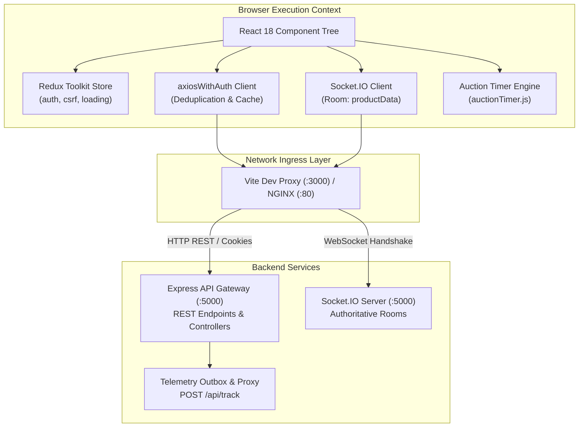
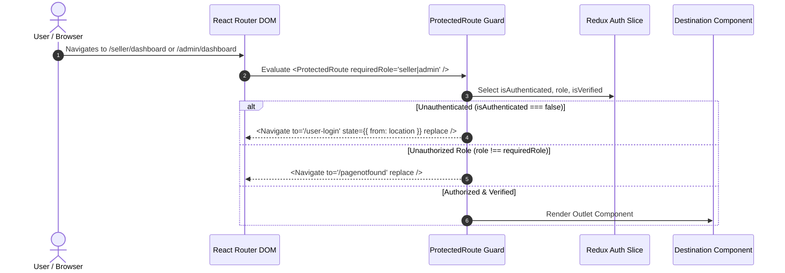
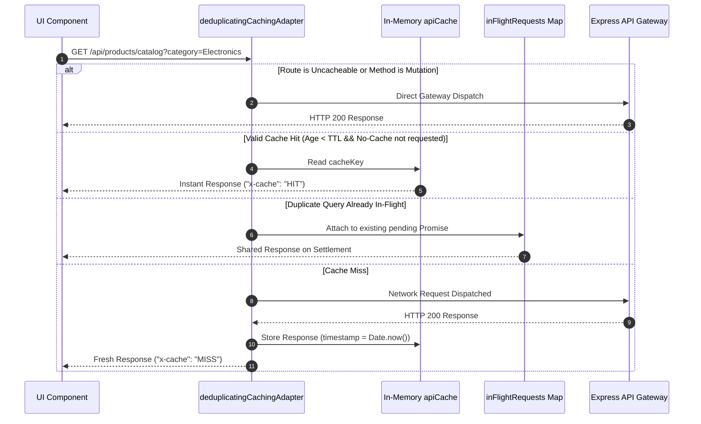
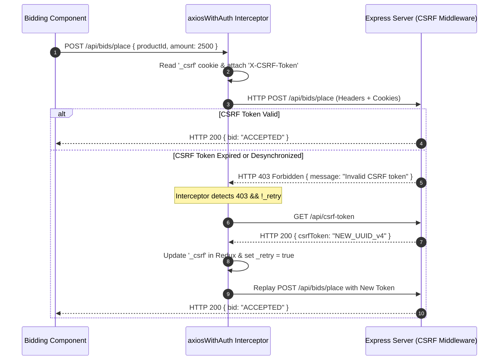
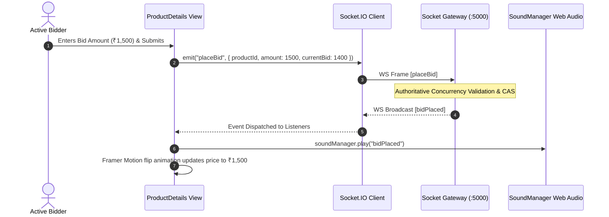

# AuctionX Frontend Client (`client/`)

The AuctionX frontend is an enterprise-grade Single Page Application (SPA) engineered with **React 18.3**, **Vite 6**, and **Tailwind CSS v4**. Developed as the primary user, merchant, and administrative interface for AuctionX, it delivers real-time live auction bidding, dynamic anti-sniping countdown synchronization, interactive seller governance portals, an administrative control console, and personalized machine-learning product recommendations.

---

## Table of Contents

- [1. Overview & Architectural Boundaries](#1-overview--architectural-boundaries)
- [2. Technology Stack & Key Dependencies](#2-technology-stack--key-dependencies)
- [3. System Architecture & Component Hierarchy](#3-system-architecture--component-hierarchy)
- [4. Source Code Organization & Module Map](#4-source-code-organization--module-map)
- [5. Application Bootstrap & Routing Architecture](#5-application-bootstrap--routing-architecture)
- [6. State Management Architecture (Redux Toolkit & Persistence)](#6-state-management-architecture-redux-toolkit--persistence)
- [7. API Client Architecture (`axiosWithAuth`)](#7-api-client-architecture-axioswithauth)
  - [In-Flight Request Deduplication](#in-flight-request-deduplication)
  - [Short-Lived Read Cache & Identity Scoping](#short-lived-read-cache--identity-scoping)
  - [Automatic Mutation Invalidation](#automatic-mutation-invalidation)
  - [Uncacheable Route Fencing](#uncacheable-route-fencing)
- [8. Authentication, Cookies & Double-Submit CSRF Lifecycle](#8-authentication-cookies--double-submit-csrf-lifecycle)
- [9. Real-Time WebSocket Bidding Engine (Socket.IO)](#9-real-time-websocket-bidding-engine-socketio)
- [10. Auction Lifecycle & Countdown Engine (`auctionTimer.js`)](#10-auction-lifecycle--countdown-engine-auctiontimerjs)
- [11. Responsive Media Delivery & Image Optimization (`imageOptimizer.js`)](#11-responsive-media-delivery--image-optimization-imageoptimizerjs)
- [12. Bundle Optimization & Code Splitting (`vite.config.js`)](#12-bundle-optimization--code-splitting-viteconfigjs)
- [13. Styling, Theming & UI Component Primitives](#13-styling-theming--ui-component-primitives)
- [14. Client-Side Form Validation & File Handling](#14-client-side-form-validation--file-handling)
- [15. Environment Variables & Runtime Configuration](#15-environment-variables--runtime-configuration)
- [16. Local Development & Build Commands](#16-local-development--build-commands)
- [17. Testing Pyramid & Quality Assurance](#17-testing-pyramid--quality-assurance)
- [18. Troubleshooting & Common Development Failure Modes](#18-troubleshooting--common-development-failure-modes)
- [19. Known Limitations & Technical Debt](#19-known-limitations--technical-debt)
- [20. Engineering Trade-Offs & Future Roadmap](#20-engineering-trade-offs--future-roadmap)
- [21. Subsystem Cross-References](#21-subsystem-cross-references)

---

## 1. Overview & Architectural Boundaries

The AuctionX frontend client operates as a decoupled single-page application executing within modern Chromium, WebKit, and Gecko browser engines. It maintains strict separation of concerns across three backend interfaces:

1. **Backend REST Gateway (`server/`)**: Communicates via standard HTTPS JSON endpoints for authoritative catalog browsing, user authentication, profile verification, seller inventory workflows, payment signature verification, and administrative governance.
2. **Socket.IO Real-Time Gateway (`server/`)**: Maintains a persistent, low-overhead WebSocket transport connection for sub-second bid broadcasting, room participant tracking, dynamic anti-sniping soft-close extensions, and live auction state transitions.
3. **AI Recommendation Microservice Proxy (`recommendation_service/` via `server/`)**: Telemetry interaction events (`view`, `click`, `impression`) and personalized candidate feeds are proxied through Express routes (`/api/track` and `/api/recommendations`), insulating the frontend from internal microservice authentication tokens (`INTERNAL_SERVICE_KEY`) and HMAC signing secrets.



---

## 2. Technology Stack & Key Dependencies

The frontend subsystem relies on modern, audited production dependencies specified in `client/package.json`:

| Category | Package | Version | Purpose in AuctionX |
| :--- | :--- | :--- | :--- |
| **Core Framework** | `react` | `^18.3.1` | Concurrent rendering, fiber reconciler, component lifecycle hooks. |
| **DOM Renderer** | `react-dom` | `^18.3.1` | Browser DOM mount points, portals for modals and toasts. |
| **Build Pipeline** | `vite` | `^6.1.1` | Ultra-fast HMR development server, ES module compilation, Rollup bundler. |
| **Vite Plugins** | `@vitejs/plugin-react` | `^4.3.4` | Fast Refresh support for JSX transformation and hot reloads. |
| **Styling Engine** | `tailwindcss` | `^4.0.8` | Utility-first CSS framework compiled via `@tailwindcss/vite`. |
| **PostCSS Tooling** | `@tailwindcss/postcss` | `^4.0.8` | Modern CSS processing and vendor autoprefixing pipeline. |
| **State Management** | `@reduxjs/toolkit` | `^2.6.1` | Simplified Redux configuration, createSlice, createAsyncThunk. |
| **Redux Bindings** | `react-redux` | `^9.2.0` | React hooks (`useSelector`, `useDispatch`) for store subscription. |
| **Persistence** | `redux-persist` | `^6.0.0` | LocalStorage serialization for authentication tokens and profile data. |
| **Routing** | `react-router-dom` | `^7.2.0` | Declarative client-side routing, protected route guards, lazy loading. |
| **HTTP Client** | `axios` | `^1.7.9` | Promise-based HTTP client with request/response interceptors. |
| **Real-Time WebSockets**| `socket.io-client` | `^4.8.1` | Bid room subscriptions, live countdown sync, reconnection resilience. |
| **Cookie Manipulation**| `js-cookie` | `^3.0.5` | Client-readable reading of the double-submit CSRF `_csrf` cookie. |
| **Data Visualization** | `chart.js` | `^4.4.8` | Vendor-chunk isolated analytics graphs for seller and admin dashboards. |
| **Chart Adapter** | `chartjs-adapter-moment` | `^1.0.1` | Time-series scale adapter for date-based auction financial charts. |
| **PDF Generation** | `jspdf` | `^3.0.0` | Lazy-loaded on-demand invoice and consumer policy document generation. |
| **Low-Level PDF** | `pdf-lib` | `^1.17.1` | Vector document manipulation and invoice PDF stamping. |
| **Animation Engine** | `framer-motion` | `^12.4.1` | Declarative page transitions, modal spring physics, bid number flips. |
| **Timeline Motion** | `gsap` | `^3.12.7` | High-performance hero animations and marquee ticker sequences. |
| **Smooth Scrolling** | `@studio-freight/lenis` | `^1.0.42` | Inertial momentum scrolling wrapped in `SmoothScrollProvider`. |
| **UI Primitives** | `@radix-ui/react-select` | `^2.1.6` | Accessible dropdown and combobox UI components. |
| **Icon Systems** | `lucide-react` | `^0.475.0` | Consistent modern vector iconography across all dashboards. |
| **Brand Vectors** | `@fortawesome/fontawesome-free` | `^6.7.2` | Social brand vectors and payment badge icons. |
| **Phone Validation** | `libphonenumber-js` | `^1.12.6` | International E.164 phone number formatting and verification. |
| **Feedback Toasts** | `react-toastify` / `sweetalert2` | `^11.0.5` / `^11.22.0` | Non-blocking toast notifications and confirmation dialogs. |

---

## 3. System Architecture & Component Hierarchy

The client component hierarchy enforces clear ownership between global layouts, domain features, and shared atomic UI elements:

```mermaid
graph TD
    App["App Root (src/App.jsx)"]
    Router["BrowserRouter & ScrollRestoration"]
    SmoothScroll["SmoothScrollProvider (Lenis)"]
    ErrorBoundary["RouteErrorBoundary"]
    Layout["Layout Shell (Navbar, Main, Footer)"]

    App --> Router
    Router --> SmoothScroll
    SmoothScroll --> ErrorBoundary
    ErrorBoundary --> Layout

    subgraph "Public View Surfaces"
        Home["Home Page (src/pages/Home)"]
        Catalog["Catalog & Search (src/pages/User/SearchAndPostDetail)"]
        Product["Product Details & Live Room (src/pages/User/ProductDetails)"]
        AuthViews["Login, Register & OTP (src/pages/User/UserLogin)"]
    end

    subgraph "Protected User Surfaces"
        Orders["Order History & Invoices (src/pages/User/Dropdown/OrderHistory)"]
        Wallet["Wallet & Payment (src/pages/User/Dropdown/PaymentPage)"]
        Scheduled["Scheduled Auto-Bids (src/pages/User/Dropdown/ScheduledBids)"]
    end

    subgraph "Protected Seller Surfaces"
        SellerDash["Seller Dashboard (src/components/SellerDashboard)"]
        SellItem["List New Item (src/components/SellerComponents/SellProduct)"]
        SellerInventory["Inventory Manager (src/components/SellerDashboard/pages)"]
    end

    subgraph "Protected Admin Surfaces"
        AdminDash["Admin Dashboard (src/components/AdminDashboard)"]
        AuditLogs["Audit Log Explorer (src/components/AdminDashboard)"]
        Disputes["Dispute Resolution (src/components/AdminDashboard)"]
    end

    Layout --> Home
    Layout --> Catalog
    Layout --> Product
    Layout --> AuthViews
    Layout --> Orders
    Layout --> Wallet
    Layout --> Scheduled
    Layout --> SellerDash
    Layout --> SellItem
    Layout --> SellerInventory
    Layout --> AdminDash
    Layout --> AuditLogs
    Layout --> Disputes
```



---

## 4. Source Code Organization & Module Map

The client codebase is structured strictly under `client/src/` to separate global concerns from domain-specific workflows:

```
client/
├── public/                                # Unprocessed static assets served at root
│   ├── favicon.ico                        # Application favicon
│   ├── robots.txt                         # Search engine crawler policies
│   └── BrandVectors/                      # SVG brand marks and payment icons
├── src/
│   ├── app/
│   │   └── store/
│   │       └── store.js                   # Redux Toolkit root configuration & persistence
│   ├── assets/                            # Bundled CSS, SVGs, and brand images
│   ├── components/                        # Major multi-part feature views
│   │   ├── AdminDashboard/                # Administrative moderation, metrics, and audit consoles
│   │   │   ├── components/                # Admin-specific navigation and cards
│   │   │   ├── partials/dashboard/        # Audit explorer, disputes, reconciliations
│   │   │   └── utils/                     # Admin formatting and telemetry helpers
│   │   ├── Banner/                        # Marketing carousel banners (Banner1 through Banner6)
│   │   ├── Common/                        # Reusable site-wide components (Modals, Sliders, FAQs)
│   │   │   ├── AuctionLoader/             # Skeleton loaders for auction cards
│   │   │   ├── Profile/                   # User profile settings and avatar selectors
│   │   │   └── StaticPages/               # Legal terms, privacy policy, contact forms
│   │   ├── Layouts/                       # Header navigation and comprehensive footer links
│   │   ├── Modals/                        # Video modals, popup alerts, schedule bid modal
│   │   ├── ProductList/                   # Modular catalog layouts (ProductList1 - ProductList10)
│   │   ├── SellerComponents/              # Item creation forms, pricing tables, onboarding
│   │   ├── SellerDashboard/               # Seller inventory, orders, revenue metrics, goodies
│   │   ├── ui/                            # Atomic Shadcn/Radix wrappers and smooth scrollers
│   │   └── User/                          # Bidding progress bars, seller profile views, invoices
│   ├── features/                          # Domain-driven feature boundaries
│   │   ├── admin/                         # Admin feature logic and hooks
│   │   ├── auctions/                      # Auction-specific state and selectors
│   │   ├── auth/                          # Auth state slice, thunks, and login forms
│   │   ├── bidding/                       # Bidding actions and live room contracts
│   │   ├── payments/                      # Razorpay checkout modal wrappers
│   │   └── recommendations/               # Interaction telemetry hooks and recommendation rails
│   ├── layouts/                           # Top-level shell layouts
│   ├── lib/                               # Third-party wrappers (GraphQL client, utils)
│   ├── pages/                             # Route views invoked by React Router
│   │   ├── Seller/                        # Seller login, onboarding, and dashboard wrappers
│   │   └── User/                          # BidAnItem, CategoryList, ProductDetails, UserLogin
│   ├── redux/
│   │   └── slices/                        # Core Redux slices & custom Axios adapters
│   │       ├── authThunks.jsx             # Async login, logout, verification actions
│   │       ├── axiosWithAuth.jsx          # Caching, deduplicating, CSRF-recovering Axios instance
│   │       └── csrfSecuritySlice.jsx      # CSRF token fetching and sync state
│   ├── shared/                            # Atomic components shared across feature modules
│   │   ├── components/common/             # Buttons, inputs, badges, cards
│   │   ├── components/data-display/       # Lazy-loaded Chart.js visualizers
│   │   └── components/feedback/           # Global spinner overlay (loadingSlice.jsx)
│   ├── styles/                            # Tailwind CSS directives and custom animations
│   ├── utils/                             # Cross-cutting helper functions
│   │   ├── auctionTimer.js                # Authoritative auction time & countdown parsing
│   │   ├── axiosConfig.jsx                # Global Axios interceptor for loading spinners
│   │   ├── geoData.js                     # ISO-3166 country/region dataset and normalizers
│   │   ├── imageOptimizer.js              # Responsive srcset, WebP downscaling, CDN transforms
│   │   └── soundManager.js                # Web Audio API sound effects for bid events
│   ├── App.jsx                            # Route declarations, route error boundaries, layout
│   └── main.jsx                           # Application entry point, ReactDOM root, Redux Provider
├── tests/                                 # Native Node.js test runner contract suites
│   ├── adminDashboard.consolidation.test.js
│   ├── adminDashboard.shell.test.js
│   ├── assetIntegrity.test.js
│   ├── auth.cacheIsolation.test.js
│   ├── countrySelector.test.js
│   ├── geoData.test.js
│   ├── imageOptimizer.test.js
│   ├── performance.optimization.test.js
│   ├── sellerNavigation.test.js
│   └── sellerSubscription.test.js
├── package.json                           # NPM dependencies and scripts
└── vite.config.js                         # Build configuration, Rollup chunk splitting, dev proxy
```

---

## 5. Application Bootstrap & Routing Architecture

Application initialization begins in `client/src/main.jsx`. The root attaches React 18's concurrent fiber root (`createRoot`) to the `#root` element in `index.html`:

```javascript
// src/main.jsx (Initialization Sequence)
import React from "react";
import ReactDOM from "react-dom/client";
import { Provider } from "react-redux";
import { PersistGate } from "redux-persist/integration/react";
import store, { persistor } from "./app/store/store";
import App from "./App";
import "./index.css";

ReactDOM.createRoot(document.getElementById("root")).render(
  <React.StrictMode>
    <Provider store={store}>
      <PersistGate loading={null} persistor={persistor}>
        <App />
      </PersistGate>
    </Provider>
  </React.StrictMode>
);
```

### Route Resolution & Guard Boundaries

`client/src/App.jsx` coordinates declarative client-side navigation using React Router v7. Unauthenticated users attempting to access protected dashboards are intercepted by `<ProtectedRoute />`:



### Route Coverage Inventory

The following table summarizes the primary client route table and access controls:

| Route Path | View Component | Access Role | Description |
| :--- | :--- | :--- | :--- |
| `/` | `Home` | Public | Hero banner, live auctions, category rails, recommendations. |
| `/product-details/:id` | `ProductDetails` | Public | Live auction room, real-time Socket.IO bidding, image carousel. |
| `/search` | `SearchAndPostDetail` | Public | Full catalog search, category filtering, price bounds. |
| `/user-login` | `UserLogin` | Public | Email/password sign-in, Google OAuth button, 2FA prompt. |
| `/register` | `UserLogin` | Public | User account registration and profile creation. |
| `/orders` | `OrderHistory` | `user` | Buyer won auctions, payment checkout links, invoice downloads. |
| `/payment` | `PaymentPage` | `user` | Wallet balance top-up, deposit/withdraw logs, Razorpay modal. |
| `/scheduled-bids` | `ScheduledBids` | `user` | Proxy auto-bidding configurations and ceiling limits. |
| `/seller/dashboard` | `SellerDashboard` | `seller` | Merchant revenue overview, active listings, order shipments. |
| `/seller/sell-item` | `SellProduct` | `seller` | Multi-step auction creation form, image uploads, start prices. |
| `/admin/dashboard` | `Dashboard` | `admin` | System-wide statistics, active dispute alerts, revenue summaries. |
| `/admin/users` | `AdminUsersPage` | `admin` | User governance, account suspensions, verification approvals. |
| `/admin/disputes` | `AdminDisputesPage` | `admin` | Dispute mediation console, refund approvals, evidence viewer. |
| `/admin/audit-logs` | `AdminAuditExplorer` | `admin` | Real-time audit trail explorer with severity filtering. |

---

## 6. State Management Architecture (Redux Toolkit & Persistence)

Global state is orchestrated via Redux Toolkit in `client/src/app/store/store.js`. To protect against session loss across page reloads while maintaining data isolation, the store combines in-memory transient slices with persistent storage:

```javascript
// src/app/store/store.js
const authPersistConfig = {
  key: "auth",
  storage,
  whitelist: [
    "isAuthenticated",
    "isVerified",
    "verified",
    "user",
    "role",
    "profilePic",
    "isSeller",
    "loginType",
  ],
  blacklist: ["loading"],
};

export const store = configureStore({
  reducer: {
    auth: persistReducer(authPersistConfig, authReducer),
    csrf: csrfReducer,
    loading: loadingReducer,
  },
  middleware: (getDefaultMiddleware) =>
    getDefaultMiddleware({
      serializableCheck: {
        ignoredActions: ["persist/PERSIST", "persist/REHYDRATE"],
        ignoredPaths: ["auth.user"],
      },
    }),
});
```

### Slice Responsibilities

1. **`authSlice` (`src/features/auth/state/authSlice.js`)**:
   - Manages active user identity, role privileges (`user`, `seller`, `admin`), email verification flags, and profile avatar URLs.
   - Listens to asynchronous authentication thunks: `loginUser`, `registerUser`, `verifyOtp`, `logoutUser`.
   - On logout, clears persisted storage and emits the global window event `auctionx:logout`.
2. **`csrfSecuritySlice` (`src/redux/slices/csrfSecuritySlice.jsx`)**:
   - Holds the current anti-CSRF token in memory for cross-site topologies where document cookie access may be restricted.
   - Exports the asynchronous thunk `fetchCsrfToken()`, querying `GET /api/csrf-token` to acquire fresh tokens.
3. **`loadingSlice` (`src/shared/components/feedback/loadingSlice.jsx`)**:
   - Controls the global non-blocking loading spinner overlay.
   - Automatically toggled by Axios request/response interceptors unless explicitly suppressed via `{ showGlobalLoading: false }`.

---

## 7. API Client Architecture (`axiosWithAuth`)

The custom HTTP client `axiosWithAuth` (`client/src/redux/slices/axiosWithAuth.jsx`) provides advanced resilience, performance, and security mechanisms tailored to high-concurrency auction environments.

### In-Flight Request Deduplication

When multiple components mount simultaneously and request identical endpoints (e.g., fetching catalog categories or user profile data), naive applications fire redundant HTTP requests. `axiosWithAuth` intercepts concurrent GET queries:
- A shared `inFlightRequests` Map tracks pending request Promises keyed by request parameters.
- Subsequent identical requests resolve to the existing active network Promise rather than initiating a duplicate round-trip.
- Upon Promise settlement, the key is evicted from `inFlightRequests`.

### Short-Lived Read Cache & Identity Scoping

To reduce gateway load, `axiosWithAuth` maintains an in-memory LRU read cache (`apiCache`):
- **Cache TTL**: Default 15,000 milliseconds (15 seconds), customizable per request via `config.cacheTtl`.
- **Identity Isolation**: The cache key explicitly incorporates the user's role, unique ID, and token signature:
  ```
  ${authRole}:${authUserId}:${tokenFingerprint}:${url}?${serializedParams}
  ```
  This guarantees that switching user accounts or logging out never returns stale or unauthorized cached responses.
- Responses served from cache return with an added synthetic header: `"x-cache": "HIT"`.

### Automatic Mutation Invalidation

To preserve consistency, any state-modifying HTTP request (`POST`, `PUT`, `PATCH`, `DELETE`) executed through `axiosWithAuth` automatically invokes `clearApiCache()`, wiping all cached GET responses across the application.

### Uncacheable Route Fencing

Certain operational routes must always reflect immediate server state. The client hard-fences these paths from caching and deduplication:
```javascript
const UNCACHEABLE_ROUTES = [
  "/bids",
  "/bid",
  "/payment",
  "/razorpay",
  "/wallet",
  "/auth",
  "/csrf",
  "/live",
  "/2fa",
  "/twofactor",
  "/verify",
  "/subscriptions/verify",
];
```



---

## 8. Authentication, Cookies & Double-Submit CSRF Lifecycle

AuctionX implements an enterprise-grade defense against Cross-Site Request Forgery (CSRF) without relying on server-side session memory:

1. **Cookie Partitioning**:
   - Authentication tokens (`token` for users, `sellerToken` for merchants) are issued with `httpOnly: true`, preventing client JavaScript from inspecting credential strings.
   - The anti-CSRF token is issued in an unsigned, client-readable cookie named `_csrf` (`httpOnly: false`, `sameSite: "Lax"`).
2. **Request Header Injection**:
   - Every outgoing request intercepted by `axiosWithAuth` inspects `document.cookie` for the `_csrf` value.
   - If present, it attaches the token to the custom HTTP header `X-CSRF-Token`.
3. **Automated Single-Attempt CSRF Recovery**:
   - If an authenticated request fails with an HTTP 403 response matching `"CSRF token missing"` or `"Invalid CSRF token"`, the client interceptor triggers recovery.
   - The interceptor initiates a shared `csrfRefreshPromise` querying `GET /api/csrf-token`.
   - The fresh token updates both the Redux store and the request header.
   - The original failed request is re-executed exactly once (`originalRequest._retry = true`).



---

## 9. Real-Time WebSocket Bidding Engine (Socket.IO)

The live bidding interface (`client/src/pages/User/ProductDetails/ProductDetails.jsx`) manages the full WebSocket lifecycle:

### Connection Lifecycle

When a user opens an auction page:
1. `io(API_URL || undefined, { withCredentials: true })` initializes the socket transport.
2. The client emits `joinProductRoom` with the specific auction `productId`.
3. The server assigns the socket to an isolated channel room, ensuring that bids placed on Item A are not broadcast to participants observing Item B.

### Event Contracts

The client registers listeners for authoritative server broadcasts:

| Inbound Event Name | Payload Structure | UI Response Action |
| :--- | :--- | :--- |
| `productData` | Full Product object | Re-synchronizes current highest bid, bidder avatar, and bid count. |
| `bidPlaced` | `{ productId, currentBid, bidderName, bidCount }` | Triggers animated price flip, plays positive audio chime (`soundManager.js`). |
| `auctionExtended` | `{ productId, newEndTime, extensionDuration }` | Flashes dynamic "Anti-Sniping Extension: +2 Minutes" banner; resets countdown timer. |
| `auctionStarted` | `{ productId, startTime }` | Flips auction badge from "Upcoming" to "Live Bidding Active". |
| `auctionEnded` | `{ productId, winner, finalPrice }` | Disables bid submission buttons; renders settlement or victory banners. |
| `error` | `{ message: string }` | Displays error toast (e.g., "Bid must exceed current price by ₹50"). |
| `reconnect` | None | Re-emits `joinProductRoom` to restore subscription after network blips. |



---

## 10. Auction Lifecycle & Countdown Engine (`auctionTimer.js`)

Client-side countdown timers frequently suffer from timezone skew, invalid date parsing, and drift. The canonical utility `client/src/utils/auctionTimer.js` provides deterministic calculations:

### Safe Date Parsing (`parseAuctionDates`)
- Supports full ISO-8601 timestamps as well as legacy schemas separating `biddingStartDate` (e.g. `2026-10-26`) and `biddingStartTime` (e.g. `14:00`).
- Because the backend scheduler operates in UTC, the parser combines legacy parts with an explicit `'Z'` suffix (`YYYY-MM-DDTHH:MM:00Z`), preventing browser timezone offset corruption.

### State Derivation (`calculateAuctionTime`)
Derives the unambiguous lifecycle phase based on authoritative timestamps:
- **`isUpcoming`**: Current time is strictly prior to `startTime` or status is `SCHEDULED` / `DRAFT`.
- **`isActive`**: Current time is between `startTime` and `endTime` and status is `LIVE` / `Active`.
- **`isEnded`**: Current time is greater than or equal to `endTime` or status matches a terminal enum (`Closed`, `ENDED`, `SETTLED`, `UNSOLD`, `CANCELLED`).

### Anti-Sniping Soft-Close Synchronization
When an incoming `auctionExtended` WebSocket event arrives, the client replaces `endDate` with the extended timestamp. The timer automatically recalculates remaining milliseconds without requiring a full page refresh.

---

## 11. Responsive Media Delivery & Image Optimization (`imageOptimizer.js`)

High-resolution auction imagery can degrade mobile network performance. `client/src/utils/imageOptimizer.js` negotiates dynamic resizing and WebP/AVIF format transcoding:

### Cloudinary CDN Transformations
When an image URL points to Cloudinary (`res.cloudinary.com`), the utility dynamically injects transformation parameters immediately following `/image/upload/`:
```javascript
// Generated URL Structure:
// https://res.cloudinary.com/demo/image/upload/f_auto,q_80,c_limit,w_450/v12345/product.jpg
```
- `f_auto`: Automatically negotiates AVIF or WebP based on client browser `Accept` headers.
- `q_80`: Applies visually lossless 80% compression.
- `c_limit`: Constrains dimensions without upscaling smaller source images.

### Responsive SrcSet Generation (`getResponsiveSrcSet`)
Generates standardized multi-density `srcset` strings for responsive `` and `<picture>` tags:
```javascript
getResponsiveSrcSet(url, [360, 720, 1080])
// Yields: ".../w_360/... 360w, .../w_720/... 720w, .../w_1080/... 1080w"
```

### Pre-Configured Dimension Presets
- `getOptimizedThumbnail(url, size = 160)`: Square crop for avatar previews and bid history rows.
- `getOptimizedCardImage(url, width = 450)`: Optimized bounding box for catalog grid cards.
- `getOptimizedDetailImage(url, width = 900)`: High-resolution slide for primary product viewports.

---

## 12. Bundle Optimization & Code Splitting (`vite.config.js`)

To achieve low First Contentful Paint (FCP) and Largest Contentful Paint (LCP) times, Vite's Rollup pipeline splits vendor dependencies into isolated cacheable chunks (`client/vite.config.js`):

```javascript
// vite.config.js (Rollup manualChunks configuration)
manualChunks: (id) => {
  if (id.includes("node_modules/chart.js") || id.includes("node_modules/moment")) {
    return "vendor-charts";
  }
  if (id.includes("node_modules/jspdf") || id.includes("node_modules/pdf-lib")) {
    return "vendor-pdf";
  }
  if (id.includes("node_modules/react/") || id.includes("node_modules/react-dom/")) {
    return "vendor-react";
  }
  if (id.includes("node_modules/@reduxjs/toolkit") || id.includes("node_modules/react-redux")) {
    return "vendor-redux";
  }
  if (id.includes("node_modules/lucide-react") || id.includes("node_modules/react-icons")) {
    return "vendor-icons";
  }
  if (id.includes("node_modules/framer-motion") || id.includes("node_modules/gsap")) {
    return "vendor-animation";
  }
}
```

```mermaid
graph TD
    Entry["Main Entry Point (src/main.jsx)"]
    VReact["vendor-react.js (~150 KB)<br/>React, ReactDOM, React-Router"]
    VRedux["vendor-redux.js (~45 KB)<br/>Redux Toolkit, Redux-Persist"]
    VIcons["vendor-icons.js (~80 KB)<br/>Lucide React, FontAwesome"]
    VAnim["vendor-animation.js (~110 KB)<br/>Framer Motion, GSAP, Lenis"]

    Entry --> VReact
    Entry --> VRedux
    Entry --> VIcons
    Entry --> VAnim

    subgraph "Lazy-Loaded On-Demand Chunks"
        VCharts["vendor-charts.js (~180 KB)<br/>Chart.js, Adapter Moment<br/>(Loaded on Dashboard routes)"]
        VPdf["vendor-pdf.js (~1,034 KB)<br/>jsPDF, pdf-lib<br/>(Loaded on Invoice Download)"]
    end

    Entry -.->|Dynamic Import ()| VCharts
    Entry -.->|Dynamic Import ()| VPdf
```

---

## 13. Styling, Theming & UI Component Primitives

### Tailwind CSS v4 Engine
AuctionX leverages the latest Tailwind CSS v4 architecture via `@tailwindcss/vite`. Styling directives are defined in `src/index.css` using modern CSS nesting and custom utility tokens:
- **Dark Theme Tokens**: Built around deep neutral slates (`#0B0F19`, `#1E293B`) paired with high-contrast amber and emerald action colors for bidding indicators.
- **Glassmorphism**: Backdrop blur overlays (`backdrop-blur-md bg-slate-900/80`) used across navigation bars, modal dialogs, and floating bid control panels.

### Animation & Motion Architecture
- **Framer Motion**: Coordinates entry/exit layout transitions for modal sheets, slide-over panels, and bid activity alerts.
- **Lenis Smooth Scroll**: Provides momentum-based scrolling across extensive catalog pages, initialized in `src/components/ui/SmoothScroll/SmoothScroll.jsx`.

---

## 14. Client-Side Form Validation & File Handling

User inputs undergo client-side validation prior to network dispatch to minimize unnecessary server cycles:

### Form Inputs & Internationalization
- **Phone Validation**: Uses `libphonenumber-js` and `react-phone-number-input` to enforce strict E.164 international formatting on seller onboarding forms.
- **Geographic Data**: `src/utils/geoData.js` supplies standardized ISO-3166 country and subdivision registries, preventing address submission anomalies.

### Media File Upload Validation
Before sending image payloads to the backend's Multer/Sharp ingestion pipeline, the client verifies file constraints:
- **Maximum File Size**: Strict 5MB ceiling per asset.
- **MIME Type Whitelist**: Restricts file selections to `image/jpeg`, `image/png`, and `image/webp`.
- **Pre-Upload Dimension Check**: Uses in-browser `Image()` objects to verify that image bounds do not exceed 4096px, preventing client-side canvas memory exhaustion.

---

## 15. Environment Variables & Runtime Configuration

The client application reads configuration variables via Vite's `import.meta.env` interface. Create a local `.env` file in `client/` based on `client/.env.example`:

| Variable Name | Required | Default Value | Purpose & Architectural Context |
| :--- | :--- | :--- | :--- |
| `VITE_API_URL` | Optional | `http://localhost:5000` | Target URL for backend REST API, Socket.IO gateway, and OAuth handshakes. In production under same-origin reverse proxies, leave empty to use relative paths (`/api`). |
| `VITE_APP_NAME` | Optional | `AuctionX` | Branding title rendered in document heads, navbar logos, and system notifications. |
| `VITE_SOCKET_URL`| Optional | Same as `VITE_API_URL` | Dedicated WebSocket connection address if Socket.IO is hosted on a separate subdomain or port. |

> [!NOTE]
> Vite exposes only environment variables prefixed with `VITE_` to client-side bundles. Never place private keys, database passwords, or payment webhook secrets in `client/.env`.

---

## 16. Local Development & Build Commands

All development and verification commands run from the `client/` directory:

```powershell
# Navigate to client directory
cd client

# Install all required frontend dependencies
npm install

# Start local development server with Hot Module Replacement (HMR)
# Server listens on http://localhost:3000 (proxies /api and /socket.io to :5000)
npm run dev

# Execute ESLint static code quality checks
npm run lint

# Execute native contract test suite (10 test files)
npm test

# Compile production-optimized distribution bundle to client/dist/
npm run build

# Preview the compiled production build locally on http://localhost:4173
npm run preview
```

---

## 17. Testing Pyramid & Quality Assurance

The frontend test suite utilizes the native Node.js test runner (`node:test`, `node:assert`), eliminating heavy external test runner overhead while delivering sub-second execution speeds.

### Executing Client Tests
```powershell
# Run the complete verified contract suite across all 10 test files
npm test

# Run an individual contract test file
node --test tests/imageOptimizer.test.js
node --test tests/geoData.test.js
```

### Verified Test Suite Inventory

| Test Specification File | Invariants Verified | Passed Tests |
| :--- | :--- | :--- |
| `tests/geoData.test.js` | ISO-3166 geographic normalizations, country code mapping, fallback parsing. | 8 |
| `tests/countrySelector.test.js` | Address combobox filtering, state/province cascading selections. | 6 |
| `tests/imageOptimizer.test.js` | Cloudinary URL generation, responsive srcset strings, dimension bounding. | 10 |
| `tests/auth.cacheIsolation.test.js`| Redux identity scoping, cache key generation, token change cache eviction. | 8 |
| `tests/performance.optimization.test.js`| Lazy chunk resolution, manual chunk splitting contracts, bundle boundaries. | 8 |
| `tests/sellerNavigation.test.js`| Role-based route access, navigation drawer items, merchant breadcrumbs. | 8 |
| `tests/sellerSubscription.test.js`| Merchant tier limits, subscription status checks, feature entitlement flags. | 8 |
| `tests/adminDashboard.shell.test.js`| Admin layout components, sidebar collapsible states, profile dropdowns. | 6 |
| `tests/adminDashboard.consolidation.test.js` | Merged route resolution, audit log filters, reconciliation table sorting. | 8 |
| `tests/assetIntegrity.test.js` | SVG brand vector integrity, font icon bindings, default avatar assets. | 4 |
| **Total Automated Coverage** | **Complete frontend contract and optimization invariants** | **76 Passed** |

---

## 18. Troubleshooting & Common Development Failure Modes

### 1. HTTP 403 "Invalid CSRF token" on Form Submission
- **Symptom**: State-modifying requests (`POST`, `PUT`) fail with a 403 Forbidden status.
- **Root Cause**: The client-side `_csrf` cookie is missing, expired, or was blocked by cross-origin cookie policies.
- **Resolution**:
  - Verify that `withCredentials: true` is enabled in Axios (handled by default in `axiosWithAuth`).
  - Ensure the backend server is running and reachable on `http://localhost:5000`.
  - Trigger manual token refresh by calling `store.dispatch(fetchCsrfToken())`.

### 2. Socket.IO Connection Dropped or Constant Reconnection
- **Symptom**: Console logs show repeated `WebSocket connection failed` or `transport close`.
- **Root Cause**: Backend server is offline, port 5000 is occupied, or CORS origin is unlisted in `server/src/bootstrap/application/createApplication.js`.
- **Resolution**:
  - Verify backend health via `curl http://localhost:5000/api/health`.
  - Confirm `CLIENT_URL` in `server/.env` includes `http://localhost:3000`.

### 3. Tailwind CSS v4 Styles Not Applying
- **Symptom**: Utility classes like `bg-slate-900` or `flex` render as unstyled text.
- **Root Cause**: Missing `@tailwindcss/vite` plugin or improper CSS import order.
- **Resolution**: Ensure `vite.config.js` includes `tailwindcss()` in plugins and `src/index.css` imports `@import "tailwindcss";`.

### 4. Blank White Screen in Production Build Preview (`npm run preview`)
- **Symptom**: Application loads locally in `npm run dev` but renders a blank page in `dist/`.
- **Root Cause**: Unhandled runtime error in a lazy-loaded chunk or missing base URL.
- **Resolution**: Inspect browser console for module resolution errors; ensure `RouteErrorBoundary` catches the failure and verify all Rollup manual chunks in `vite.config.js`.

---

## 19. Known Limitations & Technical Debt

1. **Single-Node Socket.IO Assumption**: The client socket configuration assumes an in-process WebSocket gateway. Horizontal scaling across multiple backend nodes requires an external Redis pub/sub adapter.
2. **Local Canvas Image Check Limitations**: While pre-upload image checks catch file dimension limits, full binary magic-byte validation is enforced authoritatively on the backend via Sharp.
3. **Lazy PDF Initial Latency**: The heavy PDF compilation dependencies (`jspdf`, `pdf-lib`) are deferred to an on-demand chunk (~1,034 KB). The first invoice download may experience a brief 1-second delay while fetching the bundle.

---

## 20. Engineering Trade-Offs & Future Roadmap

- **Redux Persist vs. Session Storage**: Redux state persists to `localStorage` to ensure user convenience across tab closures. Future revisions may move authentication tokens to memory-only storage paired with silent refresh token rotation.
- **Micro-Frontend Architecture**: As seller and admin dashboard features expand, separating the governance consoles into standalone Vite sub-applications would reduce initial bundle sizes.
- **Service Worker Offline Caching**: Introducing a Progressive Web App (PWA) service worker to cache catalog thumbnails and static UI chrome for offline inspection.

---

## 21. Subsystem Cross-References

- **[Root Repository README](../README.md)**: Master architecture overview, security controls, and system-wide setup.
- **[Backend Gateway README](../server/README.md)**: Node.js Express controllers, Socket.IO rooms, and transaction serialization.
- **[Playwright E2E README](../e2e/README.md)**: Browser automation suites verifying client login, browsing, and bidding flows.
- **[AI Recommendation Microservice README](../recommendation_service/README.md)**: Python FastAPI ranking algorithms and telemetry contracts.
