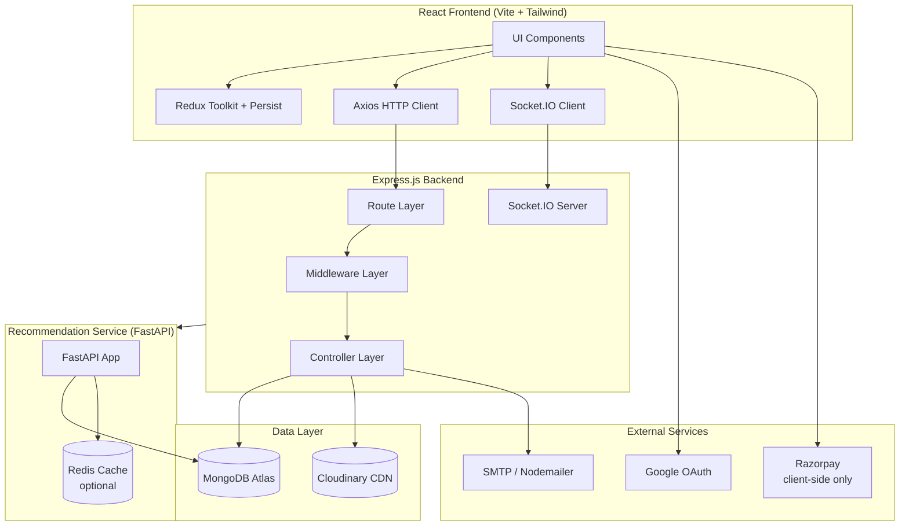
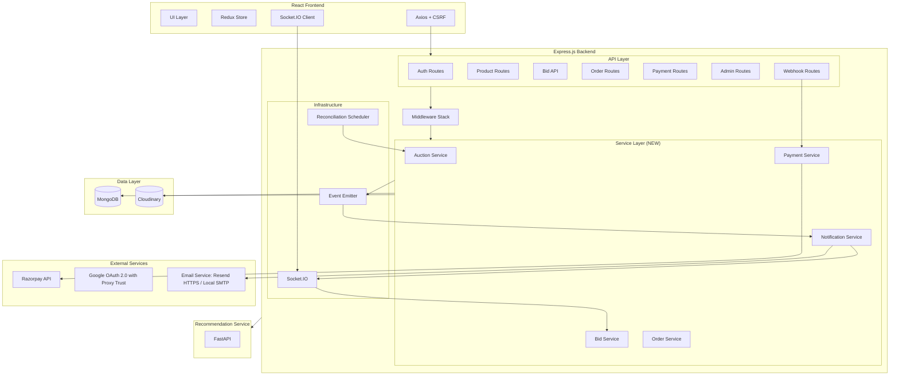
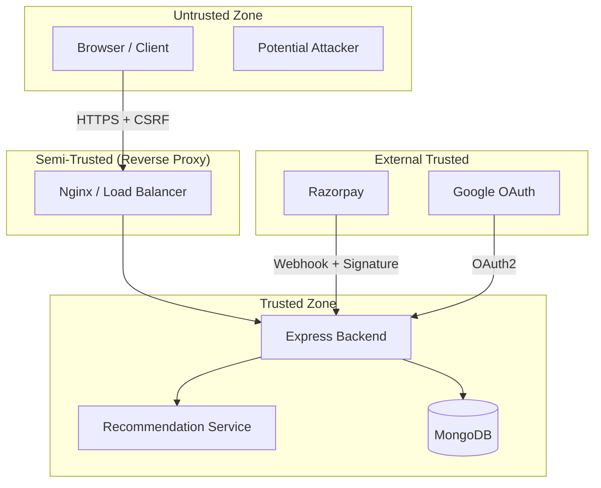
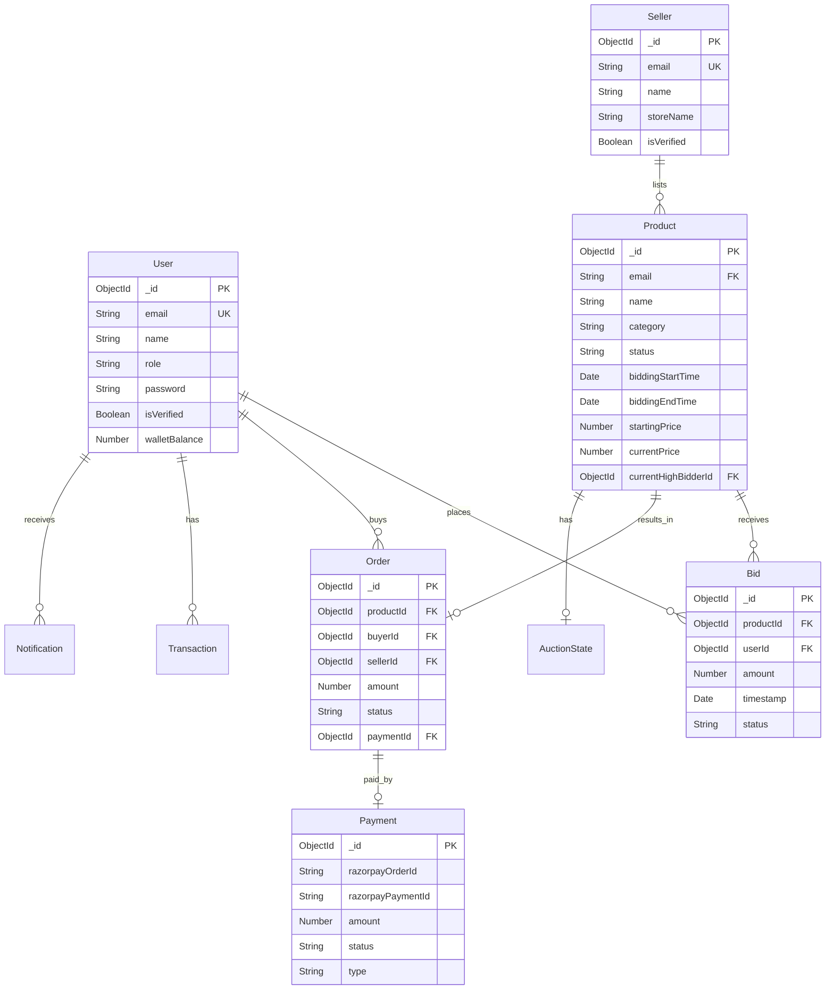
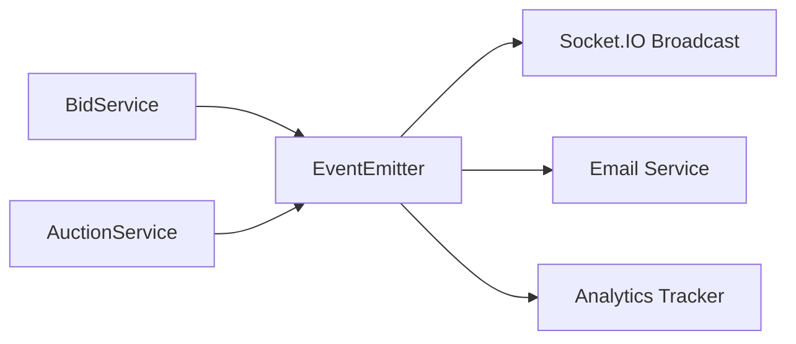
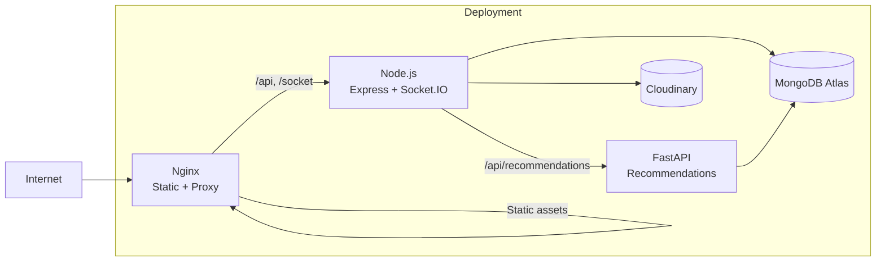

# Auction X — High-Level Design

> **Document version:** 0.1.0 — Design-only phase  
> **Last updated:** 2026-10-13  
> **Status:** Draft — awaiting owner review  
> **Companion documents:** `00-system-flows.md`, `02-low-level-design.md`

---

## 1. Executive Summary

Auction X is a MERN-stack online auction marketplace with real-time bidding via Socket.IO, Razorpay payment integration, a FastAPI recommendation service, and separate admin/seller/user dashboards. The repository reconnaissance reveals a feature-rich application with significant gaps in financial integrity, auction lifecycle management, bid concurrency, and data retention that must be addressed before production deployment.

This HLD proposes a target architecture that preserves the existing modular monolith pattern, introduces a proper auction state machine, a secure Razorpay integration, atomic bid acceptance, and a reconciliation-based scheduler — all without requiring infrastructure beyond what a single Node.js process (with optional background workers) and MongoDB can provide.

---

## 2. Product Scope and System Boundaries

### In scope
- Auction marketplace for physical/digital goods.
- User and seller registration, verification, and profile management.
- Product listing with image uploads, auction configuration, and scheduling.
- Real-time bidding with live updates.
- Auction lifecycle: creation → scheduling → live bidding → closure → winner settlement.
- Payment integration (Razorpay) for wallet top-up, auction purchases, and banner payments.
- Admin dashboard for moderation, analytics, and management.
- Recommendation engine for personalized product suggestions.

### Out of scope (until explicitly approved)
- Multi-currency support.
- Physical shipping/logistics integration.
- Advanced fraud detection / ML-based bid monitoring.
- Mobile native applications.
- Multi-tenancy.

---

## 3. Functional Requirements

| ID | Requirement | Priority | Current Status |
|----|------------|----------|---------------|
| FR-01 | User registration (email/password + Google OAuth) | P0 | Implemented |
| FR-02 | Seller registration and verification | P0 | Implemented (no moderation) |
| FR-03 | Product listing with images | P0 | Implemented |
| FR-04 | Auction scheduling with configurable duration | P0 | Partial (hardcoded 2min) |
| FR-05 | Real-time bidding with concurrent safety | P0 | Partial (race conditions) |
| FR-06 | Bid history and audit trail | P0 | Not implemented |
| FR-07 | Automated auction closure and winner determination | P0 | Not implemented |
| FR-08 | Secure payment processing (Razorpay) | P0 | Broken (no server verification) |
| FR-09 | Order creation and settlement | P1 | Partial (no payment link) |
| FR-10 | Wallet management (deposit/withdraw) | P1 | Implemented (insecure) |
| FR-11 | Notifications (bid, win, outbid, auction end) | P1 | Not implemented |
| FR-12 | Admin moderation and management | P1 | Implemented (no audit trail) |
| FR-13 | Product recommendations | P2 | Implemented |
| FR-14 | Banner/promotion system | P2 | Partial |
| FR-15 | Reporting and analytics | P2 | Partial |

---

## 4. Non-Functional Requirements

| Requirement | Business Reason | Proposed Target | Measurement | Current Evidence | Assumptions |
|-------------|----------------|-----------------|-------------|-----------------|-------------|
| **Bid latency** | Real-time auction experience | < 500ms (bid → broadcast) | Socket.IO round-trip measurement | Unknown | Single-server deployment |
| **Bid consistency** | Financial integrity | Zero lost or double-counted bids | Bid count audit vs. history | Race conditions exist | MongoDB atomic ops sufficient |
| **Payment integrity** | Financial correctness | 100% server-verified payments | Reconciliation against Razorpay | No verification exists | Razorpay standard integration |
| **Availability** | User trust | 99.5% uptime during auction hours | Monitoring / uptime service | Unknown | Single instance + restart policy |
| **Data durability** | Regulatory / business | No auction or bid data loss | MongoDB replica set, backups | Physical deletion exists | Atlas managed backups |
| **Security** | User trust, compliance | OWASP Top 10 addressed | Security audit checklist | Partial (CSRF, sanitize, helmet) | No penetration testing |
| **Concurrent users** | Peak auction periods | 100-500 simultaneous bidders | Load testing | Unknown, needs measurement | |
| **Page load time** | User experience | < 3s initial load, < 1s navigation | Lighthouse / RUM | Unknown | CDN for static assets |
| **Auction time accuracy** | Fairness | < 5 second clock skew tolerance | Server-time-only enforcement | Server time used, no NTP verification | |

---

## 5. Current Architecture and Verified Limitations

### 5.1 Architecture

### 5.2 Verified Limitations

| Category | Limitation | Impact |
|----------|-----------|--------|
| **Bidding** | No atomic bid acceptance — race conditions | Data loss, unfair auction outcomes |
| **Bidding** | No bid history — bids overwrite product fields | No audit trail, no dispute resolution |
| **Bidding** | `biddingStartPrice` reused for current bid | Original reserve price lost |
| **Payment** | No server-side Razorpay integration | Users can credit arbitrary wallet amounts |
| **Payment** | `/verify-payment` endpoint does not exist | Payment "verification" always falls to catch block |
| **Lifecycle** | No automated auction closure | Auctions stay "Active" indefinitely after end time |
| **Lifecycle** | No winner determination | No settlement flow |
| **Lifecycle** | 2-minute hardcoded duration | Unusable for real auctions |
| **Data** | Physical deletion of auction products | Bid history, audit data destroyed |
| **Security** | Seller profile update routes missing auth | IDOR vulnerability |
| **Security** | JWT secret env var inconsistency | Potential auth failures |
| **Architecture** | Two bid submission paths (Socket + REST) | Inconsistent business rules |

---

## 6. Proposed Architecture

The proposed architecture maintains the modular monolith pattern but introduces:

1. **Service layer** between controllers and data access for business rule centralization.
2. **Bid collection** for immutable bid history.
3. **Atomic bid acceptance** using MongoDB conditional updates.
4. **Reconciliation scheduler** for auction state transitions.
5. **Server-side Razorpay integration** with order creation, signature verification, and webhooks.
6. **Event emitter** for decoupled side effects (notifications, analytics).

---

## 7. Architecture Diagram

---

## 8. Component Responsibilities

| Component | Responsibility | Changes from Current |
|-----------|---------------|---------------------|
| **Auth Routes** | User/Seller registration, login, OAuth, OTP, password reset | Consolidate JWT secret, add refresh tokens |
| **Product Routes** | CRUD for auction listings | Add draft/scheduled states |
| **Bid API** | Single authoritative bid submission endpoint | NEW — replaces Socket `placeBid` and REST `patchProduct` |
| **Bid Service** | Atomic bid validation, persistence, and broadcasting | NEW — centralizes all bid logic |
| **Auction Service** | Auction state machine, lifecycle transitions | NEW |
| **Payment Service** | Razorpay order creation, verification, webhooks | NEW |
| **Payment Routes** | Payment API endpoints + webhook receiver | NEW |
| **Order Service** | Winner settlement, order lifecycle | Refactored from current controller |
| **Notification Service** | Socket broadcast, email, future push | NEW |
| **Email Delivery Subsystem** | Dual-provider dispatcher (`emailService.js`), Resend HTTPS API in production, Nodemailer SMTP in local development | NEW — Auto-environment detection on Render, masked logging, bounded retries, and OTP safety |
| **Wallet & Settlement Engine** | Authoritative balance management, atomic bid reservation (`reservedBalance`), and winner capture | NEW — Prevents outbid lockups and settlement delays |
| **Reconciliation Scheduler** | Periodic auction state transition check | NEW |
| **Event Emitter** | Decoupled side-effect trigger | NEW (Node.js EventEmitter) |

---

## 9. External System Integrations

| System | Integration Type | Data Flow | Authentication |
|--------|-----------------|-----------|---------------|
| **MongoDB Atlas** | Direct driver (Mongoose) | Bidirectional | Connection string |
| **Cloudinary** | SDK + REST API | Upload images, delete images | API key/secret |
| **Razorpay** | REST API + Webhooks | Create orders, verify payments, receive events | API key/secret + webhook secret |
| **Google** | OAuth 2.0 (with Reverse-Proxy Trust) | Authentication delegation, profile lookup | Client ID/Secret (`GOOGLE_CALLBACK_URL`) |
| **Email Delivery** | Dual-Provider: Resend SDK (Prod HTTPS API) / Nodemailer (Local SMTP) | Send OTP, registration verification, 2FA, contact inquiries, security alerts | Resend API Key (`RESEND_API_KEY`) / SMTP credentials |
| **Recommendation Service** | HTTP proxy | Fetch recommendations | Internal network |

---

## 10. Trust Boundaries and Security Boundaries

**Key trust boundaries:**
1. **Client → Server**: All input untrusted. Server must validate everything.
2. **Razorpay → Server**: Webhook must verify signature using raw body + secret.
3. **Server → MongoDB**: Server is the sole trusted writer. No direct client access.
4. **Bid amounts**: Server is the authoritative source. Client-submitted amounts are proposals, not facts.
5. **Time**: Server clock is authoritative. Client timestamps are never trusted.

---

## 11. Core Data Entities and Relationships

---

## 12. Auction Lifecycle Overview

See `00-system-flows.md` §3 for full state diagram.

The proposed minimal state model for Auction X:

| State | Description | Entry Condition |
|-------|-------------|-----------------|
| `DRAFT` | Listing created, not yet published | Seller creates product |
| `SCHEDULED` | Published, awaiting start time | Seller publishes listing |
| `LIVE` | Active bidding | Server time >= startTime |
| `ENDED` | Bidding closed | Server time >= endTime |
| `COMPLETED` | Winner paid, auction settled | Payment verified |
| `UNSOLD` | No bids received | Ended with zero bids |
| `CANCELLED` | Cancelled by seller or admin | Manual action |

---

## 13. Bidding Architecture

**Source of truth**: MongoDB `Product.currentPrice` field updated atomically via `findOneAndUpdate` with `$lt` condition.

**Single bid path**: Socket.IO `placeBid` event → `BidService.acceptBid()` → atomic DB update → broadcast.

The REST `PATCH /api/products/tempdata/:id` endpoint will be deprecated and eventually removed.

**Concurrency strategy**: MongoDB's `findOneAndUpdate` with filter `{ _id: productId, currentPrice: { $lt: bidAmount }, status: "LIVE" }`. If the update matches zero documents, the bid is rejected (either outbid or auction not live).

---

## 14. Payment Architecture

**Payment flows:**
1. **Wallet top-up**: Server creates Razorpay order → client completes checkout → server verifies signature → credits wallet.
2. **Auction purchase**: Winner clicks "Pay" → server creates Razorpay order linked to auction → client completes checkout → server verifies signature → marks order as paid.
3. **Banner payment**: Seller selects plan → server creates Razorpay order → client completes checkout → server verifies → activates banner.

**Webhook handling**: All payment state transitions confirmed via Razorpay webhooks as the ultimate source of truth. Client success handler is a hint, not proof.

---

## 15. Real-Time Event Architecture

Events are notifications of state changes already persisted in the database. Clients that miss events must resynchronize by fetching current state on reconnect.

---

## 16. Scheduling and Background Processing

**Approach**: In-process `setInterval` reconciliation loop (30-60 second interval) that:
1. Queries for `SCHEDULED` products where `startTime <= now` → transitions to `LIVE`.
2. Queries for `LIVE` products where `endTime <= now` → transitions to `ENDED`, determines winner.
3. Triggers notifications for state transitions.

**Why not a separate scheduler service**: The workload does not justify a separate process. A single Node.js process can handle periodic MongoDB queries. If scaling is needed later, this can be extracted.

**Correctness guarantee**: The bid endpoint independently enforces the time window. The scheduler improves timeliness but is not the sole correctness mechanism.

---

## 17. Data Retention and Analytics

- Ended auctions are **never physically deleted**. They transition to terminal states (`COMPLETED`, `UNSOLD`, `CANCELLED`).
- A future archival process can move old data to a separate collection after a configurable retention period (e.g., 90 days).
- Bid history is immutable — bids are never modified or deleted.
- Transaction history is immutable.
- Analytics data is collected via the recommendation service's `user_interactions` collection.

---

## 18. Deployment and Infrastructure

### Current
- Docker Compose configuration for development and production.
- Render deployment configuration (`render.yaml`).
- Three services: `client` (Vite build + Nginx), `server` (Node.js), `recommendation_service` (FastAPI + Uvicorn).

### Proposed
- No change to deployment topology.
- Add health check endpoints to all services.
- Add Razorpay npm package to server dependencies.
- Ensure graceful shutdown handling.

---

## 19. Observability and Operational Recovery

### Current
- Winston logger for HTTP requests and errors.
- Console logging throughout codebase.

### Proposed
- Structured JSON logging with correlation IDs.
- Health check endpoints: `GET /health` (Express), `GET /health` (FastAPI — exists).
- Key metrics to monitor: active auctions, bids per minute, payment success rate, Socket.IO connection count.
- Alert on: failed payment verifications, scheduler not running, database disconnection.

---

## 20. Scalability and Performance Considerations

| Bottleneck | Current | Mitigation |
|-----------|---------|-----------|
| Bid throughput | Single MongoDB update per bid | Sufficient for 100-500 concurrent users with MongoDB atomic ops |
| Product listing queries | `Product.find()` returns all products | Add pagination, status filtering, compound indexes |
| Socket.IO connections | In-process memory | Sufficient for single server; Redis adapter needed only for multi-server |
| Image uploads | Cloudinary direct upload | No change needed |
| Recommendation service | On-demand computation | Redis cache exists |

---

## 21. Failure Modes and Resilience

| Failure | Detection | Recovery | Data Impact |
|---------|----------|----------|-------------|
| MongoDB disconnection | Mongoose event listener | Auto-reconnect (built-in) | Bids fail with error during outage |
| Server crash during bid | Process monitor restarts | Atomic write ensures bid is either saved or not | Zero data corruption risk |
| Server crash during auction close | Reconciliation scheduler re-checks on restart | Missed closures handled on next cycle | Delayed closure (seconds-minutes) |
| Razorpay webhook failure | Webhook retry (Razorpay retries up to 24h) | Idempotent handler processes retry safely | Payment eventually confirmed |
| Cloudinary failure | HTTP error response | Product creation fails cleanly | No orphaned data |
| Socket.IO disconnect | Client reconnect with exponential backoff | Rejoin room, fetch current state | No data loss (DB is source of truth) |

---

## 22. Architectural Trade-Offs

| Decision | Trade-Off |
|----------|----------|
| Modular monolith (not microservices) | Simpler operations and deployment, but all components share a process. Acceptable for current scale. |
| In-process scheduler (not separate worker) | No additional infrastructure, but scheduler stops if the process crashes. Acceptable with process monitor. |
| MongoDB atomic ops (not distributed locks) | Simpler, but limited to single-document atomicity. Sufficient for bid-on-product use case. |
| Socket.IO for bids (not REST polling) | Better UX, but adds Socket.IO complexity. Already implemented. |
| Bid history in separate collection (not embedded) | Better query flexibility, no 16MB document limit. Slightly more complex writes. |

---

## 23. Risks and Unresolved Questions

| Risk | Impact | Mitigation |
|------|--------|-----------|
| Auction duration unknown | Cannot configure real auction schedules | Owner decision required |
| Payment model unclear | Cannot design settlement flow | Owner decision required |
| User/Seller unification | Affects data model and auth architecture | Owner decision required |
| No load testing data | Cannot validate performance targets | Add to test strategy |
| Razorpay test mode credentials | Cannot validate payment flow without sandbox | Requires sandbox credentials |

---

## 24. Architecture Decisions Requiring Approval

See `03-architecture-decisions.md` for full ADR format. Decisions requiring owner input:

1. **ADR-01**: Keep User and Seller as separate collections vs. unify.
2. **ADR-02**: Configurable auction duration — what is the default/minimum?
3. **ADR-03**: Strict closure vs. anti-sniping extension.
4. **ADR-04**: Payment for auction wins — wallet deduction, Razorpay, or both?
5. **ADR-05**: Minimum viable auction states for MVP.
6. **ADR-06**: Soft delete policy for products and auctions.
7. **ADR-07**: Product moderation — required before listing or post-listing?
