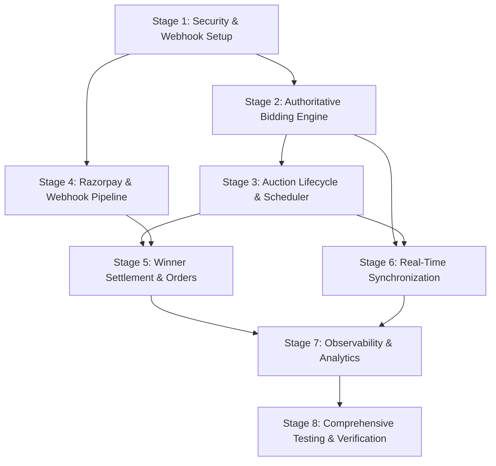

# Auction X — Implementation Roadmap

> **Document version:** 0.1.0 — Design-only phase  
> **Last updated:** 2026-10-13  
> **Status:** Draft — Awaiting project owner review and approval  

---

## Executive Overview & Phasing Principles

This implementation roadmap decomposes the production engineering upgrades for **Auction X** into **eight discrete, sequential, and independently reviewable stages**. 

### Core Engineering Principles
1. **Zero-Downtime & Backward Compatibility:** Existing REST endpoints, client interfaces, and database records remain functional throughout each transition.
2. **Security & Financial Integrity First:** High-risk vulnerabilities (race conditions, webhook tampering, unvalidated callbacks) are resolved before feature expansion.
3. **No Blind Rewrites:** Changes are strictly surgical, introducing structured services and repositories to wrap and stabilize existing models.
4. **Independent Verifiability:** Each stage concludes with automated acceptance criteria, clear definitions of done, and explicit rollback procedures.

---

## Roadmap Stage Summary

| Stage | Focus Area | Scope & Value | Effort | Prerequisites | Risk Level |
|---|---|---|---|---|---|
| **Stage 1** | Security, Sanitization & Data Integrity | Centralized auth middleware hardening, secret redaction, raw webhook parsing, input validation | **M** | Approved System Design | Low |
| **Stage 2** | Authoritative Bidding & Concurrency | Atomic `Product.findOneAndUpdate` bidding engine, dedicated `Bid` collection, server-time checks | **M** | Stage 1 | Medium |
| **Stage 3** | Auction Lifecycle & Scheduling Engine | Strict state machine, background reconciliation worker, anti-sniping soft close, feed filtering | **L** | Stage 2 | Medium |
| **Stage 4** | Razorpay Resilience & Webhook Pipeline | Dual-path payment verification, raw HMAC-SHA256 webhook handler, `WebhookEvent` idempotency | **L** | Stage 1 | High (Financial) |
| **Stage 5** | Winner Settlement & Order Lifecycle | Post-auction order creation, 24h payment window, expired order reaper, seller notification | **M** | Stages 3, 4 | Medium |
| **Stage 6** | Real-Time Sync & Socket Resiliency | Authoritative event schemas, reconnection REST resynchronization, room authorization | **S** | Stages 2, 3 | Low |
| **Stage 7** | Observability, Audit Logs & Analytics | Structured JSON logging (Pino/Winston), `AuditLog` collection, recommendation ingestion API | **S** | Stages 1-6 | Low |
| **Stage 8** | Comprehensive Verification & Testing | Automated unit/integration test suites, load testing, chaos failure injection, final release audit | **L** | Stages 1-7 | Low |

---

## Detailed Stage Breakdown

---

### Stage 1: Security, Sanitization & Data Integrity

#### 1. Scope
Harden application entry points, establish centralized input validation and error handling, configure raw webhook body parsing, and eliminate sensitive credential exposure in server logs.

#### 2. Prerequisites
- Approval of Architecture Decision Records (ADRs).
- Existing repository working tree clean.

#### 3. Files & Modules Affected
- `server/server.js`: Configure raw body parsing middleware for `/api/payment/webhook` before `express.json()`.
- `server/middleware/auth.js` / `verifyToken.js`: Harden JWT parsing, handle token expiration gracefully, reject forged tokens.
- `server/middleware/errorHandler.js` (NEW): Standardize JSON error responses (`{ success: false, error: { code, message, details } }`).
- `server/middleware/validation.js` (NEW): Request validation schemas (Joi / express-validator or Zod).
- `server/utils/logger.js` (NEW): Structured logger with automatic secret redaction (`password`, `key_secret`, `token`, `signature`).

#### 4. Dependencies
- Minimal external dependencies (`zod` or `joi` for schema validation if chosen, or standard sanitization utility).

#### 5. Data Migration Requirements
- None. Fully compatible with existing database data.

#### 6. Rollback Plan
- Revert commits modifying `server.js` and middleware files. No schema changes are introduced.

#### 7. Acceptance Criteria
- [ ] Requests with invalid payloads return HTTP 400 with structured error codes.
- [ ] `/api/payment/webhook` captures raw `req.body` buffer for cryptographic signature validation.
- [ ] Log outputs never include passwords, payment keys, or JWT tokens.
- [ ] Existing valid client routes continue to authenticate and respond without regressions.

#### 8. Risks & Mitigations
- *Risk:* Altering Express body parsing could break existing JSON endpoints.
- *Mitigation:* Apply `express.raw({ type: 'application/json' })` strictly to the `/api/payment/webhook` route path; all other routes retain standard `express.json()`.

#### 9. Estimated Effort
**M (Medium)** — ~1-2 engineer days.

#### 10. Definition of Done
- Error handler and validation middleware active. Webhook endpoint properly buffers raw payload. No secrets in logs. Existing frontend requests succeed.

---

### Stage 2: Authoritative Bidding & Concurrency Engine

#### 1. Scope
Eliminate race conditions and stale price overwrites during bidding. Implement atomic MongoDB conditional updates, create the dedicated append-only `Bid` collection, and enforce server-authoritative time boundaries.

#### 2. Prerequisites
- Stage 1 completed.

#### 3. Files & Modules Affected
- `server/models/Bid.js` (NEW): Append-only bid schema (`productId`, `bidder`, `amount`, `status`, `createdAt`, `ipAddress`).
- `server/models/Product.js`: Add schema fields `currentPrice`, `highestBidder`, `bidCount`, `minIncrement`, `version`.
- `server/services/bidService.js` (NEW): Encapsulates atomic bidding logic, increment validation, and authorization.
- `server/controllers/productController.js` & `server/routes/productRoutes.js`: Update `POST /api/products/:id/bid` to invoke `bidService`.
- `server/socket/index.js`: Update live bid handler to invoke `bidService` rather than directly updating models.

#### 4. Dependencies
- None. Uses native MongoDB atomic operations.

#### 5. Data Migration Requirements
- Backfill existing products in MongoDB:
  - If `currentPrice` is missing, set `currentPrice = startingPrice || price`.
  - Set `bidCount = bids.length || 0`.
  - Set `minIncrement = 50` (or calculated default).

#### 6. Rollback Plan
- Feature toggle `USE_ATOMIC_BID_SERVICE=false` falling back to legacy bidding handler if unexpected issues arise.

#### 7. Acceptance Criteria
- [ ] Two simultaneous bids at identical price result in exactly one winning bid and one rejected with HTTP 409 (`BID_OUTBID` / `STALE_PRICE`).
- [ ] Bids from the listing's own seller are rejected with HTTP 403 (`SELLER_CANNOT_BID`).
- [ ] Bids submitted when `Date.now() >= endTime` are strictly rejected with HTTP 400 (`AUCTION_CLOSED`).
- [ ] Every accepted bid creates an immutable entry in the `Bid` collection.
- [ ] `Product.currentPrice` and `Product.highestBidder` match the latest accepted bid.

#### 8. Risks & Mitigations
- *Risk:* High concurrency contention causes high rejection rate.
- *Mitigation:* Return current price in error payload so frontend immediately prompts user with updated minimum bid amount.

#### 9. Estimated Effort
**M (Medium)** — ~2 engineer days.

#### 10. Definition of Done
- Unit tests verify atomic bid execution, rejection of self-bidding, rejection of outbid bids, and rejection past `endTime`. `Bid` model properly populated.

---

### Stage 3: Auction Lifecycle & Scheduling Engine

#### 1. Scope
Implement the full state machine (`DRAFT`, `SCHEDULED`, `LIVE`, `ENDED`, `SETTLED`, `UNSOLD`, `CANCELLED`), resilient background reconciliation worker, anti-sniping dynamic soft-close extension, and feed filtering.

#### 2. Prerequisites
- Stage 2 completed.

#### 3. Files & Modules Affected
- `server/models/Product.js`: Add `status` enum validation, `antiSnipeCount`, `extendedUntil`, `isDeleted`, `deletedAt`. Add compound indexes: `{ status: 1, category: 1, endTime: 1 }`.
- `server/models/SystemLock.js` (NEW): Distributed lease lock collection with TTL index.
- `server/services/auctionService.js` (NEW): Encapsulate state transitions, winner finalization, anti-sniping extension logic.
- `server/services/schedulerService.js` (NEW): Cron-driven reconciliation worker (`reconcileExpiredAuctions`, `startScheduledAuctions`).
- `server/controllers/productController.js`: Update feed endpoints (`GET /api/products`) to strictly filter `{ status: 'LIVE', isDeleted: false }`.

#### 4. Dependencies
- `node-cron` for scheduling ticks.

#### 5. Data Migration Requirements
- Migration script: Map legacy status values (e.g. `isApproved: true`, active booleans) to new lifecycle enums:
  - If `endTime < now` -> `status = 'ENDED'` or `'UNSOLD'` (depending on whether bids exist).
  - If `startTime <= now && endTime > now` -> `status = 'LIVE'`.
  - If `startTime > now` -> `status = 'SCHEDULED'`.

#### 6. Rollback Plan
- Disable `schedulerService` cron initialization; feed endpoints fall back to checking `isDeleted: { $ne: true }`.

#### 7. Acceptance Criteria
- [ ] Expired auctions are transitioned from `LIVE` to `ENDED` (or `UNSOLD`) within 60 seconds by reconciler.
- [ ] If bid is placed within 2 minutes of `endTime`, `endTime` is extended by 2 minutes (up to 15m maximum), and `AUCTION_EXTENDED` socket event is broadcast.
- [ ] Ended/Unsold auctions disappear from active browse feeds but remain accessible via direct URL and user history endpoints.
- [ ] Soft-deleted products are completely excluded from buyer searches.
- [ ] Multiple running Node instances do not execute duplicate reconciliations due to `SystemLock`.

#### 8. Risks & Mitigations
- *Risk:* Background worker fails during server deployment or crash.
- *Mitigation:* System reconciles all overdue auctions idempotently on server startup and every subsequent 30-second interval.

#### 9. Estimated Effort
**L (Large)** — ~3 engineer days.

#### 10. Definition of Done
- State machine passes all valid and invalid transition tests. Scheduler tests verify automatic closing, winner assignment, and soft-delete queries.

---

### Stage 4: Razorpay Payment Resilience & Webhook Pipeline

#### 1. Scope
Implement dual-path payment verification (synchronous client callback + durable asynchronous webhook handler), HMAC-SHA256 signature verification, and `WebhookEvent` idempotency ledger.

#### 2. Prerequisites
- Stage 1 completed (raw webhook body buffering).

#### 3. Files & Modules Affected
- `server/models/Payment.js` (NEW): Payment transaction ledger (`orderId`, `razorpayPaymentId`, `razorpayOrderId`, `amount`, `status`, `idempotencyKey`).
- `server/models/WebhookEvent.js` (NEW): Webhook deduplication log with unique index on `eventId`.
- `server/services/paymentService.js` (NEW): Encapsulates Razorpay REST SDK calls, signature validation, idempotent status transitions.
- `server/controllers/paymentController.js`: Refactor to delegate to `paymentService`.
- `server/routes/paymentRoutes.js`: Expose `/api/payment/create-order`, `/api/payment/verify`, `/api/payment/webhook`.

#### 4. Dependencies
- `razorpay` npm package (existing), `crypto` (Node.js built-in).

#### 5. Data Migration Requirements
- None. Payment records will accumulate from new transactions forward.

#### 6. Rollback Plan
- If issues occur, payments can temporarily revert to legacy verification endpoint while keeping webhook logging in audit mode.

#### 7. Acceptance Criteria
- [ ] Server creates Razorpay orders via server-side REST API; client never dictates order price.
- [ ] `POST /api/payment/verify` cryptographically verifies HMAC-SHA256 signature using `RAZORPAY_KEY_SECRET`.
- [ ] `POST /api/payment/webhook` validates signature on raw request body using `RAZORPAY_WEBHOOK_SECRET`.
- [ ] Replayed or duplicate webhook deliveries return HTTP 200 without duplicate database state changes or double credits.
- [ ] If user closes browser after payment, the webhook independently records `CAPTURED` and settles the order.

#### 8. Risks & Mitigations
- *Risk:* Missing `RAZORPAY_WEBHOOK_SECRET` environment variable in production.
- *Mitigation:* Application startup health check validates presence of required payment environment variables.

#### 9. Estimated Effort
**L (Large)** — ~3 engineer days.

#### 10. Definition of Done
- Signature verification unit tests pass for valid, invalid, and replayed requests. Idempotency ledger tested against duplicate payloads.

---

### Stage 5: Winner Settlement & Order Lifecycle

#### 1. Scope
Establish the post-auction settlement workflow: automatically generate pending orders when auctions conclude with a winner, enforce a 24-hour payment grace window, handle expired unpaid orders, and notify buyers/sellers.

#### 2. Prerequisites
- Stages 3 and 4 completed.

#### 3. Files & Modules Affected
- `server/models/Order.js`: Update schema to link `productId`, `buyerId`, `sellerId`, `finalBidAmount`, `status` (`PENDING_PAYMENT`, `PAID`, `EXPIRED`, `CANCELLED`, `DISPUTED`), `paymentDueBy`.
- `server/services/orderService.js` (NEW): Order creation on auction close, payment linking, unpaid order expiration worker.
- `server/services/auctionService.js`: Call `orderService.createPendingOrder()` upon auction transition to `ENDED`.
- `server/controllers/orderController.js` & `server/routes/orderRoutes.js`: Endpoints for buyers to view won orders and initiate Razorpay checkout.
- `client/src/pages/WonAuctionsPage.jsx` / `OrdersPage.jsx`: UI for reviewing won items, viewing payment countdown, and paying.

#### 4. Dependencies
- Internal service interactions between `auctionService`, `orderService`, and `paymentService`.

#### 5. Data Migration Requirements
- Existing `Order` collection schemas aligned to include `paymentDueBy` and lifecycle status enums.

#### 6. Rollback Plan
- Feature toggle `AUTO_CREATE_ORDER_ON_END=false`. Manual order creation maintained if needed.

#### 7. Acceptance Criteria
- [ ] Auction close with a winner automatically spawns an `Order` with `status: 'PENDING_PAYMENT'` and `paymentDueBy = now + 24h`.
- [ ] Winner can initiate payment for the exact winning amount through Razorpay.
- [ ] Successful payment transitions Order to `PAID` and Product to `SETTLED`.
- [ ] If 24 hours elapse without payment, background job transitions Order to `EXPIRED` and notifies the seller.

#### 8. Risks & Mitigations
- *Risk:* Clock synchronization between server and client countdown timers.
- *Mitigation:* Client displays countdown based on server-provided `paymentDueBy` ISO timestamp.

#### 9. Estimated Effort
**M (Medium)** — ~2-3 engineer days.

#### 10. Definition of Done
- Complete order lifecycle verified from auction close to payment completion, including timeout expiration handling.

---

### Stage 6: Real-Time Synchronization & Socket Resiliency

#### 1. Scope
Harden the Socket.IO real-time event pipeline. Authorize room joins, broadcast authoritative state snapshots, handle reconnections gracefully, and eliminate client desynchronization.

#### 2. Prerequisites
- Stages 2 and 3 completed.

#### 3. Files & Modules Affected
- `server/socket/index.js`: Standardize event naming (`BID_PLACED`, `AUCTION_EXTENDED`, `AUCTION_ENDED`), authenticate socket connections, validate room join permissions.
- `client/src/context/SocketContext.jsx` & `client/src/pages/AuctionDetailPage.jsx`: On socket `connect` or `reconnect`, trigger authoritative REST refresh (`GET /api/products/:id`).

#### 4. Dependencies
- Socket.IO client/server (existing).

#### 5. Data Migration Requirements
- None.

#### 6. Rollback Plan
- Revert socket handlers; client continues to operate via REST polling fallback.

#### 7. Acceptance Criteria
- [ ] Socket connections authenticate with valid user JWT or connect as guest with read-only room subscription.
- [ ] Live bid broadcast includes full state snapshot (`productId`, `currentPrice`, `bidCount`, `highestBidder`, `endTime`, `status`).
- [ ] Disconnecting and reconnecting Wi-Fi immediately resynchronizes the UI with the exact database state.

#### 8. Risks & Mitigations
- *Risk:* High reconnection storms causing REST spikes after server restart.
- *Mitigation:* Add random jitter (100–1000ms) to frontend reconnection fetch calls.

#### 9. Estimated Effort
**S (Small)** — ~1 engineer day.

#### 10. Definition of Done
- Socket event contracts verified; reconnection test proves UI resynchronizes to correct price after dropped packets.

---

### Stage 7: Observability, Audit Logs & Recommendation Pipeline

#### 1. Scope
Implement structured JSON application logging with automated PII/secret scrubbing, establish the immutable `AuditLog` collection for administrative actions, and provide a secure interaction feed for the FastAPI recommendation service.

#### 2. Prerequisites
- Stages 1 through 6 completed.

#### 3. Files & Modules Affected
- `server/models/AuditLog.js` (NEW): Schema tracking `actorId`, `action`, `targetType`, `targetId`, `beforeState`, `afterState`, `ipAddress`, `timestamp`.
- `server/utils/logger.js`: Centralized Winston/Pino logger emitting structured JSON with log levels.
- `server/routes/internalRoutes.js` (NEW): Authenticated endpoint `GET /api/internal/recommendations/interactions` for the FastAPI service.
- `recommendation_service/main.py`: Consume interaction feed via API key authentication.

#### 4. Dependencies
- `winston` or `pino` logger.

#### 5. Data Migration Requirements
- None.

#### 6. Rollback Plan
- Logger and internal routes can be modified or disabled without impacting core auction flows.

#### 7. Acceptance Criteria
- [ ] Every administrative action (auction cancellation, refund, seller verification) creates an immutable `AuditLog` record.
- [ ] Log outputs contain correlation request IDs and zero credentials or secret tokens.
- [ ] FastAPI recommendation service successfully reads interaction data using internal secret key.

#### 8. Risks & Mitigations
- *Risk:* Internal endpoint exposed publicly.
- *Mitigation:* Guard internal route with a dedicated `INTERNAL_SERVICE_KEY` header and reject external traffic.

#### 9. Estimated Effort
**S (Small)** — ~1-2 engineer days.

#### 10. Definition of Done
- Audit logs generated on administrative actions; logger verified in production mode; internal endpoint secured.

---

### Stage 8: Comprehensive Verification & Test Execution

#### 1. Scope
Execute the comprehensive test suite designed in `05-test-strategy.md` across all stages: unit tests, integration tests, concurrency tests, webhook replay tests, and end-to-end user journeys.

#### 2. Prerequisites
- Stages 1 through 7 implemented.
- Design Verification Gate approved.

#### 3. Files & Modules Affected
- `server/tests/unit/`: Test suites for bidding, state machine, signature verification.
- `server/tests/integration/`: MongoDB memory server integration tests for auction reconciliation, order checkout, webhooks.
- `server/tests/concurrency/`: High-concurrency race condition tests (50 concurrent bids on single auction).

#### 4. Dependencies
- `jest` or `mocha`, `supertest`, `mongodb-memory-server`.

#### 5. Data Migration Requirements
- None (runs in isolated test environment).

#### 6. Rollback Plan
- Any failed test halts deployment and triggers targeted remediation in the respective stage.

#### 7. Acceptance Criteria
- [ ] 100% of critical invariant tests pass (zero concurrency overwrites, zero dropped webhooks, zero invalid transitions).
- [ ] Code coverage on core domain services (`bidService`, `auctionService`, `paymentService`, `orderService`) exceeds 85%.
- [ ] All security and authorization tests pass.

#### 8. Risks & Mitigations
- *Risk:* Flaky tests due to timer race conditions.
- *Mitigation:* Use simulated fake timers (`jest.useFakeTimers()`) for time boundary testing.

#### 9. Estimated Effort
**L (Large)** — ~3-4 engineer days.

#### 10. Definition of Done
- Full test suite runs green in automated CI/CD pipeline. Production readiness report signed off.

---

## Critical Dependency Path

