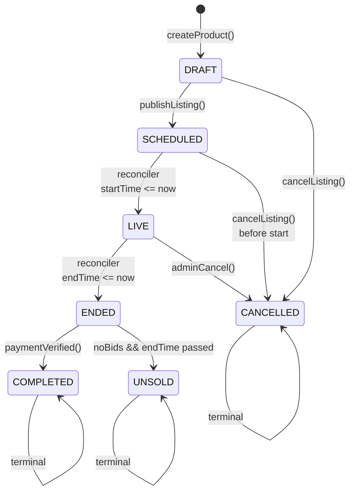
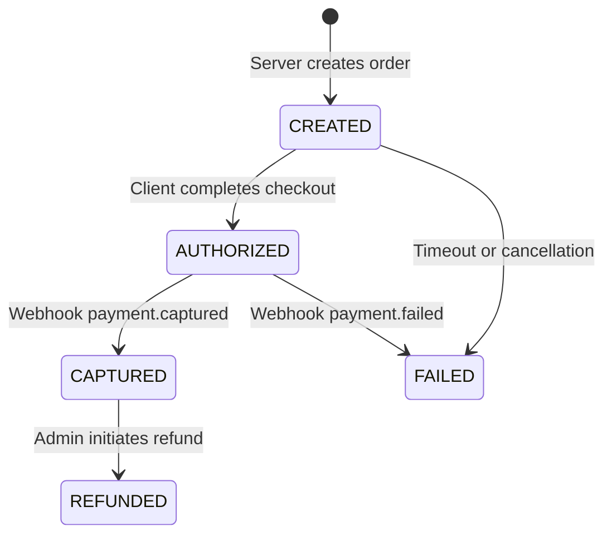

# Auction X — Low-Level Design

> **Document version:** 0.1.0 — Design-only phase  
> **Last updated:** 2026-10-13  
> **Status:** Draft — awaiting owner review

---

## A. Module Boundaries

### Current Module Structure

```
server/
├── controllers/           # Business logic in controllers (anti-pattern)
│   ├── AdminControllers/   # Admin CRUD operations
│   ├── LoginControllers/   # Auth + profile + payment
│   ├── OtherControllers/   # Socket.IO controller
│   ├── SellerControllers/  # Product CRUD, orders, seller admin
│   └── UserControllers/    # Contact, FAQ, feedback, privacy
├── middleware/             # Auth, media, security, time checks
├── models/                # Mongoose schemas
├── routes/                # Express route definitions
└── utlis/                 # Database, OAuth, image utils, seed data
```

### Proposed Module Structure

```
server/
├── routes/                 # HTTP route definitions (thin — delegates to services)
├── controllers/            # Request/response handling (validation, serialization)
├── services/               # Business logic (NEW — single source of truth)
│   ├── auctionService.js   # Auction lifecycle state machine
│   ├── bidService.js       # Bid acceptance, validation, persistence
│   ├── paymentService.js   # Razorpay integration, payment state machine
│   ├── orderService.js     # Order creation, settlement
│   ├── notificationService.js # Socket broadcast, email
│   └── userService.js      # User/Seller operations
├── middleware/             # Auth, validation, rate limiting, media
├── models/                # Mongoose schemas
├── jobs/                  # Background tasks (NEW)
│   └── auctionReconciler.js # Periodic auction state reconciliation
├── events/                # Event definitions and emitter (NEW)
└── utils/                 # Database, OAuth, helpers
```

### Dependency Direction Rules

1. Routes → Controllers → Services → Models (unidirectional)
2. Services may call other services (no circular dependencies)
3. Controllers never call Models directly
4. Socket.IO handlers call Services (not Controllers)
5. Jobs call Services
6. Events are emitted by Services, consumed by NotificationService

---

## B. Data Model

### B.1 User (EXISTING — proposed changes)

| Field | Type | Required | Current | Proposed Change |
|-------|------|----------|---------|----------------|
| `_id` | ObjectId | Auto | ✅ | — |
| `email` | String | Yes | Unique index | — |
| `name` | String | Yes | ✅ | — |
| `role` | String (enum) | Yes | `["admin", "user"]` | — |
| `password` | String | Conditional | ✅ | — |
| `isNewUser` | Boolean | — | ✅ | — |
| `isVerified` | Boolean | — | ✅ | — |
| `amount` | Number | No | ✅ | Rename to `walletBalance` |
| `profilePic` | Array | No | ✅ | — |
| Address fields | String | No | ✅ | — |
| `createdAt` | Date | Auto | Timestamps | — |
| `updatedAt` | Date | Auto | Timestamps | — |

### B.2 Seller (EXISTING — proposed changes)

Same structure as User with additional `storeName`, `storeDescription`.

**Business decision needed:** Unify User and Seller into one collection? See ADR-01.

### B.3 Product / Auction (EXISTING — proposed changes)

| Field | Type | Required | Current | Proposed Change |
|-------|------|----------|---------|----------------|
| `_id` | ObjectId | Auto | ✅ | — |
| `name` | String | Yes | ✅ | — |
| `email` | String | Yes | ✅ | Rename to `sellerEmail`, add `sellerId` ref |
| `category` | String | Yes | ✅ | Validate against enum |
| `description` | Array | Yes | ✅ | — |
| `images` | Array | Yes | ✅ | — |
| `mobileNumber` | String | Yes | ✅ | — |
| `biddingStartDate` | Date | Yes | ✅ | Merge into `startTime` |
| `biddingStartTime` | String | Yes | ISO string or HH:MM | Merge into `startTime` (Date) |
| `biddingStartPrice` | Number | Yes | Overwritten by bids | Rename to `startingPrice` (immutable) |
| `biddingEndTime` | String | Yes | ISO string | Rename to `endTime` (Date type) |
| `status` | String | Yes | `["Active", "Closed"]` | `["DRAFT", "SCHEDULED", "LIVE", "ENDED", "COMPLETED", "UNSOLD", "CANCELLED"]` |
| — | — | — | — | **ADD `currentPrice`** (Number) — current highest bid |
| — | — | — | — | **ADD `currentHighBidder`** (ObjectId ref) |
| — | — | — | — | **ADD `bidCount`** (Number) |
| — | — | — | — | **ADD `winnerId`** (ObjectId ref) |
| — | — | — | — | **ADD `auctionDuration`** (Number, minutes) |
| `tempuseremail` | String | No | Current bidder | REMOVE (replaced by `currentHighBidder`) |
| `tempamount` | Number | No | Current bid amount | REMOVE (replaced by `currentPrice`) |
| `tempname` | String | No | Current bidder name | REMOVE |
| `hasBanner` | Boolean | No | ✅ | — |
| `bannerImage` | Object | No | ✅ | — |
| `bannerPlan` | String | No | ✅ | — |

**Indexes (proposed):**
- `{ status: 1, endTime: 1 }` — for reconciliation queries
- `{ status: 1, startTime: 1 }` — for upcoming auctions
- `{ sellerEmail: 1, status: 1 }` — for seller's listings
- `{ category: 1, status: 1 }` — for category browsing
- `{ createdAt: -1 }` — for recent listings

### B.4 Bid (NEW)

| Field | Type | Required | Description |
|-------|------|----------|-------------|
| `_id` | ObjectId | Auto | |
| `productId` | ObjectId | Yes | Reference to Product |
| `userId` | ObjectId | Yes | Reference to User |
| `userEmail` | String | Yes | Denormalized for queries |
| `userName` | String | Yes | Denormalized for display |
| `amount` | Number | Yes | Bid amount |
| `previousPrice` | Number | Yes | Price before this bid |
| `status` | String | Yes | `["ACCEPTED", "REJECTED", "OUTBID"]` |
| `rejectionReason` | String | No | Why bid was rejected |
| `createdAt` | Date | Auto | Server timestamp |

**Indexes:**
- `{ productId: 1, createdAt: -1 }` — bid history for a product
- `{ userId: 1, createdAt: -1 }` — user's bid history
- `{ productId: 1, amount: -1 }` — highest bid query

**Retention:** Bids are never deleted. They are immutable after creation.

### B.5 Order (EXISTING — proposed changes)

| Field | Type | Required | Current | Proposed Change |
|-------|------|----------|---------|----------------|
| `_id` | ObjectId | Auto | ✅ | — |
| `title` | String | Yes | ✅ | — |
| `userEmail` | String | Yes | ✅ | — |
| `sellerEmail` | String | Yes | ✅ | — |
| — | — | — | — | **ADD `productId`** (ObjectId ref) |
| — | — | — | — | **ADD `paymentId`** (ObjectId ref) |
| — | — | — | — | **ADD `status`** (enum: PENDING, PAID, CANCELLED, REFUNDED) |
| — | — | — | — | **ADD `paymentDeadline`** (Date) |
| `biddingStartPrice` | Number | Yes | ✅ | Rename to `originalPrice` |
| `highestBid` | Number | No | ✅ | Rename to `finalPrice` |

### B.6 Payment (NEW)

| Field | Type | Required | Description |
|-------|------|----------|-------------|
| `_id` | ObjectId | Auto | |
| `razorpayOrderId` | String | Yes | From `razorpay.orders.create()` |
| `razorpayPaymentId` | String | No | From checkout callback |
| `razorpaySignature` | String | No | For verification |
| `amount` | Number | Yes | Amount in smallest currency unit (paise) |
| `currency` | String | Yes | Default `"INR"` |
| `type` | String | Yes | `["WALLET_TOPUP", "AUCTION_PURCHASE", "BANNER_PAYMENT"]` |
| `status` | String | Yes | `["CREATED", "AUTHORIZED", "CAPTURED", "FAILED", "REFUNDED"]` |
| `userId` | ObjectId | Yes | Who is paying |
| `relatedEntityId` | ObjectId | No | Product ID, Order ID, etc. |
| `relatedEntityType` | String | No | `"product"`, `"order"`, `"banner"` |
| `webhookEvents` | Array | No | Log of webhook events received |
| `idempotencyKey` | String | Yes | Unique key per payment attempt |
| `createdAt` | Date | Auto | |
| `updatedAt` | Date | Auto | |

**Indexes:**
- `{ razorpayOrderId: 1 }` — unique
- `{ razorpayPaymentId: 1 }` — unique sparse
- `{ userId: 1, createdAt: -1 }`
- `{ idempotencyKey: 1 }` — unique

---

## C. Auction State Machine



### State Transition Table

| From | To | Trigger | Authorization | DB Mutations | Side Effects |
|------|----|---------|---------------|-------------|-------------|
| — | DRAFT | `createProduct()` | Authenticated seller | Create Product doc | — |
| DRAFT | SCHEDULED | `publishListing()` | Product owner | `status → SCHEDULED` | — |
| DRAFT | CANCELLED | `cancelListing()` | Product owner or admin | `status → CANCELLED` | — |
| SCHEDULED | LIVE | Reconciler (startTime ≤ now) | System (automated) | `status → LIVE` | Emit `auction:started` |
| SCHEDULED | CANCELLED | `cancelListing()` | Product owner or admin | `status → CANCELLED` | — |
| LIVE | ENDED | Reconciler (endTime ≤ now) | System (automated) | `status → ENDED`, set `winnerId` | Emit `auction:ended`, notify winner + seller |
| LIVE | CANCELLED | `adminCancel()` | Admin only | `status → CANCELLED` | Notify all participants |
| ENDED | COMPLETED | `paymentVerified()` | System (webhook) | `status → COMPLETED` | Create/update Order |
| ENDED | UNSOLD | Reconciler (no bids) | System (automated) | `status → UNSOLD` | Notify seller |

### Invalid Transitions (Rejected with 4xx)

- LIVE → DRAFT (cannot unpublish a live auction)
- ENDED → LIVE (cannot restart a closed auction)
- COMPLETED → any (terminal state)
- CANCELLED → any (terminal state)
- UNSOLD → any (terminal state)

### Synchronous vs. Asynchronous

| Transition | Execution | Reason |
|-----------|-----------|--------|
| DRAFT → SCHEDULED | Synchronous (user request) | Immediate feedback |
| SCHEDULED → LIVE | Asynchronous (reconciler) | Time-triggered |
| LIVE → ENDED | Asynchronous (reconciler) | Time-triggered |
| Bid placement | Synchronous | Real-time feedback needed |
| ENDED → COMPLETED | Asynchronous (webhook) | External event |

---

## D. Bidding Algorithm and Concurrency

### Pseudocode

```javascript
async function acceptBid(productId, userId, userEmail, userName, bidAmount) {
  // 1. Server time is authoritative
  const now = new Date();
  
  // 2. Atomic conditional update
  const result = await Product.findOneAndUpdate(
    {
      _id: productId,
      status: "LIVE",
      startTime: { $lte: now },
      endTime: { $gt: now },
      currentPrice: { $lt: bidAmount },  // Bid must exceed current price
    },
    {
      $set: {
        currentPrice: bidAmount,
        currentHighBidder: userId,
      },
      $inc: { bidCount: 1 },
    },
    { new: true }
  );
  
  // 3. If no document matched, the bid is rejected
  if (!result) {
    const product = await Product.findById(productId).lean();
    if (!product) throw new BidError("PRODUCT_NOT_FOUND");
    if (product.status !== "LIVE") throw new BidError("AUCTION_NOT_LIVE");
    if (now < product.startTime) throw new BidError("AUCTION_NOT_STARTED");
    if (now >= product.endTime) throw new BidError("AUCTION_ENDED");
    if (bidAmount <= product.currentPrice) throw new BidError("BID_TOO_LOW", product.currentPrice);
    throw new BidError("BID_REJECTED");
  }
  
  // 4. Validate minimum increment
  const minimumBid = (result.currentPrice - bidAmount) === 0 
    ? result.startingPrice + MIN_INCREMENT 
    : result.currentPrice; // Already validated by $lt condition
  
  // 5. Record bid in history (separate collection, non-blocking)
  const bid = await Bid.create({
    productId,
    userId,
    userEmail,
    userName,
    amount: bidAmount,
    previousPrice: result.currentPrice, // Price BEFORE this bid
    status: "ACCEPTED",
  });
  
  // 6. Broadcast to all clients in the room
  io.to(productId.toString()).emit("bidUpdate", {
    productId: productId.toString(),
    currentPrice: bidAmount,
    bidderName: userName,
    bidCount: result.bidCount,
    endTime: result.endTime,
  });
  
  // 7. Emit event for notifications (outbid notification to previous bidder)
  events.emit("bid:accepted", { bid, product: result });
  
  return { success: true, bid };
}
```

### Concurrency Analysis with Atomic Update

```
Timeline: Two users bid simultaneously
─────────────────────────────────────
Product currentPrice = 1000

T1: User A bids 1200
    findOneAndUpdate({ currentPrice: { $lt: 1200 } }) → MATCHES → price = 1200
    
T2: User B bids 1300
    findOneAndUpdate({ currentPrice: { $lt: 1300 } }) → MATCHES (1200 < 1300) → price = 1300
    
Result: Both bids accepted. Price correctly at 1300.
Bid history: [A: 1200, B: 1300]

Alternative timeline:
T1: User A bids 1200, User B bids 1100 simultaneously
    A: findOneAndUpdate({ currentPrice: { $lt: 1200 } }) → MATCHES → price = 1200
    B: findOneAndUpdate({ currentPrice: { $lt: 1100 } }) → NO MATCH (1200 > 1100) → REJECTED
    
Result: A accepted, B rejected with BID_TOO_LOW.
```

### Minimum Bid Increment

- **Proposed**: `MIN_INCREMENT = 200` (₹200, matching current behavior).
- Validation: `bidAmount >= product.currentPrice + MIN_INCREMENT`.
- Enforced in the `$lt` filter as `currentPrice: { $lt: bidAmount - MIN_INCREMENT + 1 }` is NOT needed — the minimum increment is validated before the atomic update.

### Duplicate Request Protection

- Socket.IO event deduplication: Debounce on client side (300ms).
- Server-side: Even if a duplicate bid arrives, the atomic update is idempotent — the second identical bid will be rejected because `currentPrice` is no longer `$lt` the same amount.

### Tie-Breaking

- MongoDB `findOneAndUpdate` is serialized at the document level. The first write wins.

### Bid at Closing Boundary

- The filter `endTime: { $gt: now }` ensures bids at or after the exact closing time are rejected.
- Server time (`new Date()`) is authoritative. Client clock manipulation has no effect.

---

## E. Scheduling and Background Jobs

### Reconciliation Job: `auctionReconciler.js`

```javascript
async function reconcileAuctions() {
  const now = new Date();
  
  // 1. Transition SCHEDULED → LIVE
  const startedResult = await Product.updateMany(
    { status: "SCHEDULED", startTime: { $lte: now } },
    { $set: { status: "LIVE" } }
  );
  if (startedResult.modifiedCount > 0) {
    // Fetch started auctions and emit events
    const started = await Product.find({ status: "LIVE", startTime: { $gte: new Date(now - 120000) } });
    started.forEach(p => events.emit("auction:started", { product: p }));
  }
  
  // 2. Transition LIVE → ENDED
  const endedProducts = await Product.find(
    { status: "LIVE", endTime: { $lte: now } }
  );
  
  for (const product of endedProducts) {
    const updateData = { status: product.bidCount > 0 ? "ENDED" : "UNSOLD" };
    if (product.currentHighBidder) {
      updateData.winnerId = product.currentHighBidder;
    }
    
    await Product.findOneAndUpdate(
      { _id: product._id, status: "LIVE" }, // Guard against concurrent reconciliation
      { $set: updateData }
    );
    
    events.emit("auction:ended", { product: { ...product.toObject(), ...updateData } });
  }
}

// Run every 30 seconds
const RECONCILE_INTERVAL = 30_000;
setInterval(reconcileAuctions, RECONCILE_INTERVAL);
```

### Multiple Worker Avoidance

- Single-process deployment: only one reconciler runs.
- Guard clause in `findOneAndUpdate` prevents double-transition: `{ _id: product._id, status: "LIVE" }` — if another worker already transitioned it, this update matches 0 documents.

### Recovery After Restart

- On server startup, immediately run `reconcileAuctions()` to catch up on any missed transitions.
- The reconciler is stateless — it always queries the current state of the database.

### Monitoring

- Log each reconciliation cycle: number of transitions, duration.
- Alert if no reconciliation has run in > 2 minutes (process may be stuck or crashed).

---

## F. Ended Auctions and Historical Retention

### Distinction Between States

| Concept | Mechanism | Example |
|---------|-----------|---------|
| **Business lifecycle state** | `product.status` field | `ENDED`, `COMPLETED`, `UNSOLD` |
| **Active feed visibility** | Query filter: `status IN ("SCHEDULED", "LIVE")` | Only SCHEDULED and LIVE appear in marketplace |
| **Recently ended visibility** | Query filter: `status = "ENDED" AND endTime > now - 24h` | Shown in "recently ended" section |
| **Archival** | Future: move to `products_archive` collection after 90 days | Not visible in main queries |
| **Admin removal** | `status = "CANCELLED"` | Removed from all public feeds |

### Feed Queries

```javascript
// Active marketplace: only SCHEDULED and LIVE
Product.find({ status: { $in: ["SCHEDULED", "LIVE"] } }).sort({ startTime: 1 });

// Recently ended (for browsing): ENDED + COMPLETED in last 24h
Product.find({ 
  status: { $in: ["ENDED", "COMPLETED"] }, 
  endTime: { $gte: new Date(Date.now() - 24 * 60 * 60 * 1000) } 
}).sort({ endTime: -1 });

// Seller's listings: all statuses for their products
Product.find({ sellerEmail: email }).sort({ createdAt: -1 });

// Auction history (user): bids placed by this user
Bid.find({ userId: userId }).sort({ createdAt: -1 }).populate('productId');
```

### "Ended a Few Minutes Ago"

- Defined as: `product.endTime` is in the past AND `endTime > now - RECENT_THRESHOLD`.
- `RECENT_THRESHOLD = 24 hours` (configurable).
- All times are UTC. Server uses `new Date()` (UTC).
- Client displays times in user's local timezone using `date-fns` (already a dependency).

### What Never Gets Deleted

- Products with bids (bid history must be preserved).
- Products with associated orders or payments.
- Products cancelled by admin (audit trail).

---

## G. Razorpay Integration

### G.1 Server-Side Order Creation

```javascript
// paymentService.js
const Razorpay = require('razorpay');

const razorpay = new Razorpay({
  key_id: process.env.RAZORPAY_KEY_ID,
  key_secret: process.env.RAZORPAY_KEY_SECRET,
});

async function createPaymentOrder({ amount, type, userId, relatedEntityId, relatedEntityType, idempotencyKey }) {
  // 1. Check for existing payment with same idempotency key
  const existing = await Payment.findOne({ idempotencyKey });
  if (existing) return existing; // Idempotent — return existing order
  
  // 2. Create Razorpay order
  const razorpayOrder = await razorpay.orders.create({
    amount: amount * 100, // Convert to paise
    currency: "INR",
    receipt: idempotencyKey,
  });
  
  // 3. Store payment record
  const payment = await Payment.create({
    razorpayOrderId: razorpayOrder.id,
    amount: amount * 100,
    currency: "INR",
    type,
    status: "CREATED",
    userId,
    relatedEntityId,
    relatedEntityType,
    idempotencyKey,
  });
  
  return payment;
}
```

### G.2 Signature Verification

```javascript
const crypto = require('crypto');

function verifyRazorpaySignature(orderId, paymentId, signature) {
  const body = orderId + "|" + paymentId;
  const expectedSignature = crypto
    .createHmac('sha256', process.env.RAZORPAY_KEY_SECRET)
    .update(body)
    .digest('hex');
  return expectedSignature === signature;
}
```

### G.3 Webhook Endpoint

```javascript
// POST /api/webhooks/razorpay
// IMPORTANT: Must receive raw body for signature verification
// Must be excluded from CSRF middleware and JSON body parsing

async function handleRazorpayWebhook(req, res) {
  // 1. Verify webhook signature
  const webhookSignature = req.headers['x-razorpay-signature'];
  const webhookBody = req.rawBody; // Raw body buffer
  const expectedSignature = crypto
    .createHmac('sha256', process.env.RAZORPAY_WEBHOOK_SECRET)
    .update(webhookBody)
    .digest('hex');
  
  if (expectedSignature !== webhookSignature) {
    return res.status(400).json({ error: 'Invalid signature' });
  }
  
  // 2. Parse event
  const event = JSON.parse(webhookBody);
  
  // 3. Idempotent processing — check if already processed
  const payment = await Payment.findOne({ razorpayOrderId: event.payload.order.entity.id });
  if (!payment) {
    return res.status(200).json({ status: 'ignored' }); // Unknown order
  }
  
  // 4. Append webhook event to log
  await Payment.findByIdAndUpdate(payment._id, {
    $push: { webhookEvents: { event: event.event, receivedAt: new Date(), payload: event.payload } }
  });
  
  // 5. Process based on event type
  switch (event.event) {
    case 'payment.captured':
      await processPaymentCaptured(payment, event.payload);
      break;
    case 'payment.failed':
      await processPaymentFailed(payment, event.payload);
      break;
    // ... other events
  }
  
  // 6. Always respond 200 to prevent Razorpay retry
  res.status(200).json({ status: 'processed' });
}
```

### G.4 Payment State Machine



### G.5 Secret Management

- `RAZORPAY_KEY_ID` — server env var only
- `RAZORPAY_KEY_SECRET` — server env var only, never exposed to client
- `RAZORPAY_WEBHOOK_SECRET` — server env var only
- `VITE_RAZORPAY_API_KEY` — client public key (already in client env)
- **Never log** payment IDs, signatures, or secrets in production

---

## H. API Contracts

### H.1 Bid Submission

**Endpoint:** Socket.IO event `placeBid` (primary path)

**Request:**
```json
{
  "productId": "string (ObjectId)",
  "amount": "number (positive, >= currentPrice + 200)"
}
```

**Success Response (broadcast to room):**
```json
{
  "event": "bidUpdate",
  "data": {
    "productId": "string",
    "currentPrice": "number",
    "bidderName": "string",
    "bidCount": "number",
    "endTime": "string (ISO 8601)"
  }
}
```

**Error Response (to bidder only):**
```json
{
  "event": "bidError",
  "data": {
    "code": "BID_TOO_LOW | AUCTION_NOT_LIVE | AUCTION_ENDED | AUTH_REQUIRED",
    "message": "string",
    "currentPrice": "number (optional — current price for BID_TOO_LOW)"
  }
}
```

### H.2 Create Payment Order

**Endpoint:** `POST /api/payments/create-order`  
**Auth:** Required (JWT)  
**CSRF:** Required

**Request:**
```json
{
  "amount": "number (positive, in rupees)",
  "type": "WALLET_TOPUP | AUCTION_PURCHASE | BANNER_PAYMENT",
  "relatedEntityId": "string (optional — product/order ID)",
  "idempotencyKey": "string (client-generated UUID)"
}
```

**Response (200):**
```json
{
  "success": true,
  "order": {
    "id": "string (razorpay order ID)",
    "amount": "number (in paise)",
    "currency": "INR"
  },
  "paymentId": "string (internal payment record ID)"
}
```

### H.3 Verify Payment

**Endpoint:** `POST /api/payments/verify`  
**Auth:** Required (JWT)

**Request:**
```json
{
  "razorpayOrderId": "string",
  "razorpayPaymentId": "string",
  "razorpaySignature": "string",
  "paymentId": "string (internal)"
}
```

**Response (200):**
```json
{
  "success": true,
  "status": "CAPTURED",
  "walletBalance": "number (if WALLET_TOPUP)"
}
```

### H.4 Product CRUD (existing, backward-compatible changes)

No breaking changes to existing endpoints. New fields are optional additions:
- `GET /api/products/` — add `status` query parameter for filtering
- `GET /api/products/:id` — response includes new fields (`currentPrice`, `bidCount`, etc.)
- `POST /api/products/` — optionally accepts `auctionDuration` (defaults to system default)

### H.5 Webhook Receiver

**Endpoint:** `POST /api/webhooks/razorpay`  
**Auth:** Razorpay signature verification (no JWT, no CSRF)  
**Content-Type:** `application/json` (raw body preserved)

**Response:** Always `200 OK` to prevent retry storms.

---

## I. Real-Time Event Contracts

| Event Name | Direction | Payload | Authorization | Ordering |
|-----------|-----------|---------|---------------|----------|
| `joinProductRoom` | Client → Server | `{ productId }` | Any (auth optional) | — |
| `productData` | Server → Client | `{ productId, currentPrice, bidderName, bidCount, endTime, status }` | Room membership | Not guaranteed |
| `bidUpdate` | Server → Room | `{ productId, currentPrice, bidderName, bidCount, endTime }` | Room membership | Best-effort (DB is authoritative) |
| `bidError` | Server → Client | `{ code, message, currentPrice }` | Bidder only | — |
| `auctionStarted` | Server → Room | `{ productId, startTime, endTime }` | Room membership | — |
| `auctionEnded` | Server → Room | `{ productId, winnerName, finalPrice, bidCount }` | Room membership | — |

**Reconnection contract:**
1. Client reconnects via Socket.IO built-in reconnection.
2. Client re-emits `joinProductRoom` for each room it was in.
3. Server responds with full current state from DB (not from memory).
4. Client replaces its local state with the server response.

---

## J. Error Handling and Observability

### Structured Error Response

```json
{
  "success": false,
  "error": {
    "code": "BID_TOO_LOW",
    "message": "Bid must be at least ₹1200",
    "requestId": "req-uuid-here"
  }
}
```

### Error Codes

| Code | HTTP Status | Description |
|------|------------|-------------|
| `AUTH_REQUIRED` | 401 | No valid JWT |
| `AUTH_EXPIRED` | 401 | JWT expired |
| `FORBIDDEN` | 403 | Not authorized for this resource |
| `NOT_FOUND` | 404 | Resource not found |
| `VALIDATION_ERROR` | 400 | Invalid request data |
| `BID_TOO_LOW` | 400 | Bid below minimum |
| `AUCTION_NOT_LIVE` | 400 | Auction not in LIVE state |
| `AUCTION_ENDED` | 400 | Bidding period has ended |
| `PAYMENT_VERIFICATION_FAILED` | 400 | Razorpay signature invalid |
| `DUPLICATE_REQUEST` | 409 | Idempotency key already used |
| `INTERNAL_ERROR` | 500 | Unexpected server error |

### Logging Rules

- **Always log**: Request ID, user ID (if authenticated), action, result, duration.
- **Never log**: Passwords, JWT tokens, Razorpay secrets, payment signatures, full credit card numbers.
- **Redact**: Email addresses in high-volume logs (use user ID instead).

### Metrics to Track

- `auction.bid.accepted` — counter
- `auction.bid.rejected` — counter by reason
- `auction.state_transition` — counter by from→to
- `payment.created` — counter by type
- `payment.captured` — counter
- `payment.failed` — counter
- `socket.connections.active` — gauge
- `reconciler.run.duration` — histogram
- `reconciler.transitions` — counter

---

## K. Security Review

| Threat | Current Status | Proposed Fix |
|--------|---------------|-------------|
| **BOLA (Broken Object-Level Authorization)** | Partially fixed (HIGH-02, HIGH-04) | Audit all endpoints for ownership checks |
| **Privilege escalation** | Admin check in User only | Verify admin auth across all admin routes |
| **Bid manipulation** | No atomic validation | Atomic `findOneAndUpdate` with conditions |
| **Replay attacks** | No protection | Idempotency keys for payments; Socket deduplication for bids |
| **Webhook spoofing** | No webhook endpoint | Signature verification with raw body |
| **Payment signature bypass** | No verification exists | Mandatory `crypto.createHmac` verification |
| **CSRF** | Implemented (csrfMiddleware) | Exempt webhook endpoint from CSRF |
| **Input validation** | Partial (express-validator on some routes) | Extend to all mutating endpoints |
| **Mass assignment** | `delete updateData.email` in updateProduct | Whitelist allowed fields instead of blacklisting |
| **Rate limiting** | Login routes only | Add rate limiting to bid and payment endpoints |
| **File upload security** | Cloudinary handles transformation | Validate file types and sizes server-side |
| **NoSQL injection** | `express-mongo-sanitize` applied | Continue using |
| **XSS** | Helmet headers applied | Ensure user-generated content is sanitized |
| **Sensitive data exposure** | Audit logs may contain PII | Implement log redaction |
| **Admin auditability** | No admin action logs | Add admin audit trail |

---

## L. Implementation Mapping

| Proposed Change | Existing File(s) | New File(s) | Reason | Dependencies | Migration | Backward-Compatible |
|----------------|------------------|-------------|--------|-------------|-----------|---------------------|
| Bid Service | `SocketController.js`, `productController.js` (patchProduct) | `services/bidService.js` | Centralize bid logic, add atomicity | Product model changes | Add `currentPrice`, `bidCount` fields | Emit both old and new events during transition |
| Bid Collection | — | `models/Bid.js` | Immutable bid history | — | New collection, no migration | Yes |
| Auction Service | `checkTimeRestriction.js` | `services/auctionService.js` | State machine, lifecycle | Product status enum change | Migrate `Active`→`LIVE`, `Closed`→`ENDED` | Map old enum values |
| Reconciler | — | `jobs/auctionReconciler.js` | Auto-close auctions, determine winners | Auction Service | — | Yes |
| Payment Service | `UserPaymentController.js` | `services/paymentService.js`, `models/Payment.js` | Secure Razorpay integration | `razorpay` npm package | — | New endpoints, old ones deprecated |
| Payment Routes | — | `routes/paymentRoutes.js` | Payment API + webhook | Payment Service | — | Yes |
| Product Model | `Product.js` | — (modify in place) | Add `currentPrice`, `bidCount`, `winnerId`, `startingPrice`; expand `status` enum | — | Data migration script | Backward-compatible additions |
| Order Model | `orderSchema.js` | — (modify in place) | Add `productId`, `paymentId`, `status` | — | Existing orders get `status: "LEGACY"` | Yes |
| Notification Service | — | `services/notificationService.js` | Centralize notifications | Socket.IO, Nodemailer | — | Yes |
| Email Delivery Subsystem | `emailSender.js`, `contactUsEmailSender.js` | `src/common/utilities/email/` | Dual-provider email infrastructure (Resend HTTPS + Nodemailer SMTP) | `resend`, `nodemailer` | Centralized email dispatch | Yes |
| Wallet Reservation Engine | `user.js` (amount field) | `src/modules/users/models/user.js`, `bidService.js` | Authoritative available balance checks, atomic reservations, and winner captures | MongoDB atomic operators | Adds `reservedBalance` to User schema | Yes |
| Event System | — | `events/index.js` | Decoupled side effects | — | — | Yes |

---

## M. Detailed Subsystem Implementation Specifications

### M.1 Centralized Dual-Provider Email Subsystem (`server/src/common/utilities/email/`)
The email subsystem isolates external mail delivery concerns behind a unified provider abstraction:

```
server/src/common/utilities/email/
├── emailConfig.js               # Environment-aware provider & sender configuration
├── emailService.js              # Centralized dispatch facade with validation & retry logic
├── index.js                     # Public module exports
└── providers/
    ├── resendProvider.js        # Production HTTPS API provider (resend)
    └── smtpProvider.js          # Development SMTP provider (nodemailer)
```

1. **`emailConfig.js` (Provider Resolution & Environment Invariants):**
   - Implements `isProductionEnvironment()`, evaluating `NODE_ENV === "production"`, `ENVIRONMENT === "production"`, `RENDER === "true"`, `RENDER_EXTERNAL_URL`, or `RENDER_SERVICE_ID`.
   - Resolves provider precedence:
     - Explicit `EMAIL_PROVIDER` (`resend` or `smtp`).
     - If `EMAIL_PROVIDER` is unset: automatically selects `resend` if `RESEND_API_KEY` is present or executing on Render; otherwise defaults to `smtp`.
   - Throws descriptive configuration error if running in production with `EMAIL_PROVIDER=smtp` or without `RESEND_API_KEY`.
2. **`emailService.js` (Facade, Retries & Invariant Fencing):**
   - Validates required fields (`to`, `subject`, and either `html` or `text`) before invoking provider.
   - **Bounded Exponential Retry:** Transient 5xx network errors and rate limits (429) retry up to 2 times with jittered backoff (150ms initial delay). Permanent 4xx client errors (400, 401, 403, 422) fail immediately without retry.
   - **OTP Non-Retry Invariant:** Any email categorized as `category: "otp"` is strictly excluded from retry loops (`if (options.category === "otp") throw error`). This guarantees users never receive duplicate OTP emails due to network jitter.
3. **`resendProvider.js` (Production Resend Implementation):**
   - Calls `resend.emails.send()` over HTTPS port 443 with `{ from, to, subject, html, text, reply_to }`.
   - Emits structured diagnostic logs with masked recipients (`bu***@example.com`).
   - Sanitizes error payloads before re-throwing, ensuring API keys are never leaked into logs or error stacks.
4. **`smtpProvider.js` (Development Nodemailer Implementation):**
   - Connects to SMTP host via Nodemailer transporter.
   - Redacts credentials from error messages upon delivery failure.

### M.2 Wallet Available Balance Reservation & Settlement Protocol
To eliminate auction winner payment defaults and race conditions, user wallets implement three-tier balance accounting:
1. **Balance Accounting Invariants:**
   - `balance`: Total deposited funds (integer or 2-decimal precision).
   - `reservedBalance`: Total funds currently held as active high bids in running auctions.
   - `availableBalance = balance - reservedBalance`: Maximum spendable funds for placing new bids or withdrawing.
2. **Atomic Bid Reservation:**
   - When a bidder submits an accepted bid of ₹X, the bid service checks `user.balance - user.reservedBalance >= X`.
   - Upon acceptance, funds are atomically reserved:
     ```js
     await User.updateOne(
       { _id: bidderId, balance: { $gte: bidderReserved + bidAmount } },
       { $inc: { reservedBalance: bidAmount } }
     );
     ```
3. **Outbid Instant Release:**
   - When a higher bid is placed by a different user, the previous high bidder's reserved balance is immediately released:
     ```js
     await User.updateOne(
       { _id: previousBidderId },
       { $inc: { reservedBalance: -previousBidAmount } }
     );
     ```
4. **Authoritative Finalization & Order Creation:**
   - Upon auction completion, the scheduler or reconciler finalizes the winning bid:
     ```js
     await User.updateOne(
       { _id: winnerId },
       { $inc: { balance: -winningBid, reservedBalance: -winningBid } }
     );
     ```
   - A paid `Order` document is atomically generated with `paymentMethod: "WALLET"` and status `PAID`, eliminating post-auction checkout abandonment.

---

> **STOP**: Do not implement any of the above until design review is complete and owner approval is received. This document describes the target architecture, not approved changes.
