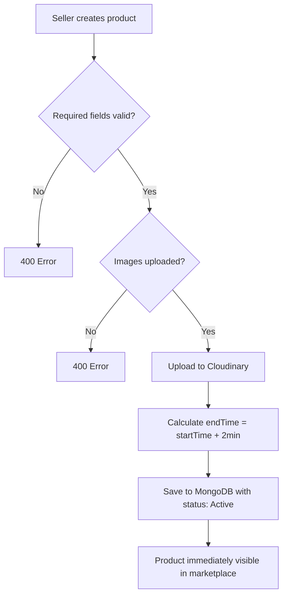
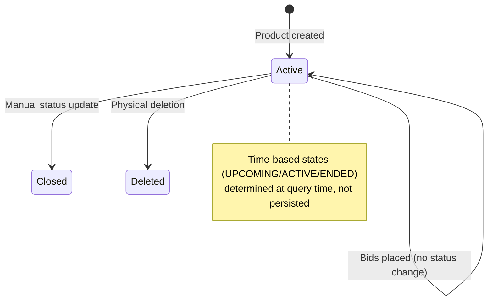
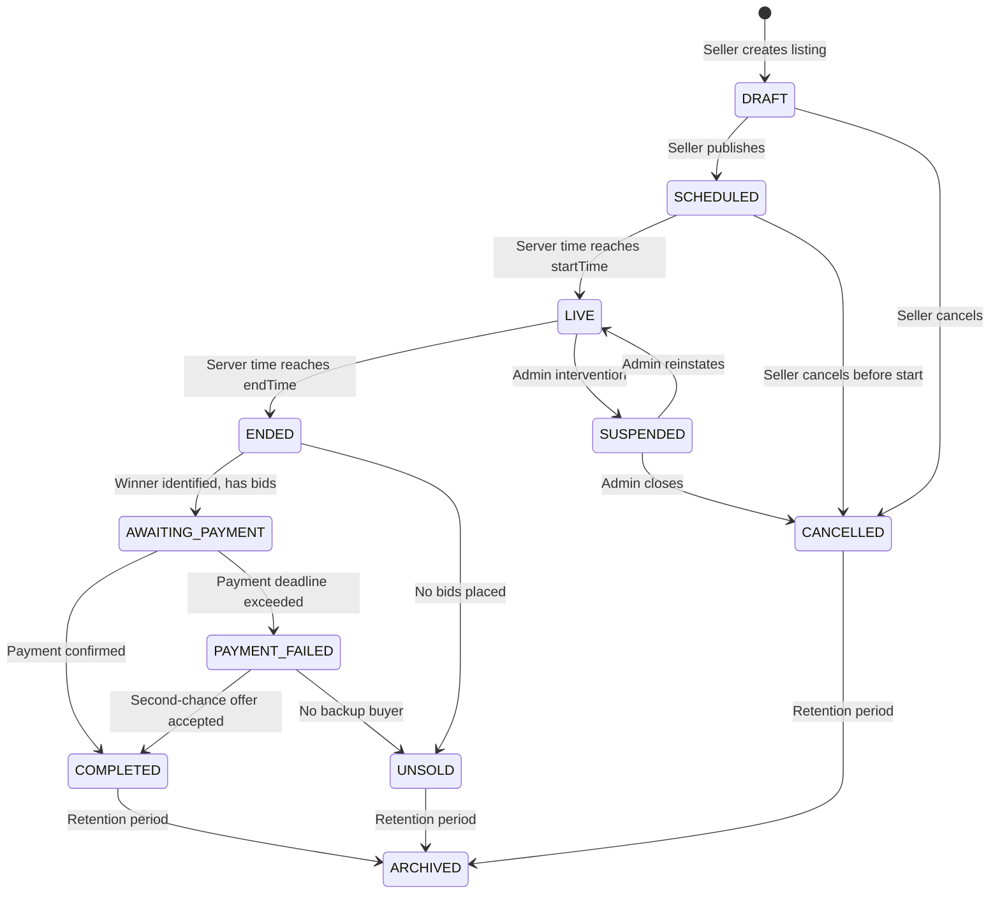
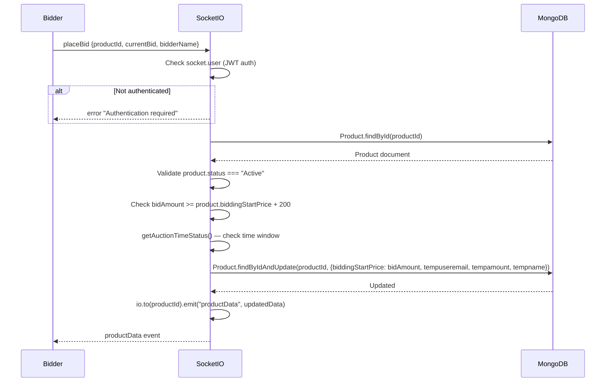
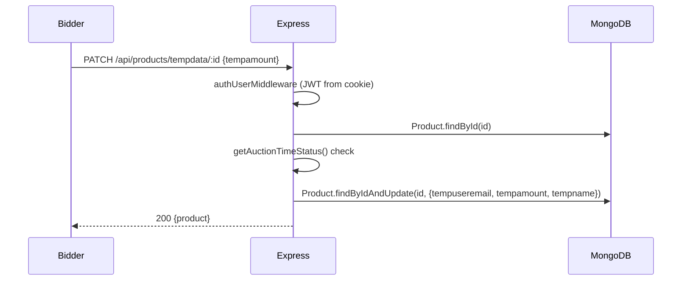
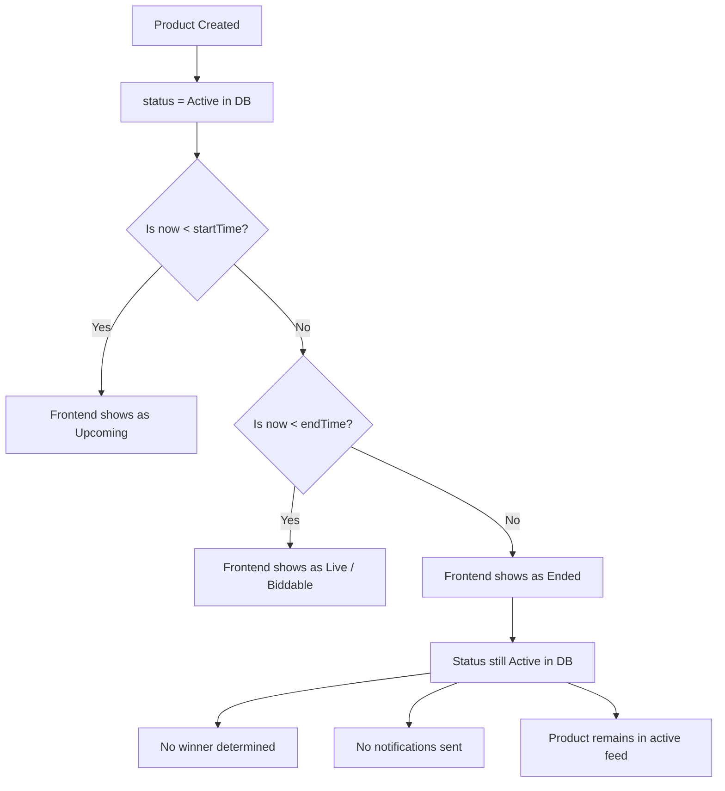
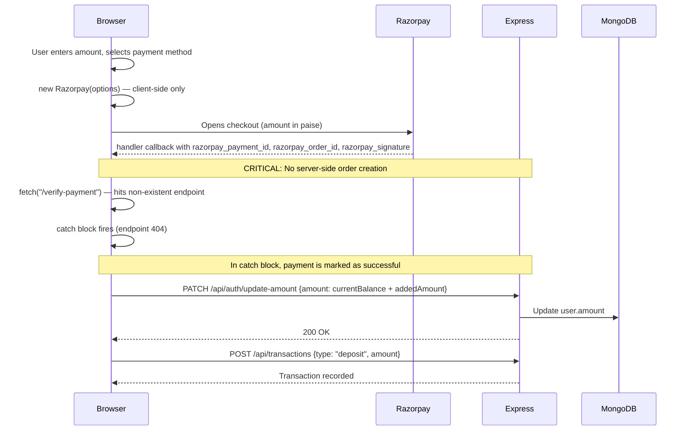
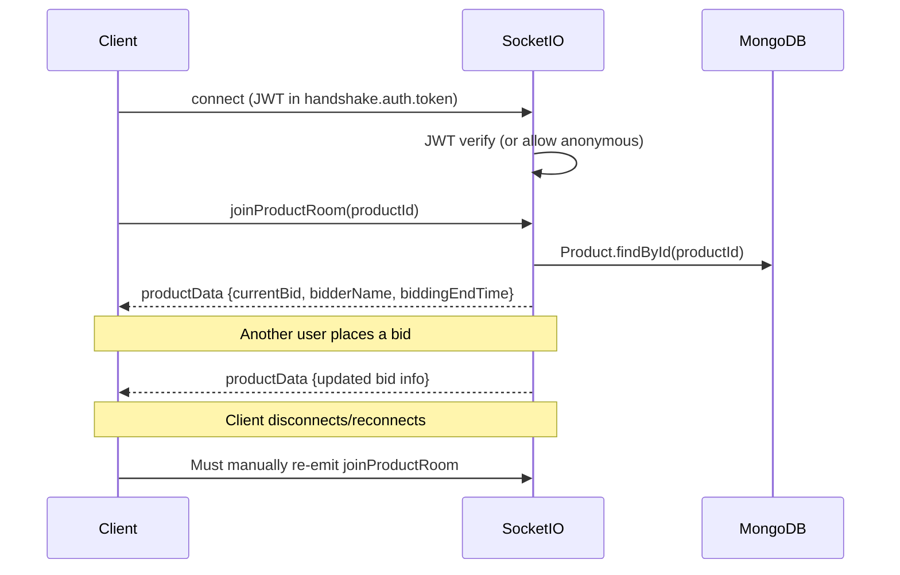

# Auction X — System Flows

> **Document version:** 0.1.0 — Design-only phase  
> **Last updated:** 2026-10-13  
> **Status:** Draft — awaiting owner review

---

## Table of Contents

1. [Authentication and Identity](#1-authentication-and-identity)
2. [Seller Onboarding and Listing Creation](#2-seller-onboarding-and-listing-creation)
3. [Complete Auction Lifecycle](#3-complete-auction-lifecycle)
4. [Bidding Flow](#4-bidding-flow)
5. [Auction Scheduling and Closing](#5-auction-scheduling-and-closing)
6. [Razorpay Payment Lifecycle](#6-razorpay-payment-lifecycle)
7. [Product Purchase and Winner Settlement](#7-product-purchase-and-winner-settlement)
8. [Notifications and Real-Time Updates](#8-notifications-and-real-time-updates)
9. [Admin, Moderation, Reporting, and Analytics](#9-admin-moderation-reporting-and-analytics)
10. [Failure and Recovery Flows](#10-failure-and-recovery-flows)

---

## 1. Authentication and Identity

### CURRENT IMPLEMENTATION

**Components:** React frontend → Express backend → MongoDB (User/Seller/OTP collections) → Google OAuth (Passport.js)

#### 1.1 Registration

- **User registration** (`POST /api/auth/user/register`): Accepts `name`, `email`, `password`. Password is hashed with bcrypt. User is created with `isNewUser: true`, `isVerified: false`.
- **Seller registration** (`POST /api/auth/seller/register`): Same flow, separate Seller model and collection.
- **Rate limiting** applied on user login/register routes (`loginLimiter`). Seller login currently **does not** have rate limiting applied (commented out in `SellerAuthRoutes.js`).
- CSRF token required for all mutating requests.

#### 1.2 Login

- **Email/password login** (`POST /api/auth/user/login`, `POST /api/auth/seller/login`): Validates credentials, issues JWT signed with `JWT_SECRET`, sets cookie (`token` or `sellerToken`) with `httpOnly`.
- JWT payload includes `id`, `email`, `name`, `role`, `isNewUser`.
- JWT expiry: 24 hours.
- No refresh token mechanism.

#### 1.3 Google OAuth

- Uses `passport-google-oauth20` strategy.
- Callback at `/auth/google/callback` — creates or updates User (not Seller) in the User collection.
- New Google users created with `isNewUser: true`, `isVerified: false`.
- JWT issued in callback handler, set as cookie, redirects to client with `isNewUser` flag.
- Seller also has Google OAuth routes in `SellerAuthRoutes.js` with a separate `SellerGoogleLoginController`.

#### 1.4 Session/Token Management

- JWT stored in `httpOnly` cookie.
- `authUserMiddleware` checks cookies (`token` or `sellerToken`) or `Authorization: Bearer` header.
- Token verification looks up user by `decoded.id` (fallback to `decoded.email`) in both User and Seller collections.
- Optional auth middleware exists for public-but-enriched routes.
- No token renewal/refresh mechanism. User must re-authenticate after 24h.

#### 1.5 Logout

- `POST /api/auth/logout` — clears the cookie.

#### 1.6 OTP Verification

- `POST /api/auth/send-otp` — generates OTP, stores in OTP collection (TTL 3000 seconds ≈ 50 minutes), sends via email (Nodemailer).
- `POST /api/auth/verify-otp` — validates OTP against stored value.
- OTP collection has unique constraint on `email` (one active OTP per email).
- Previous audit removed `GET /get-otp/:email` (CRIT-01 fix).

#### 1.7 User Verification

- `PATCH /api/auth/verify-user` — marks user as `isVerified: true`, `isNewUser: false`.
- Frontend directs new users to `VerifyProfilePage` or `VerifySellerProfilePage`.

#### 1.8 Password Reset

- `PasswordResetFlow` component exists on frontend.
- `PATCH /api/auth/update-password` — now requires JWT authentication (CRIT-02 fix).

#### 1.9 Role-Based Authorization

- Two roles in User model: `admin`, `user`.
- Two roles in Seller model: `admin`, `seller`.
- `authAdminMiddleware` — verifies JWT and checks `role === 'admin'` in User collection.
- `authUserMiddleware` — any authenticated user or seller.
- Ownership verification middleware (`verifyOwnership`) added for profile operations (HIGH-04 fix).

#### 1.10 Verified Issues

| Issue | Severity | Detail |
|-------|----------|--------|
| JWT secret env inconsistency | LOW | Standardized on single `JWT_SECRET` variable across all services |
| No token refresh | MEDIUM | 24h expiry with no refresh = forced re-login |
| Seller login no rate limit | LOW | Rate limiter commented out on seller login |
| Duplicate check-user route | LOW | `SellerAuthRoutes.js` registers `POST /check-user` twice (L125, L130) |
| Seller profile routes no auth | HIGH | `PATCH /updateUserProfile/:email`, `PATCH /updateUserProfileImage/:email`, `PATCH /resetProfileImage/:email` on seller routes lack `authUserMiddleware` |
| Admin check in User model only | MEDIUM | `authAdminMiddleware` checks User collection only; admin sellers are not recognized |

```mermaid
sequenceDiagram
    participant Browser
    participant Express
    participant MongoDB
    participant Google

    Note over Browser,Google: Email/Password Login
    Browser->>Express: POST /api/auth/user/login {email, password}
    Express->>Express: Validate CSRF token
    Express->>MongoDB: Find user by email
    MongoDB-->>Express: User document
    Express->>Express: bcrypt.compare(password, hash)
    Express->>Express: jwt.sign({id, email, name, role}, secret, 24h)
    Express-->>Browser: Set-Cookie: token=JWT; httpOnly

    Note over Browser,Google: Google OAuth Login
    Browser->>Express: GET /auth/google
    Express->>Google: Redirect to Google consent
    Google-->>Browser: Redirect with auth code
    Browser->>Express: GET /auth/google/callback?code=...
    Express->>Google: Exchange code for tokens
    Google-->>Express: Profile + email
    Express->>MongoDB: Find or create User
    Express->>Express: jwt.sign(...)
    Express-->>Browser: Set-Cookie: token=JWT; redirect to client
```

### PROPOSED DESIGN

See HLD §1 and LLD §A–B for full proposed authentication architecture.

Key changes proposed:
1. Standardize on `JWT_SECRET` across all services.
2. Add refresh token with short-lived access token.
3. Apply rate limiting on all login routes.
4. Fix seller profile routes to require authentication.
5. Fix duplicate route registration.
6. Evaluate unifying User and Seller into one collection with a `role` discriminator.

---

## 2. Seller Onboarding and Listing Creation

### CURRENT IMPLEMENTATION

#### 2.1 Seller Registration and Verification

- Separate Seller model with fields: `name`, `email`, `password`, `role`, `isNewUser`, `isVerified`, `storeName`, `storeDescription`, profile fields.
- Registration, OTP, and verification follow same pattern as User.
- **No formal seller approval/moderation workflow.** Sellers self-register and self-verify via OTP.

#### 2.2 Product Creation

- `POST /api/products/` — requires `authUserMiddleware` (any authenticated user or seller).
- Body: `name`, `category`, `description` (JSON array of {name, description} pairs), `mobileNumber`, `biddingStartDate`, `biddingStartTime`, `biddingStartPrice`, `email`, `hasBanner`, `bannerPlan`.
- Images uploaded to Cloudinary via `handleImageUploads` middleware.
- **Bidding end time is hardcoded to `startTime + 2 minutes`** (L57 of `productController.js`). This appears to be a development/testing value.
- Product stored with `status: "Active"` by default.
- No draft/review/moderation state. Products go live immediately upon creation.

#### 2.3 Product Validation

- Server validates required fields exist (not null/empty).
- At least one image required.
- **No server-side validation of**: future start date, valid category values, bid price minimum, description content length, or mobile number format.
- Description parsed from JSON string — no sanitization of content.

#### 2.4 Product Update

- `PUT /api/products/:id` — requires auth + `checkTimeRestriction` middleware.
- Ownership check: product.email === req.user.email OR admin.
- Prevents changing product `email` (ownership transfer).
- Can add images, update banner, update description.
- **Can be called during active bidding** (only restricted after end time).

#### 2.5 Product Deletion

- `DELETE /api/products/:id` — requires auth + `checkTimeRestriction` + ownership.
- Deletes Cloudinary images, then deletes from MongoDB.
- `deleteSuccessProduct` — separate endpoint that deletes without Cloudinary cleanup.
- **Physical deletion** — no soft delete, no archival.

#### 2.6 Banner System

- Products can have a `hasBanner`, `bannerImage`, and `bannerPlan`.
- Separate admin banner management routes exist.
- Razorpay integration on `SellItemPage.jsx` for banner payment (frontend-only, no server-side order creation).



### PROPOSED DESIGN

Key changes proposed:
1. Add `DRAFT` and `SCHEDULED` states before `ACTIVE`.
2. Implement configurable auction duration (not hardcoded 2 minutes).
3. Add server-side validation for future start dates, categories, prices.
4. Add soft deletion / archival instead of physical delete.
5. Add moderation workflow (optional, business decision needed).
6. Server-side Razorpay order creation for banner payments.

---

## 3. Complete Auction Lifecycle

### CURRENT IMPLEMENTATION

#### 3.1 Current State Model

The Product schema has a `status` field with only two values: `"Active"` and `"Closed"`.

The time-based lifecycle is determined by `getAuctionTimeStatus()`:
- **UPCOMING**: `now < biddingStartTime`
- **ACTIVE**: `now >= biddingStartTime && now < biddingEndTime && status !== "Closed"`
- **ENDED**: `now >= biddingEndTime || status === "Closed"`

**There is no scheduled/background job to transition statuses.** The status is evaluated on each request using server time comparison.

#### 3.2 Lifecycle Issues

| Issue | Detail |
|-------|--------|
| No automatic closure | `status` remains `"Active"` even after `biddingEndTime` passes. The time-based check catches this but the DB field is stale. |
| No winner determination | No automated process identifies the winner when bidding ends. |
| No settlement trigger | Nothing happens when an auction ends — no notification, no order creation, no payment prompt. |
| Physical deletion of ended auctions | The `deleteSuccessProduct` endpoint allows deleting products after auction ends — destroying bid history. |
| No unsold handling | If no bids are placed, the product remains `"Active"` in DB indefinitely. |
| No cancellation workflow | Status can be set to `"Closed"` manually but no cancellation reason or refund logic. |
| 2-minute auction duration | Hardcoded in `productController.js` L57. |



### PROPOSED DESIGN



**Business decisions required from owner:**
1. Which states are needed for MVP vs. future?
2. Is there a payment deadline for winners?
3. Should second-chance offers be supported?
4. What is the minimum/default auction duration?

---

## 4. Bidding Flow

### CURRENT IMPLEMENTATION

#### 4.1 Bid Submission Sequence

Two independent bid paths exist:

**Path A — Socket.IO (`placeBid` event):**



**Path B — REST API (`PATCH /api/products/tempdata/:id`):**



#### 4.2 Critical Bidding Issues

| Issue | Severity | Detail |
|-------|----------|--------|
| **No bid history** | CRITICAL | Bids overwrite `biddingStartPrice`, `tempuseremail`, `tempamount`, `tempname` directly on the Product document. Previous bids are lost. |
| **Race condition** | CRITICAL | Two simultaneous bids: both read current price, both validate >= price+200, both write. Last write wins, first bid silently dropped. No atomic compare-and-set. |
| **biddingStartPrice is overwritten** | CRITICAL | The field `biddingStartPrice` is used for both the initial reserve price AND the current highest bid. Original starting price is lost after first bid. |
| **Duplicate bid paths** | HIGH | Socket and REST endpoints both update the same fields but with different validation logic. No consistency guarantee. |
| **No bid amount validation against current price** | HIGH | Socket handler checks `bidAmount >= biddingStartPrice + 200` but `biddingStartPrice` *is* the current highest bid, not the original. REST path has no minimum increment check. |
| **No seller self-bid prevention** | MEDIUM | Product owner can bid on their own auction. |
| **Client-controlled bidder name** | LOW | `bidderName` comes from client payload, not from authenticated user's verified name. |
| **No bid ceiling/maximum** | LOW | No upper bound on bid amounts. |

#### 4.3 Concurrency Analysis

```
Timeline: Two users bid simultaneously
─────────────────────────────────────
T1: User A reads Product (price = 1000)
T2: User B reads Product (price = 1000)
T3: User A validates bid 1200 >= 1000+200 ✓
T4: User B validates bid 1300 >= 1000+200 ✓
T5: User A writes price = 1200 (findByIdAndUpdate)
T6: User B writes price = 1300 (findByIdAndUpdate)

Result: User B wins. User A's bid is silently lost.
User A sees 1200 as "accepted" but it was immediately overwritten.
No record that User A ever bid.
```

### PROPOSED DESIGN

See LLD §D for detailed bidding algorithm with atomic operations using MongoDB's `findOneAndUpdate` with conditions, bid history collection, and Socket.IO broadcast.

---

## 5. Auction Scheduling and Closing

### CURRENT IMPLEMENTATION

#### 5.1 When Auctions Become Visible

- Products are visible immediately upon creation (`getAllProducts` returns all products sorted by `createdAt`).
- No distinction between upcoming and live in the query — frontend filters based on time.
- `getProductsByCategory` filters by `status: "Active"` only.

#### 5.2 When Bidding Opens/Closes

- Determined at query time by `getAuctionTimeStatus()` comparing server `new Date()` against `biddingStartTime` and `biddingEndTime`.
- No server-side scheduler or cron job.
- **No automatic status transition.** A product created with a start time 1 hour from now is already `status: "Active"` in the database.

#### 5.3 Auction Closure

- **No automated closure process exists.**
- The `checkTimeRestriction` middleware and `getAuctionTimeStatus()` function prevent operations after `biddingEndTime`, but:
  - No winner is determined
  - No notifications are sent
  - No order is created
  - Status remains `"Active"` in the database
  - The product remains in the active feed until manually closed or deleted

#### 5.4 Anti-Sniping

- Not implemented. No time extension on last-second bids.

#### 5.5 Ended Auctions in Feeds

- `getAllProducts` returns ALL products including ended ones.
- Frontend is responsible for filtering/displaying based on time.
- No server-side pagination or filtering by auction state.



### PROPOSED DESIGN

1. **Reconciliation-based approach** — a periodic job (every 30-60 seconds) queries for products where `biddingEndTime <= now AND status === "LIVE"` and transitions them to `ENDED`.
2. **Bid endpoint independently enforces time window** — the scheduler improves timeliness but is not the sole correctness mechanism.
3. **Anti-sniping recommendation**: For Auction X's use case, recommend **strict scheduled closure** (no extension) for MVP simplicity. Anti-sniping can be added later as a configurable option per auction.

**Trade-offs:**

| Approach | Pros | Cons |
|----------|------|------|
| Strict closure | Simple, predictable, clear end time for all participants | Last-second sniping possible |
| Anti-sniping extension | Fairer for bidders, higher final prices | Unpredictable end time, complex implementation, socket sync challenges |

---

## 6. Razorpay Payment Lifecycle

### CURRENT IMPLEMENTATION

#### 6.1 Payment Purposes

Two payment uses identified:

1. **Wallet top-up** (`PaymentPage.jsx`): User adds money to their account balance.
2. **Banner payment** (`SellItemPage.jsx`): Seller pays for a promotional banner plan.

**Neither payment flow is related to auction purchases.** Auctions do not have a payment-for-purchase flow.

#### 6.2 Wallet Top-Up Flow (PaymentPage.jsx)



#### 6.3 Critical Payment Issues

| Issue | Severity | Detail |
|-------|----------|--------|
| **No server-side Razorpay order** | CRITICAL | No `razorpay.orders.create()` call on server. Payment amount is controlled entirely by the client. |
| **No payment verification** | CRITICAL | `fetch("/verify-payment")` calls a non-existent endpoint. The `catch` block (error handler) treats the 404 as success and credits the amount. |
| **Client controls amount credited** | CRITICAL | User's balance is updated by client-calculated `totalamount = amount + amountToPay`. A malicious client could credit any amount. |
| **No Razorpay signature verification** | CRITICAL | `razorpay_signature` is sent to `/verify-payment` but never actually verified server-side. |
| **No webhook endpoint** | HIGH | No server-side webhook handler for Razorpay payment events. |
| **No Razorpay SDK on server** | HIGH | `razorpay` npm package is not in server dependencies. |
| **Withdrawal has no real payment** | MEDIUM | Withdrawal just decrements the DB balance — no actual bank transfer or payment gateway interaction. |
| **Transaction records are informational only** | MEDIUM | Transaction model records `deposit`/`withdrawal` but is not linked to any Razorpay payment ID or verification. |

#### 6.4 Banner Payment Flow (SellItemPage.jsx)

- Uses Razorpay checkout on client side.
- On success handler, records `paymentId: response.razorpay_payment_id` but only uses it for UI display.
- No server-side order creation, verification, or webhook handling.
- Same fundamental issues as wallet top-up.

### PROPOSED DESIGN

See LLD §G for complete Razorpay integration with:
- Server-side order creation
- Signature verification
- Webhook handlers
- Payment state machine
- Idempotent processing

---

## 7. Product Purchase and Winner Settlement

### CURRENT IMPLEMENTATION

#### 7.1 Order Creation

- `POST /api/orders/` — creates an Order document with `title`, `name`, `userEmail`, `sellerEmail`, `category`, `images`, `biddingStartPrice`, `highestBid`, `phoneNo`, `address`.
- Requires authentication.
- **No link to a specific auction/product ID.** The order stores product metadata as copies, not references.
- **No automated trigger.** Order creation is a manual client action, not triggered by auction end.

#### 7.2 Winner Determination

- **Not implemented.** No server-side process identifies the highest bidder when an auction ends.
- The winning bid information is stored as `tempuseremail`, `tempamount`, `tempname` on the Product — but this is just the last bid, and there's no "winner" flag or notification.

#### 7.3 Payment for Purchases

- **Not implemented.** Orders are created without payment. No payment flow links an order to a Razorpay transaction.
- The `user.amount` field (wallet balance) exists but is not used for auction purchases.

#### 7.4 Settlement Flow

- **Does not exist.** There is no:
  - Payment deadline for winners
  - Second-chance offer mechanism
  - Seller notification of sale
  - Platform fee calculation
  - Delivery/shipping coordination
  - Order status tracking (pending, paid, shipped, delivered)

### PROPOSED DESIGN

**Business decisions required:**
1. Does the winning bidder pay for the item? If so, how? (Wallet balance, direct Razorpay payment, or both?)
2. Is there a payment deadline?
3. What happens if the winner doesn't pay?
4. Are there platform fees?
5. Is there a delivery/shipping flow, or is it handled outside the platform?

---

## 8. Notifications and Real-Time Updates

### CURRENT IMPLEMENTATION

#### 8.1 Socket.IO Setup

- Socket.IO server initialized with CORS configuration matching the Express server.
- JWT-based authentication in Socket.IO middleware — but allows unauthenticated connections.
- Socket routes mounted at `/socket`.

#### 8.2 Room Management

- Clients join product rooms by emitting `joinProductRoom(productId)`.
- No room authorization — any connected client can join any product room.
- No room cleanup on auction end.

#### 8.3 Live Bid Broadcasting

- On `placeBid`, server broadcasts `productData` event to all clients in the room.
- Event payload: `{ productId, currentBid, bidderName, biddingEndTime }`.
- No event ordering or sequencing.
- No acknowledgment mechanism.

#### 8.4 Missing Notification Features

| Feature | Status |
|---------|--------|
| Auction start notification | Not implemented |
| Auction end notification | Not implemented |
| Winner notification | Not implemented |
| Seller notification (sale) | Not implemented |
| Outbid notification | Not implemented |
| Reconnection state sync | Partial — `joinProductRoom` refetches current state from DB |
| Email notifications | Only for OTP and contact form |
| Push notifications | Not implemented |
| Offline user handling | Not handled |

#### 8.5 Reconnection Behavior

- On reconnect, client must re-emit `joinProductRoom` to rejoin and receive current state.
- No automatic room rejoin on Socket.IO reconnect.
- No missed-event replay mechanism.



### PROPOSED DESIGN

See LLD §I for event contracts and HLD §15 for real-time architecture.

---

## 9. Admin, Moderation, Reporting, and Analytics

### CURRENT IMPLEMENTATION

#### 9.1 Admin Dashboard

Extensive admin dashboard with routes under `/api/admin/`:

- **Customer management**: CRUD operations on users.
- **Inventory management**: CRUD on admin-managed inventory items (separate from auction products).
- **Order management**: CRUD on orders (admin view of all orders).
- **Subscription management**: CRUD on user subscriptions.
- **Transaction management**: View/manage financial transactions.
- **Report management**: Reports model with `reporterName`, `reporterEmail`, `reportType`, `description`, `status`, `resolution`.
- **Banner management**: Admin-managed promotional banners.
- **Events and Calendar**: Admin event scheduling.
- **Notifications**: Admin notification management.
- **Seller management**: Admin management of sellers.
- **Goodies management**: Admin-managed goodies/rewards.
- **Privacy requests**: User privacy/data requests.
- **Contact form submissions**: Admin view of contact form submissions.

#### 9.2 Admin Authentication

- All admin routes protected by `adminAuthMiddleware` (HIGH-01 fix).
- Admin is identified by `role: "admin"` in the User collection.

#### 9.3 Product Moderation

- **No explicit moderation queue.** Products go live immediately on creation.
- Admin can delete products or update status, but no approval workflow.

#### 9.4 Audit Trails

- No dedicated audit log collection.
- `Transaction` model records deposits and withdrawals.
- `Reports` model records user reports.
- Winston logger records HTTP requests and errors.
- No audit trail for admin actions (who deleted what, who changed what).

#### 9.5 Analytics

- Admin dashboard has analytics and sales pages on the frontend.
- Recommendation service tracks `user_interactions` (views, clicks, bids, purchases).
- No dedicated analytics pipeline or aggregation.

### PROPOSED DESIGN

See HLD §17 and LLD §K for proposed audit, moderation, and analytics architecture.

---

## 10. Failure and Recovery Flows

### CURRENT IMPLEMENTATION

#### 10.1 Database Unavailability

- `DbCon()` calls `process.exit(1)` on initial connection failure.
- Mongoose handles reconnection automatically for transient disconnections.
- No circuit breaker or health check endpoint.

#### 10.2 Application Restart During Auction

- **No recovery mechanism.** Since there's no scheduler, there's nothing to restart.
- Socket.IO connections are lost on restart. Clients must reconnect manually.
- Active auctions continue to be time-checked correctly on next request (stateless time comparison).

#### 10.3 Socket Server Disconnection

- Socket.IO has built-in reconnection on client side.
- No state sync on reconnect beyond `joinProductRoom`.
- Bids placed during disconnection are lost for that client.

#### 10.4 Cloudinary Failure

- Image upload failure returns 500 error to client.
- Product is not created if images fail to upload (correct behavior).
- Cloudinary deletion failure during product delete is not caught — product may be deleted from DB while images remain in Cloudinary.

#### 10.5 Duplicate Webhook Delivery

- No webhook endpoint exists, so not applicable.

#### 10.6 Global Error Handling

- `unhandledRejection` handler logs and continues.
- `uncaughtException` handler logs and exits.
- Express error handler middleware catches route errors.

#### 10.7 Missing Recovery Mechanisms

| Mechanism | Status |
|-----------|--------|
| Health check endpoint | Not implemented |
| Graceful shutdown | Not implemented |
| Database connection pool monitoring | Not implemented |
| Request timeout | Not configured |
| Retry logic (any operation) | Not implemented |
| Idempotency keys | Not implemented |
| Dead letter queue | Not applicable (no queue) |
| Data reconciliation | Not implemented |
| Backup/restore procedures | Not documented |

### PROPOSED DESIGN

See HLD §21 and LLD §J for failure modes, recovery mechanisms, and observability requirements.

---

## Appendix: Inventory of External Dependencies

| Service | Purpose | Configuration |
|---------|---------|---------------|
| MongoDB Atlas | Primary database | `MONGODB_URL` env var |
| Cloudinary | Image storage | SDK configuration in middleware |
| Razorpay | Payments | Client-side key only, no server SDK |
| Google OAuth | Authentication | Client ID, Secret, Callback URL |
| Nodemailer | Email (OTP, contact) | SMTP configuration |
| Redis (optional) | Recommendation cache | `REDIS_URL` in recommendation service |

---

## Appendix: Business Questions Requiring Owner Input

1. **Auction duration**: What is the intended auction duration? (Currently 2 minutes — clearly a dev value.)
2. **Payment model**: Do auction winners pay for items? How? Wallet balance, direct payment, or both?
3. **Seller vs. User**: Should sellers and users be unified into one model with roles?
4. **Moderation**: Should products require admin approval before going live?
5. **Wallet purpose**: What is the user wallet (`amount` field) intended for? Bidding deposits? Direct purchases?
6. **Anti-sniping**: Is last-second bid extension desired?
7. **Platform fees**: Are there platform fees on auctions or sales?
8. **Shipping/delivery**: Is delivery handled on-platform or externally?
9. **Refunds**: Under what conditions are refunds supported?
10. **Data retention**: How long should ended auction data be kept?
