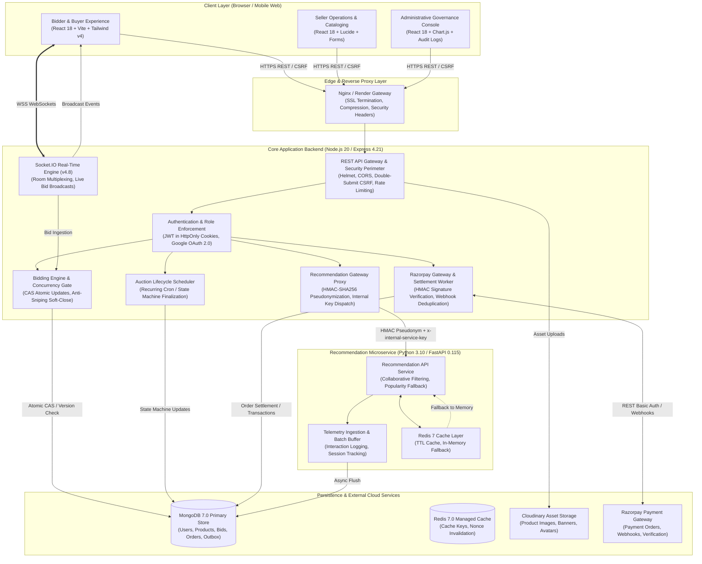

# AuctionX — System Overview & Architecture Topology

> **Document Classification:** Core Architecture Specification  
> **Status:** Active / Normative  
> **Target Audience:** Architects, Backend/Frontend Engineers, DevOps, Security Reviewers  
> **Last Verified:** October 2026  

---

## 1. System Overview & Vision

**AuctionX** is a distributed, real-time auction, e-commerce marketplace, and recommendation platform built for concurrent bidding, deterministic financial settlement, and privacy-first personalization.

### Core Architectural Invariants

1. **Server-Authoritative State:** The browser client is an untrusted presentation layer. All bids, prices, auction clocks, buyer invoices, and wallet balances are authoritatively calculated and persisted by the backend.
2. **Deterministic Settlement:** Auction conclusions, order creations, and Razorpay/wallet settlements follow strict state-machine transitions with durable idempotency keys and outbox dispatch.
3. **Optimistic Concurrency Control:** Standalone MongoDB database environments do not require multi-document distributed transactions. State mutations leverage version-checked atomic Compare-And-Swap (CAS) operations.
4. **Isolated Microservice Boundaries:** Recommendation computation and offline model evaluation are decoupled into a dedicated Python FastAPI service. The core Express server proxies client traffic, scrubs raw emails, and signs requests with HMAC pseudonyms and internal service keys.

---

## 2. System Context & Top-Level Topology

---

## 3. Subsystem Breakdown

### 3.1 Client Frontend (`client/`)
- **Technology:** React 18, Vite 6, Redux Toolkit, React Router DOM v7, Tailwind CSS v4, Lucide Icons, Chart.js.
- **Portals:**
  - **Bidder Marketplace:** Live auction catalogs, countdown timers, WebSocket room subscriptions, instant bidding, order checkout.
  - **Seller Operations:** Product catalog management, inventory tracking, sales revenues, order status tracking.
  - **Administrative Governance:** User account status management (suspension/restoration), product listing moderation, auction lifecycle telemetry, dispute investigation, settlement reconciliation.
- **Security Posture:** Stores no raw authentication tokens in localStorage; authentication relies on server-managed `HttpOnly`, `SameSite=Lax/None` cookies with double-submit CSRF protection for mutating operations.

### 3.2 Core Backend Server (`server/`)
- **Technology:** Node.js 20 (LTS), Express 4.21, Socket.IO 4.8, Mongoose 8.7.
- **Role Enforcement:** Multi-tier authorization checking User, Seller, and Admin collections; strict IDOR protection enforcing email/ID ownership matching on all resources.
- **Auction Engine:** Atomic version-checked bid placement, minimum increments (+₹50 canonical), anti-sniping dynamic soft-close (+2 minutes on last-minute bids, capped at +15 minutes).
- **Payment Settlement:** Razorpay order creation in server-authoritative integer paise, HMAC-SHA256 checkout and webhook verification, 24-hour payment deadlines with automated expiration workers.

### 3.3 Recommendation Service (`recommendation_service/`)
- **Technology:** Python 3.10, FastAPI 0.115, Uvicorn, PyMongo, Redis-py, NumPy.
- **Privacy Design:** Receives pseudonymous user identifiers generated via backend HMAC-SHA256 (`RECOMMENDATION_HMAC_SECRET`). Raw email addresses are never stored in telemetry collections.
- **Caching & Fallback:** Redis 7.0 cache with automatic in-memory fallback. Express backend provides local catalog fallback if the microservice is unreachable.

---

## 4. Key Architectural Documents

| Document | Path | Purpose |
| :--- | :--- | :--- |
| **System Flows** | [`system-flows.md`](./system-flows.md) | Exhaustive sequence diagrams and state transitions for auth, bidding, payments, and admin. |
| **High-Level Design** | [`high-level-design.md`](./high-level-design.md) | Architectural component boundaries, networking topologies, and failure domain boundaries. |
| **Low-Level Design** | [`low-level-design.md`](./low-level-design.md) | Detailed schema models, index definitions, API contracts, and concurrency algorithms. |
| **Architecture Decisions** | [`architecture-decisions.md`](./architecture-decisions.md) | Architecture Decision Records (ADRs) detailing technology choices and trade-offs. |
| **Frontend Design System** | [`frontend-design-system.md`](./frontend-design-system.md) | Design token hierarchy, CSS variables, dark/light themes, and reusable component guidelines. |
| **Design Verification** | [`design-verification.md`](./design-verification.md) | Verification criteria ensuring runtime matches architectural specifications. |
| **Implementation Roadmap** | [`implementation-roadmap.md`](./implementation-roadmap.md) | Historical staged delivery roadmap and verified production milestones. |
