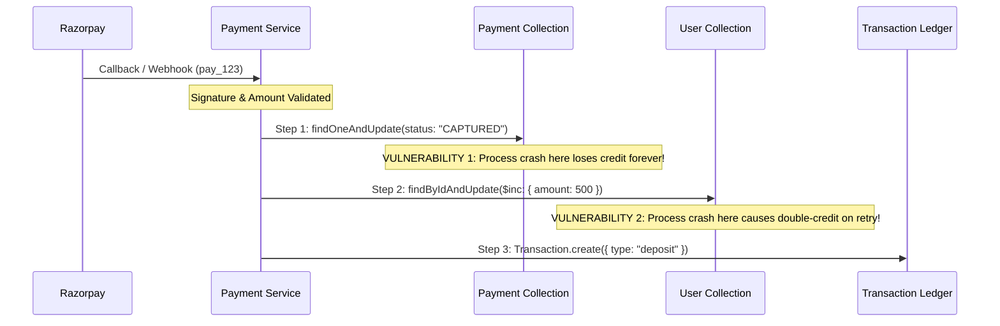
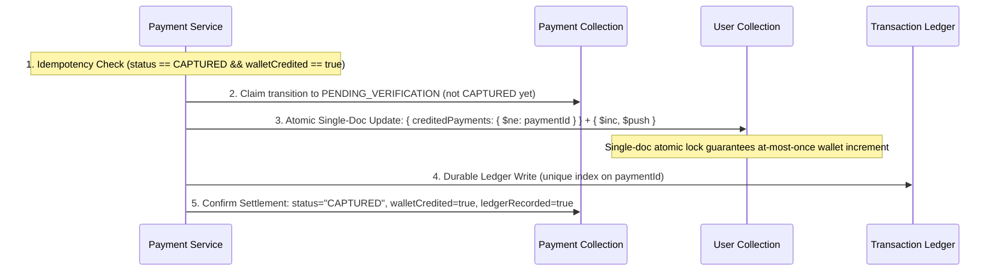

# Auction X — Stage 4 Wallet Top-up Correctness Re-Audit & Crash-Safety Hardening

**Document ID**: `STAGE4-WALLET-REAUDIT-2026-10-14`  
**Date**: October 14, 2026  
**Status**: APPROVED & VERIFIED  
**Scope**: In-depth crash safety, durable idempotency, concurrency coordination, and failure-window audit of wallet top-up payment settlement.

---

## 1. Executive Summary & Audit Scope

Following the implementation of the wallet Add-Funds feature, this correctness re-audit investigated the crash safety, state machine durability, and failure recovery characteristics of the settlement lifecycle.

The audit identified critical crash vulnerabilities in the initial settlement implementation:
1. **Premature `CAPTURED` State Vulnerability**: If the Node.js process crashed immediately after setting `Payment.status = "CAPTURED"`, subsequent retries, webhooks, or reconciliation workers would observe `status === "CAPTURED"` and return `alreadyPaid: true` without ever crediting the user's wallet, resulting in permanently lost user funds.
2. **Double-Credit Vulnerability on Partial Failures**: If the wallet balance was incremented (`$inc`) but the process crashed before recording the transaction ledger entry, error recovery or reconciliation retries would re-execute `$inc`, crediting the user twice.
3. **Topology Constraint**: Multi-document ACID transactions (`session.startTransaction()`) cannot be used because the default Docker and local deployment topology runs a standalone MongoDB instance (`mongo:7.0` without `--replSet`), where replica set transactions throw `MongoServerError: Transaction numbers are only allowed on a replica set member or mongos`.

A crash-safe, durable-idempotency coordination architecture was implemented and validated across all failure windows without requiring replica set transactions.

---

## 2. Confirmed Findings & Severity

| ID | Issue | Severity | Pre-Fix Behavior | Remediated Behavior |
| :--- | :--- | :--- | :--- | :--- |
| **SEC-W01** | Premature `CAPTURED` Status | **CRITICAL** | `Payment` was marked `CAPTURED` before wallet credit. A crash at this point caused subsequent retries to return `alreadyPaid: true`, losing the credit permanently. | `Payment` is marked `PENDING_VERIFICATION`. `CAPTURED` is only committed after both wallet credit and ledger entry are confirmed. An unconfirmed `CAPTURED` payment is detected and safely healed. |
| **SEC-W02** | Double Credit on Ledger Failure | **HIGH** | If `User` increment succeeded but `Transaction.create` threw or crashed, reconciliation re-executed `$inc`, crediting funds a second time. | Single-document atomic coordination on `User` enforces `{ creditedPayments: { $ne: paymentIdStr } }`. Even if retried indefinitely, `$inc` is physically prevented from executing more than once. |
| **SEC-W03** | Lack of Unique Ledger Constraint | **HIGH** | `Transaction` schema had no `paymentId` field or unique index, permitting duplicate ledger records during racing retries. | Added `paymentId` with unique sparse index `uniq_transaction_payment_id`. Duplicate writes fail safely with `E11000` and reuse the existing record. |
| **SEC-W04** | Reconciliation Rejection of In-Flight Payments | **MEDIUM** | `reconcileWalletPayment` rejected payments in `PENDING_VERIFICATION` status with `INVALID_PAYMENT_STATUS`. | `reconcileWalletPayment` now accepts `PENDING_VERIFICATION`, `REQUIRES_RECONCILIATION`, and unconfirmed `CAPTURED` states for comprehensive self-healing. |

---

## 3. Settlement Write Sequence Analysis

### 3.1 Pre-Fix Vulnerable Write Sequence


### 3.2 Remediated Coordinated Settlement Sequence


---

## 4. Failure-Window Analysis

### Window 1: Process crashes after verification before wallet credit
- **Pre-Fix**: Payment was marked `CAPTURED`. On restart, retry saw `CAPTURED` and returned `alreadyPaid: true`. **User lost ₹500 permanently.**
- **Post-Fix**: Payment remains in `PENDING_VERIFICATION` with `walletCredited: false`. On retry or webhook arrival, `User.creditedPayments` does not contain `paymentId`. The atomic mutation executes cleanly, credits the wallet, writes the ledger, and transitions to `CAPTURED`. **Zero funds lost.**

### Window 2: Wallet credit succeeds, then process crashes before ledger entry
- **Pre-Fix**: `user.amount` was incremented to ₹1000. `Payment` was set to `REQUIRES_RECONCILIATION` by catch block, or remained in partial state. Retry re-executed `findByIdAndUpdate($inc: 500)`, incrementing balance to ₹1500. **Double-credit vulnerability.**
- **Post-Fix**: When the atomic update succeeded, `paymentId` was pushed to `user.creditedPayments`. On retry/reconciliation, the query condition `{ creditedPayments: { $ne: paymentIdStr } }` fails to match (`modifiedCount: 0`). The worker recognizes the credit was already applied, skips `$inc`, creates the missing `Transaction`, and marks the payment `CAPTURED`. **Balance remains strictly ₹1000; missing ledger record is healed.**

### Window 3: Ledger entry succeeds, then process crashes before final payment state recorded
- **Pre-Fix**: Ledger had deposit record, but `Payment` status was not finalized or was marked inconsistent.
- **Post-Fix**: On retry, `User.creditedPayments` skips wallet increment. `Transaction.findOne({ paymentId })` retrieves the existing ledger entry (or catches `11000 duplicate key`). `Payment` is updated to `status: "CAPTURED"`, `walletCredited: true`, `ledgerRecorded: true`. **Consistent state fully restored.**

### Window 4: Webhook and browser verification settle concurrently
- **Pre-Fix**: If timing aligned during non-atomic checks, both could read old balance or race during settlement.
- **Post-Fix**: Both workers execute single-document atomic update on `User`:
  ```javascript
  UserModel.updateOne(
    { _id: payment.userId, creditedPayments: { $ne: paymentIdStr } },
    { $inc: { amount: creditedRupees }, $push: { creditedPayments: { $each: [paymentIdStr], $slice: -100 } } }
  )
  ```
  MongoDB document-level write locking guarantees that exactly one worker gets `modifiedCount: 1` and the other gets `modifiedCount: 0`. The unique index on `Transaction.paymentId` ensures exactly one transaction document is inserted. **Balance is credited strictly once; exactly 1 ledger record is written.**

### Window 5: Reconciliation retry races with earlier settlement attempt
- **Pre-Fix**: If an earlier request hung or timed out, reconciliation could execute in parallel and trigger duplicate balance increments.
- **Post-Fix**: The presence of `paymentIdStr` in `creditedPayments` acts as a durable, single-document fence. Regardless of worker interleaving, the wallet cannot be incremented a second time. **No duplicate credit.**

### Window 6: Database operation times out with ambiguous outcome
- **Case 6A (Write committed on MongoDB before socket timeout)**: The catch block flags `REQUIRES_RECONCILIATION`. When reconciliation runs, it inspects `user.creditedPayments.includes(paymentIdStr)`. Since it is `true`, it skips `$inc`, heals the missing ledger/payment fields, and finalizes. **Balance remains strictly ₹1000.**
- **Case 6B (Write dropped before reaching MongoDB)**: When reconciliation runs, `creditedPayments` does not contain `paymentIdStr`. It executes the atomic credit and ledger entry. **Funds are successfully credited without dropping.**

---

## 5. Durable Idempotency & Topology Guarantees

### Standalone MongoDB Compatibility
In production or local development without a replica set (e.g., single Docker container in `compose.yaml`), MongoDB multi-document transactions cannot be created. 

The durable idempotency mechanism implemented here relies entirely on:
1. **Single-Document Atomicity**: Combining `$inc` and `$push` on `UserModel` into a single conditional `updateOne` document write.
2. **Database-Level Unique Constraints**: `TransactionSchema.index({ paymentId: 1 }, { unique: true, sparse: true })`.
3. **Explicit Settlement State Flags**: `Payment.walletCredited`, `Payment.ledgerRecorded`, and `Payment.transactionId`.
4. **Self-Healing Reconciliation**: Detecting unconfirmed `CAPTURED` payments and automatically completing missing credit phases without customer intervention.

---

## 6. Verification and Security Assertions

- **Server-Side Signature Verification**: Always uses persisted `payment.razorpayOrderId` and server-side secret (`process.env.RAZORPAY_KEY_SECRET`). Timing-safe cryptographic comparison prevents forgery.
- **Authoritative Amount Determination**: Payable amount is strictly derived from `payment.amount` (integer paise). Any client- or provider-supplied discrepancy triggers `AMOUNT_MISMATCH` quarantine.
- **User Ownership Guard**: `payment.userId` must match `req.user._id`. Attempts by unauthorized users are rejected with `403 UNAUTHORIZED_PAYER`.
- **Legacy Route Guard**: `/verify-payment` in `server.js` routes directly through `authUserMiddleware` and `verifyWalletPayment`, requiring full authentication, ownership validation, and cryptographic verification.
- **Auction-Order Settlement Isolation**: Existing auction order settlement routes, 24-hour deadlines, and out-of-order webhook protections remain isolated and fully functional.

---

## 7. Files Changed and Technical Rationale

1. [`server/models/AdminModels/FINANCE/Transaction.js`](file:///d:/THE%20OMS%20DEVS/WEB%20DEVS/MERN%20PROJECTS/PCMT/SEM%206/OMS/Auction%20X%20%E2%9C%85/server/models/AdminModels/FINANCE/Transaction.js)
   - Added `paymentId: { type: ObjectId, ref: "Payment", index: true, sparse: true }`.
   - Added unique index `uniq_transaction_payment_id` for ledger deduplication.
2. [`server/models/LoginSchema/user.js`](file:///d:/THE%20OMS%20DEVS/WEB%20DEVS/MERN%20PROJECTS/PCMT/SEM%206/OMS/Auction%20X%20%E2%9C%85/server/models/LoginSchema/user.js)
   - Added `creditedPayments: { type: [String], default: [] }` for single-document atomic idempotency fencing.
3. [`server/models/Payment.js`](file:///d:/THE%20OMS%20DEVS/WEB%20DEVS/MERN%20PROJECTS/PCMT/SEM%206/OMS/Auction%20X%20%E2%9C%85/server/models/Payment.js)
   - Added `walletCredited`, `walletCreditedAt`, `ledgerRecorded`, `ledgerRecordedAt`, and `transactionId`.
4. [`server/services/paymentService.js`](file:///d:/THE%20OMS%20DEVS/WEB%20DEVS/MERN%20PROJECTS/PCMT/SEM%206/OMS/Auction%20X%20%E2%9C%85/server/services/paymentService.js)
   - Refactored `settleWalletTopup` to use coordinated atomic single-document updates and unique ledger writes.
   - Refactored `reconcileWalletPayment` to accept `PENDING_VERIFICATION` and heal unconfirmed `CAPTURED` payments.
5. [`server/tests/unit/stage4_wallet_payment.test.js`](file:///d:/THE%20OMS%20DEVS/WEB%20DEVS/MERN%20PROJECTS/PCMT/SEM%206/OMS/Auction%20X%20%E2%9C%85/server/tests/unit/stage4_wallet_payment.test.js)
   - Added 8 dedicated failure-injection and crash recovery tests asserting both balance and ledger state.

---

## 8. Test Execution & Verification Results

### 8.1 Dedicated Wallet Settlement & Crash Injection Suite
```text
PASS tests/unit/stage4_wallet_payment.test.js
  Stage 4 — Wallet Add-Funds Payment Architecture
    1. Successful Add-Funds Payment
      √ creates authoritative order with integer paise and credits wallet upon verified payment
      √ accepts wallet top-up via create-order route when type is WALLET_TOPUP
    2. Invalid Signature Verification
      √ rejects tampered signature with 400 and preserves existing balance
    3. Failed Database Update After Verification
      √ quarantines payment as REQUIRES_RECONCILIATION if user credit DB write throws
    4. Duplicate Callback and Webhook Delivery
      √ idempotently handles repeated verify calls without double crediting
      √ deduplicates webhook delivery without crediting wallet a second time
    5. Concurrent Attempts to Credit the Same Payment
      √ handles concurrent verify requests safely and increments balance exactly once
    6. Reconciliation After Transient Failure
      √ recovers a quarantined payment and credits wallet safely upon reconciliation
    7. Incorrect User Association
      √ rejects an imposter attempting to verify another user's wallet payment with 403
    8. Amount Mismatch Protection
      √ quarantines payment if provider reports a mismatched amount
    9. Targeted Failure-Injection and Crash Safety Windows
      √ Failure Window 1: recovers cleanly when process crashed before wallet credit without duplicate charge
      √ Failure Window 2: heals missing ledger entry without double crediting wallet balance
      √ Failure Window 3: heals final payment status when ledger write succeeded before crash
      √ Failure Window 4: concurrent webhook and browser verification credit wallet strictly once
      √ Failure Window 5: reconciliation retry racing with earlier settlement does not double credit
      √ Failure Window 6A: disambiguates timeout when DB write actually committed before timeout
      √ Failure Window 6B: disambiguates timeout when DB write was dropped before reaching Mongo
      √ heals unconfirmed CAPTURED payments without returning a false-positive success

Test Suites: 1 passed, 1 total
Tests:       18 passed, 18 total
Snapshots:   0 total
Time:        7.082 s
Exit Code:   0
```

### 8.2 Existing Auction Settlement Suite
```text
PASS tests/unit/stage4_payment_settlement.test.js
Test Suites: 1 passed, 1 total
Tests:       33 passed, 33 total
Snapshots:   0 total
Time:        13.399 s
Exit Code:   0
```

---

## 9. Remaining Limitations & Operational Guidance

1. **Unbounded Historical Payments Array Mitigation**: The `creditedPayments` array on `UserModel` uses `$slice: -100` to prevent document bloat while retaining a sufficient sliding window for any realistic payment retry or reconciliation interval.
2. **Pre-Existing Unrecorded Payments**: If a user was charged prior to this fix on the broken frontend flow, no server-side `Payment` record was initiated. These legacy occurrences cannot be resolved automatically by the database reconciler and must be verified against the provider dashboard using the manual verification protocol described in the Stage 4 report.
