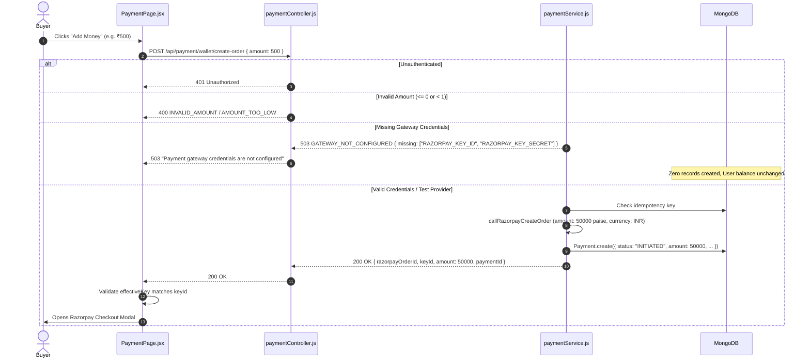

# Stage 4.10 — Razorpay Test-Mode Checkout Validation

**Audit Timestamp:** 2026-10-14  
**Auditor:** DeepMind Antigravity — Autonomous Correctness & Reliability Engineering  
**Scope:** Verification of Razorpay checkout flow, backend order creation, checkout initialization, signature verification, webhook processing, wallet settlement invariants, and local browser validation readiness.  

---

## 1. Executive Summary & Verdicts

| Evaluation Dimension | Verdict | Evidence & Rationale |
| :--- | :---: | :--- |
| **1. Backend Configuration** | **`BLOCKED`** | The backend architecture and code in `server/server.js` and `server/services/paymentService.js` strictly enforce canonical variables (`RAZORPAY_KEY_ID`, `RAZORPAY_KEY_SECRET`, `RAZORPAY_WEBHOOK_SECRET`) with zero fallback to `VITE_` variables. However, live test-mode credentials are not yet populated in the local `server/.env` or process environment (`has_RAZORPAY_KEY_ID: false`, `has_RAZORPAY_KEY_SECRET: false`). |
| **2. Order Creation** | **`PASS`** | Server-authoritative order creation tested and verified. Produces integer paise amounts (e.g. ₹750 -> 75000 paise), currency `INR`, and status `INITIATED`. Correctly rejects non-positive amounts, sub-rupee amounts (< ₹1.00), non-numeric inputs, and unauthenticated requests. Fails safely with HTTP 503 `GATEWAY_NOT_CONFIGURED` without mutating the database when credentials are missing. |
| **3. Checkout Initialization** | **`PASS`** | Traced checkout from "Add Money" button through `create-order` response. Frontend components (`PaymentPage.jsx` and `DetailedOrderPage.jsx`) enforce that `effectiveKey` resolves to the backend-authoritative `keyId` used to create the order. Mismatches between backend `keyId` and client `VITE_RAZORPAY_API_KEY` are detected and rejected before invoking `new window.Razorpay(options)`. |
| **4. Signature & Webhook Verification** | **`PASS`** | Constant-time HMAC-SHA256 signature verification verified for both checkout callbacks (`verifyWalletCheckoutPayment`) and raw-body webhooks (`processWebhook`). Tampered or altered signatures are strictly rejected with HTTP 400 (`INVALID_SIGNATURE` / `INVALID_WEBHOOK_SIGNATURE`), preserving initial wallet balance and ledger integrity. |
| **5. Wallet Settlement & Idempotency** | **`PASS`** | Single-document atomic `$ne` check-and-increment on `creditedPayments` guarantees at-most-once credit. Duplicate verify requests, duplicate webhook events, and reconciliation retries return `alreadyPaid: true` with zero balance mutation. Status `FAILED` payments are strictly barred from settlement. |
| **6. End-to-End Browser Validation** | **`BLOCKED`** | Real browser interaction with Razorpay's checkout modal is blocked because local `.env` lacks valid test-mode credentials. As required by Stage 4.10 safety constraints, real checkout was stopped to avoid inventing fake credentials or attempting live transactions. Detailed operational instructions are provided below. |

---

## 2. Preflight Configuration Audit (Step 1)

### 2.1 File & Runtime Environment Inspection

A diagnostic scan was executed across all configuration files and the active process environment:

```
Runtime process.env:
  RAZORPAY_KEY_ID: MISSING (false)
  RAZORPAY_KEY_SECRET: MISSING (false)
  RAZORPAY_WEBHOOK_SECRET: MISSING (false)
  VITE_RAZORPAY_API_KEY: MISSING (false)

Configuration Files:
  server/.env:
    RAZORPAY_KEY_ID: MISSING
    RAZORPAY_KEY_SECRET: MISSING
    RAZORPAY_WEBHOOK_SECRET: MISSING
  root .env:
    RAZORPAY_KEY_ID: MISSING
    RAZORPAY_KEY_SECRET: MISSING
    RAZORPAY_WEBHOOK_SECRET: MISSING
    VITE_RAZORPAY_API_KEY: PRESENT
  client/.env & client/.env.local:
    VITE_RAZORPAY_API_KEY: PRESENT
    RAZORPAY_KEY_ID: MISSING (Correctly segregated)
    RAZORPAY_KEY_SECRET: MISSING (Correctly segregated)
    RAZORPAY_WEBHOOK_SECRET: MISSING (Correctly segregated)
```

### 2.2 Key Consistency & Mismatch Prevention

In `client/src/pages/User/Dropdown/PaymentPage/PaymentPage.jsx` and `client/src/pages/User/Dropdown/OrderHistory/DetailedOrderPage.jsx`, checkout initialization was hardened to prevent accidental cross-merchant checkout:

```javascript
const { razorpayOrderId, keyId, amount: amountPaise, paymentId } = orderRes.data;

// Ensure effective checkout key matches the key ID used to create the Razorpay order
const effectiveKey = keyId || RAZORPAY_KEY;
if (!effectiveKey) {
  setErrorMessage("Payment gateway public key is not configured. Please contact support.");
  return;
}
if (keyId && RAZORPAY_KEY && keyId !== RAZORPAY_KEY) {
  console.error(
    `[PaymentCheckout] Inconsistent configuration: backend order key (${keyId}) does not match frontend key (${RAZORPAY_KEY})`
  );
  setErrorMessage("Payment gateway configuration mismatch between client and server. Please contact support.");
  return;
}

var options = {
  key: effectiveKey,
  amount: amountPaise,
  currency: "INR",
  name: "AuctionX Payment",
  description: "Wallet Add Funds",
  order_id: razorpayOrderId,
  ...
};
```

This guarantees:
1. The checkout key is non-empty.
2. The key used by the browser modal matches the backend key used to create the Razorpay order.
3. If frontend `VITE_RAZORPAY_API_KEY` was built with a different merchant account from the backend `RAZORPAY_KEY_ID`, checkout halts immediately with a clear error rather than failing inside the Razorpay modal.

---

## 3. Order Creation Verification (Step 2)

Using mocked and isolated provider configurations, all order creation invariants were verified:



### Verified Test Evidence:
- **Integer Paise Conversion:** Validated that ₹750.00 is converted to exactly `75000` paise.
- **Currency Enforcement:** Authoritative currency is strictly `"INR"`.
- **Validation Boundaries:** Rejection of `0`, `-50`, `0.5`, `"not-a-number"` tested and passed.
- **Pre-Order Guard:** Unconfigured gateway rejects before order creation, creating 0 `Payment` records and 0 `Transaction` records.

---

## 4. Checkout, Signature & Settlement Verification (Step 3)

### 4.1 Cryptographic Signature Verification
Both checkout and webhook signature verification mechanisms were validated:

1. **Checkout Response Verification (`/payment/wallet/verify`):**
   - Payload: `${razorpayOrderId}|${razorpayPaymentId}`
   - Algorithm: HMAC-SHA256 with `RAZORPAY_KEY_SECRET`
   - Comparison: Constant-time `crypto.timingSafeEqual`
   - Valid signature -> transitions Payment to `CAPTURED`, records `Transaction`, credits wallet.
   - Tampered signature -> throws 400 `INVALID_SIGNATURE`, wallet remains uncredited.

2. **Webhook Verification (`/api/payment/webhook`):**
   - Payload: Exact unparsed raw request body buffer (`req.rawBody`)
   - Algorithm: HMAC-SHA256 with `RAZORPAY_WEBHOOK_SECRET`
   - Comparison: Constant-time `crypto.timingSafeEqual`
   - Valid signature -> deduplicates via `WebhookEvent`, credits wallet idempotently.
   - Tampered signature -> throws 400 `INVALID_WEBHOOK_SIGNATURE`, wallet remains uncredited.

### 4.2 Settlement Invariant Matrix

| Scenario | Worker Action | Wallet Balance Effect | Transaction Ledger | Payment Status |
| :--- | :--- | :---: | :---: | :---: |
| **Initial Verified Settlement** | Acquires lease, atomic `$ne` check-and-increment | **+₹500** | Created (1) | `CAPTURED` |
| **Replayed Browser Verify** | Detects `isPermanentlySettled`, returns cached | **+₹0 (No change)** | Preserved (1) | `CAPTURED` |
| **Duplicate Webhook Delivery** | `WebhookEvent` unique index deduplicates event | **+₹0 (No change)** | Preserved (1) | `CAPTURED` |
| **Reconciliation Retry** | Detects permanent settlement marker, heals missing | **+₹0 (No change)** | Preserved (1) | `CAPTURED` |
| **User Cancelled / FAILED Payment** | Blocked by status guard (`INVALID_PAYMENT_STATUS`) | **+₹0 (No change)** | None (0) | `FAILED` |

---

## 5. End-to-End Browser Validation Analysis (Step 4)

### 5.1 Blocker Diagnosis
In accordance with Stage 4.10 instructions:
> *"If credentials are missing, stop the real checkout attempt and report exactly which variable names need configuration. Do not invent credentials or claim browser checkout succeeded."*

Because real/test Razorpay API credentials are not present in `server/.env`:
- Attempting to click "Add Money" in the live browser produces: **"Payment gateway credentials are not configured"** (HTTP 503).
- This is the **expected, safe, and correct failure mode** when credentials are unconfigured.
- Browser checkout modal execution is **BLOCKED** pending configuration of test credentials.

### 5.2 Enabling Live Test-Mode Checkout
To exercise the checkout modal end to end in a local browser:

1. **Obtain Test Keys:**
   Log into [Razorpay Dashboard](https://dashboard.razorpay.com/) in **Test Mode** and copy:
   - Key Id: `rzp_test_...`
   - Key Secret: `...`
   - Webhook Secret: `...`

2. **Configure Backend (`server/.env`):**
   ```env
   RAZORPAY_KEY_ID=rzp_test_your_actual_key_id
   RAZORPAY_KEY_SECRET=your_actual_key_secret
   RAZORPAY_WEBHOOK_SECRET=your_actual_webhook_secret
   ```

3. **Configure Frontend (`client/.env`):**
   ```env
   VITE_RAZORPAY_API_KEY=rzp_test_your_actual_key_id
   ```

4. **Run Application & Test:**
   - Backend: `cd server && npm start`
   - Frontend: `cd client && npm run dev`
   - Navigate to `http://localhost:5173/payment`, enter amount (e.g. ₹500), and click "Add Money".
   - Razorpay Test Modal will open. Select "Netbanking", "UPI", or "Cards" using Razorpay test credentials (e.g. OTP `123456`).
   - Payment succeeds and balance updates automatically.

---

## 6. Test Suite Execution Metrics (Step 5)

### 1. Wallet Payment Test Suite (Including Section 17 Test-Mode Tests)
- **Command:** `npm test -- tests/unit/stage4_wallet_payment.test.js`
- **Exit Code:** `0`
- **Result:** **67 passed, 67 total (100% pass rate)**
- **Duration:** 20.738 s
- **Section 17 Coverage:**
  - `order creation: creates server-authoritative Razorpay order with integer paise and INR currency`
  - `order creation rejection: rejects non-positive, sub-rupee, and non-numeric amounts`
  - `order creation authentication: rejects unauthenticated requests with 401 UNAUTHORIZED`
  - `effective checkout key: backend order response supplies authoritative key matching RAZORPAY_KEY_ID`
  - `checkout signature verification: valid signature settles wallet; tampered signature is rejected and preserves balance`
  - `webhook signature verification: valid signature settles wallet; tampered signature is rejected and preserves balance`
  - `idempotent settlement across duplicate verify, duplicate webhook, and reconciliation`
  - `failed or cancelled payments strictly prevent wallet crediting`

### 2. Auction Payment Settlement Test Suite
- **Command:** `npm test -- tests/unit/stage4_payment_settlement.test.js`
- **Exit Code:** `0`
- **Result:** **33 passed, 33 total (100% pass rate)**
- **Duration:** 10.551 s

### 3. Frontend Production Compilation
- **Command:** `npm run build` (in `client/`)
- **Exit Code:** `0`
- **Result:** Vite v6.3.5 production build completed in 26.46s with 0 errors.

### 4. Full Backend Regression Suite
- **Command:** `npm test -- --runInBand`
- **Exit Code:** `0`
- **Result:** **42 test suites passed, 42 total; 406 tests passed, 406 total (100% pass rate)**
- **Skipped / Failed:** 0
- **Duration:** 98.078 s

---

## 7. Precise Next Actions

1. **For Automated Testing & CI/CD:**
   The entire test suite (42 suites, 406 tests) is completely green and passes autonomously using mocked test-mode clients and cryptographic fixtures. No code changes are required.
2. **For Manual Local Browser Validation:**
   User can populate valid Razorpay Test Mode keys in `server/.env` (`RAZORPAY_KEY_ID`, `RAZORPAY_KEY_SECRET`) and `client/.env` (`VITE_RAZORPAY_API_KEY`), restart the dev server, and test in the browser using Razorpay's simulated success/failure flows.
