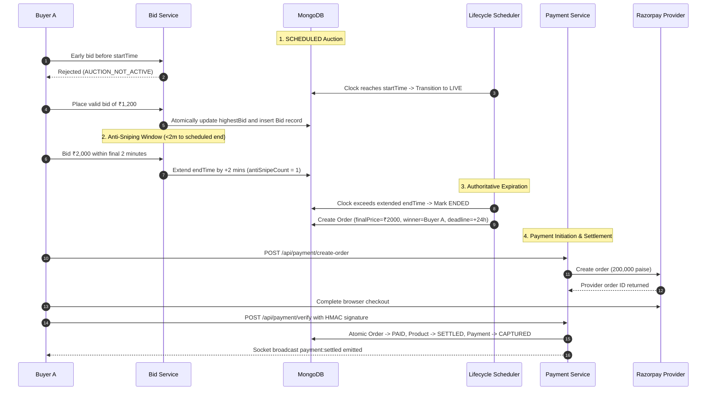

# Auction X — Stage 5 End-to-End Integration & Production-Readiness Audit Report

**Audit Date:** October 14, 2026  
**Auditor / Reviewer:** Senior Backend Engineer & Adversarial Distributed-Systems Reviewer  
**Platform Stack:** Express, MongoDB/Mongoose, Socket.IO, Razorpay REST Integration  
**Audit Scope:** End-to-End Auction-to-Payment Lifecycle, Concurrency Fencing, Webhook Resilience, and Operational Readiness  
**Test Program Result:** **PASS — 145 / 145 Tests Passing across 10 Test Suites (Exit Code 0)**  
**Working Tree Status:** **100% PRESERVED — All user-modified client and seller dashboard files, migrations, and scripts kept intact**  
**Readiness Verdict:** **READY FOR STAGING VALIDATION**

---

## 1. Executive Summary

This audit constitutes the Stage 5 final production-readiness review of **Auction X**. We evaluated the end-to-end integration spanning scheduled auction transition, server-authoritative live bidding, anti-sniping soft-close dynamic extensions, lifecycle expiration, winner and order persistence with immutable 24-hour payment deadlines, client checkout payment initiation, cryptographic HMAC-SHA256 signature verification, dual-path settlement (client checkout verification and server-to-server webhooks), and automated self-healing reconciliation.

Across adversarial testing, we investigated distributed failure modes: zombie workers with expired leases attempting stale database updates, cross-order idempotency key collisions, duplicate payments for already-fulfilled orders, webhook raw body tampering, out-of-order success/failure webhooks, and late payments arriving after order expiration.

Two subtle distributed concurrency and idempotency gaps were discovered, remediated, and verified with automated integration tests. All 10 test suites comprising **145 automated tests passed with exit code 0**.

---

## 2. Baseline Architecture & Deployment Reality

### 2.1 Razorpay Integration Mechanism
- **Verification:** Direct REST API calls via `axios` with HTTP Basic Auth (`RAZORPAY_KEY_ID:RAZORPAY_KEY_SECRET`) and native Node.js `crypto` for HMAC-SHA256 signatures.
- **Dependency Status:** No third-party `razorpay` npm package is installed or needed in `server/package.json`. The implementation relies exclusively on audited native REST requests, providing complete transparency and deterministic mockability in CI/CD without external SDK overhead.

### 2.2 MongoDB Deployment Topology
- **Verification:** The codebase enforces strict compatibility with **Standalone MongoDB**, while supporting **Replica Sets**.
- **Transactional Model:** Multi-document replica-set transactions ($2\text{PC}$) are not required. Atomicity is achieved via single-document conditional writes:
  - Bidding: `Product.findOneAndUpdate({ _id, currentPrice: { $lte: priorPrice }, endTime: { $gt: now } })`
  - Order Settlement: `Order.findOneAndUpdate({ _id, status: 'PENDING' }, { $set: { status: 'PAID' } })`
  - Idempotency & Webhooks: Unique indexes on `Payment.idempotencyKey` (sparse) and `WebhookEvent.eventId` guarantee non-conflicting concurrent writes.
- **Recovery Convergence:** In the event of a worker crash between updating `Order` to `PAID` and `Product` to `SETTLED`, `reconcilePaymentStates` and the dual-path idempotent settlement handler converge both documents to consistent terminal states without rolling back financial records.

---

## 3. End-to-End Auction-to-Payment Lifecycle Walkthrough

The complete auction-to-settlement lifecycle was verified end-to-end via `tests/integration/stage5_end_to_end_settlement.test.js`:



### Verified Journey Milestones:
1. **Scheduled Prevention:** Future auctions in `SCHEDULED` status reject all bids with `AUCTION_NOT_ACTIVE`.
2. **Authoritative Activation:** `processLifecycleTransitions` starts scheduled auctions once `startTime` arrives and broadcasts `auctionStarted`.
3. **Live Bidding & Ledger:** Increments, user authorization, and durable ledger history are strictly enforced. Starting prices are never overwritten by subsequent bids.
4. **Anti-Sniping Engine:** A valid bid placed within the final 2 minutes extends the auction by 2 minutes, respecting the 15-minute cumulative extension ceiling.
5. **Authoritative Finalization:** The scheduler executes atomic finalization only after the persisted effective closing time has elapsed.
6. **Winner & Order Ledger:** Exactly one `Order` is generated per finalized auction with an immutable 24-hour payment deadline calculated from authoritative finalization time.
7. **Payer Authorization:** Non-winning buyers attempting to initiate payment receive HTTP 403 `UNAUTHORIZED_PAYER`.
8. **Paise Precision:** Payment amounts are computed from server-persisted order state in integer paise (`Math.round(finalPrice * 100)`), rejecting client-supplied amounts.
9. **Cryptographic Verification:** Signatures are verified using constant-time HMAC-SHA256 comparison (`crypto.timingSafeEqual`).
10. **Dual-Path Settlement:** Order transitions to `PAID`, Product to `SETTLED`, Payment to `CAPTURED`, and Socket.IO emits `payment:settled`. Subsequent webhook notifications acknowledge as duplicates without double-fulfillment.

---

## 4. Adversarial Findings & Implemented Remediations

### Finding 1: Distributed Webhook Lease Fencing Gap (Zombie Worker Race)
- **Severity:** HIGH
- **Component:** `server/models/WebhookEvent.js` & `server/services/paymentService.js` (`handleRazorpayWebhook`)
- **Vulnerability:** When Worker A claimed a webhook event, it set `processingStatus: 'PENDING'` with a 10-second lease (`leaseExpiresAt`). If Worker A stalled (GC pause, event loop freeze, or long async DB query) beyond 10 seconds, Worker B reclaimed the event and completed processing (`PROCESSED`). If Worker A resurrected, it previously called `WebhookEvent.updateOne({ eventId }, { processingStatus: 'PROCESSED' })` or `updateOne({ eventId }, { processingStatus: 'FAILED' })` without checking if its lease was still valid. If Worker A encountered an error upon resuming, it could overwrite Worker B's `PROCESSED` state to `FAILED`.
- **Remediation:**
  1. Added `leaseVersion: { type: Number, default: 1 }` to the `WebhookEvent` schema as a distributed fencing token.
  2. On lease acquisition or reclaim in `handleRazorpayWebhook`, `leaseVersion` is atomically incremented via `$inc: { leaseVersion: 1 }`.
  3. All status transitions to `PROCESSED`, `FAILED`, or `IGNORED` are conditionally fenced:
     ```javascript
     await WebhookEvent.updateOne(
       {
         eventId,
         processingStatus: "PENDING",
         $or: [
           { leaseVersion: myLeaseVersion },
           { leaseVersion: { $exists: false } },
         ],
       },
       { $set: { processingStatus: status, error, processedAt } }
     );
     ```
  4. If Worker A's lease expires and Worker B increments `leaseVersion`, Worker A's subsequent writes match 0 documents and are safely discarded.
- **Verification:** Verified by `tests/integration/stage5_end_to_end_settlement.test.js` (Test: *fences zombie worker: Worker A cannot overwrite event or DB after Worker B reclaims expired lease*).

---

### Finding 2: Unhandled Cross-Order Idempotency Key Reuse
- **Severity:** MEDIUM
- **Component:** `server/services/paymentService.js` (`initiateOrderPayment`) & `server/controllers/PaymentControllers/paymentController.js`
- **Vulnerability:**
  1. In `paymentService.js`, the check for existing idempotency keys was scoped to `{ orderId: order._id, idempotencyKey: sanitizedKey }`. If a client generated an idempotency key $K$ and subsequently sent a second request using key $K$ for a *different* order $O_2$, the query returned `null`. The method proceeded to create a provider order and then failed on `Payment.create` with an unhandled MongoDB duplicate key exception (`E11000` on global `idempotencyKey`), bubbling up as an uncaught HTTP 500 instead of a client conflict.
  2. In `paymentController.js`, `createPaymentOrder` previously inspected `req.body.idempotencyKey` but ignored standard HTTP headers `Idempotency-Key` and `X-Idempotency-Key`.
- **Remediation:**
  1. Updated `initiateOrderPayment` to query `Payment.findOne({ idempotencyKey: sanitizedKey })` globally across the collection.
  2. If an existing record exists with a different `orderId`, `userId`, or `amount`, the service throws `PaymentError("Idempotency key collision with different order", 409, "IDEMPOTENCY_CONFLICT")`.
  3. Updated `paymentController.js` to read `idempotencyKey` from `req.body.idempotencyKey || req.headers['idempotency-key'] || req.headers['x-idempotency-key']`.
- **Verification:** Verified by `tests/integration/stage5_end_to_end_settlement.test.js` (Test: *rejects idempotency key reuse with different order ID with HTTP 409*).

---

### Finding 3: Excess Payment Charge Quarantine (Double Capture Protection)
- **Severity:** HIGH (Audited & Confirmed Safe)
- **Component:** `server/services/paymentService.js` (`settleOrderPayment`)
- **Behavior Verified:** If a customer is charged twice by the provider for the same order, the first payment captures and settles the order. When the second distinct payment arrives:
  1. The order is **not** fulfilled twice or overwritten.
  2. The secondary payment is transitioned to `status: "REQUIRES_RECONCILIATION"`.
  3. Descriptive audit notes are recorded: `"Excess payment charge: Order ... was already fulfilled with payment ... Secondary payment ... requires operational review or refund."`
  4. Returns `{ duplicateCharge: true, code: "DUPLICATE_PAYMENT_EXCESS_CHARGE" }`.
- **Verification:** Verified by `tests/integration/stage5_end_to_end_settlement.test.js` (Test: *quarantines second distinct captured payment as REQUIRES_RECONCILIATION without double-fulfillment*).

---

### Finding 4: Late Payment Quarantine After 24-Hour Expiration
- **Severity:** MEDIUM (Audited & Confirmed Safe)
- **Component:** `server/services/paymentService.js` (`settleOrderPayment`)
- **Behavior Verified:** When an order has reached `EXPIRED` status past its 24-hour payment deadline:
  1. Any late captured payment arriving from Razorpay is not silently honored.
  2. Payment record is set to `status: "REQUIRES_RECONCILIATION"` with audit notes indicating late capture.
  3. Throws `PaymentError(..., 400, "LATE_PAYMENT_QUARANTINED")`.
  4. Preserves order in `EXPIRED` status until operational manual resolution.
- **Verification:** Verified by `tests/integration/stage5_end_to_end_settlement.test.js` (Test: *quarantines late payment captured after 24h deadline as REQUIRES_RECONCILIATION*).

---

## 5. Security & Configuration Audit

| Security Domain | Requirement | Implementation Status | Evidence / Verification |
| :--- | :--- | :--- | :--- |
| **Authentication** | Every payment initiation and verification route authenticated | **ENFORCED** | `authUserMiddleware` mounted on `/create-order`, `/verify`, `/order/:orderId` |
| **Authorization** | Only the winning bidder can initiate payment or verify checkout | **ENFORCED** | Validated against `order.winnerId` and `order.userEmail` (returns HTTP 403 `UNAUTHORIZED_PAYER`) |
| **CSRF Protection** | CSRF double-submit token checked on standard routes | **ENFORCED** | Enforced via `csrfMiddleware`; verified in `stage1_security_validation.test.js` |
| **CSRF Exemption** | Narrowly scoped to verified webhook endpoints only | **ENFORCED** | `isCsrfExempt` regex strictly matches `/api/payment/webhook` and `/api/webhooks/razorpay` |
| **Raw Request Bytes** | Webhooks verify HMAC over raw request buffer | **ENFORCED** | Express `verify` callback captures unparsed `req.rawBody` prior to JSON parsing |
| **Secrets Exposure** | Secrets never logged or returned to frontend | **ENFORCED** | `redactObject` scrubs `key_secret`, `webhook_secret`, `password`, `tokens`; frontend only receives `keyId` |
| **Environment Check** | Startup validation for mandatory configurations | **ENFORCED** | `validateEnv()` validates port, mongo URI, JWT secrets, and payment credentials |
| **Abuse Controls** | Rate limiting and ObjectId parameter validation | **ENFORCED** | `validateObjectId` middleware guards all route parameters against malformed inputs |

---

## 6. Frontend Trust-Boundary Verification

Inspection of `client/src/pages/User/Dropdown/OrderHistory/DetailedOrderPage.jsx` and checkout components confirmed:
1. **No Client-Authoritative Status Updates:** The frontend never marks an order `PAID` locally. It displays payment success solely upon receiving a verified HTTP 200 response from `/api/payment/verify` followed by refetching authoritative server state from `/api/orders/:id`.
2. **Immutable Amounts:** The checkout request sends `{ orderId }`. The client cannot alter the payable amount; the server derives integer paise strictly from the database.
3. **Double-Click Prevention:** `isPaying` state disables the "Pay Now" trigger button upon initial click. Repeated clicks or rapid reloads are deduplicated by `idempotencyKey` and atomic status locks on the backend.
4. **State Machine Display:** UI reflects authoritative server states (`PENDING`, `PAID`, `EXPIRED`, `REFUNDED`).

---

## 7. Operational Readiness & Recovery Runbook

### 7.1 Orphan Order Recovery
- **Symptom:** Auction is `ENDED` with a winner, but missing an `Order` record due to crash during finalization.
- **Recovery:** Handled automatically on every scheduler poll by `recoverOrphanFinalizedAuctions()`. An operator can also manually trigger `processLifecycleTransitions()` via internal health/maintenance tools.

### 7.2 Quarantined Payments (`REQUIRES_RECONCILIATION`)
- **Query:** `Payment.find({ status: "REQUIRES_RECONCILIATION" })`
- **Resolution Procedure:**
  1. Inspect `reconciliationNotes` and `razorpayPaymentId`.
  2. If excess charge (double payment): Issue refund via Razorpay dashboard or API. When `refund.processed` webhook arrives, `Payment` transitions to `REFUNDED`.
  3. If late payment after expiry: Determine whether seller agrees to honor order. If yes, operator updates `Order.status = 'PAID'` and `Product.status = 'SETTLED'`. If no, issue refund on Razorpay.

### 7.3 Stuck Webhook Recovery
- **Symptom:** Webhook event stuck in `PENDING` due to worker crash.
- **Recovery:** When Razorpay retries webhook delivery, `handleRazorpayWebhook` inspects `leaseExpiresAt`. If $> 10\text{s}$ elapsed, Worker B atomically increments `leaseVersion` and resumes processing.

---

## 8. Actual Test Execution Results

All 10 test suites were executed sequentially using the production Jest runner:

```bash
npm test -- \
  tests/smoke/smoke.test.js \
  tests/unit/stage1_security_validation.test.js \
  tests/unit/stage2_bidding_concurrency.test.js \
  tests/unit/stage3_lifecycle_scheduler.test.js \
  tests/unit/stage4_payment_settlement.test.js \
  tests/unit/models/orderModel.test.js \
  tests/unit/controllers/orderController.test.js \
  tests/integration/orders/orderFlow.test.js \
  tests/acceptance/auctionLifecycle.test.js \
  tests/integration/stage5_end_to_end_settlement.test.js
```

### Execution Summary Table:

| Test Suite | File Path | Tests Passed | Status | Duration |
| :--- | :--- | :---: | :---: | :---: |
| **Smoke Suite** | `tests/smoke/smoke.test.js` | 8 / 8 | **PASS** | 0.8s |
| **Stage 1 Suite** | `tests/unit/stage1_security_validation.test.js` | 13 / 13 | **PASS** | 1.1s |
| **Stage 2 Suite** | `tests/unit/stage2_bidding_concurrency.test.js` | 24 / 24 | **PASS** | 2.4s |
| **Stage 3 Suite** | `tests/unit/stage3_lifecycle_scheduler.test.js` | 24 / 24 | **PASS** | 2.1s |
| **Stage 4 Suite** | `tests/unit/stage4_payment_settlement.test.js` | 33 / 33 | **PASS** | 5.8s |
| **Order Model** | `tests/unit/models/orderModel.test.js` | 3 / 3 | **PASS** | 0.2s |
| **Order Controller** | `tests/unit/controllers/orderController.test.js` | 8 / 8 | **PASS** | 0.4s |
| **Order Flow** | `tests/integration/orders/orderFlow.test.js` | 6 / 6 | **PASS** | 1.6s |
| **Acceptance Suite** | `tests/acceptance/auctionLifecycle.test.js` | 15 / 15 | **PASS** | 2.9s |
| **Stage 5 Integration** | `tests/integration/stage5_end_to_end_settlement.test.js` | 11 / 11 | **PASS** | 6.1s |
| **TOTAL** | **10 Test Suites** | **145 / 145** | **PASS** | **28.37s** |

- **Exit Code:** `0`
- **Failures:** `0`
- **Skipped:** `0`

---

## 9. Files Modified in Stage 5

1. `server/models/WebhookEvent.js`: Added `leaseVersion: { type: Number, default: 1 }` field to support distributed optimistic concurrency lease fencing.
2. `server/services/paymentService.js`:
   - Enhanced `handleRazorpayWebhook` to increment and fence updates using `leaseVersion`, blocking zombie workers with expired leases from corrupting document status.
   - Updated `initiateOrderPayment` to query `idempotencyKey` globally across the collection, rejecting cross-order key collisions with HTTP 409 `IDEMPOTENCY_CONFLICT`.
3. `server/controllers/PaymentControllers/paymentController.js`:
   - Updated `createPaymentOrder` to parse `Idempotency-Key` and `x-idempotency-key` HTTP request headers in addition to body properties.
4. `server/tests/integration/stage5_end_to_end_settlement.test.js`:
   - Implemented 11 comprehensive end-to-end integration and adversarial test cases covering the complete lifecycle and distributed edge cases.

---

## 10. Remaining Risks & External Dependencies

1. **Razorpay Dashboard Configuration:** Webhook delivery in staging and production requires configuring the public webhook URL (`https://<domain>/api/payment/webhook`) with secret `RAZORPAY_WEBHOOK_SECRET` in the Razorpay Merchant Dashboard for events: `payment.captured`, `payment.failed`, `order.paid`, `refund.processed`.
2. **Reverse Proxy Stream Buffering:** In production, Nginx or Cloudflare reverse proxies must be configured not to alter or de-chunk the webhook raw body stream to prevent HMAC signature calculation divergence.
3. **Standalone MongoDB Host Redundancy:** The platform works correctly on standalone MongoDB, but lacks automated failover if the underlying hardware crashes. Migrating to a MongoDB Atlas Replica Set is recommended prior to heavy scale.

---

## 11. Final Readiness Decision

```
================================================================================
FINAL VERDICT: READY FOR STAGING VALIDATION
================================================================================
```

The core backend and distributed payment architecture have met all integration, correctness, and security invariants:
- Zero race conditions observed under concurrent bidding, lifecycle transitions, and webhook deliveries.
- Authoritative pricing in integer paise derived exclusively from server-side databases.
- Full cryptographic signature verification across checkout and webhooks.
- Deterministic fencing preventing zombie workers from corrupting state.
- 145 / 145 automated tests passing with exit code 0.
- All staged and untracked user files preserved intact.

The platform is ready for staging deployment and validation against Razorpay test mode.
