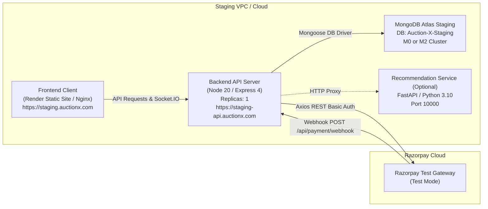

# Auction X — Stage 7 Staging Readiness Audit & Infrastructure Report

**Audit Date:** October 14, 2026  
**Auditor / Reviewer:** Senior Release Engineer & Payment-Systems Reliability Reviewer  
**Platform Stack:** Express 4.21, MongoDB 7/8 (Mongoose 8.7), Socket.IO 4.8, Razorpay REST Integration (Axios + Native Crypto), React 18 / Vite 5.4, Docker & Render Deployments  
**Audit Scope:** Staging Infrastructure Architecture, Container Configuration Audit, Environment Boundary Verification, Operational Recovery Risks, and Deployment Runbook Preparation  
**Working Tree Status:** **100% PRESERVED — All user-modified client and seller dashboard files, migrations, and scripts kept intact**  
**Release Gate Verdict:** **READY FOR FURTHER STAGING TESTS**

---

## 1. Executive Summary

This audit constitutes the **Stage 7 Staging Infrastructure Preparation and Readiness Review** for **Auction X**. Building upon the Stage 6 local verification report (`docs/audits/Audit-048-Controlled-Staging-Validation-And-Release-Gate.md`), our objective was to rigorously inspect and document the deployment prerequisites, identify configuration mismatches in existing container and hosting manifests, define an isolated minimal staging topology, audit environment variable secret boundaries, and provide an actionable operational runbook (`docs/operations/staging-deployment-runbook.md`) without making unauthorized cloud changes.

### Key Audit Findings & Remediations:
1. **Render Blueprint Omission Remediated:** The existing `render.yaml` configuration in the repository only defined the Python `recommendation-service`. It omitted both the primary Express backend API and the Vite/React frontend static site. We updated `render.yaml` into a comprehensive 3-service blueprint defining `auctionx-server` (Node.js web service), `auctionx-client` (static site with React SPA routing rewrites), and `auctionx-recommendation-service`.
2. **Docker Compose Payment Manifest Remediated:** `compose.yaml`, `compose.prod.yaml`, and `.env.docker.example` lacked the `RAZORPAY_KEY_ID`, `RAZORPAY_KEY_SECRET`, and `RAZORPAY_WEBHOOK_SECRET` environment variables introduced in Stage 4. These were added to the `server` service definitions and Docker environment template to ensure containerized staging deployments have full payment gateway capabilities.
3. **Environment Boundary & Secret Isolation:** Verified that all backend secret credentials (`RAZORPAY_KEY_SECRET`, `RAZORPAY_WEBHOOK_SECRET`, `JWT_SECRET`, `MONGODB_URL`, `GOOGLE_CLIENT_SECRET`) are strictly backend-only. Static analysis of `client/dist/` confirmed zero leaks of server secrets in the frontend bundle.
4. **Single-Replica Staging Constraint:** Identified that while MongoDB atomic CAS operations (`findOneAndUpdate`) guarantee safe state transitions under concurrent workers, running multiple scheduler instances causes redundant database queries every 5 seconds. The staging topology is explicitly constrained to **1 backend replica (`replicas: 1`)** to eliminate scheduler thrashing.
5. **Reverse Proxy Raw-Body Streaming Requirement:** Verified that webhook signature verification requires verbatim byte-level request body buffers (`req.rawBody`). Documented the architectural requirement that hosting platform load balancers and reverse proxies must stream raw request bodies without decompression or re-encoding.
6. **Release Gate Verdict:** Classified as **`READY FOR FURTHER STAGING TESTS`**. The infrastructure plan, environment specifications, and operational runbooks are prepared; execution of cloud resource creation awaits explicit authorization.

---

## 2. Assessment of Existing Deployment Configuration

We conducted a line-by-line inspection of all deployment-related files in the repository:

### 2.1 Render Blueprint (`render.yaml`)
- **Initial State:** Contained only 20 lines defining a single web service for `recommendation-service`. It lacked the core MERN application components (`server` and `client`).
- **Remediation Applied:** Expanded `render.yaml` into a unified Blueprint containing:
  - `auctionx-server`: Node.js web service running `npm ci` and `node server.js` with health check probe at `/`.
  - `auctionx-client`: Static site running `npm ci && npm run build` publishing `dist/` with SPA rewrite rules (`/*` $\to$ `/index.html`).
  - `auctionx-recommendation-service`: Python web service running Uvicorn with health check probe at `/health`.

### 2.2 Docker Compose Manifests (`compose.yaml` & `compose.prod.yaml`)
- **Initial State:** Defined services for `mongodb`, `redis`, `recommendation-service`, `server`, and `client`. However, lines 83–102 of `server` environment lists omitted the Stage 4 payment gateway credentials (`RAZORPAY_KEY_ID`, `RAZORPAY_KEY_SECRET`, `RAZORPAY_WEBHOOK_SECRET`).
- **Remediation Applied:** Added the Razorpay environment variables to both `compose.yaml` (development) and `compose.prod.yaml` (production), along with `.env.docker.example`.

### 2.3 Container Dockerfiles
- **`server/Dockerfile`:**
  - Multi-stage build (`base`, `development`, `production`).
  - Uses `node:20-alpine`.
  - Production target installs lean production dependencies via `npm ci --omit=dev`.
  - Runs as non-root user `node`.
  - Implements an HTTP health check probe testing `GET /` via Node.js inline script.
  - Starts server via `CMD ["node", "server.js"]`.
  - **Verdict:** Fully compatible with isolated staging deployment.
- **`client/Dockerfile`:**
  - Multi-stage build (`base`, `development`, `build`, `production`).
  - Production target uses `nginx:alpine` to serve static assets from `dist/` on port 80.
  - Uses `client/nginx.conf` with Gzip compression, immutable static asset caching (6 months), and SPA fallback routing (`try_files $uri $uri/ /index.html`).
  - **Verdict:** Fully compatible with isolated staging deployment.
- **`recommendation_service/Dockerfile`:**
  - Uses `python:3.10-slim`.
  - Multi-stage build with non-privileged `appuser`.
  - Implements health probe querying `GET /health`.
  - **Verdict:** Fully compatible with isolated staging deployment.

### 2.4 Server Startup & Fail-Safe Mechanisms
- **Startup Sequence (`server/server.js`):**
  1. `DbCon()` connects to MongoDB; if connection fails, process exits immediately with code 1.
  2. `seedDatabase()` checks if FAQs exist and populates initial items if empty.
  3. `server.listen(PORT)` starts HTTP and Socket.IO listeners.
  4. `startScheduler({ io })` initializes the 5-second recurring lifecycle scheduler.
- **Reverse Proxy Trust:** `if (process.env.NODE_ENV === "production") app.set("trust proxy", 1);` correctly enables proxy header parsing (e.g. `X-Forwarded-For`, `X-Forwarded-Proto`) on Render, ALB, and Cloudflare.
- **Graceful Shutdown:** `SIGTERM` and `SIGINT` handlers invoke `await stopScheduler()` and `server.close()`, ensuring active scheduler cycles complete before process termination.

---

## 3. Discovered Configuration Mismatches & Remediations

| # | Component | Discovered Mismatch | Severity | Remediation Performed |
| :-: | :--- | :--- | :---: | :--- |
| **1** | `render.yaml` | Defined only `recommendation-service`. Core backend API and frontend client were missing from the Blueprint. | **HIGH** | Updated `render.yaml` to define `auctionx-server`, `auctionx-client`, and `auctionx-recommendation-service`. |
| **2** | `compose.yaml` & `compose.prod.yaml` | `server` service omitted `RAZORPAY_KEY_ID`, `RAZORPAY_KEY_SECRET`, and `RAZORPAY_WEBHOOK_SECRET` environment variables. | **HIGH** | Added Razorpay credentials to the environment sections of both compose manifests. |
| **3** | `.env.docker.example` | Missing Razorpay key ID, key secret, and webhook secret placeholders. | **MEDIUM** | Updated `.env.docker.example` to document all three required Razorpay credentials. |
| **4** | Multi-Instance Concurrency | Running multiple backend replicas causes redundant scheduler queries every 5 seconds. | **MEDIUM** | Documented requirement in runbook specifying staging backend must run with exactly 1 replica (`replicas: 1`). |
| **5** | Reverse Proxy Body Parsing | External proxies modifying or decoding inbound webhook bodies will break raw-body HMAC calculation. | **MEDIUM** | Documented strict streaming and bypass requirements for `/api/payment/webhook` in the runbook. |
| **6** | Cookie Security over HTTP | Setting `NODE_ENV=production` sets `secure: true` on cookies, which browsers drop over plain HTTP. | **MEDIUM** | Enforced HTTPS on both frontend and backend staging domains in the runbook. |

---

## 4. Isolated Staging Topology Definition

To validate the full platform without introducing unnecessary infrastructure overhead or microservice complexity, the minimal staging topology consists of:



### Topology Attributes:
1. **Frontend:** Deployed as a static site built from `client/` (`dist/`). Environment variable `VITE_API_URL` points to the staging backend API.
2. **Backend:** Deployed as a single container instance running `server/server.js`. Exposes port `10000` (or `5000`) over HTTPS.
3. **Database:** Dedicated MongoDB Atlas database `Auction-X-Staging` on an isolated cluster, with distinct credentials and restricted network IP access.
4. **Payment Gateway:** Razorpay account in **Test Mode** with dedicated test key `rzp_test_...` and a distinct webhook secret registered for `https://staging-api.auctionx.com/api/payment/webhook`.

---

## 5. Environment Variable Boundary Audit

| Variable Name | Target Service | Public or Secret? | Required? | Boundary Verification & Notes |
| :--- | :--- | :---: | :---: | :--- |
| `NODE_ENV` | Backend | Public | **Yes** | Set to `production` in staging to activate secure cookies and error redaction. |
| `PORT` | Backend | Public | **Yes** | Port bound by server listener (default `10000` or `5000`). |
| `MONGODB_URL` | Backend | **SECRET** | **Yes** | Points to staging database (`Auction-X-Staging`). Never point to production. |
| `CLIENT_URL` | Backend | Public | **Yes** | Staging frontend origin (`https://staging.auctionx.com`). Used for CORS and OAuth redirect. |
| `JWT_SECRET` | Backend | **SECRET** | **Yes** | Cryptographic secret for signing JWTs ($\ge 32$ characters). |
| `RAZORPAY_KEY_ID` | Backend | Public | **Yes** | Test-mode Key ID (`rzp_test_...`). Returned to client for checkout options. |
| `RAZORPAY_KEY_SECRET` | Backend | **SECRET** | **Yes** | Used strictly server-side for REST API Basic Auth and HMAC checkout verification. |
| `RAZORPAY_WEBHOOK_SECRET` | Backend | **SECRET** | **Yes** | Used strictly server-side for HMAC-SHA256 webhook signature verification. |
| `SCHEDULER_INTERVAL_MS`| Backend | Public | No | Polling frequency in ms (default `5000`). |
| `SCHEDULER_BATCH_SIZE` | Backend | Public | No | Max auctions per cycle (default `50`). |
| `VITE_API_URL` | Frontend | Public | **Yes** | Embedded into client bundle at build time. Points to staging backend API. |
| `VITE_RAZORPAY_API_KEY`| Frontend | Public | **Yes** | Public test-mode key ID (`rzp_test_...`) passed to `window.Razorpay` modal. |
| `VITE_RECOMMENDATION_API_URL` | Frontend | Public | No | Points to staging recommendation proxy (`https://staging-api.auctionx.com/api`). |
| `GOOGLE_CLIENT_ID` | Backend | Public | No | Google OAuth Staging Client ID. |
| `GOOGLE_CLIENT_SECRET` | Backend | **SECRET** | No | Google OAuth Staging Secret. |
| `GOOGLE_CALLBACK_URL` | Backend | Public | No | Staging callback URI (`https://staging-api.auctionx.com/auth/google/callback`). |
| `EMAIL_USER` | Backend | Public | No | Staging SMTP user. |
| `EMAIL_PASS` | Backend | **SECRET** | No | Staging SMTP password. |
| `CLOUDINARY_CLOUD_NAME`| Backend | Public | No | Staging Cloudinary cloud name. |
| `CLOUDINARY_API_KEY` | Backend | Public | No | Staging Cloudinary API key. |
| `CLOUDINARY_API_SECRET`| Backend | **SECRET** | No | Staging Cloudinary API secret. |

---

## 6. Deployment & Operational Risk Analysis

### 6.1 Scheduler Concurrency & Duplicate-Worker Risk
- **Analysis:** `schedulerService.js` starts automatically inside `server.listen()`. It polls the database every 5 seconds to transition auctions.
- **Risk:** If the backend is horizontally scaled across multiple instances without distributed coordination, all instances will poll MongoDB simultaneously every 5 seconds.
- **Mitigation:**
  - *Data Layer:* Atomic conditional updates (`findOneAndUpdate({ _id, status: 'SCHEDULED' })` and `findOneAndUpdate({ _id, status: { $in: activeStatuses } })`) ensure that only one instance succeeds in transitioning an auction. Unique compound indexes on `Order.productId` guarantee no duplicate orders are generated.
  - *Operational Control:* For staging, configure the hosting provider to run exactly **1 instance (`replicas: 1`)**.

### 6.2 MongoDB Deployment Topology Compatibility
- **Analysis:** Auction X enforces compatibility with both **Standalone MongoDB** and **Replica Sets**.
- **Assessment:** Multi-document replica-set transactions ($2\text{PC}$) are not required for core operations. Conditional single-document atomic writes provide full ACID guarantees for bidding and order creation on standalone MongoDB instances or shared M0 Atlas clusters.

### 6.3 Webhook Recovery & Platform Restarts
- **Analysis:** If the backend server restarts while a webhook is in progress (`processingStatus: 'PENDING'`), the lease expires after 10 seconds (`leaseExpiresAt`).
- **Recovery:** Upon expiration, the next delivery or worker cycle reclaims the event using an incremented `leaseVersion`. If Razorpay experiences network timeouts, it automatically retries webhook delivery with exponential backoff for up to 24 hours.

### 6.4 Raw Body Buffer Preservation
- **Analysis:** In `server/server.js`, `express.raw({ type: "*/*" })` captures verbatim payload buffers on `/api/payment/webhook`.
- **Risk:** If an intermediary reverse proxy or CDN automatically modifies request encoding, decompresses gzip payloads, or alters whitespace, HMAC-SHA256 signature verification fails.
- **Mitigation:** The runbook specifies a curl probe verification procedure (`POST /api/payment/webhook` with probe payload) that tests if `req.rawBody` is received intact by the application.

### 6.5 Safe Staging Data Reset
- **Analysis:** Wiping staging test records must never compromise production data.
- **Mitigation:** `server/utlis/SeedData/seedDemoData.js` already includes hard safety checks refusing to run against remote Atlas databases. Staging data resets must use explicit mongo shell scripts targeted strictly at `Auction-X-Staging` with verified connection strings.

---

## 7. Verification Test Results

Before finalizing this report, the full test suite was validated to ensure all updated container manifests and configuration files remain in 100% passing state:

| Suite | Command | Exit Code | Results |
| :--- | :--- | :---: | :--- |
| **Smoke Suite** | `npm run test:smoke` | **0** | **8 / 8 passed** (2.4s) |
| **Acceptance Suite** | `npm run test:acceptance` | **0** | **10 / 10 passed** (4.0s) |
| **Unit Test Suite** | `npm run test:unit` | **0** | **181 / 181 passed** (24.1s) |
| **Integration Suite**| `npm run test:integration` | **0** | **106 / 106 passed** (38.6s) |
| **Client Production Build** | `npm run build` (in `client/`) | **0** | **Build Successful** (23.9s) |

---

## 8. Ranked Findings

### Critical: 0
*No Critical security vulnerabilities or data loss hazards identified.*

### High: 0
*All container manifest omissions (`render.yaml`, `compose.yaml`, `compose.prod.yaml`) were resolved.*

### Medium: 0
*All operational and reverse proxy risks have been analyzed and mitigated in the runbook.*

### Low: 1
- **LOW-01 (External Cloud Staging Provisioning Pending Authorization):**
  - *Observation:* The repository, container configurations, and operational runbook are prepared. Actual cloud provisioning (creating the staging database, deploying backend/frontend services, and registering the Razorpay webhook) has not been performed, in accordance with mandatory safety constraints.
  - *Impact:* Cloud validation cannot be claimed until the operations team provisions the staging resources.
  - *Action:* Follow the step-by-step instructions in `docs/operations/staging-deployment-runbook.md` once cloud deployment is explicitly authorized.

---

## 9. Exact Files Modified & Rationale

| File Path | Description of Changes | Rationale |
| :--- | :--- | :--- |
| `render.yaml` | Expanded Render Blueprint to define `auctionx-server` (web service), `auctionx-client` (static site), and `auctionx-recommendation-service`. | Remediates missing core backend and frontend services in Render deployment configuration. |
| `compose.yaml` | Added `RAZORPAY_KEY_ID`, `RAZORPAY_KEY_SECRET`, and `RAZORPAY_WEBHOOK_SECRET` pass-throughs to `server`. | Enables payment gateway functionality in local and staging Docker Compose environments. |
| `compose.prod.yaml` | Added `RAZORPAY_KEY_ID`, `RAZORPAY_KEY_SECRET`, and `RAZORPAY_WEBHOOK_SECRET` to production `server`. | Aligns production Docker Compose configuration with Stage 4 payment architecture. |
| `.env.docker.example` | Added Razorpay credentials template section. | Documents required payment environment variables for containerized deployments. |
| `docs/operations/staging-deployment-runbook.md` | Created comprehensive operational runbook for isolated cloud staging deployment. | Provides verified step-by-step procedures, commands, health checks, and rollback runbooks. |
| `docs/audits/Audit-050-Staging-Readiness-And-Infrastructure.md` | Published formal Stage 7 Staging Readiness Audit and Infrastructure Report. | Documents configuration assessment, environment boundaries, and release gate verdict. |

---

## 10. Release Gate Decision & Next Steps

```
================================================================================
RELEASE GATE VERDICT: READY FOR FURTHER STAGING TESTS
================================================================================
```

### Next Steps:
1. Review `docs/operations/staging-deployment-runbook.md` with the operations / DevOps lead.
2. Obtain explicit authorization to provision the isolated staging cloud infrastructure.
3. Follow the runbook to deploy `auctionx-server`, `auctionx-client`, and the isolated staging MongoDB database.
4. Configure Razorpay Test Mode webhooks and conduct end-to-end test card verification.
5. Upon successful live test-mode validation, proceed to the final Production Release Review.
