# Stage 7.24 — KYC Upload Threat Model and Secure Architecture Proposal

**Execution Date:** October 19, 2026  
**Auditor:** Antigravity Agentic Security & Compliance Subagent  
**Scope:** Client onboarding upload flows, server profile update endpoints, Mongoose models, threat modeling, architecture option evaluation, and migration planning  
**Repository:** `D:\THE OMS DEVS\WEB DEVS\MERN PROJECTS\PCMT\SEM 6\OMS\Auction X ✅`  
**Target Public Repository:** `https://github.com/OmSardar/AuctionX-Enhanced-Live-AI-Auction-Platform.git`  
**Conclusion Status:** `KYC ARCHITECTURE PROPOSAL COMPLETE — IMPLEMENTATION AWAITS OWNER APPROVAL`  
**Release Readiness Gate:** `PUBLIC RELEASE STILL BLOCKED`

---

## 1. Executive Summary

During Stages 7.20 through 7.23, an unsigned Cloudinary upload endpoint in `VerifyProfilePage.jsx` and `VerifySellerProfilePage.jsx` was flagged as a critical security release blocker. Historical documentation hypothesized that this endpoint facilitated direct, unauthenticated uploads of government identification documents (e.g., Aadhaar, Passports, Driving Licenses).

Stage 7.24 executed an exhaustive code-level investigation tracing the complete upload and update sequence across client components, server routes, middleware pipelines, controller handlers, database models, and marketing/compliance text.

### Key Discoveries from Code Analysis:
1. **The "KYC" Misnomer vs. Actual Implementation:**
   - The file upload inputs in both [`VerifyProfilePage.jsx:598`](file:///d:/THE%20OMS%20DEVS/WEB%20DEVS/MERN%20PROJECTS/PCMT/SEM%206/OMS/Auction%20X%20%E2%9C%85/client/src/pages/User/UserLogin/VerifyProfilePage.jsx#L598) and [`VerifySellerProfilePage.jsx:610`](file:///d:/THE%20OMS%20DEVS/WEB%20DEVS/MERN%20PROJECTS/PCMT/SEM%206/OMS/Auction%20X%20%E2%9C%85/client/src/pages/User/UserLogin/VerifySellerProfilePage.jsx#L610) are explicitly labeled **"Profile Picture"**, accept `accept="image/*"`, and render within circular avatar preview containers (`h-12 w-12 rounded-full`).
   - The Mongoose models ([`UserModel`](file:///d:/THE%20OMS%20DEVS/WEB%20DEVS/MERN%20PROJECTS/PCMT/SEM%206/OMS/Auction%20X%20%E2%9C%85/server/models/LoginSchema/user.js#L77-L82) and [`SellerModel`](file:///d:/THE%20OMS%20DEVS/WEB%20DEVS/MERN%20PROJECTS/PCMT/SEM%206/OMS/Auction%20X%20%E2%9C%85/server/models/LoginSchema/seller.js#L37-L42)) store this uploaded image strictly under `profilePic` and `selectedAvatar`. Neither schema contains fields for government ID numbers, identity document scans, tax certificates, or KYC compliance records.
   - The pages are named "VerifyProfile" because they represent initial user onboarding where unverified users (`isVerified: false`) complete profile registration and proceed immediately to **email OTP verification** ([`OTPverification.jsx`](file:///d:/THE%20OMS%20DEVS/WEB%20DEVS/MERN%20PROJECTS/PCMT/SEM%206/OMS/Auction%20X%20%E2%9C%85/client/src/pages/User/UserLogin/OTPverification.jsx)).
2. **The Marketing Claim Discrepancy:**
   - Platform marketing copy ([`FAQ.jsx:35`](file:///d:/THE%20OMS%20DEVS/WEB%20DEVS/MERN%20PROJECTS/PCMT/SEM%206/OMS/Auction%20X%20%E2%9C%85/client/src/components/Layouts/Footer/Help/FAQ/FAQ.jsx#L35) and [`seedData.js:504`](file:///d:/THE%20OMS%20DEVS/WEB%20DEVS/MERN%20PROJECTS/PCMT/SEM%206/OMS/Auction%20X%20%E2%9C%85/server/utlis/SeedData/seedData.js#L504)) claims that sellers must submit "ID proof, address proof, and PAN/GST details" reviewed by a "compliance team within 24 to 48 hours."
   - In actual code, no government ID collection, document upload form, or manual admin compliance review queue exists. Verification status `isVerified: true` is granted automatically upon submitting a valid 6-digit email OTP.
3. **The Actual Security Vulnerability:**
   - While genuine government documents are not currently collected or stored, the upload mechanism in both pages uses **unauthenticated, unsigned direct uploads to Cloudinary** (`https://api.cloudinary.com/v1_1/dszvpb3q5/image/upload`) using preset `product_image`.
   - Any external entity can post arbitrary files to Cloudinary cloud `dszvpb3q5` without authentication, bypassing backend validation, rate limiting, and authorization, risking storage quota exhaustion, content injection, and financial denial-of-wallet.
   - If users upload personal identity documents under the mistaken impression that "Verify Your Profile" requires identity proof, those images are delivered through a public Cloudinary CDN without access control.

---

## 2. Workstream A — Current Behavior & Code Trace

### 2.1 Trace of User & Seller Verification Flows

```mermaid
sequenceDiagram
    autonumber
    actor User as User / Seller Browser
    participant Cloudinary as Cloudinary API (dszvpb3q5)
    participant Server as AuctionX Express Backend
    participant DB as MongoDB (UserModel / SellerModel)
    participant Email as Email / Nodemailer Service

    Note over User,Server: Stage 1: Onboarding Form (VerifyProfilePage)
    User->>User: Selects profile image (accept="image/*")
    User->>Cloudinary: POST /v1_1/dszvpb3q5/image/upload<br/>(upload_preset="product_image", file=Blob)<br/>[NO AUTH / NO BACKEND INVOLVEMENT]
    Cloudinary-->>User: 200 OK { secure_url, public_id }
    
    Note over User,Server: Stage 2: Profile Update
    User->>Server: PATCH /api/auth/{user|seller}/updateProfile<br/>Headers: X-CSRF-Token, Cookie: token<br/>Body: { address, phoneNo, city, profilePic: [{ secure_url, public_id }] }
    Server->>Server: IsUser / IsSeller JWT Middleware (authenticates session)
    Server->>DB: findByIdAndUpdate(userId, { $set: updateFields })<br/>[Stores profilePic & selectedAvatar; isVerified remains false]
    DB-->>Server: Updated document
    Server-->>User: 200 OK { user, profilePic }

    Note over User,Email: Stage 3: Email OTP Verification
    User->>Server: POST /api/auth/{user|seller}/send-otp { email }
    Server->>Email: Generates 6-digit OTP & sends email
    Server-->>User: 200 OK (Navigates to /OTPverification)
    User->>Server: POST /api/auth/{user|seller}/verify-otp { email, otp }
    Server->>DB: findOneAndUpdate({ email }, { isVerified: true })
    DB-->>Server: Updated user
    Server-->>User: 200 OK { isVerified: true }
```

### 2.2 Verification Against Codebase Evidence

| Question | Code Evidence / Finding | Classification |
| :--- | :--- | :--- |
| **1. Avatar vs. ID Document** | Labeled `"Profile Picture"` in [`VerifyProfilePage.jsx:598`](file:///d:/THE%20OMS%20DEVS/WEB%20DEVS/MERN%20PROJECTS/PCMT/SEM%206/OMS/Auction%20X%20%E2%9C%85/client/src/pages/User/UserLogin/VerifyProfilePage.jsx#L598) and [`VerifySellerProfilePage.jsx:610`](file:///d:/THE%20OMS%20DEVS/WEB%20DEVS/MERN%20PROJECTS/PCMT/SEM%206/OMS/Auction%20X%20%E2%9C%85/client/src/pages/User/UserLogin/VerifySellerProfilePage.jsx#L610). Input has `accept="image/*"`, rendered in circular avatar thumbnail `h-12 w-12 rounded-full`. | **Confirmed Fact** (Avatar only) |
| **2. Storage Target Field** | Controllers ([`UserVerificationController.js:185`](file:///d:/THE%20OMS%20DEVS/WEB%20DEVS/MERN%20PROJECTS/PCMT/SEM%206/OMS/Auction%20X%20%E2%9C%85/server/controllers/LoginControllers/UserLoginController/UserVerificationController.js#L185) and [`SellerVerificationController.js:181`](file:///d:/THE%20OMS%20DEVS/WEB%20DEVS/MERN%20PROJECTS/PCMT/SEM%206/OMS/Auction%20X%20%E2%9C%85/server/controllers/LoginControllers/SellerLoginController/SellerVerificationController.js#L181)) store URL in `updateFields.profilePic` and `updateFields.selectedAvatar`. No document fields exist in schemas. | **Confirmed Fact** (`profilePic` / `selectedAvatar`) |
| **3. Public Exposure** | Endpoint `GET /api/auth/profile-pic?email=...` ([`UserAuthRoutes.js:180`](file:///d:/THE%20OMS%20DEVS/WEB%20DEVS/MERN%20PROJECTS/PCMT/SEM%206/OMS/Auction%20X%20%E2%9C%85/server/routes/LoginRoutes/UserAuthRoutes.js#L180)) returns profilePic URL without requiring authentication. Public profile endpoint `GET /api/auth/getUserByEmail/:email` ([`UserProfileController.js:28`](file:///d:/THE%20OMS%20DEVS/WEB%20DEVS/MERN%20PROJECTS/PCMT/SEM%206/OMS/Auction%20X%20%E2%9C%85/server/controllers/LoginControllers/UserLoginController/UserProfileController.js#L28)) exposes profilePic publicly to all clients. | **Confirmed Fact** (Publicly exposed by design for avatars) |
| **4. Verification Status Update** | `updateProfile` does NOT alter `isVerified`. Verification status (`isVerified: true`) is updated exclusively in `verifyOtp` ([`UserVerificationController.js:321`](file:///d:/THE%20OMS%20DEVS/WEB%20DEVS/MERN%20PROJECTS/PCMT/SEM%206/OMS/Auction%20X%20%E2%9C%85/server/controllers/LoginControllers/UserLoginController/UserVerificationController.js#L321)) upon validating an email OTP. For sellers, admins can also toggle `isVerified: true` via `PATCH /api/sellers/:id/verify`. | **Confirmed Fact** (Email OTP authorization, not document review) |
| **5. Upload Controls & Limits** | The direct upload (`axios.post("https://api.cloudinary.com/v1_1/dszvpb3q5/image/upload", ...)`) includes zero JWT headers, zero session cookies, zero server-side MIME checks, zero magic byte inspection, and zero AuctionX backend rate limits. | **Confirmed Fact** (Completely unauthenticated & uncontrolled) |
| **6. Existing Backend Upload Route** | Backend route `POST /api/auth/user/upload-profile-pic` ([`UserAuthRoutes.js:200`](file:///d:/THE%20OMS%20DEVS/WEB%20DEVS/MERN%20PROJECTS/PCMT/SEM%206/OMS/Auction%20X%20%E2%9C%85/server/routes/LoginRoutes/UserAuthRoutes.js#L200)) is authenticated (`authUserMiddleware`), enforces Multer disk validation (5MB max, JPEG/PNG/WEBP), and applies Cloudinary facial crop transformation `{ width: 300, height: 300, crop: "fill", gravity: "face" }`. | **Confirmed Fact** (Private, authenticated route exists for avatars) |
| **7. Live Cloudinary Preset Configuration** | The upload preset `"product_image"` is invoked without signature or API secret, which only succeeds on Cloudinary if configured as "unsigned" in the dashboard. However, account-level storage limits, allowed resource types, and transformation restrictions on `dszvpb3q5` cannot be inspected from the Git repository. | **Separation:** Unsigned invocation is **Confirmed Fact**; specific dashboard policies are **Unknown External Config** |

---

## 3. Workstream B — Comprehensive Threat Model

### 3.1 Threat Assessment Matrix

| Threat ID | Threat Category | Code Path | Preconditions & Impact | Existing Mitigations | Missing Controls | Proposed Verification Test |
| :--- | :--- | :--- | :--- | :--- | :--- | :--- |
| **TM-01** | **Unauthenticated Storage Abuse & Denial-of-Wallet** | `VerifyProfilePage.jsx:270`, `VerifySellerProfilePage.jsx:280` | **Precondition:** Attacker discovers cloud name `dszvpb3q5` and preset `product_image`.<br/>**Impact:** Automated scripts upload massive volumes of data directly to Cloudinary, exhausting free/paid bandwidth and storage quotas, causing denial of service for legitimate auction images. | None. Direct browser POST bypasses all backend controls. | Server-side mediation, client upload signature verification, per-user upload quotas, IP rate limiting. | `test("rejects direct unauthenticated POST without valid backend signature")` |
| **TM-02** | **Content Validation Bypass (Malicious Executables / HTML)** | `VerifyProfilePage.jsx:265-272` | **Precondition:** Attacker crafts multipart POST with HTML/SVG containing XSS payloads or executable binaries disguised as images.<br/>**Impact:** If Cloudinary serves file with `text/html` or raw delivery, stored XSS or malware hosting on trusted domain occurs. | Client-side `accept="image/*"` attribute (easily bypassed via curl/script). | Server-side MIME validation, magic-byte inspection (`file-type` header check), SVG sanitization/rasterization. | `test("rejects upload of HTML/SVG containing script tags disguised as JPEG")` |
| **TM-03** | **Unintended Public Exposure of Sensitive User Data** | `VerifyProfilePage.jsx:284`, `UserProfileController.js:80` | **Precondition:** User mistakenly uploads an Aadhaar card, driver's license, or utility bill in the "Verify Profile" step.<br/>**Impact:** Document is stored in public Cloudinary bucket with public CDN URL; URL is returned to any caller via `GET /api/auth/profile-pic?email=...`. | UI shows circular avatar preview to signal portrait photo. | Clear UI disclaimers ("Do NOT upload government IDs"), or dedicated private storage bucket if true KYC is introduced. | `test("confirms profilePic URLs are not indexed or publicly queryable if marked confidential")` |
| **TM-04** | **Arbitrary Image Overwrite / IDOR in Profile Update** | `UserVerificationController.js:185`, `UserAuthRoutes.js:186` | **Precondition:** Authenticated user submits `PATCH /updateProfile` with arbitrary `public_id` or external `secure_url` belonging to another user or malicious source.<br/>**Impact:** Attacker associates inappropriate or copyrighted third-party Cloudinary assets with their account or injects malicious URLs into database. | Route requires `IsUser` JWT authentication. Server inspects user ID from `req.user._id`. | Server verification that the uploaded asset was genuinely uploaded by the authenticated user session. | `test("verifies uploaded public_id belongs to the calling user session before saving")` |
| **TM-05** | **Cross-Role Authorization Bypass (User vs. Seller Profile Update)** | `UserAuthRoutes.js:186`, `SellerAuthRoutes.js:196` | **Precondition:** Standard user tokens sent to seller update endpoints or vice versa.<br/>**Impact:** Normal user gaining seller profile attributes (`storeName`, `storeDescription`) without completing seller onboarding. | `IsUser` verifies `role === "user"` or `role === "admin"`; `IsSeller` verifies seller token. | Strict role validation on model update targets. | `test("ensures normal user JWT cannot invoke /api/auth/seller/updateProfile")` |
| **TM-06** | **Orphaned Storage Garbage Accumulation** | `VerifyProfilePage.jsx:270`, `UserVerificationController.js:190` | **Precondition:** User selects file, Cloudinary upload succeeds, but user abandons page or backend `PATCH /updateProfile` fails validation.<br/>**Impact:** Abandoned images remain permanently stored in Cloudinary without database references, leaking storage costs over time. | None in verification flow. (`UserProfileController.js:259` deletes old images only on successful `/upload-profile-pic`). | Two-phase commit, temporary upload staging with auto-expiration (e.g. 24-hour lifecycle rules), or backend-mediated transactional cleanup. | `test("cleans up or expires staged files if profile update transaction fails")` |
| **TM-07** | **Absence of Audit Trail for Identity Verification** | `UserVerificationController.js:321` | **Precondition:** Compliance audit or dispute requires proof of when and how a seller was verified.<br/>**Impact:** `isVerified` is a bare boolean flag in MongoDB. No timestamp, IP address, verification method, or compliance officer ID is logged. | Basic console logging. | Verification audit log collection (`VerificationAudit` schema storing timestamp, IP, verificationType, adminId, result). | `test("creates immutable audit log entry whenever isVerified transitions to true")` |

---

## 4. Workstream C — Secure Architecture Options Comparison

### 4.1 Architecture Options Evaluated

```mermaid
graph TD
    subgraph "Option A: Private S3-Compatible Object Storage"
        A1[Client Request] -->|1. Request Presigned PUT| A2[Express Backend: Authenticated]
        A2 -->|2. Generate Presigned URL| A1
        A1 -->|3. Direct PUT Encrypted| A3[Private S3 Bucket KMS]
        A1 -->|4. Confirm Upload| A2
        A2 -->|5. Verify & Save Ref| A4[(MongoDB)]
        A5[Admin KYC Viewer] -->|Request View| A2
        A2 -->|Generate 5-min GET URL| A5
    end

    subgraph "Option B: Authenticated Server-Mediated Upload (Recommended for Avatars)"
        B1[Client Form] -->|1. Multipart POST| B2[Express Backend: Multer & File-Type]
        B2 -->|2. Magic Byte & Size Check| B2
        B2 -->|3. Server-to-Cloud Upload| B3[Cloudinary / S3 Private]
        B2 -->|4. Atomic DB Update| B4[(MongoDB)]
        B2 -->|5. Return User Data| B1
    end

    subgraph "Option C: Cloudinary Signed / Authenticated Uploads"
        C1[Client Form] -->|1. Request Upload Signature| C2[Express Backend: api_secret]
        C2 -->|2. Return Signature & Timestamp| C1
        C1 -->|3. POST with Signature| C3[Cloudinary: Authenticated Asset]
        C1 -->|4. Update Profile| C2
        C2 -->|5. Save Ref| C4[(MongoDB)]
    end
```



### 4.2 Comprehensive Comparative Evaluation Matrix

| Evaluation Criteria | Option A: Private S3-Compatible Store (AWS S3 / Cloudflare R2 / MinIO) | Option B: Authenticated Server-Mediated Upload (Express + Multer + Storage) | Option C: Cloudinary Signed / Authenticated Delivery |
| :--- | :--- | :--- | :--- |
| **Security & Authorization Model** | **Industry Gold Standard for KYC:** Bucket has public access blocked (`BlockPublicAcls`). Server-side encryption with AWS KMS. Access granted only via short-lived (e.g., 5-minute) presigned GET URLs issued to authenticated admins. | **Robust for Avatars & Small Documents:** Client never communicates with storage directly. Backend enforces JWT authentication, CSRF validation, strict file size limits, and magic-byte inspection before forwarding to storage. | **Medium Security:** Requires server-generated cryptographic signature (`api_secret`) passed to client. Uses Cloudinary `type: "authenticated"` or `type: "private"`. Requires token-based delivery URLs (`cloudinary.url(..., { sign_url: true })`). |
| **Required Backend Changes** | High: Add AWS SDK v3 (`@aws-sdk/client-s3`), presigned URL generator endpoints, admin document viewing routes, and KMS configuration. | **Low to Medium:** Reuses existing Multer and storage infrastructure in `server/middleware/Media/ImageUpload.js`. Unify `VerifyProfilePage` with `uploadProfilePicture`. | Medium: Add signature endpoint `GET /api/auth/cloudinary-sign` using `cloudinary.utils.api_sign_request`. Update delivery logic to sign all served URLs. |
| **Required Frontend Changes** | Medium: Implement two-step presigned URL fetch and direct S3 `PUT` with binary payload. | **Minimal:** Point `VerifyProfilePage` and `VerifySellerProfilePage` file upload to backend `POST /api/auth/user/upload-profile-pic`. | Low to Medium: Request signature from backend before initiating direct Cloudinary POST. |
| **Storage & Delivery Costs** | Low: S3/R2 storage costs are minimal (~$0.015/GB/mo). No transformation charges. Zero egress cost with Cloudflare R2. | Low: Storage cost depends on backend destination. Minimal server memory/bandwidth overhead for 300x300 avatar images. | High / Variable: Cloudinary pricing scales on "transformation credits" and plan tier. Advanced authenticated delivery may require paid tier. |
| **Operational Complexity** | Medium: Requires provisioning S3 bucket, IAM role, KMS keys, and lifecycle rules. | **Lowest:** Runs entirely within existing Node.js server environment and current configuration. | High: Dependent on Cloudinary plan features, account tier, and dashboard settings. |
| **Private Access & Deletion** | Excellent: Native AWS IAM policies, KMS encryption, bucket lifecycle auto-deletion after statutory retention period (e.g., 5 years). | Good: Server manages storage deletion directly via SDK calls. | Complex: Deleting authenticated assets requires signed API calls; token expiration configuration required on dashboard. |
| **Migration Implications** | Existing public avatar URLs remain on Cloudinary or migrate cleanly. Clean separation between avatar and KYC storage. | **Zero Migration Risk:** Current avatar URLs continue to function normally. Profile images use existing folder structure. | Risky: Converting existing assets to authenticated delivery breaks any component referencing raw `res.cloudinary.com` URLs without signature logic. |
| **Risks to Existing Avatars** | None. Completely isolated from public avatars. | **None.** Preserves current avatar selection, preview, and display behaviors across the entire application. | **High Risk:** Could break avatar rendering in Navbar, SellerPage, and Reviews if signature tokens expire. |

### 4.3 Architecture Recommendation

- **For Current Codebase (Avatar / Profile Image Uploads):**
  **Adopt Option B (Authenticated Server-Mediated Upload).**
  The current upload in `VerifyProfilePage` and `VerifySellerProfilePage` is demonstrably a profile avatar, not an identity document. The backend ALREADY possesses an authenticated, validated avatar upload route ([`POST /api/auth/user/upload-profile-pic`](file:///d:/THE%20OMS%20DEVS/WEB%20DEVS/MERN%20PROJECTS/PCMT/SEM%206/OMS/Auction%20X%20%E2%9C%85/server/routes/LoginRoutes/UserAuthRoutes.js#L200)) equipped with `authUserMiddleware`, Multer 5MB limits, JPEG/PNG/WEBP filtering, and automatic old-avatar cleanup. Routing the verification form's avatar upload through this backend endpoint immediately eliminates the unsigned direct Cloudinary upload without introducing new infrastructure dependencies or risking regression.

- **For Future Compliance (If Genuine KYC Documents are Required):**
  **Adopt Option A (Private S3-Compatible Object Storage).**
  If the platform owner decides to implement real KYC identity verification as advertised in the FAQ (ID proof, address proof, PAN/GST), government documents MUST NOT be stored on Cloudinary or served publicly. They must reside in an encrypted, private S3/R2 bucket with zero public access, accessible only via time-limited presigned URLs generated for authorized compliance administrators.

---

## 5. Workstream D — Separation of Avatars from Identity Verification

### 5.1 Analysis of Business Intent vs. Code Reality

The investigation reveals a fundamental divergence between the product's marketing claims and its actual implementation:

1. **Marketing & Help Text:**
   - [`client/src/components/Layouts/Footer/Help/FAQ/FAQ.jsx:35`](file:///d:/THE%20OMS%20DEVS/WEB%20DEVS/MERN%20PROJECTS/PCMT/SEM%206/OMS/Auction%20X%20%E2%9C%85/client/src/components/Layouts/Footer/Help/FAQ/FAQ.jsx#L35):
     > *"To list lots, navigate to 'Become a Seller' and complete our KYC verification. You must submit valid government identification, address proof, and tax details. Our compliance team reviews seller submissions within 24 to 48 hours."*
   - [`server/utlis/SeedData/seedData.js:504`](file:///d:/THE%20OMS%20DEVS/WEB%20DEVS/MERN%20PROJECTS/PCMT/SEM%206/OMS/Auction%20X%20%E2%9C%85/server/utlis/SeedData/seedData.js#L504):
     > *"Submit your KYC documents through the 'Become a Seller' page, including ID proof, address proof, and PAN/GST details."*
2. **Actual Code Implementation:**
   - The form in [`VerifySellerProfilePage.jsx`](file:///d:/THE%20OMS%20DEVS/WEB%20DEVS/MERN%20PROJECTS/PCMT/SEM%206/OMS/Auction%20X%20%E2%9C%85/client/src/pages/User/UserLogin/VerifySellerProfilePage.jsx) asks only for Name, Address, Phone, Store Name, Store Description, and a **Profile Picture**.
   - No file inputs exist for ID proof, address proof, or tax documents.
   - No database schema exists for holding documents.
   - No compliance review queue exists. Verification is completed immediately via email OTP.

### 5.2 Two Clearly Separated Architecture Paths

```
                     ┌────────────────────────────────────────────────────────┐
                     │              OWNER ARCHITECTURAL DECISION              │
                     └──────────────────────────┬─────────────────────────────┘
                                                │
                 ┌──────────────────────────────┴──────────────────────────────┐
                 ▼                                                             ▼
   ┌───────────────────────────┐                                 ┌───────────────────────────┐
   │          PATH 1           │                                 │          PATH 2           │
   │   Profile Onboarding &    │                                 │  Genuine Identity & KYC   │
   │      Avatar Upload        │                                 │    Document Collection    │
   │    (Current Reality)      │                                 │    (Marketing Promise)    │
   └─────────────┬─────────────┘                                 └─────────────┬─────────────┘
                 │                                                             │
   • Eliminate unsigned Cloudinary upload                         • Implement dedicated KYC schema
   • Route file through authenticated backend                     • Private S3/R2 storage with KMS
   • Validate size, MIME, magic bytes                            • Zero public CDN delivery
   • Treat asset as public avatar                                • Manual compliance review queue
   • Update marketing copy to remove false KYC claims            • Retention & GDPR deletion rules
```

#### Path 1: Profile Onboarding & Avatar Upload (Immediate Code Rectification)
- **Use Case:** AuctionX operates as a community marketplace where identity is validated via email OTP and mobile phone verification, while user avatars provide social presence.
- **Remediation:**
  1. Remove the direct Cloudinary upload from `VerifyProfilePage.jsx` and `VerifySellerProfilePage.jsx`.
  2. Send the file to `POST /api/auth/user/upload-profile-pic` (or include multipart form data directly in the profile update).
  3. Validate MIME type and magic bytes on the server.
  4. Align marketing and FAQ text to accurately describe email/phone verification rather than claiming uncollected government ID checks.

#### Path 2: Genuine Identity & KYC Verification (New Feature Implementation)
- **Use Case:** AuctionX legally requires formal KYC compliance (Aadhaar/PAN/Passport) for high-value auction lots and seller payouts under financial regulations.
- **Requirements:**
  1. Create a dedicated `KycDocument` model (storing `documentType`, `encryptedStorageKey`, `verificationStatus: 'pending'|'approved'|'rejected'`, `submittedAt`, `reviewedBy`, `rejectionReason`).
  2. Store documents exclusively in a private S3/R2 bucket with zero public delivery.
  3. Deliver documents to admin compliance officers via 5-minute presigned GET URLs after validating admin role.
  4. Implement an audit log for all document views and approval decisions.
  5. Establish data retention and cryptographic deletion policies compliant with DPDP / GDPR.

---

## 6. Workstream E — Implementation Plan & Acceptance Criteria

### 6.1 Ordered Implementation Stages

```
Stage 1: Owner Decision & Policy Approval
  ├── Decide between Path 1 (Avatar-only) or Path 2 (Genuine KYC)
  └── Approve storage provider and data retention rules

Stage 2: Server-Side Authentication & Endpoint Unification
  ├── Deprecate direct browser Cloudinary calls in client verification pages
  └── Route onboarding uploads through authenticated backend middleware

Stage 3: Strict File Type & Signature Validation
  ├── Validate MIME type using multer fileFilter
  └── Validate file magic bytes using 'file-type' library (reject polyglots & disguised scripts)

Stage 4: Upload Size & Rate Limits
  ├── Enforce strict 5MB maximum file size limit
  └── Apply dedicated multer upload rate limiter (e.g., max 10 uploads per IP/user per hour)

Stage 5: Secure Storage & Delivery Isolation
  ├── For avatars: store in organized Cloudinary folder with face crop
  └── For KYC (if approved): store in private S3 bucket with KMS encryption and presigned URLs

Stage 6: Safe Database Persistence & Error Handling
  ├── Atomic update of user profile fields
  └── Automatic rollback/deletion of uploaded assets if DB transaction fails

Stage 7: Storage Cleanup & Orphan Remediation
  └── Delete superseded avatar assets from Cloudinary when new avatars are uploaded

Stage 8: Security Audit Logging (Redacted Payloads)
  ├── Log upload attempts, user IDs, timestamps, and IP addresses
  └── Never log file content, tokens, or personal identity details

Stage 9: Automated Security & Regression Test Suite
  ├── Test upload rejection for unauthorized users
  ├── Test rejection of non-image MIME types and invalid magic bytes
  └── Verify existing profile update and OTP verification flows remain unbroken

Stage 10: Operational Rollback & Production Verification
  ├── Verify clean compilation under Vite production build
  └── Maintain rollback plan to previous profile update route if required
```

### 6.2 Objectively Testable Acceptance Criteria

| ID | Category | Acceptance Criterion | Test Verification Method |
| :--- | :--- | :--- | :--- |
| **AC-01** | **Direct Upload Elimination** | Zero occurrences of `api.cloudinary.com` or `upload_preset` in client-side code. | Static code scan (`grep_search`) across `client/src/`. |
| **AC-02** | **Authentication Gate** | All file upload endpoints return HTTP 401 Unauthorized when invoked without a valid session cookie or JWT Bearer token. | Integration test: `POST /api/auth/user/upload-profile-pic` without auth header. |
| **AC-03** | **Magic Byte Validation** | A file with extension `.jpg` but containing HTML/JavaScript or executable binaries is rejected with HTTP 400 Bad Request. | Integration test: upload polyglot file; assert `400 "Invalid file signature"`. |
| **AC-04** | **Size Limit Enforcement** | Any upload payload exceeding 5MB is rejected with HTTP 413 Payload Too Large before processing. | Integration test: stream 6MB dummy file; assert HTTP 413 or Multer `LIMIT_FILE_SIZE`. |
| **AC-05** | **Rate Limit Protection** | More than 10 upload requests within 15 minutes from the same user/IP are throttled with HTTP 429 Too Many Requests. | Integration test: loop 12 rapid uploads; assert HTTP 429 on 11th request. |
| **AC-06** | **State Integrity** | User verification state `isVerified` cannot be toggled to `true` via any profile update or image upload endpoint. | Integration test: `PATCH /updateProfile` with body `{ isVerified: true }`; assert field is ignored. |
| **AC-07** | **Avatar Behavior Preservation** | Existing user profile picture updates, avatar previews, circular crops, and display in Navbar and Dashboard remain 100% functional. | Regression test suite + manual verification in `ProfilePage` and `Navbar`. |
| **AC-08** | **Orphan Prevention** | When a user replaces an existing custom avatar, the previous Cloudinary asset is safely destroyed via `uploader.destroy`. | Unit test with mocked Cloudinary `uploader.destroy`. |
| **AC-09** | **Audit Trail** | Upload transactions generate audit log entries containing `{ timestamp, userId, action, ip, status }` with zero PII or credentials. | Unit test inspecting audit logger output. |
| **AC-10** | **Build & Diff Cleanliness** | Client builds with exit code 0 (`npm run build --prefix client`) and `git diff --check` passes with zero errors. | Automated build and git check commands. |

---

## 7. Assumptions & Owner Decisions Required

Before implementing any code changes for Stage 7.25, the repository owner must provide explicit decisions on the following questions:

1. **Owner Decision 1: Business Identity Model (Path 1 vs. Path 2):**
   - Does AuctionX intend to operate purely with **Profile Onboarding + Email OTP Verification** (Path 1), or does the business require **Formal Government KYC Document Collection** (Path 2)?
   - *Recommendation:* If Path 1, align marketing copy to reflect actual OTP verification and remediate the avatar upload via backend Route B. If Path 2, schedule a separate architectural stage to provision private S3/R2 storage and build an admin compliance review portal.
2. **Owner Decision 2: Cloudinary Account Configuration:**
   - Can the owner verify whether preset `"product_image"` on Cloudinary cloud `dszvpb3q5` has restricted upload settings, or should it be permanently disabled in favor of backend-only signed uploads?
   - *Recommendation:* Transition all media uploads to backend-mediated authenticated uploads, then delete or restrict the unsigned preset on Cloudinary.
3. **Owner Decision 3: Marketing Text Reconciliation:**
   - Does the owner authorize correcting the false compliance claims in [`FAQ.jsx`](file:///d:/THE%20OMS%20DEVS/WEB%20DEVS/MERN%20PROJECTS/PCMT/SEM%206/OMS/Auction%20X%20%E2%9C%85/client/src/components/Layouts/Footer/Help/FAQ/FAQ.jsx#L35) and [`OurStory.jsx`](file:///d:/THE%20OMS%20DEVS/WEB%20DEVS/MERN%20PROJECTS/PCMT/SEM%206/OMS/Auction%20X%20%E2%9C%85/client/src/components/Layouts/Footer/AboutUs/OurStory/OurStory.jsx#L86) to match the platform's actual automated OTP verification workflow?

---

## 8. Non-Destructive Verification Results

### 8.1 Repository Safety & Integrity Check

- **`git diff --check` Execution:** Completed with exit code 0 (no merge conflict markers, whitespace corruption, or syntax errors).
- **Staged Documentation Renames:** Exactly 27 staged renames preserved untouched in Git index (`git diff --cached --name-status`).
- **Quarantined Asset Verification:** All 22 quarantined binary files remain physically present on disk.
- **Banner4 SVGs:** All 6 original Banner4 SVG assets remain intact.
- **Zero Mutating Changes:** No application code was altered; no endpoints were added; no database connections were opened; no live remote calls were made.

---

## 9. Conclusion & Release Gate Status

The threat model, current flow analysis, and architecture proposal for the profile verification upload flows are fully documented. The evidence confirms that the existing implementation handles **profile avatars** rather than confidential government identity documents, but suffers from an **unauthenticated, unsigned direct upload vulnerability** to Cloudinary.

Until the platform owner formally approves the choice between Path 1 (Avatar-only backend mediation) and Path 2 (Full private KYC infrastructure) and the remediation is implemented, public release of AuctionX remains blocked.

### Final Status:

`KYC ARCHITECTURE PROPOSAL COMPLETE — IMPLEMENTATION AWAITS OWNER APPROVAL`

`PUBLIC RELEASE STILL BLOCKED`
