# Stage 7.26 — Avatar Upload Security Remediation Implementation Plan

**Execution Date:** October 19, 2026  
**Auditor:** Antigravity Agentic Security & Compliance Subagent  
**Scope:** Actionable implementation plan to remediate avatar upload vulnerabilities, enforce IDOR protection, implement zero-dependency magic-byte validation, attach rate limiting, guarantee resource cleanup, migrate onboarding pages, and reconcile marketing claims  
**Repository:** `D:\THE OMS DEVS\WEB DEVS\MERN PROJECTS\PCMT\SEM 6\OMS\Auction X ✅`  
**Target Public Repository:** `https://github.com/OmSardar/AuctionX-Enhanced-Live-AI-Auction-Platform.git`  
**Conclusion Status:** `SECURITY IMPLEMENTATION PLAN COMPLETE — AWAITING OWNER APPROVAL`  
**Release Readiness Gate:** `PUBLIC RELEASE STILL BLOCKED`

---

## 1. Executive Summary & Objective

In Stage 7.25 ([`Audit-078-Authenticated-Avatar-Upload-Readiness.md`](file:///d:/THE%20OMS%20DEVS/WEB%20DEVS/MERN%20PROJECTS/PCMT/SEM%206/OMS/Auction%20X%20%E2%9C%85/docs/audits/Audit-078-Authenticated-Avatar-Upload-Readiness.md)), the backend profile picture endpoints:
- `POST /api/auth/user/upload-profile-pic`
- `POST /api/auth/seller/upload-profile-pic`

were audited for their ability to replace the direct, unsigned Cloudinary uploads in [`VerifyProfilePage.jsx`](file:///d:/THE%20OMS%20DEVS/WEB%20DEVS/MERN%20PROJECTS/PCMT/SEM%206/OMS/Auction%20X%20%E2%9C%85/client/src/pages/User/UserLogin/VerifyProfilePage.jsx) and [`VerifySellerProfilePage.jsx`](file:///d:/THE%20OMS%20DEVS/WEB%20DEVS/MERN%20PROJECTS/PCMT/SEM%206/OMS/Auction%20X%20%E2%9C%85/client/src/pages/User/UserLogin/VerifySellerProfilePage.jsx). The audit identified four critical architectural gaps:
1. **IDOR Vulnerability:** Controllers locate target users using unverified `req.body.email` rather than enforcing ownership against the authenticated session `req.user.email`.
2. **MIME Spoofing Risk:** Multer filters only inspect the client-provided HTTP `Content-Type` header, omitting magic-byte validation.
3. **Absence of Rate Limiting:** No upload limiter is attached to `/upload-profile-pic`.
4. **Resource Leaks on Failure:** Local disk files leak if Cloudinary upload fails; Cloudinary assets orphan if MongoDB save fails; old avatars are deleted before new ones are safely committed.

This document provides a concrete, file-by-file implementation plan for Stage 7.27 to execute this remediation safely without breaking existing callers or onboarding flows.

---

## 2. Request Flow Comparison

### 2.1 Current Vulnerable Flow vs. Proposed Hardened Flow

```mermaid
graph TD
    subgraph "CURRENT ONBOARDING FLOW (VULNERABLE)"
        C1[Client Onboarding Form] -->|1. Direct POST with unsigned preset 'product_image'| C2[Cloudinary API dszvpb3q5]
        C2 -->|2. Returns public secure_url| C1
        C1 -->|3. PATCH /updateProfile with unverified URL| C3[Express Backend]
        C3 -->|4. Stores profilePic in MongoDB| C4[(MongoDB)]
    end

    subgraph "PROPOSED HARDENED ONBOARDING FLOW"
        P1[Client Onboarding Form] -->|1. Multipart POST file + CSRF + Auth Cookie| P2[Express: authUserMiddleware]
        P2 -->|2. Authenticates JWT & checks suspension| P3[uploadLimiter: 10 req / 15 min]
        P3 -->|3. Rate limit check| P4[Multer: 5MB Disk Ingestion]
        P4 -->|4. Native Magic-Byte Signature Check| P5{Valid JPEG/PNG/WebP?}
        P5 -->|No| P6[Delete local temp file & return 400 Bad Request]
        P5 -->|Yes| P7[Cloudinary Upload: crop fill, gravity face]
        P7 -->|5. Finally block| P8[Always delete local temp file]
        P7 -->|6. Call Controller| P9[uploadProfilePicture Controller]
        P9 -->|7. Enforce Ownership: req.user._id| P10[Save new avatar to MongoDB]
        P10 -->|Failure| P11[Rollback: delete newly uploaded Cloudinary asset]
        P10 -->|Success| P12[Purge old custom avatar from Cloudinary]
        P12 -->|8. Return unified response| P1
        P1 -->|9. Proceed to email OTP verification| P13[OTP Verification Flow]
    end
```



---

## 3. Exact File-by-File Implementation Plan

### 3.1 File 1: Rate Limiter Middleware
- **Target File:** [`server/middleware/Security/RateLimiter.js`](file:///d:/THE%20OMS%20DEVS/WEB%20DEVS/MERN%20PROJECTS/PCMT/SEM%206/OMS/Auction%20X%20%E2%9C%85/server/middleware/Security/RateLimiter.js)
- **Proposed Function:** `avatarUploadLimiter`
- **Implementation Specifications:**
  - `windowMs: 15 * 60 * 1000` (15 minutes).
  - `max: process.env.NODE_ENV === "test" ? 1000 : 10` (10 uploads per window per user/IP).
  - `keyGenerator: (req) => req.user?._id?.toString() || req.ip` (ensures authenticated quotas cannot be bypassed by IP cycling).
  - `standardHeaders: true`, `legacyHeaders: false`.
  - Export `avatarUploadLimiter` alongside existing `loginLimiter` and `telemetryLimiter`.
  - *Multi-instance note:* Built using standard memory store matching codebase conventions; documented for future Redis backing if horizontally scaled across multiple cluster nodes.

### 3.2 File 2: Zero-Dependency File Signature Validator (New Helper)
- **Target File:** `server/utlis/Image/imageSignatureValidator.js` (New Utility)
- **Proposed Function:** `validateImageSignature(filePath)`
- **Zero-Dependency Justification:**
  Instead of importing heavy external ESM-only packages (e.g. `file-type`), native Node.js `fs` and `Buffer` comparisons inspect the initial bytes of the ingested disk buffer:
  - **JPEG:** Bytes 0–2 must equal `0xFF, 0xD8, 0xFF`.
  - **PNG:** Bytes 0–7 must equal `0x89, 0x50, 0x4E, 0x47, 0x0D, 0x0A, 0x1A, 0x0A`.
  - **WebP:** Bytes 0–3 must equal `'RIFF'` (`0x52, 0x49, 0x46, 0x46`) and bytes 8–11 must equal `'WEBP'` (`0x57, 0x45, 0x42, 0x50`).
- **Logic:**
  ```javascript
  const fs = require("fs");

  const validateImageSignature = async (filePath) => {
    let fd = null;
    try {
      fd = fs.openSync(filePath, "r");
      const buffer = Buffer.alloc(12);
      const bytesRead = fs.readSync(fd, buffer, 0, 12, 0);
      if (bytesRead < 12) return false;

      // JPEG check
      if (buffer[0] === 0xff && buffer[1] === 0xd8 && buffer[2] === 0xff) {
        return "image/jpeg";
      }
      // PNG check
      if (
        buffer[0] === 0x89 && buffer[1] === 0x50 && buffer[2] === 0x4e &&
        buffer[3] === 0x47 && buffer[4] === 0x0d && buffer[5] === 0x0a &&
        buffer[6] === 0x1a && buffer[7] === 0x0a
      ) {
        return "image/png";
      }
      // WebP check
      if (
        buffer.toString("ascii", 0, 4) === "RIFF" &&
        buffer.toString("ascii", 8, 12) === "WEBP"
      ) {
        return "image/webp";
      }
      return false;
    } catch {
      return false;
    } finally {
      if (fd !== null) fs.closeSync(fd);
    }
  };
  module.exports = { validateImageSignature };
  ```

### 3.3 File 3: Upload Middleware Hardening & Guaranteed Local Cleanup
- **Target File:** [`server/middleware/Media/ImageUpload.js`](file:///d:/THE%20OMS%20DEVS/WEB%20DEVS/MERN%20PROJECTS/PCMT/SEM%206/OMS/Auction%20X%20%E2%9C%85/server/middleware/Media/ImageUpload.js)
- **Key Modifications:**
  1. Integrate `validateImageSignature` before calling `uploadToCloudinary`. If invalid, immediately delete the temporary file and return HTTP 400 Bad Request with `{ success: false, message: "Invalid image file signature. Only authentic JPEG, PNG, or WebP files are allowed." }`.
  2. Structure local file unlinking inside a `try...finally` block. Regardless of whether `uploadToCloudinary` succeeds or throws a network timeout, `fs.unlinkSync(file.path)` is guaranteed to execute, eliminating `./uploads/` disk leakage.

### 3.4 File 4: User Controller Hardening (IDOR Prevention & Atomic Rollback)
- **Target File:** [`server/controllers/LoginControllers/UserLoginController/UserProfileController.js`](file:///d:/THE%20OMS%20DEVS/WEB%20DEVS/MERN%20PROJECTS/PCMT/SEM%206/OMS/Auction%20X%20%E2%9C%85/server/controllers/LoginControllers/UserLoginController/UserProfileController.js#L185-L280)
- **Key Modifications:**
  1. **Derive Target from Session:**
     ```javascript
     const isAdmin = req.user.role === "admin";
     const requestedEmail = req.body.email?.trim().toLowerCase();
     
     // IDOR Security Rule: Non-admins can only modify their own profile
     if (!isAdmin && requestedEmail && requestedEmail !== req.user.email.toLowerCase()) {
       return res.status(403).json({
         success: false,
         message: "Unauthorized: You cannot modify another user's profile picture.",
       });
     }
     
     // Target lookup
     const targetId = (!isAdmin || !requestedEmail) ? req.user._id : null;
     const user = targetId 
       ? await UserModel.findById(targetId) 
       : await UserModel.findOne({ email: requestedEmail });
     ```
  2. **Cloudinary Rollback on Database Failure:**
     If `user.save()` fails in the controller, catch the error, immediately execute `await deleteFromCloudinary(uploadedImage.public_id)`, and return HTTP 500 without leaking credentials.
  3. **Safe Deletion Sequence:**
     Persist the new avatar first. Only after `await user.save()` succeeds, trigger the background deletion of `oldPublicId` (if eligible).
  4. **Unified Response Structure:**
     Return `{ success: true, message: "...", image: updatedUser.profilePic[0], profilePic: updatedUser.profilePic, user: updatedUser }` to maintain full backward compatibility with all existing callers.

### 3.5 File 5: Seller Controller Hardening (IDOR Prevention & Atomic Rollback)
- **Target File:** [`server/controllers/LoginControllers/SellerLoginController/SellerProfileController.js`](file:///d:/THE%20OMS%20DEVS/WEB%20DEVS/MERN%20PROJECTS/PCMT/SEM%206/OMS/Auction%20X%20%E2%9C%85/server/controllers/LoginControllers/SellerLoginController/SellerProfileController.js#L121-L200)
- **Key Modifications:**
  Apply the exact same IDOR validation, Cloudinary rollback on database failure, safe deletion sequence, and unified response format to `SellerModel`.

### 3.6 File 6: Route Rate-Limiter Attachment
- **Target Files:**
  - [`server/routes/LoginRoutes/UserAuthRoutes.js`](file:///d:/THE%20OMS%20DEVS/WEB%20DEVS/MERN%20PROJECTS/PCMT/SEM%206/OMS/Auction%20X%20%E2%9C%85/server/routes/LoginRoutes/UserAuthRoutes.js#L200-L213)
  - [`server/routes/LoginRoutes/SellerAuthRoutes.js`](file:///d:/THE%20OMS%20DEVS/WEB%20DEVS/MERN%20PROJECTS/PCMT/SEM%206/OMS/Auction%20X%20%E2%9C%85/server/routes/LoginRoutes/SellerAuthRoutes.js#L210-L223)
- **Key Modifications:**
  Insert `avatarUploadLimiter` into the middleware chain:
  ```javascript
  AuthRoutes.post(
    "/upload-profile-pic",
    authUserMiddleware,
    avatarUploadLimiter,
    handleImageUploads([...]),
    uploadProfilePicture
  );
  ```

### 3.7 Files 7 & 8: Client Onboarding Migration
- **Target Files:**
  - [`client/src/pages/User/UserLogin/VerifyProfilePage.jsx:263-287`](file:///d:/THE%20OMS%20DEVS/WEB%20DEVS/MERN%20PROJECTS/PCMT/SEM%206/OMS/Auction%20X%20%E2%9C%85/client/src/pages/User/UserLogin/VerifyProfilePage.jsx#L263-L287)
  - [`client/src/pages/User/UserLogin/VerifySellerProfilePage.jsx:273-297`](file:///d:/THE%20OMS%20DEVS/WEB%20DEVS/MERN%20PROJECTS/PCMT/SEM%206/OMS/Auction%20X%20%E2%9C%85/client/src/pages/User/UserLogin/VerifySellerProfilePage.jsx#L273-L297)
- **Key Modifications:**
  Replace the direct Axios POST to Cloudinary with an authenticated multipart POST to `${API_URL}/api/auth/user/upload-profile-pic` (or `/api/auth/seller/upload-profile-pic`):
  ```javascript
  if (file) {
    const uploadFormData = new FormData();
    uploadFormData.append("profilePic", file);
    uploadFormData.append("email", email);

    const uploadResponse = await axios.post(
      `${API_URL}/api/auth/user/upload-profile-pic`,
      uploadFormData,
      {
        headers: {
          "Content-Type": "multipart/form-data",
          ...(csrfToken ? { "X-CSRF-Token": csrfToken } : {}),
        },
        withCredentials: true,
        onUploadProgress: (progressEvent) => {
          const { loaded, total } = progressEvent;
          setUploadProgress(Math.floor((loaded * 100) / total));
        },
      }
    );
    profileImage = uploadResponse.data?.image || uploadResponse.data?.profilePic?.[0];
  }
  ```
  *Workflow Continuity:* The local `previewUrl` (`URL.createObjectURL(selectedFile)`) remains untouched. Profile data submission to `PATCH /updateProfile` continues with the verified `profileImage`. Email OTP issuance (`POST /send-otp`) and navigation to `/OTPverification` proceed seamlessly.

---

## 4. Backward Compatibility Analysis

The audit evaluated all four existing callers of `/upload-profile-pic`:

| Calling Component | Physical Location | Ingested Form Fields | Consumed Response Fields | Compatibility Outcome |
| :--- | :--- | :--- | :--- | :--- |
| `AvatarSelector.jsx` | [`AvatarSelector.jsx:430-470`](file:///d:/THE%20OMS%20DEVS/WEB%20DEVS/MERN%20PROJECTS/PCMT/SEM%206/OMS/Auction%20X%20%E2%9C%85/client/src/components/Common/Profile/AvatarSelector.jsx#L430-L470) | `profilePic`, `email` | `response.data?.image?.secure_url` | **Zero Regression:** Field names and response structure match. |
| `ProfileSettingsPage.jsx` | [`ProfileSettingsPage.jsx:117-139`](file:///d:/THE%20OMS%20DEVS/WEB%20DEVS/MERN%20PROJECTS/PCMT/SEM%206/OMS/Auction%20X%20%E2%9C%85/client/src/components/Common/Profile/ProfilePages/ProfileSettingsPage/ProfileSettingsPage.jsx#L117-L139) | `profilePic`, `email` | `response.data` | **Zero Regression:** Passes user's own email; receives updated user/profilePic. |
| `AdminAccount/ProfileTab.jsx` | [`ProfileTab.jsx:27-60`](file:///d:/THE%20OMS%20DEVS/WEB%20DEVS/MERN%20PROJECTS/PCMT/SEM%206/OMS/Auction%20X%20%E2%9C%85/client/src/components/AdminDashboard/partials/dashboard/AdminAccount/ProfileTab.jsx#L27-L60) | `profilePic`, `email` | `response.data.profilePic` | **Zero Regression:** Admin role permits self-update; `profilePic` array returned. |
| `SellerDashboard/ProfileTab.jsx` | `SellerDashboard/.../ProfileTab.jsx:27-60` | `profilePic`, `email` | `response.data.profilePic` | **Zero Regression:** Seller updates own profile; `profilePic` array returned. |

---

## 5. Security & Regression Test Specifications

The implementation plan requires authoring a focused integration test suite:
`server/tests/integration/auth/avatarUploadSecurity.test.js`

### 5.1 Test Specifications

```javascript
describe("Stage 7.27 - Avatar Upload Security & IDOR Verification", () => {
  // Test 1: Reject unauthenticated uploads
  it("rejects POST /upload-profile-pic without auth token with 401", async () => {
    const res = await request(app)
      .post("/api/auth/user/upload-profile-pic")
      .attach("profilePic", validJpegBuffer, "avatar.jpg");
    expect(res.status).toBe(401);
  });

  // Test 2: Reject IDOR attempts (User A attempting to update User B)
  it("rejects non-admin attempt to update another user's avatar with 403", async () => {
    const res = await request(app)
      .post("/api/auth/user/upload-profile-pic")
      .set("Cookie", [`token=${userAToken}`])
      .field("email", "victim_user_b@example.com")
      .attach("profilePic", validJpegBuffer, "avatar.jpg");
    expect(res.status).toBe(403);
    expect(res.body.message).toMatch(/unauthorized|modify another user/i);
    
    // Assert victim's avatar was NOT modified
    const victim = await UserModel.findOne({ email: "victim_user_b@example.com" });
    expect(victim.profilePic[0]?.secure_url).not.toBe("tampered_url");
  });

  // Test 3: Allow admin to update user avatar when explicitly authorized
  it("allows admin to update user avatar when passing target email", async () => {
    const res = await request(app)
      .post("/api/auth/user/upload-profile-pic")
      .set("Cookie", [`token=${adminToken}`])
      .field("email", "user_to_moderate@example.com")
      .attach("profilePic", validJpegBuffer, "avatar.jpg");
    expect(res.status).toBe(200);
  });

  // Test 4: Reject disguised polyglot files (HTML/JS renamed to .jpg)
  it("rejects file with .jpg extension containing HTML/JS polyglot with 400", async () => {
    const fakeJpg = Buffer.from("<html><script>alert(1)</script></html>");
    const res = await request(app)
      .post("/api/auth/user/upload-profile-pic")
      .set("Cookie", [`token=${userAToken}`])
      .attach("profilePic", fakeJpg, "avatar.jpg");
    expect(res.status).toBe(400);
    expect(res.body.message).toMatch(/invalid image file signature/i);
  });

  // Test 5: Rate Limiter Throttling
  it("enforces rate limit after exceeding 10 uploads in 15 minutes", async () => {
    for (let i = 0; i < 10; i++) {
      await request(app)
        .post("/api/auth/user/upload-profile-pic")
        .set("Cookie", [`token=${userAToken}`])
        .attach("profilePic", validJpegBuffer, `avatar_${i}.jpg`);
    }
    const throttled = await request(app)
      .post("/api/auth/user/upload-profile-pic")
      .set("Cookie", [`token=${userAToken}`])
      .attach("profilePic", validJpegBuffer, "avatar_11.jpg");
    expect(throttled.status).toBe(429);
  });

  // Test 6: Verify guaranteed local disk cleanup on upload failure
  it("unlinks temporary disk file even when Cloudinary upload fails", async () => {
    // Mock cloudinary.uploader.upload to throw
    jest.spyOn(cloudinary.uploader, "upload").mockRejectedValueOnce(new Error("Cloudinary down"));
    const unlinkSpy = jest.spyOn(fs, "unlinkSync");
    
    await request(app)
      .post("/api/auth/user/upload-profile-pic")
      .set("Cookie", [`token=${userAToken}`])
      .attach("profilePic", validJpegBuffer, "avatar.jpg");
      
    expect(unlinkSpy).toHaveBeenCalled();
  });
});
```

---

## 6. Marketing Claim Inventory & Proposed Alignments

As mandated, the four identified KYC claims were inventoried and aligned with the actual automated OTP verification reality:

| File Location | Current Marketing Claim Text | Proposed Accurate Text Replacement |
| :--- | :--- | :--- |
| [`FAQ.jsx:35`](file:///d:/THE%20OMS%20DEVS/WEB%20DEVS/MERN%20PROJECTS/PCMT/SEM%206/OMS/Auction%20X%20%E2%9C%85/client/src/components/Layouts/Footer/Help/FAQ/FAQ.jsx#L35) | `"To list lots, navigate to 'Become a Seller' and complete our KYC verification. You must submit valid government identification, address proof, and tax details. Our compliance team reviews seller submissions within 24 to 48 hours."` | `"To list lots, register as a seller and verify your account. Complete your seller profile details and confirm your registered email address with our secure OTP verification system to activate instant seller privileges."` |
| [`seedData.js:504`](file:///d:/THE%20OMS%20DEVS/WEB%20DEVS/MERN%20PROJECTS/PCMT/SEM%206/OMS/Auction%20X%20%E2%9C%85/server/utlis/SeedData/seedData.js#L504) | `"Submit your KYC documents through the 'Become a Seller' page, including ID proof, address proof, and PAN/GST details."` | `"Complete your store setup on the 'Become a Seller' page and verify your registered email address with your secure 6-digit verification code."` |
| [`OurStory.jsx:86`](file:///d:/THE%20OMS%20DEVS/WEB%20DEVS/MERN%20PROJECTS/PCMT/SEM%206/OMS/Auction%20X%20%E2%9C%85/client/src/components/Layouts/Footer/AboutUs/OurStory/OurStory.jsx#L86) | `"Engineered with real-time WebSockets, verified seller KYC, automated escrow settlement, and intelligent recommendation rankings."` | `"Engineered with real-time WebSockets, verified seller authentication, automated escrow settlement, and intelligent recommendation rankings."` |
| [`Payment.jsx:390`](file:///d:/THE%20OMS%20DEVS/WEB%20DEVS/MERN%20PROJECTS/PCMT/SEM%206/OMS/Auction%20X%20%E2%9C%85/client/src/components/Layouts/Footer/Help/Payment/Payment.jsx#L390) | `"Bank transfers verified via profile KYC"` | `"Bank transfers verified via profile security verification"` |

---

## 7. Staged Implementation & Rollback Runbook

### 7.1 Execution Sequence (Stage 7.27)

```
Step 1: Implement imageSignatureValidator.js (Zero-dependency magic-byte checker)
Step 2: Update RateLimiter.js (Add avatarUploadLimiter)
Step 3: Hardened ImageUpload.js (Integrate signature check + try/finally unlink)
Step 4: Update UserProfileController.js (IDOR fix, DB rollback, post-save deletion)
Step 5: Update SellerProfileController.js (IDOR fix, DB rollback, post-save deletion)
Step 6: Update UserAuthRoutes.js & SellerAuthRoutes.js (Attach avatarUploadLimiter)
Step 7: Run backend security integration test suite (Verify tests pass)
Step 8: Migrate VerifyProfilePage.jsx & VerifySellerProfilePage.jsx (Switch to backend upload)
Step 9: Run client regression test suite & Vite production build (npm run build --prefix client)
Step 10: Run git diff --check & produce Stage 7.27 remediation audit
```

### 7.2 Rollback Runbook
- **Backend Rollback:**
  If the rate limiter or magic-byte checker triggers unexpected false positives with valid user cameras/smartphones, the middleware changes in `UserAuthRoutes.js` can be reverted without touching client files.
- **Frontend Rollback:**
  The onboarding pages can fall back to making avatar uploads optional if backend timeouts occur, without blocking profile submission or OTP verification.
- **Database Safety:**
  No database schema changes or migrations are made. `UserModel` and `SellerModel` remain 100% backward-compatible.

---

## 8. Owner Decisions Required

Before implementing Stage 7.27, the repository owner must confirm:
1. **Approval of Upload Rate Limit:** Confirm whether the proposed limit of **10 uploads per 15 minutes** per authenticated user is acceptable.
2. **Approval of Onboarding Migration:** Confirm replacing the direct browser-to-Cloudinary upload in `VerifyProfilePage.jsx` and `VerifySellerProfilePage.jsx` with the authenticated backend endpoint.
3. **Approval of Marketing Text Alignment:** Confirm updating the text in `FAQ.jsx`, `seedData.js`, `OurStory.jsx`, and `Payment.jsx` to reflect automated email/phone OTP verification instead of uncollected government document checks.

---

## 9. Non-Destructive Verification Results

- **`git diff --check` Execution:** Completed with exit code 0 (clean, no whitespace errors or merge conflict markers).
- **Staged Documentation Renames:** Exactly 27 staged renames preserved untouched in Git index (`git diff --cached --name-status`).
- **Quarantined Asset Verification:** All 22 quarantined binary files remain physically present on disk.
- **Banner4 SVGs:** All 6 original Banner4 SVG assets remain intact.
- **Zero Mutating Changes:** No application code was altered; no endpoints were added; no database connections were opened; no live remote calls were made.

---

## 10. Conclusion & Release Gate Status

The implementation plan to remediate avatar upload vulnerabilities, enforce IDOR protection, implement zero-dependency magic-byte validation, attach rate limiting, guarantee resource cleanup, migrate onboarding pages, and reconcile marketing claims is complete and ready for execution upon owner approval.

### Final Status:

`SECURITY IMPLEMENTATION PLAN COMPLETE — AWAITING OWNER APPROVAL`

`PUBLIC RELEASE STILL BLOCKED`
