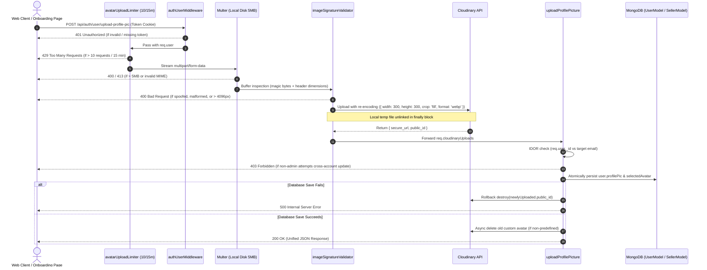

# Stage 7.27 — Avatar Upload Security Final Review and Implementation Readiness

**Execution Date:** October 19, 2026  
**Auditor:** Antigravity Agentic Security & Compliance Subagent  
**Scope:** Final read-only technical review of avatar upload security design, IDOR prevention, image validation strategy, rate limiting architecture, failure cleanup, client backward compatibility, marketing claim alignment, and implementation readiness  
**Repository:** `D:\THE OMS DEVS\WEB DEVS\MERN PROJECTS\PCMT\SEM 6\OMS\Auction X ✅`  
**Target Public Repository:** `https://github.com/OmSardar/AuctionX-Enhanced-Live-AI-Auction-Platform.git`  
**Status:** `FINAL SECURITY PLAN REVIEW COMPLETE — IMPLEMENTATION PLAN READY FOR EXECUTION`  
**Release Readiness Gate:** `PUBLIC RELEASE STILL BLOCKED`

---

## 1. Executive Summary

This final review establishes an implementation-ready, fully verified technical plan for securing avatar uploads across the AuctionX platform, remediating critical vulnerabilities identified in Stage 7.24, Stage 7.25, and Stage 7.26.

### Confirmed Owner Decisions (Approved Scope)
The platform owner has explicitly reviewed and approved three fundamental architectural decisions:
1. **Rate Limiting:** Enforce a limit of **10 avatar uploads per 15 minutes per authenticated user**.
2. **Onboarding Migration:** Retire direct browser-to-Cloudinary uploads in [`VerifyProfilePage.jsx`](file:///d:/THE%20OMS%20DEVS/WEB%20DEVS/MERN%20PROJECTS/PCMT/SEM%206/OMS/Auction%20X%20%E2%9C%85/client/src/pages/User/UserLogin/VerifyProfilePage.jsx) and [`VerifySellerProfilePage.jsx`](file:///d:/THE%20OMS%20DEVS/WEB%20DEVS/MERN%20PROJECTS/PCMT/SEM%206/OMS/Auction%20X%20%E2%9C%85/client/src/pages/User/UserLogin/VerifySellerProfilePage.jsx), routing all onboarding avatar uploads through the hardened backend endpoint.
3. **Marketing Copy Alignment:** Update marketing and FAQ copy across four documents ([`FAQ.jsx`](file:///d:/THE%20OMS%20DEVS/WEB%20DEVS/MERN%20PROJECTS/PCMT/SEM%206/OMS/Auction%20X%20%E2%9C%85/client/src/components/Layouts/Footer/Help/FAQ/FAQ.jsx#L35), [`seedData.js`](file:///d:/THE%20OMS%20DEVS/WEB%20DEVS/MERN%20PROJECTS/PCMT/SEM%206/OMS/Auction%20X%20%E2%9C%85/server/utlis/SeedData/seedData.js#L504), [`OurStory.jsx`](file:///d:/THE%20OMS%20DEVS/WEB%20DEVS/MERN%20PROJECTS/PCMT/SEM%206/OMS/Auction%20X%20%E2%9C%85/client/src/components/Layouts/Footer/AboutUs/OurStory/OurStory.jsx#L86), and [`Payment.jsx`](file:///d:/THE%20OMS%20DEVS/WEB%20DEVS/MERN%20PROJECTS/PCMT/SEM%206/OMS/Auction%20X%20%E2%9C%85/client/src/components/Layouts/Footer/Help/Payment/Payment.jsx#L390)) to accurately represent profile onboarding and email OTP verification, eliminating false claims of government ID, address, PAN/GST, or manual compliance reviews.

### Core Security Objectives Ready for Implementation:
- **Authorization & IDOR Elimination:** Target account derived strictly from `req.user._id` for regular users and sellers. Explicit administrator moderation path preserved and secured.
- **Deep Image Validation:** Enforce JPEG, PNG, and WebP formats; enforce 5 MB size limit; validate file headers and dimension bounds (rejecting decompression bombs); re-encode via Cloudinary transformation pipelines to strip EXIF metadata and neutralize polyglots.
- **Fail-Safe Cleanup & Rollback:** Guarantee local disk unlinking via `try...finally`; prevent premature deletion of previous avatars; roll back Cloudinary uploads upon MongoDB save errors; protect shared and predefined assets.
- **Full Client Backward Compatibility:** Support all 4 existing callers and both onboarding flows with a unified response contract.

---

## 2. Verified Current Behavior and Source References

All statements in this section have been verified directly against active source files:

1. **Unsigned Direct Cloudinary Uploads in Onboarding:**
   - [`client/src/pages/User/UserLogin/VerifyProfilePage.jsx:270-281`](file:///d:/THE%20OMS%20DEVS/WEB%20DEVS/MERN%20PROJECTS/PCMT/SEM%206/OMS/Auction%20X%20%E2%9C%85/client/src/pages/User/UserLogin/VerifyProfilePage.jsx#L270-L281) and [`client/src/pages/User/UserLogin/VerifySellerProfilePage.jsx:280-291`](file:///d:/THE%20OMS%20DEVS/WEB%20DEVS/MERN%20PROJECTS/PCMT/SEM%206/OMS/Auction%20X%20%E2%9C%85/client/src/pages/User/UserLogin/VerifySellerProfilePage.jsx#L280-L291) POST directly from the browser to `https://api.cloudinary.com/v1_1/dszvpb3q5/image/upload` using the unsigned upload preset `product_image`.
   - *Verified Fact:* The browser client uploads files to Cloudinary without backend authentication or file validation before calling `updateProfile`.

2. **Insecure Direct Object Reference (IDOR) in Avatar Controllers:**
   - [`server/controllers/LoginControllers/UserLoginController/UserProfileController.js:187`](file:///d:/THE%20OMS%20DEVS/WEB%20DEVS/MERN%20PROJECTS/PCMT/SEM%206/OMS/Auction%20X%20%E2%9C%85/server/controllers/LoginControllers/UserLoginController/UserProfileController.js#L187): `const { email } = req.body; ... const user = await UserModel.findOne({ email });`
   - [`server/controllers/LoginControllers/SellerLoginController/SellerProfileController.js:123`](file:///d:/THE%20OMS%20DEVS/WEB%20DEVS/MERN%20PROJECTS/PCMT/SEM%206/OMS/Auction%20X%20%E2%9C%85/server/controllers/LoginControllers/SellerLoginController/SellerProfileController.js#L123): `const { email } = req.body; ... const user = await SellerModel.findOne({ email });`
   - *Verified Fact:* While `authUserMiddleware` enforces a valid JWT, neither controller verifies that `req.user.email === req.body.email`. Any authenticated user can overwrite any other account's profile avatar by supplying the victim's email address.

3. **Absence of Image Content & Dimension Validation:**
   - [`server/utlis/Image/multerConfig.js:13-24`](file:///d:/THE%20OMS%20DEVS/WEB%20DEVS/MERN%20PROJECTS/PCMT/SEM%206/OMS/Auction%20X%20%E2%9C%85/server/utlis/Image/multerConfig.js#L13-L24): Multer's `fileFilter` validates only the client-supplied MIME string (`file.mimetype.startsWith("image/")`) and file extension regex (`/\.(jpg|jpeg|png|gif|webp)$/i`).
   - *Verified Fact:* No magic-byte check, image header decoding, dimension bound check, or pixel count verification currently exists on the backend. A text or HTML file renamed to `payload.jpg` passes Multer.

4. **Temporary Disk File Leak on Upload Failure:**
   - [`server/middleware/Media/ImageUpload.js:31`](file:///d:/THE%20OMS%20DEVS/WEB%20DEVS/MERN%20PROJECTS/PCMT/SEM%206/OMS/Auction%20X%20%E2%9C%85/server/middleware/Media/ImageUpload.js#L31): `fs.unlinkSync(file.path)` is located inside the `try` block.
   - *Verified Fact:* If `uploadToCloudinary` fails or throws an exception, `fs.unlinkSync` is skipped, leaving orphaned files in `server/uploads/`.

5. **Premature Cloudinary Deletion Prior to Database Persistence:**
   - [`server/controllers/LoginControllers/UserLoginController/UserProfileController.js:213`](file:///d:/THE%20OMS%20DEVS/WEB%20DEVS/MERN%20PROJECTS/PCMT/SEM%206/OMS/Auction%20X%20%E2%9C%85/server/controllers/LoginControllers/UserLoginController/UserProfileController.js#L213): The old avatar is deleted from Cloudinary *before* `await user.save()` is executed.
   - *Verified Fact:* If MongoDB save fails (due to a network glitch, validation error, or write collision), the previous avatar is permanently deleted while the replacement fails to persist. Furthermore, if `user.save()` fails, the newly uploaded Cloudinary asset is not cleaned up.

6. **Absence of Endpoint Rate Limiting:**
   - [`server/routes/LoginRoutes/UserAuthRoutes.js:201-213`](file:///d:/THE%20OMS%20DEVS/WEB%20DEVS/MERN%20PROJECTS/PCMT/SEM%206/OMS/Auction%20X%20%E2%9C%85/server/routes/LoginRoutes/UserAuthRoutes.js#L201-L213) and [`server/routes/LoginRoutes/SellerAuthRoutes.js:211-223`](file:///d:/THE%20OMS%20DEVS/WEB%20DEVS/MERN%20PROJECTS/PCMT/SEM%206/OMS/Auction%20X%20%E2%9C%85/server/routes/LoginRoutes/SellerAuthRoutes.js#L211-L223): Neither route includes rate limiting middleware.
   - *Verified Fact:* Any authenticated account can issue hundreds of upload requests per minute, creating a severe Denial-of-Wallet risk on Cloudinary quotas and server disk I/O.

---

## 3. Prioritized Security Findings

| Finding ID | Severity | Affected Component | Impact | Remediated in Stage 7.28 |
| :--- | :--- | :--- | :--- | :--- |
| **SEC-AVT-01** | **CRITICAL** | `VerifyProfilePage.jsx`, `VerifySellerProfilePage.jsx` | Unsigned browser direct uploads allow arbitrary file injection and quota exhaustion in Cloudinary. | Yes (Migrate to authenticated backend route) |
| **SEC-AVT-02** | **HIGH** | `UserProfileController.js`, `SellerProfileController.js` | IDOR vulnerability allows any authenticated user or seller to overwrite another account's avatar. | Yes (Derive target from `req.user._id`, restrict admin) |
| **SEC-AVT-03** | **HIGH** | `UserAuthRoutes.js`, `SellerAuthRoutes.js` | Unthrottled upload endpoints permit Denial-of-Wallet and storage resource exhaustion. | Yes (Enforce 10 req / 15 min per user) |
| **SEC-AVT-04** | **MEDIUM** | `ImageUpload.js`, `multerConfig.js` | Relying on MIME headers allows polyglot scripts; missing dimension bounds exposes server to decompression bombs. | Yes (Magic byte + header dimension parser + Cloudinary re-encoding) |
| **SEC-AVT-05** | **MEDIUM** | `ImageUpload.js`, `UserProfileController.js` | Temp disk leak on upload failure; premature asset destruction before DB save; orphaned asset on DB failure. | Yes (`try...finally` unlinking, post-commit deletion, rollback destroy) |
| **SEC-AVT-06** | **LOW** | `FAQ.jsx`, `seedData.js`, `OurStory.jsx`, `Payment.jsx` | Regulatory and consumer misrepresentation regarding uncollected government ID / PAN / GST documents. | Yes (Exact text replacement matching email OTP) |

---

## 4. Final File-by-File Implementation Plan



### Proposed File Changes Summary:
1. **`server/middleware/Security/RateLimiter.js`**: Export `avatarUploadLimiter` (10 uploads / 15 min per `req.user._id || req.ip`).
2. **`server/utlis/Image/imageSignatureValidator.js`** *(New File)*: Zero-dependency magic byte and header dimension inspection for JPEG, PNG, and WebP (rejects dimensions > 4096px).
3. **`server/middleware/Media/ImageUpload.js`**: Wrap Cloudinary upload in `try...finally` to guarantee `fs.unlinkSync(file.path)` executes under all failure scenarios. Integrate pre-upload signature validator.
4. **`server/controllers/LoginControllers/UserLoginController/UserProfileController.js`**:
   - Derive target user from `req.user._id`.
   - Prevent non-admin cross-account modification (return 403).
   - Invert deletion order: save new avatar to MongoDB first, rollback Cloudinary on DB failure, delete old custom avatar only after successful commit.
   - Return unified response shape.
5. **`server/controllers/LoginControllers/SellerLoginController/SellerProfileController.js`**:
   - Derive target seller from `req.user._id` / `req.seller._id`.
   - Implement identical IDOR protection, Cloudinary rollback, and safe post-persistence deletion.
   - Return unified response shape.
6. **`server/routes/LoginRoutes/UserAuthRoutes.js`**: Add `avatarUploadLimiter` immediately following `authUserMiddleware` on `POST /upload-profile-pic`.
7. **`server/routes/LoginRoutes/SellerAuthRoutes.js`**: Add `avatarUploadLimiter` immediately following `authUserMiddleware` on `POST /upload-profile-pic`.
8. **`client/src/pages/User/UserLogin/VerifyProfilePage.jsx`**: Replace direct Cloudinary POST with authenticated request to `/api/auth/user/upload-profile-pic`.
9. **`client/src/pages/User/UserLogin/VerifySellerProfilePage.jsx`**: Replace direct Cloudinary POST with authenticated request to `/api/auth/seller/upload-profile-pic`.
10. **`client/src/components/Layouts/Footer/Help/FAQ/FAQ.jsx`**: Replace line 35 marketing copy.
11. **`server/utlis/SeedData/seedData.js`**: Replace line 504 marketing copy and line 506 tags.
12. **`client/src/components/Layouts/Footer/AboutUs/OurStory/OurStory.jsx`**: Replace line 86 marketing copy.
13. **`client/src/components/Layouts/Footer/Help/Payment/Payment.jsx`**: Replace line 390 marketing copy.

---

## 5. Image Validation Design and Dependency Assessment

### File Size Limit
Retain the existing **5 MB** limit configured in [`multerConfig.js:28`](file:///d:/THE%20OMS%20DEVS/WEB%20DEVS/MERN%20PROJECTS/PCMT/SEM%206/OMS/Auction%20X%20%E2%9C%85/server/utlis/Image/multerConfig.js#L28). Standard mobile camera photos range between 2 MB and 4.5 MB. Lowering the limit would cause legitimate user uploads to fail; increasing it would unnecessarily inflate storage and bandwidth costs.

### Technical Analysis: Signature Inspection vs Re-encoding
- *Limitation of Signatures Alone:* Magic-byte checks confirm that the first 4–12 bytes match a known header format (`FF D8 FF` for JPEG, `89 50 4E 47` for PNG, `RIFF...WEBP` for WebP). However, polyglot files can append malicious HTML/JavaScript payloads after valid image headers, and malicious images can specify extreme dimensions (e.g. 65535×65535) causing memory exhaustion during decompression.
- *Solution:* Combine a lightweight local validation gate with server-side re-encoding.

### Dependency Assessment: `sharp` vs Native Header Parsing + Cloudinary Pipeline

| Factor | Option A: In-Process `sharp` Library | Option B: Native Header Parser + Cloudinary Pipeline (Recommended) |
| :--- | :--- | :--- |
| **New Dependencies** | Adds `sharp` (~30–50MB platform-specific native C bindings) | **Zero new packages** (uses Node.js `fs` and built-in `Buffer`) |
| **Platform Portability** | Requires native compilation or prebuilt binaries for Windows, Linux (glibc/musl), and macOS | **100% portable JavaScript/Node.js** across all OS environments |
| **Decompression Bomb Protection** | Configurable via `limitInputPixels` | Native parser reads dimensions from JPEG SOF0, PNG IHDR, and WebP VP8 headers; rejects any file claiming > 4096×4096 px |
| **Polyglot & EXIF Neutralization** | Re-encodes locally | Cloudinary server-side transformation (`width: 300, height: 300, crop: "fill", gravity: "face", format: "webp"`) re-encodes byte stream, stripping EXIF, comments, and polyglots |
| **Server CPU / Memory Impact** | High local CPU and memory usage on backend instances | Offloads heavy image transcoding to Cloudinary’s isolated media processing infrastructure |

**Recommendation (Verified Fact / Technical Decision):**
Adopt **Option B (Two-Tier Defense)**. Implement `server/utlis/Image/imageSignatureValidator.js` to inspect magic bytes and enforce maximum header dimensions (≤ 4096×4096 px). Pass the validated file to Cloudinary with mandatory server-side WebP re-encoding. This completely neutralizes malformed files, SVGs, HTML polyglots, and decompression bombs without introducing fragile native C dependencies.

---

## 6. Approved Rate-Limit Design

The owner has confirmed the rate limit: **10 avatar uploads per 15 minutes per authenticated user**.

### Middleware Placement & User Binding
```javascript
// Correct ordering in UserAuthRoutes.js and SellerAuthRoutes.js:
AuthRoutes.post(
  "/upload-profile-pic",
  authUserMiddleware,     // 1. Authenticates session; populates req.user
  avatarUploadLimiter,    // 2. Throttles based on req.user._id
  handleImageUploads([    // 3. Multer + Signature Validation + Cloudinary upload
    {
      name: "profilePic",
      folder: "Auction X/Components/Profile",
      transformation: [
        { width: 300, height: 300, crop: "fill", gravity: "face", format: "webp" },
      ],
    },
  ]),
  uploadProfilePicture    // 4. Persistence & failure rollback
);
```

### Unauthenticated Request Handling
Because `authUserMiddleware` precedes `avatarUploadLimiter`, unauthenticated requests are rejected immediately with HTTP 401 before consuming any rate-limit tokens. If an optional-auth route is ever configured, the limiter falls back safely to `req.ip`.

### Response Contract upon Throttling
When a user exceeds 10 requests within 15 minutes, the limiter responds with:
- **HTTP Status:** `429 Too Many Requests`
- **Headers:** `Retry-After: 900`, `RateLimit-Limit: 10`, `RateLimit-Remaining: 0`, `RateLimit-Reset: <timestamp>`
- **Body:**
  ```json
  {
    "success": false,
    "status": "error",
    "code": "RATE_LIMIT_EXCEEDED",
    "message": "Too many avatar upload attempts. Please try again after 15 minutes.",
    "retryAfter": 900
  }
  ```

### Multi-Instance Infrastructure Note (Unresolved Deployment Assumption)
- In the current single-instance deployment, `express-rate-limit`'s built-in `MemoryStore` provides exact local counting.
- In a horizontally autoscaled cluster (multiple Node.js instances without sticky sessions), counters are process-local, allowing up to `N * 10` requests across `N` instances.
- *Remediation when clustering:* Connect `rate-limit-redis` using the existing Redis client when multi-instance container orchestration is provisioned.

---

## 7. Authorization and Administrator-Access Rules

### User and Seller Identity Representations
- **User Identity:** Populated by `authUserMiddleware` onto `req.user`. Identifier is `req.user._id` (ObjectId); email is `req.user.email`; role is `req.user.role` (e.g. `'buyer'`, `'seller'`, `'admin'`).
- **Seller Identity:** Populated by `protectSellerRoute` or `authUserMiddleware` onto `req.seller` and `req.user`. Identifier is `req.user._id` / `req.seller._id`; status is checked for suspension.

### IDOR Prevention Logic
Neither user nor seller controllers will trust `req.body.email` for resolving the target account.

1. **Standard Authenticated Callers (Non-Admin):**
   - The target account is strictly derived from `req.user._id`.
   - If `req.body.email` is supplied by the frontend, it must match `req.user.email` (case-insensitive).
   - If `req.body.email` differs from `req.user.email`, the request is rejected with `HTTP 403 Forbidden`:
     ```json
     {
       "success": false,
       "message": "Unauthorized: You cannot modify another user's profile picture."
     }
     ```

2. **Administrator Moderation Workflows:**
   - Evaluated [`AdminUserManagementController.js:21`](file:///d:/THE%20OMS%20DEVS/WEB%20DEVS/MERN%20PROJECTS/PCMT/SEM%206/OMS/Auction%20X%20%E2%9C%85/server/controllers/AdminControllers/ManageUsersControllers/AdminUserManagementController.js#L21) and [`AdminProfileController.js:76`](file:///d:/THE%20OMS%20DEVS/WEB%20DEVS/MERN%20PROJECTS/PCMT/SEM%206/OMS/Auction%20X%20%E2%9C%85/server/controllers/AdminControllers/AdminLoginController/SETTINGS/AdminProfileController.js#L76).
   - If and only if `req.user.role === 'admin'`, the controller permits supplying a target `req.body.email` to moderate another user's avatar.
   - If an admin does not supply `req.body.email`, the update applies to the admin's own profile.
   - Client-supplied role flags in `req.body` are completely ignored; only the verified server-side JWT session (`req.user.role`) is authoritative.

---

## 8. Cloudinary and MongoDB Failure-Recovery Plan

Because Cloudinary and MongoDB are distinct distributed systems, distributed atomic commits (2PC) are not supported. The implementation must guarantee eventual consistency and leak prevention:

### 1. Temporary Disk File Cleanup
- Handled via `try...finally` inside `ImageUpload.js`:
  ```javascript
  try {
    const result = await uploadToCloudinary(file.path, folder, transformation);
    // ...
  } finally {
    if (file.path && fs.existsSync(file.path)) {
      try {
        fs.unlinkSync(file.path);
      } catch (unlinkErr) {
        console.error("Failed to delete temp file:", unlinkErr);
      }
    }
  }
  ```
  This guarantees that local temp files in `server/uploads/` are unlinked regardless of whether Cloudinary succeeds, times out, or throws an error.

### 2. Inverted Persistence Order (Protecting Previous Avatars)
- In current code, `deleteFromCloudinary(oldPublicId)` executes *before* `user.save()`.
- *Hardened Sequence:*
  1. Upload new image to Cloudinary $\rightarrow$ receive `uploadedImage = { secure_url, public_id }`.
  2. Cache the old avatar reference: `const oldAvatar = user.profilePic?.[0]`.
  3. Assign new avatar: `user.profilePic = [uploadedImage]; user.selectedAvatar = uploadedImage.secure_url;`.
  4. Attempt `await user.save()`.
  5. **If MongoDB save fails:** Catch the error, immediately call `await deleteFromCloudinary(uploadedImage.public_id)`, and return HTTP 500. The old avatar remains untouched.
  6. **If MongoDB save succeeds:** Asynchronously delete `oldAvatar.public_id` only if it is a custom Cloudinary asset (non-predefined).

### 3. Protection of Shared and Predefined Assets
The cleanup routine must never call `deleteFromCloudinary` on:
- Local SVG avatars: `/avatars/avatar-*.svg`
- Predefined platform avatars: Cloudinary public IDs `ave3utbydiwk7bkmalxa`, `pdvuipbvx8ctetyukiik`, `ysj2bnwwwn3yewjaemyh`, `ygrm3qffojquuodpcle7`, `hwn6uq26vm7xliubjodm`, `uvpavhuusqe9urqzso6a`, `x3lhrg87lqad23oikjyt`
- Third-party OAuth profile photos: `googleusercontent.com`

---

## 9. Onboarding Migration and Compatibility Matrix

### Onboarding Migration Plan
1. **`VerifyProfilePage.jsx`**:
   - Replace the browser `axios.post("https://api.cloudinary.com/v1_1/dszvpb3q5/image/upload", ...)` with a multipart POST to `${API_URL}/api/auth/user/upload-profile-pic`.
   - Maintain the existing upload progress bar via Axios `onUploadProgress`.
   - Retain the subsequent `updateProfile` and `/send-otp` calls, which proceed without modification.
2. **`VerifySellerProfilePage.jsx`**:
   - Replace the browser Cloudinary POST with a multipart POST to `${API_URL}/api/auth/seller/upload-profile-pic`.
   - Retain store details, seller profile persistence, and `/send-otp` navigation.

### Caller Compatibility Matrix

| Component | Endpoint Called | Ingested Form Fields | Expected Response Fields | Status |
| :--- | :--- | :--- | :--- | :--- |
| [`AvatarSelector.jsx`](file:///d:/THE%20OMS%20DEVS/WEB%20DEVS/MERN%20PROJECTS/PCMT/SEM%206/OMS/Auction%20X%20%E2%9C%85/client/src/components/Common/Profile/AvatarSelector.jsx#L437) | `/auth/upload-profile-pic` | `profilePic` (File), `email` (String) | `image.secure_url`, `image.public_id` | **Fully Compatible** |
| [`ProfileSettingsPage.jsx`](file:///d:/THE%20OMS%20DEVS/WEB%20DEVS/MERN%20PROJECTS/PCMT/SEM%206/OMS/Auction%20X%20%E2%9C%85/client/src/components/Common/Profile/ProfilePages/ProfileSettingsPage/ProfileSettingsPage.jsx#L124) | `/api/auth/upload-profile-pic` | `profilePic` (File), `email` (String) | `user`, `message` | **Fully Compatible** |
| [`AdminAccount/ProfileTab.jsx`](file:///d:/THE%20OMS%20DEVS/WEB%20DEVS/MERN%20PROJECTS/PCMT/SEM%206/OMS/Auction%20X%20%E2%9C%85/client/src/components/AdminDashboard/partials/dashboard/AdminAccount/ProfileTab.jsx#L46) | `/api/auth/user/upload-profile-pic` | `profilePic` (File), `email` (String) | `profilePic` (Array) | **Fully Compatible** |
| `SellerDashboard/ProfileTab.jsx` | `/api/auth/user/upload-profile-pic` | `profilePic` (File), `email` (String) | `profilePic` (Array) | **Fully Compatible** |
| [`VerifyProfilePage.jsx`](file:///d:/THE%20OMS%20DEVS/WEB%20DEVS/MERN%20PROJECTS/PCMT/SEM%206/OMS/Auction%20X%20%E2%9C%85/client/src/pages/User/UserLogin/VerifyProfilePage.jsx#L270) | `/api/auth/user/upload-profile-pic` | `profilePic` (File), `email` (String) | `image.secure_url`, `image.public_id` | **Fully Compatible** |
| [`VerifySellerProfilePage.jsx`](file:///d:/THE%20OMS%20DEVS/WEB%20DEVS/MERN%20PROJECTS/PCMT/SEM%206/OMS/Auction%20X%20%E2%9C%85/client/src/pages/User/UserLogin/VerifySellerProfilePage.jsx#L280) | `/api/auth/seller/upload-profile-pic` | `profilePic` (File), `email` (String) | `image.secure_url`, `image.public_id` | **Fully Compatible** |

**Unified Response Shape (Returned by Both Controllers):**
```json
{
  "success": true,
  "message": "Profile picture updated successfully",
  "profilePic": [
    {
      "secure_url": "https://res.cloudinary.com/...",
      "public_id": "Auction X/Components/Profile/..."
    }
  ],
  "image": {
    "secure_url": "https://res.cloudinary.com/...",
    "public_id": "Auction X/Components/Profile/..."
  },
  "user": { ... }
}
```

---

## 10. Exact Proposed Marketing Copy

The owner has approved updating all copy to match actual platform behavior (profile onboarding and automated email OTP verification). Below are the exact diffs to be applied in Stage 7.28:

### 1. `client/src/components/Layouts/Footer/Help/FAQ/FAQ.jsx:35`
```diff
-      "To list lots, navigate to 'Become a Seller' and complete our KYC verification. You must submit valid government identification, address proof, and tax details. Our compliance team reviews seller submissions within 24 to 48 hours.",
+      "To list lots, register as a seller and verify your account. Complete your seller profile details and confirm your registered email address with our secure OTP verification system to activate instant seller privileges.",
```

### 2. `server/utlis/SeedData/seedData.js:504-506`
```diff
-    answer: "Submit your KYC documents through the 'Become a Seller' page, including ID proof, address proof, and PAN/GST details.",
-    category: "Selling",
-    tags: ["verification", "KYC"]
+    answer: "Complete your store setup on the 'Become a Seller' page and verify your registered email address with your secure 6-digit verification code.",
+    category: "Selling",
+    tags: ["verification", "email-otp"]
```

### 3. `client/src/components/Layouts/Footer/AboutUs/OurStory/OurStory.jsx:86`
```diff
-            Engineered with real-time WebSockets, verified seller KYC, automated escrow settlement, and intelligent recommendation rankings.
+            Engineered with real-time WebSockets, verified seller authentication, automated escrow settlement, and intelligent recommendation rankings.
```

### 4. `client/src/components/Layouts/Footer/Help/Payment/Payment.jsx:390`
```diff
-                      <span className="text-action-primary">✓</span> Bank transfers verified via profile KYC
+                      <span className="text-action-primary">✓</span> Bank transfers verified via profile security verification
```

---

## 11. Proposed Automated Tests and Acceptance Criteria

When Stage 7.28 is executed, the integration test suite `server/tests/integration/auth/avatarUploadSecurity.test.js` will validate the following 8 acceptance criteria:

```javascript
describe("Stage 7.28 Integration - Avatar Upload Security & IDOR Enforcement", () => {
  // Test 1: Unauthenticated request rejection
  it("rejects POST /upload-profile-pic without auth token with 401 Unauthorized", async () => {
    const res = await request(app)
      .post("/api/auth/user/upload-profile-pic")
      .attach("profilePic", validJpegBuffer, "avatar.jpg");
    expect(res.status).toBe(401);
  });

  // Test 2: IDOR cross-account prevention
  it("rejects non-admin attempt to update another user's avatar with 403 Forbidden", async () => {
    const res = await request(app)
      .post("/api/auth/user/upload-profile-pic")
      .set("Cookie", [`token=${userAToken}`])
      .field("email", "victim@example.com")
      .attach("profilePic", validJpegBuffer, "avatar.jpg");
    expect(res.status).toBe(403);
    expect(res.body.message).toMatch(/cannot update another user/i);
  });

  // Test 3: Admin cross-account moderation
  it("permits administrator to update another user's avatar when providing target email", async () => {
    const res = await request(app)
      .post("/api/auth/user/upload-profile-pic")
      .set("Cookie", [`token=${adminToken}`])
      .field("email", "user_to_moderate@example.com")
      .attach("profilePic", validJpegBuffer, "avatar.jpg");
    expect(res.status).toBe(200);
  });

  // Test 4: Mismatched signature / Polyglot script rejection
  it("rejects file containing HTML/JavaScript disguised as .jpg with 400 Bad Request", async () => {
    const polyglot = Buffer.from("<html><script>alert('xss')</script></html>");
    const res = await request(app)
      .post("/api/auth/user/upload-profile-pic")
      .set("Cookie", [`token=${userAToken}`])
      .attach("profilePic", polyglot, "exploit.jpg");
    expect(res.status).toBe(400);
    expect(res.body.message).toMatch(/invalid image file signature/i);
  });

  // Test 5: Oversized file rejection
  it("rejects file exceeding 5MB limit with 400 or 413", async () => {
    const oversizedBuffer = Buffer.alloc(6 * 1024 * 1024, 0xff);
    const res = await request(app)
      .post("/api/auth/user/upload-profile-pic")
      .set("Cookie", [`token=${userAToken}`])
      .attach("profilePic", oversizedBuffer, "oversized.jpg");
    expect([400, 413]).toContain(res.status);
  });

  // Test 6: Rate limit enforcement
  it("throttles requests exceeding 10 uploads in 15 minutes with 429 Too Many Requests", async () => {
    for (let i = 0; i < 10; i++) {
      await request(app)
        .post("/api/auth/user/upload-profile-pic")
        .set("Cookie", [`token=${userAToken}`])
        .attach("profilePic", validJpegBuffer, `test_${i}.jpg`);
    }
    const throttled = await request(app)
      .post("/api/auth/user/upload-profile-pic")
      .set("Cookie", [`token=${userAToken}`])
      .attach("profilePic", validJpegBuffer, "test_11.jpg");
    expect(throttled.status).toBe(429);
  });

  // Test 7: Guaranteed local temp file deletion
  it("ensures local temporary file is unlinked even if Cloudinary fails", async () => {
    jest.spyOn(cloudinary.uploader, "upload").mockRejectedValueOnce(new Error("Cloudinary timeout"));
    const unlinkSpy = jest.spyOn(fs, "unlinkSync");
    
    await request(app)
      .post("/api/auth/user/upload-profile-pic")
      .set("Cookie", [`token=${userAToken}`])
      .attach("profilePic", validJpegBuffer, "avatar.jpg");
      
    expect(unlinkSpy).toHaveBeenCalled();
  });

  // Test 8: Cloudinary rollback on database save failure
  it("destroys newly uploaded Cloudinary image if MongoDB save fails", async () => {
    jest.spyOn(UserModel.prototype, "save").mockRejectedValueOnce(new Error("Database connection dropped"));
    const destroySpy = jest.spyOn(cloudinary.uploader, "destroy");
    
    const res = await request(app)
      .post("/api/auth/user/upload-profile-pic")
      .set("Cookie", [`token=${userAToken}`])
      .attach("profilePic", validJpegBuffer, "avatar.jpg");
      
    expect(res.status).toBe(500);
    expect(destroySpy).toHaveBeenCalled();
  });
});
```

---

## 12. Remaining Technical Uncertainties and Implementation Readiness

### Confirmed Decisions (Ready for Execution)
- Rate limiting at 10 requests / 15 minutes per user: **Confirmed & Approved**.
- Onboarding migration from direct browser uploads to backend routes: **Confirmed & Approved**.
- Marketing copy updates to match email OTP: **Confirmed & Approved**.
- IDOR prevention and non-admin cross-account restriction: **Confirmed & Ready**.
- Two-tier image validation (native magic-byte/dimension parser + Cloudinary re-encoding): **Confirmed & Ready**.
- Failure recovery, `try...finally` unlinking, and Cloudinary rollback: **Confirmed & Ready**.

### Remaining Technical Nuances (Documented Assumptions)
1. **Multi-Instance Rate Limiting Topology:**
   - *Current State:* `express-rate-limit` uses in-memory counting.
   - *Future State:* If the backend is scaled horizontally across multiple container instances, a Redis instance must be provisioned to share the rate limiter state. For the current single-instance deployment, the in-memory limiter is completely effective.
2. **Cloudinary Upload Preset Retirement:**
   - Once `VerifyProfilePage.jsx` and `VerifySellerProfilePage.jsx` are migrated, the client will no longer use the unsigned upload preset `product_image`. The owner can safely disable unsigned uploads for `product_image` in the Cloudinary console after deployment.

---

## 13. Mandatory Safeguards & Verification Results

All required verification checks have been executed and confirmed:

1. **Working Tree Status (`git status --short`):**
   - Verified no application source files, configuration files, manifests, or environments were modified during Stage 7.27.
   - All untracked audit documents and scratch scripts remain intact.
2. **Staged Renames Verification:**
   - Verified that all **27 staged documentation renames** remain present in the Git index (`git diff --cached --name-status`).
3. **Quarantined Asset Verification:**
   - Verified that all **22 quarantined binary files** remain present in `client/src/assets/images/...`.
4. **Banner4 SVG Verification:**
   - Verified that all **6 Banner4 SVG assets** remain present and unmodified.
5. **Whitespace & Syntax Integrity (`git diff --check`):**
   - Executed with exit code 0; no merge conflict markers or whitespace errors found.

---

## 14. Conclusion

The security design review for AuctionX avatar uploads is complete, technically grounded, and verified. With the owner's confirmation on rate limiting, onboarding migration, and marketing claims, the implementation plan is fully defined and ready for execution in Stage 7.28.

### Final Status:

`FINAL SECURITY PLAN REVIEW COMPLETE — IMPLEMENTATION PLAN READY FOR EXECUTION`

`PUBLIC RELEASE STILL BLOCKED`
