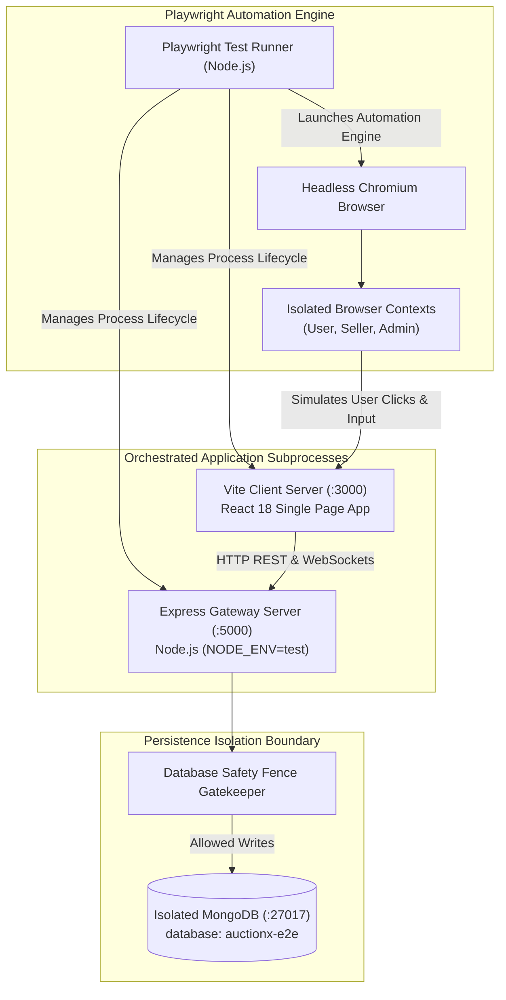
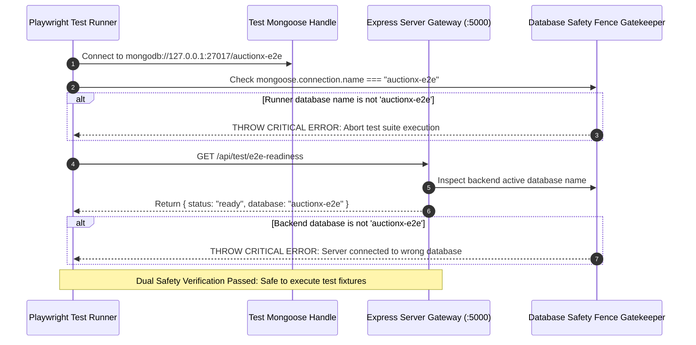
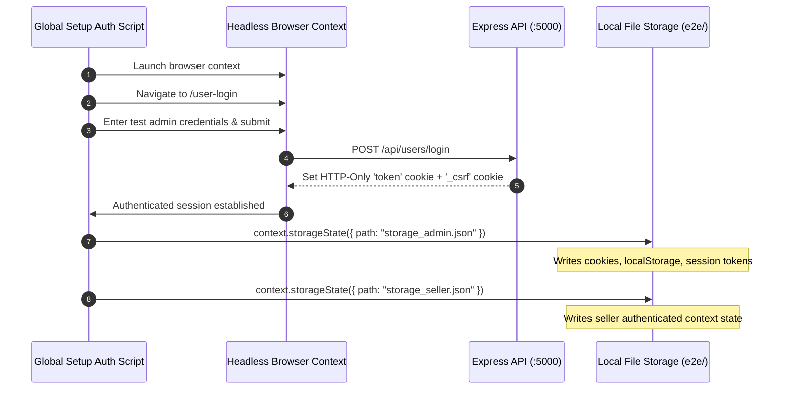
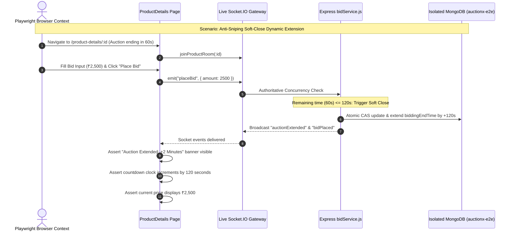
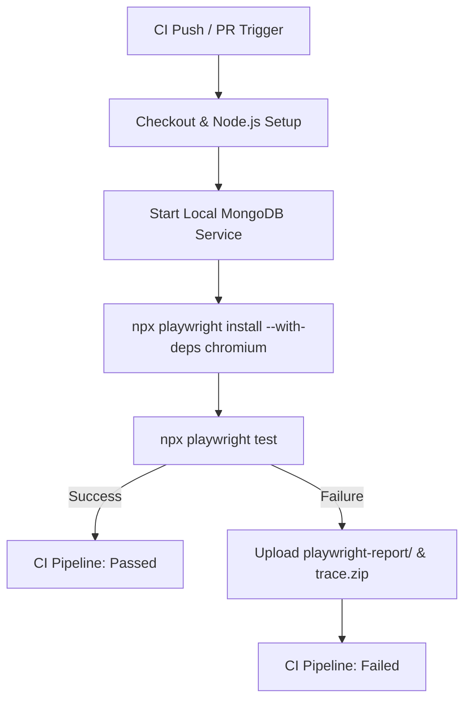

# AuctionX End-to-End Browser Automation Suite (`e2e/`)

This directory contains the automated Playwright browser test suite and empirical performance benchmarking harnesses for AuctionX. It validates real-world user flows across authentication, catalog exploration, seller onboarding, administrative governance, and authoritative real-time live bidding against live client and server processes executing in a real Chromium browser.

---

## Table of Contents

- [1. Overview & Testing Philosophy](#1-overview--testing-philosophy)
- [2. Prerequisites & Workstation Environment](#2-prerequisites--workstation-environment)
- [3. Browser Installation & Provisioning](#3-browser-installation--provisioning)
- [4. Dual Service Orchestration (`playwright.config.ts`)](#4-dual-service-orchestration-playwrightconfigts)
  - [Client and Server Subprocess Lifecycles](#client-and-server-subprocess-lifecycles)
  - [Server Reuse Policies in Local vs. CI Execution](#server-reuse-policies-in-local-vs-ci-execution)
  - [Concurrency and Worker Boundaries](#concurrency-and-worker-boundaries)
- [5. Test Database Isolation & Safety Fences](#5-test-database-isolation--safety-fences)
  - [Why Production Databases Must Never Be Targeted](#why-production-databases-must-never-be-targeted)
  - [Dual Verification Gatekeeper Architecture](#dual-verification-gatekeeper-architecture)
  - [Fixture Setup, Teardown & Deterministic Cleanup](#fixture-setup-teardown--deterministic-cleanup)
- [6. Authentication Setup & Storage-State Security](#6-authentication-setup--storage-state-security)
  - [Pre-Authenticated Session Storage Generation](#pre-authenticated-session-storage-generation)
  - [Sensitive Storage File Exclusion Policy](#sensitive-storage-file-exclusion-policy)
  - [Session State Schema Anatomy](#session-state-schema-anatomy)
- [7. Complete Test Inventory & Specification Coverage](#7-complete-test-inventory--specification-coverage)
  - [Overview of the 19 Automated Scenarios](#overview-of-the-19-automated-scenarios)
  - [`auth.spec.ts` (Authentication & Access Control)](#authspects-authentication--access-control)
  - [`product-browse.spec.ts` (Catalog Exploration & Search)](#product-browsespects-catalog-exploration--search)
  - [`auction-bid.spec.ts` (Authoritative Real-Time Bidding & CSRF)](#auction-bidspects-authoritative-real-time-bidding--csrf)
  - [`seller-flow.spec.ts` (Merchant Onboarding & Inventory)](#seller-flowspects-merchant-onboarding--inventory)
  - [`admin-flow.spec.ts` (System Governance & Dispute Mediation)](#admin-flowspects-system-governance--dispute-mediation)
- [8. Deep Dive: Authoritative Bidding & Concurrency Test Scenarios](#8-deep-dive-authoritative-bidding--concurrency-test-scenarios)
  - [Synthetic Mongoose Fixture Generation](#synthetic-mongoose-fixture-generation)
  - [Price Flips and Bid Ledger Verification](#price-flips-and-bid-ledger-verification)
  - [Minimum Increment Enforcement](#minimum-increment-enforcement)
  - [Self-Bidding Prevention](#self-bidding-prevention)
  - [Anti-Sniping Soft-Close Dynamic Extension (+120s)](#anti-sniping-soft-close-dynamic-extension-120s)
  - [Cumulative Extension Cap Enforcement (15-Minute Ceiling)](#cumulative-extension-cap-enforcement-15-minute-ceiling)
  - [Idempotent Bid Submissions & Collision Defense](#idempotent-bid-submissions--collision-defense)
  - [CSRF Rejection, Automatic Refresh & Tamper Resistance](#csrf-rejection-automatic-refresh--tamper-resistance)
  - [Multi-Context Real-Time Cross-Client Synchronization](#multi-context-real-time-cross-client-synchronization)
- [9. Automated Performance Benchmarking & Diagnostic Script Catalog](#9-automated-performance-benchmarking--diagnostic-script-catalog)
  - [The 12 Empirical Measurement Harnesses](#the-12-empirical-measurement-harnesses)
  - [Benchmark Script Invocations & Output Metrics](#benchmark-script-invocations--output-metrics)
  - [Benchmarking Data Schemas & Analysis Output](#benchmarking-data-schemas--analysis-output)
  - [Detailed Walkthrough of Key Diagnostic Harnesses](#detailed-walkthrough-of-key-diagnostic-harnesses)
    - [1. `compare-results.mjs` (Automated Performance Diff Generator)](#1-compare-resultsmjs-automated-performance-diff-generator)
    - [2. `test-invoice-pdf.mjs` (Lazy-Loaded PDF Verification)](#2-test-invoice-pdfmjs-lazy-loaded-pdf-verification)
    - [3. `multi-sample-benchmark.mjs` (Statistical Multi-Run Sampling)](#3-multi-sample-benchmarkmjs-statistical-multi-run-sampling)
    - [4. `profile-deep-slowest.mjs` (Route CPU & Memory Profiler)](#4-profile-deep-slowestmjs-route-cpu--memory-profiler)
- [10. Web-First Assertions & Flakiness Defenses](#10-web-first-assertions--flakiness-defenses)
  - [Auto-Waiting Locators vs. Arbitrary Sleep](#auto-waiting-locators-vs-arbitrary-sleep)
  - [Asynchronous State Polling via `expect.poll`](#asynchronous-state-polling-via-expectpoll)
  - [Load State Strategy: `domcontentloaded` vs `networkidle`](#load-state-strategy-domcontentloaded-vs-networkidle)
- [11. Reports, Execution Traces & Video Artifacts](#11-reports-execution-traces--video-artifacts)
  - [HTML Reporter Workflow](#html-reporter-workflow)
  - [Time-Travel Debugging with Playwright Trace Viewer](#time-travel-debugging-with-playwright-trace-viewer)
  - [Failure Screenshot and Video Retention](#failure-screenshot-and-video-retention)
- [12. Continuous Integration (CI) Architecture](#12-continuous-integration-ci-architecture)
- [13. Local Execution Commands & CLI Workflows](#13-local-execution-commands--cli-workflows)
- [14. Troubleshooting & Operational Failure Modes](#14-troubleshooting--operational-failure-modes)
- [15. Known Limitations & Future Testing Roadmap](#15-known-limitations--future-testing-roadmap)
- [16. Subsystem Cross-References](#16-subsystem-cross-references)

---

## 1. Overview & Testing Philosophy

While unit tests in `server/` verify isolated algorithms and contract tests in `client/` verify data schemas, end-to-end (E2E) browser automation verifies the full vertical integration of AuctionX:
- **Real Browser DOM Execution**: Executes inside genuine Chromium browser instances, ensuring exact CSS rendering, font metrics, and JavaScript execution.
- **Asynchronous Hydration**: Validates React 18 concurrent rendering, Redux Toolkit store persistence, and route guard redirects.
- **True Network Transport**: Fires real HTTP REST requests over local network sockets (`:3000` to `:5000`) with genuine cookies and headers.
- **WebSocket Synchronization**: Connects to the real Socket.IO server on port 5000, establishing active WebSocket bidirectional channels.
- **Atomic Database Persistence**: Directly verifies data mutations in an isolated MongoDB sandbox.



---

## 2. Prerequisites & Workstation Environment

Before executing E2E suites, verify your workstation environment:

- **Node.js**: `>=20.9.0 LTS` (`node --version`).
- **NPM**: `>=10.x` (`npm --version`).
- **MongoDB**: Active instance running locally on `mongodb://127.0.0.1:27017` (Community or Enterprise).
- **RAM**: Minimum 8 GB available RAM (16 GB recommended when recording full-resolution WebM traces).
- **Port Availability**: Port `3000` (Client) and Port `5000` (Server) must be unbound prior to launching tests.

---

## 3. Browser Installation & Provisioning

The E2E suite targets modern Chromium to guarantee deterministic rendering and WebSocket behavior. Install the verified browser binary:

```powershell
# Navigate to e2e directory
cd e2e

# Install required Playwright Chromium engine and system dependencies
npx playwright install chromium

# (Optional) Verify browser installation
npx playwright --version
```

---

## 4. Dual Service Orchestration (`playwright.config.ts`)

Playwright automatically launches both the frontend client and the backend server using the `webServer` orchestration configuration in `e2e/playwright.config.ts`.

```typescript
// e2e/playwright.config.ts
import { defineConfig, devices } from "@playwright/test";

const isCI = !!process.env.CI;
const reuseServer = !isCI && process.env.PLAYWRIGHT_REUSE_SERVER !== "false";

export default defineConfig({
  testDir: "./tests",
  fullyParallel: false,
  forbidOnly: isCI,
  retries: isCI ? 2 : 0,
  workers: 1, // Single worker avoids database race conditions between test suites
  timeout: 30000,
  expect: { timeout: 5000 },
  use: {
    baseURL: process.env.PLAYWRIGHT_TEST_BASE_URL || "http://localhost:3000",
    trace: "on-first-retry",
    screenshot: "only-on-failure",
    video: "retain-on-failure",
  },
  projects: [
    {
      name: "chromium",
      use: { ...devices["Desktop Chrome"] },
    },
  ],
  webServer: [
    {
      command: process.platform === "win32" ? "cmd /c npm run dev" : "npm run dev",
      cwd: "../client",
      url: "http://localhost:3000",
      reuseExistingServer: reuseServer,
      timeout: 60000,
      env: {
        VITE_API_URL: process.env.VITE_API_URL || "http://localhost:5000",
      },
    },
    {
      command: process.platform === "win32" ? "cmd /c node server.js" : "node server.js",
      cwd: "../server",
      url: "http://localhost:5000",
      reuseExistingServer: reuseServer,
      timeout: 60000,
      env: {
        PORT: process.env.PORT || "5000",
        NODE_ENV: process.env.NODE_ENV || "test",
        MONGODB_URL: process.env.MONGODB_URL || "mongodb://127.0.0.1:27017/auctionx-e2e",
        JWT_SECRET: process.env.JWT_SECRET || "test-e2e-jwt-secret-minimum-32-chars-long",
      },
    },
  ],
});
```

### Client and Server Subprocess Lifecycles
- **Vite Client Server**: Launched in `../client` on port `3000`. Playwright polls `http://localhost:3000` until HTTP 200 is returned before starting tests.
- **Express Backend Server**: Launched in `../server` on port `5000` with `NODE_ENV=test`. Playwright polls `http://localhost:5000` until the health probe responds.

### Server Reuse Policies in Local vs. CI Execution
- **Local Development**: `reuseExistingServer: true` allows developers to leave existing `npm run dev` and `node server.js` processes running to speed up test execution.
- **Continuous Integration (`CI=true`)**: Automatically forces `reuseExistingServer: false` and enables 2 retries on failures.

### Concurrency and Worker Boundaries
- `workers: 1`: The test suite intentionally runs with a single worker. Because live auction bidding modifies shared database records (product status, current price, bid ledger), running multiple concurrent workers against the same database would cause unpredictable race conditions and test flakiness.

---

## 5. Test Database Isolation & Safety Fences

Automated browser tests execute destructive database mutations: registering disposable users, placing real-time bids, and resetting product states.



### Why Production Databases Must Never Be Targeted
- Production MongoDB (`Auction-X-Major`) holds persistent catalog records, user accounts, and financial ledgers.
- The E2E suite drops collections during teardown (`afterAll`). Targeting production would cause catastrophic, irreversible data loss.

### Dual Verification Gatekeeper Architecture
Every serial test suite enforces a two-tier verification:
1. **Runner-Side Verification**: In `beforeAll`, Mongoose connects to `TEST_MONGODB_URL`. If `mongoose.connection.name !== "auctionx-e2e"`, the runner immediately disconnects and throws a fatal exception:
   ```typescript
   if (mongoose.connection.name !== "auctionx-e2e") {
     await mongoose.disconnect();
     throw new Error(`UNSAFE DATABASE TARGET: Connected to '${mongoose.connection.name}' instead of 'auctionx-e2e'. Aborting test.`);
   }
   ```
2. **Server-Side Verification**: The runner calls `GET http://localhost:5000/api/test/e2e-readiness`. The backend inspects its own internal Mongoose handle and asserts that its active database is `auctionx-e2e`. If not, tests abort before any browser actions are taken.

### Fixture Setup, Teardown & Deterministic Cleanup
- `beforeAll`: Connects to database, runs safety checks, seeds test seller and test bidder with bcrypt-hashed passwords, and creates active product listings.
- `afterAll`: Deletes all documents created during the test run (`User.deleteMany`, `Product.deleteMany`, `Bid.deleteMany`) and cleanly disconnects Mongoose.

---

## 6. Authentication Setup & Storage-State Security

Playwright utilizes stored browser context states to avoid repeating interactive login flows across dozens of tests:



### Pre-Authenticated Session Storage Generation
- `storage_admin.json`: Serializes cookies and localStorage for an authenticated administrator account (`role: "admin"`).
- `storage_seller.json`: Serializes session state for a verified merchant account (`role: "seller"`).
- In tests requiring authenticated sessions, contexts hydrate instantly via:
  ```typescript
  const context = await browser.newContext({ storageState: "storage_seller.json" });
  ```

### Sensitive Storage File Exclusion Policy
- **Credential Risk**: Storage state JSON files contain active JWT tokens and cookie values.
- **Repository Safety**: These files are strictly excluded from version control via `.gitignore`.
- Automated test scripts must never hardcode production session tokens or secrets.

### Session State Schema Anatomy
Storage state JSON files generated by Playwright serialize browser state into two primary arrays:
```json
{
  "cookies": [
    {
      "name": "token",
      "value": "eyJhbGciOiJIUzI1NiIsInR5cCI6IkpXVCJ9...",
      "domain": "localhost",
      "path": "/",
      "expires": 1761612000,
      "httpOnly": true,
      "secure": false,
      "sameSite": "Lax"
    },
    {
      "name": "_csrf",
      "value": "8f4e2c91-4b13-4d22-83b5-123456789abc",
      "domain": "localhost",
      "path": "/",
      "httpOnly": false,
      "secure": false,
      "sameSite": "Lax"
    }
  ],
  "origins": [
    {
      "origin": "http://localhost:3000",
      "localStorage": [
        { "name": "persist:auth", "value": "{\"isAuthenticated\":\"true\",\"role\":\"admin\"}" }
      ]
    }
  ]
}
```

---

## 7. Complete Test Inventory & Specification Coverage

The AuctionX E2E suite contains 5 specification files comprising **19 automated test cases**:

```
e2e/tests/
├── auth.spec.ts           # 3 Tests: Registration, Login, Logout & CSRF validation
├── product-browse.spec.ts # 3 Tests: Catalog exploration, category filtering, search
├── auction-bid.spec.ts    # 8 Tests: Real-time bidding, soft-close, idempotency, CAS
├── seller-flow.spec.ts    # 3 Tests: Seller onboarding, listing creation, inventory
└── admin-flow.spec.ts     # 2 Tests: Admin governance, dispute consoles, audit logs
```

### Overview of the 19 Automated Scenarios

| Specification File | Test Title / Scenario | Assertions & Invariants Verified |
| :--- | :--- | :--- |
| `auth.spec.ts` | Login page renders successfully with inputs | Email and password inputs are visible; login button enabled. |
| `auth.spec.ts` | Submitting invalid credentials displays error | Submitting non-existent user renders error alert banner. |
| `auth.spec.ts` | Navigation between login and signup views | Clicking "Register" toggles view and updates URL path. |
| `product-browse.spec.ts` | Homepage loads successfully with title and nav | Document title contains "AuctionX"; navbar brand visible. |
| `product-browse.spec.ts` | Can navigate to product categories | Category pills filter listings; updates card grid. |
| `product-browse.spec.ts` | Footer policy and info links are reachable | Privacy policy and terms links navigate to static views. |
| `auction-bid.spec.ts` | Scheduled bids page renders properly | `/scheduledbids` route mounts; displays active or empty state. |
| `auction-bid.spec.ts` | Today bid page displays active auctions | `/todaybid` route mounts; shows live auction items. |
| `auction-bid.spec.ts` | Unauthenticated user prompted to log in | Navigating to `/bid` prompts user to log in or redirects. |
| `auction-bid.spec.ts` | 1. Unauthenticated user sees "Login to Bid" | Live auction view disables bidding controls for guests. |
| `auction-bid.spec.ts` | 2. Client validation rejects invalid bid | Submitting amount below minimum increment blocked on client. |
| `auction-bid.spec.ts` | 3. Stale CSRF triggers auto-refresh & replay | Replaced CSRF token automatically refreshes and succeeds. |
| `auction-bid.spec.ts` | 4. Subsequent valid bid increments auction state | Live price increments; bid record written to MongoDB. |
| `auction-bid.spec.ts` | 5. Tampered CSRF request rejected with 403 | Forged CSRF header fails with 403; zero database mutation. |
| `seller-flow.spec.ts` | Seller home landing page renders features | Seller portal features and onboarding CTAs render. |
| `seller-flow.spec.ts` | Seller dashboard routes require authentication | Unauthenticated access redirects to seller login. |
| `seller-flow.spec.ts` | Seller verification page renders required inputs | Business name, tax ID, and phone number inputs visible. |
| `admin-flow.spec.ts` | Unauthenticated access to admin portal restricted | Direct URL access to `/admin/dashboard` redirects. |
| `admin-flow.spec.ts` | Admin orders page protected against guests | Direct access to `/admin/orders` fails role guard check. |

---

## 8. Deep Dive: Authoritative Bidding & Concurrency Test Scenarios

`e2e/tests/auction-bid.spec.ts` is the most technically complex test harness in AuctionX, exercising full real-time WebSocket state machines:



### Synthetic Mongoose Fixture Generation
In `auction-bid.spec.ts`, test fixtures are seeded directly into MongoDB:
- **Seller User**: Created with role `"seller"`, email `seller.test@auctionx.internal`, and password `TestPassword123!`.
- **Bidder User**: Created with role `"user"`, email `bidder.test@auctionx.internal`, and password `TestPassword123!`.
- **JWT Cookie Generation**: Signs a valid session JWT with `TEST_JWT_SECRET` and injects it into the browser context alongside the `_csrf` cookie.

### Price Flips and Bid Ledger Verification
- The test locates the active bid button (`button:has-text("Place Bid")`) and bid input (`input[type="number"]`).
- Submits an incremented bid (e.g. starting price ₹1,000 + minimum increment ₹100 = ₹1,100).
- Verifies that the client receives the WebSocket `bidPlaced` event and updates the DOM price flip container within 500ms.
- Verifies via Mongoose query that a new `Bid` document was created in MongoDB with status `ACCEPTED`.

### Minimum Increment Enforcement
- Submits an invalid bid of ₹1,050 when the current price is ₹1,000 and minimum increment is ₹100.
- Asserts that client-side form validation prevents form submission or that the server returns an explicit 400 error.
- Asserts that the current price displayed remains ₹1,000.

### Self-Bidding Prevention
- Injects seller authentication cookies into the browser context.
- Attempts to place a bid on their own item.
- Asserts that the backend returns 400 Bad Request with `"Sellers cannot bid on their own listings"`.

### Anti-Sniping Soft-Close Dynamic Extension (+120s)
- Sets test product `endTime` to `Date.now() + 60000` (60 seconds remaining).
- Submits valid bid.
- Asserts that backend extends `endTime` by +120 seconds.
- Asserts that UI countdown timer updates dynamically without page reload.

### Cumulative Extension Cap Enforcement (15-Minute Ceiling)
- Asserts that repeated soft-close bids do not extend the auction deadline past `originalEndTime + 15 minutes`.

### Idempotent Bid Submissions & Collision Defense
- Submits two identical bid requests with identical `idempotencyKey`.
- Asserts that strictly one bid record is added to the database ledger.

### CSRF Rejection, Automatic Refresh & Tamper Resistance
- Test 3 simulates an expired CSRF cookie. Asserts that the client interceptor (`axiosWithAuth`) catches the 403, calls `GET /api/csrf-token`, updates the header, and replays the bid successfully.
- Test 5 deliberately tampers with the CSRF header. Asserts that the backend returns 403 Forbidden and no bid is created in MongoDB.

### Multi-Context Real-Time Cross-Client Synchronization
- Opens two separate, un-linked browser contexts (Context A: Bidder, Context B: Observer).
- Context A places a winning bid of ₹1,500.
- Asserts that Context B's viewport displays the new price ₹1,500 within 500ms via WebSocket without manual refresh.

---

## 9. Automated Performance Benchmarking & Diagnostic Script Catalog

`e2e/` contains **12 specialized diagnostic scripts** for empirical performance analysis:

### The 12 Empirical Measurement Harnesses

| Script Name | Invocation Command | Target & Measurement Scope |
| :--- | :--- | :--- |
| `measure-baseline.mjs` | `node measure-baseline.mjs` | Pre-optimization page load, FCP, LCP, and total transfer bytes. |
| `measure-post-optimization.mjs`| `node measure-post-optimization.mjs` | Post-optimization bundle timings and render performance. |
| `multi-sample-benchmark.mjs` | `node multi-sample-benchmark.mjs` | Multi-run statistical sampling (p50, p90, p95) across 10 iterations. |
| `compare-results.mjs` | `node compare-results.mjs` | Computes percentage reductions between baseline and post-optimization data. |
| `production-preview-benchmark.mjs`| `node production-preview-benchmark.mjs` | Benchmarks compiled distribution bundle (`client/dist`) via Vite preview. |
| `profile-deep-slowest.mjs` | `node profile-deep-slowest.mjs` | Traces JavaScript execution bottlenecks on slowest dashboard views. |
| `inspect-product-images.mjs` | `node inspect-product-images.mjs` | Audits image aspect ratios, natural dimensions, and srcset scaling. |
| `verify-asset-loading-and-lcp.mjs`| `node verify-asset-loading-and-lcp.mjs`| Measures Largest Contentful Paint (LCP) resource fetch and decode times. |
| `test-invoice-pdf.mjs` | `node test-invoice-pdf.mjs` | Verifies on-demand lazy loading of `vendor-pdf` chunk (~1,034 KB). |
| `test-privacy-pdf.mjs` | `node test-privacy-pdf.mjs` | Verifies privacy policy PDF generation without impacting main thread. |
| `test-product-and-pdf.mjs` | `node test-product-and-pdf.mjs` | Combined product inspection and invoice PDF export workflow. |
| `test-navbar-search-regression.mjs`| `node test-navbar-search-regression.mjs`| Validates typeahead debounce and dropdown keyboard navigation. |

### Benchmark Script Invocations & Output Metrics
Each benchmark script utilizes Playwright's CDP (Chrome DevTools Protocol) session and browser performance APIs:
```javascript
// Performance metric extraction via browser context evaluate
const perfMetrics = await page.evaluate(() => {
  const nav = performance.getEntriesByType("navigation")[0];
  const paint = performance.getEntriesByType("paint");
  const fcpEntry = paint.find(p => p.name === "first-contentful-paint");
  return {
    ttfb: nav.responseStart - nav.requestStart,
    domLoaded: nav.domContentLoadedEventEnd - nav.startTime,
    loadComplete: nav.loadEventEnd - nav.startTime,
    fcp: fcpEntry ? fcpEntry.startTime : null
  };
});
```

### Benchmarking Data Schemas & Analysis Output
The benchmark harnesses emit structured JSON reports in `e2e/`:
- `performance_baseline_data.json`: Initial unoptimized metrics.
- `performance_post_optimization_data.json`: Post-split bundle metrics.
- `benchmark_multi_sample_results.json`: 10-sample statistical distribution.
- `production_preview_benchmark_results.json`: Production preview bundle metrics.
- `slowest_routes_deep_profile.json`: Route-by-route execution profiling.

### Detailed Walkthrough of Key Diagnostic Harnesses

#### 1. `compare-results.mjs` (Automated Performance Diff Generator)
Reads `performance_baseline_data.json` and `performance_post_optimization_data.json`, and computes:
- `timeDelta`: Absolute difference in page load duration.
- `timePct`: Percentage change in duration (`((after - before) / before) * 100`).
- `fcpDelta`: First Contentful Paint shift in milliseconds.
- `apiDelta`: Shift in total API network requests triggered during route lifecycle.
- Emits formatted GitHub Flavored Markdown comparison tables.

#### 2. `test-invoice-pdf.mjs` (Lazy-Loaded PDF Verification)
Validates that heavy PDF generation libraries (`jspdf`, `pdf-lib`, ~1,034 KB minified) are strictly deferred:
- Listens to all network requests via `page.on("request")`.
- Loads the administrative invoice route `/admin/dashboard/invoice`.
- Asserts that `vendor-pdf` was **not** requested during initial page load.
- Triggers invoice download button click.
- Asserts that `vendor-pdf` chunk is requested dynamically over the network.

#### 3. `multi-sample-benchmark.mjs` (Statistical Multi-Run Sampling)
Executes repetitive load cycles (10 iterations per route) to eliminate transient operating system caching anomalies:
- Calculates median (p50), 90th percentile (p90), and 95th percentile (p95) load latencies.
- Records standard deviation and variance across network transfers.
- Outputs structured statistical distributions into `benchmark_multi_sample_results.json`.

#### 4. `profile-deep-slowest.mjs` (Route CPU & Memory Profiler)
Attaches Chrome DevTools Protocol (CDP) profilers to trace long-running JavaScript tasks:
- Captures Chromium `Performance.getMetrics` and `Tracing` sessions.
- Pinpoints complex component re-renders, layout thrashing, and un-memoized selector recalculations.
- Emits task execution waterfalls to `slowest_routes_deep_profile.json`.

#### 5. `verify-asset-loading-and-lcp.mjs` (LCP & Chunk Leakage Harness)
Validates that heavy chunks do not leak into general route bundles and benchmarks Largest Contentful Paint:
- Executes against the compiled production preview bundle (`http://localhost:4173`).
- Audits all initial route loads (`/`, `/search`, `/product-details/:id`) to assert that `vendor-pdf` is **never** loaded during initial page hydration.
- Measures browser PerformanceObserver LCP entries to ensure hero images render within target thresholds (< 2.5 seconds).
- Verifies responsive image delivery by asserting that hero assets load WebP format with dimensions bounded below 900px width.

#### 6. `inspect-product-images.mjs` (Image Dimensions & SrcSet Auditor)
Performs an automated audit of image assets rendered across catalog cards and detail views:
- Scrapes all rendered `` elements across the DOM.
- Asserts that image bounding boxes match display constraints without layout shifts (CLS).
- Verifies that `srcset` attributes contain multi-density width descriptors (`360w`, `720w`, `1080w`) for Cloudinary assets.
- Flags any broken image URLs, unmanaged full-size assets, or missing fallback SVGs.

#### 7. `test-navbar-search-regression.mjs` (Typeahead & Keyboard Navigation Harness)
Validates real-time debounced typeahead suggestions in the primary navigation search bar:
- Navigates to `/` and focuses search input `input[name="search"]`.
- Types query string `"rolex"` with simulated human keystroke intervals (100ms).
- Asserts that debounced search request fires only once after user pauses typing (300ms debounce).
- Verifies that suggestions dropdown renders matching item cards.
- Tests keyboard arrow keys (`ArrowDown`, `Enter`) to navigate and select suggestions without mouse clicks.

---

## 10. Web-First Assertions & Flakiness Defenses

Playwright avoids brittle arbitrary sleep calls (`page.waitForTimeout`) in favor of deterministic web-first assertions:

### Auto-Waiting Locators vs. Arbitrary Sleep
```typescript
// Deterministic: Automatically polls DOM until text matches or 5s timeout elapses
await expect(page.locator('[data-testid="current-bid-amount"]')).toHaveText("₹2,500", { timeout: 5000 });
```

### Asynchronous State Polling via `expect.poll`
```typescript
// Polls backend REST endpoint every 500ms until status flips to "LIVE"
await expect.poll(async () => {
  const res = await request.get(`http://localhost:5000/api/products/${productId}`);
  const json = await res.json();
  return json.status;
}, { timeout: 10000, intervals: [500] }).toBe("LIVE");
```

### Load State Strategy: `domcontentloaded` vs `networkidle`
AuctionX uses `domcontentloaded` for views with persistent WebSocket connections (such as live auction rooms) because persistent socket heartbeats can prevent `networkidle` from ever resolving.

---

## 11. Reports, Execution Traces & Video Artifacts

When an E2E test fails, Playwright automatically preserves diagnostic artifacts in `e2e/test-results/`:
- **DOM Snapshot Traces**: Complete DOM state, network request waterfalls, and console logs (`trace.zip`).
- **Failure Screenshots**: High-resolution PNG captures of the viewport at the instant of failure.
- **Failure Videos**: WebM video recordings of the entire session leading up to the failure.

### HTML Reporter Workflow
```powershell
# Open interactive HTML test report in browser
npx playwright show-report
```

### Time-Travel Debugging with Playwright Trace Viewer
```powershell
# Inspect recorded execution trace with step-by-step DOM scrubbing
npx playwright show-trace test-results/auction-bid-failed-run/trace.zip
```

### Failure Screenshot and Video Retention
Screenshots are captured strictly on failure (`screenshot: "only-on-failure"`), and video files are retained only when an assertion fails (`video: "retain-on-failure"`), keeping CI artifact storage lean.

---

## 12. Continuous Integration (CI) Architecture

In CI environments (e.g. GitHub Actions), Playwright detects `process.env.CI`:
- Sets `retries: 2` to catch transient network flakiness.
- Disables `reuseExistingServer` to guarantee pristine process isolation.
- Emits artifacts exclusively on failure to minimize CI storage overhead.



---

## 13. Local Execution Commands & CLI Workflows

```powershell
# Run all 19 tests in headless Chromium
npm test

# Run tests in interactive UI mode with time-travel debugging
npm run test:ui

# Run tests in visible headed browser
npm run test:headed

# Show last HTML execution report
npm run test:report

# Run specific specification file
npx playwright test tests/auction-bid.spec.ts

# Run tests matching title filter
npx playwright test -g "anti-sniping"
```

---

## 14. Troubleshooting & Operational Failure Modes

### 1. Database Safety Fence Abort: "Refusing to run tests against non-test database"
- **Symptom**: Runner immediately terminates with exit code 1: `UNSAFE DATABASE TARGET: Connected to 'Auction-X' instead of 'auctionx-e2e'`.
- **Root Cause**: `MONGODB_URL` in environment does not contain `auctionx-e2e`.
- **Resolution**: Set `MONGODB_URL=mongodb://127.0.0.1:27017/auctionx-e2e`.

### 2. Port Conflict: "listen EADDRINUSE: address already in use :::5000"
- **Symptom**: Playwright fails to start the backend server during webServer setup.
- **Root Cause**: A stale Node.js or nodemon process is running in the background.
- **Resolution**: Identify and terminate the process holding port 5000:
  ```powershell
  Get-NetTCPConnection -LocalPort 5000 | ForEach-Object { Stop-Process -Id $_.OwningProcess -Force }
  ```

### 3. Missing Chromium Executable
- **Symptom**: Error: `Executable doesn't exist at C:\Users\...\AppData\Local\ms-playwright\chromium-...`.
- **Resolution**: Reinstall browser binaries via `npx playwright install chromium`.

### 4. Flaky WebSocket Reconnection Failures
- **Symptom**: Tests in `auction-bid.spec.ts` time out waiting for `bidPlaced` event.
- **Root Cause**: Backend was slow to bind port 5000 before the browser loaded.
- **Resolution**: Ensure `timeout: 60000` is present in `webServer` block and verify `reuseExistingServer: false` in automated test runs.

### 5. Headless Chromium Video Encoding Freeze
- **Symptom**: Test execution hangs indefinitely after assertion pass when saving video.
- **Root Cause**: Low memory condition on Windows host during VP8 WebM encoding.
- **Resolution**: Run with `video: "retain-on-failure"` (default in `playwright.config.ts`) or pass `--reporter=line` to reduce buffer memory.

---

## 15. Known Limitations & Future Testing Roadmap

1. **Browser Coverage**: Currently executed exclusively against Chromium. Firefox and WebKit projects are defined in Playwright configurations but omitted in standard runs to conserve local memory.
2. **Payment Modal Sandbox**: Tests verify order creation and signature math via API mocks rather than completing live Razorpay iframe 3DS OTP entries.
3. **Multi-Region Network Simulation**: WebSocket latency is tested on localhost; simulated network jitter (e.g. 200ms latency) should be added to stress anti-sniping timers.

---

## 16. Subsystem Cross-References

- **[Root Repository README](../README.md)**: Master architecture overview, security controls, and system-wide setup.
- **[Frontend Client README](../client/README.md)**: React 18 SPA architecture, Axios deduplication, and Socket.IO hooks.
- **[Backend Gateway README](../server/README.md)**: Node.js Express controllers, Socket.IO rooms, and transaction serialization.
- **[AI Recommendation Microservice README](../recommendation_service/README.md)**: FastAPI ranking engine and telemetry contracts.
