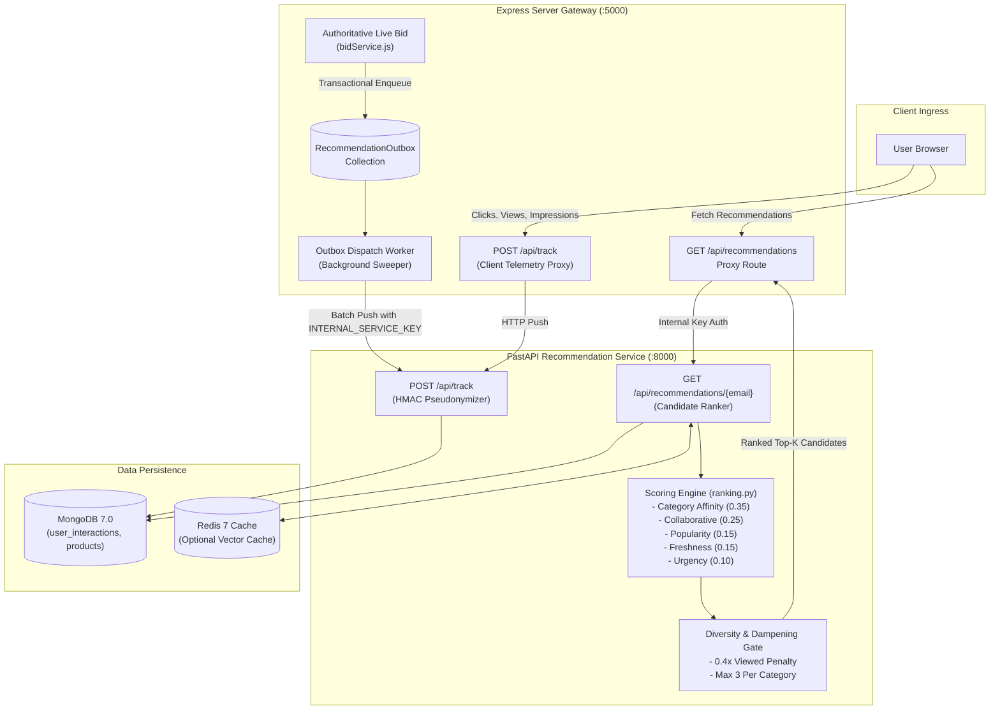
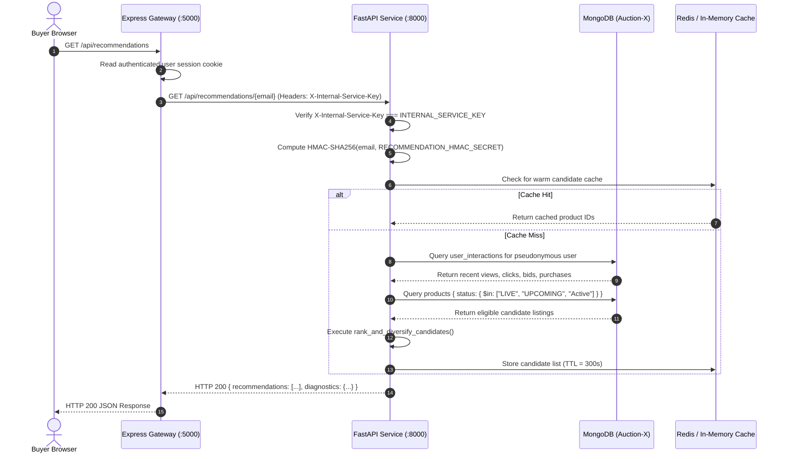
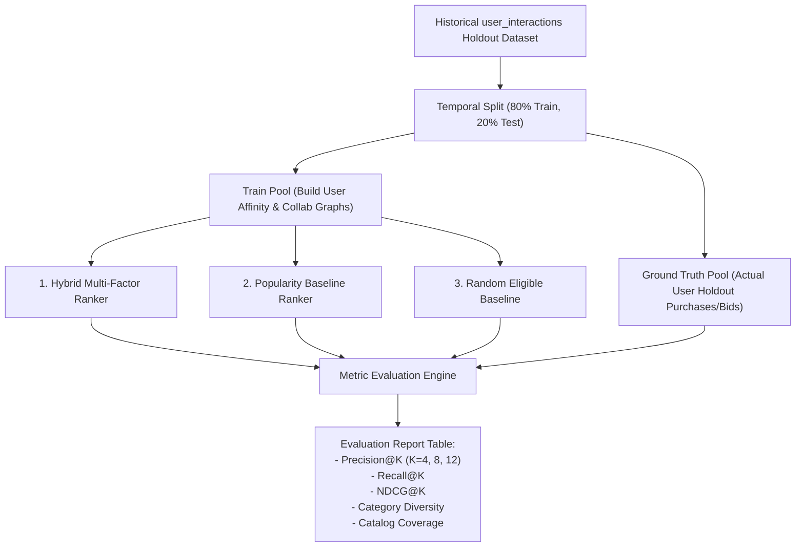

# AuctionX AI Recommendation Microservice (`recommendation_service/`)

The AuctionX Recommendation Microservice is a high-performance Python service engineered with **FastAPI**, **Uvicorn**, **PyMongo**, and **NumPy**. Operating as a decoupled analytics and candidate-ranking engine, it provides multi-factor personalized catalog recommendations, candidate diversification, repetition dampening, real-time auction lifecycle resolution, and offline quality evaluation without coupling machine-learning inference latency to user-facing live auction bidding transactions.

---

## Table of Contents

- [1. Overview & Service Philosophy](#1-overview--service-philosophy)
- [2. Technology Stack & Key Dependencies](#2-technology-stack--key-dependencies)
- [3. Microservice Architecture & Data Flow](#3-microservice-architecture--data-flow)
- [4. Source Code Layout & Module Map](#4-source-code-layout--module-map)
- [5. Application Lifecycle & Startup Hooks](#5-application-lifecycle--startup-hooks)
- [6. Comprehensive API Specifications & Endpoint Contracts](#6-comprehensive-api-specifications--endpoint-contracts)
  - [`GET /health` & `GET /ready` (Liveness & Readiness Probes)](#get-health-liveness-probe)
  - [`GET /metrics` (Operational Telemetry Snapshot)](#get-metrics-operational-telemetry-snapshot)
  - [`POST /api/track` & `POST /api/track/batch` (Telemetry Ingestion)](#post-apitrack-telemetry-ingestion)
  - [`GET /api/recommendations` (Guest & Catalog Feed)](#get-apirecommendations-guest--catalog-feed)
  - [`GET /api/recommendations/{email}` (Personalized Feed)](#get-apirecommendationsemail-personalized-feed)
- [7. Security Architecture, PII Protection & HMAC Pseudonymization](#7-security-architecture-pii-protection--hmac-pseudonymization)
  - [Internal Service Key Barrier (`INTERNAL_SERVICE_KEY`)](#internal-service-key-barrier-internal_service_key)
  - [Cryptographic User Pseudonymization (`RECOMMENDATION_HMAC_SECRET`)](#cryptographic-user-pseudonymization-recommendation_hmac_secret)
  - [Event Idempotency & Header Validation](#event-idempotency--header-validation)
- [8. Multi-Factor Scoring & Ranking Algorithm (`ranking.py`)](#8-multi-factor-scoring--ranking-algorithm-rankingpy)
  - [Interaction Intent Weights](#interaction-intent-weights)
  - [Normalized Multi-Factor Feature Weights](#normalized-multi-factor-feature-weights)
  - [Feature Score Formulations](#feature-score-formulations)
  - [Auction Lifecycle & Temporal Validity Filtering](#auction-lifecycle--temporal-validity-filtering)
  - [Repetition Control & Viewed Item Dampening (0.4x Penalty)](#repetition-control--viewed-item-dampening-04x-penalty)
  - [Category Diversity Enforcement & Slot Capping](#category-diversity-enforcement--slot-capping)
  - [Deterministic Sorting & Tie-Breaking Rules](#deterministic-sorting--tie-breaking-rules)
  - [Cold-Start & Insufficient-History Fallbacks](#cold-start--insufficient-history-fallbacks)
- [9. Offline Recommendation Quality Evaluation (`evaluation.py`)](#9-offline-recommendation-quality-evaluation-evaluationpy)
  - [Evaluation Metrics Formulation (K in [4, 8, 12])](#evaluation-metrics-formulation-k-in-4-8-12)
  - [Temporal Holdout Validation Architecture](#temporal-holdout-validation-architecture)
  - [Baseline Comparison Models](#baseline-comparison-models)
- [10. Persistence, PyMongo Integration & Caching Layer](#10-persistence-pymongo-integration--caching-layer)
  - [Deterministic MongoDB URI Resolution](#deterministic-mongodb-uri-resolution)
  - [Redis Caching & In-Memory Fallback Adapter](#redis-caching--in-memory-fallback-adapter)
- [11. CORS Configuration & Cross-Origin Policies](#11-cors-configuration--cross-origin-policies)
- [12. Environment Variable Reference & Safe Configuration](#12-environment-variable-reference--safe-configuration)
- [13. Local Setup & Python Environment Provisioning](#13-local-setup--python-environment-provisioning)
- [14. Automated Testing & Verification Framework](#14-automated-testing--verification-framework)
- [15. Docker Container Architecture & Multi-Stage Build](#15-docker-container-architecture--multi-stage-build)
- [16. Troubleshooting & Operational Failure Modes](#16-troubleshooting--operational-failure-modes)
- [17. Known Limitations & Algorithmic Boundaries](#17-known-limitations--algorithmic-boundaries)
- [18. Future Algorithmic Roadmap](#18-future-algorithmic-roadmap)
- [19. Subsystem Cross-References](#19-subsystem-cross-references)

---

## 1. Overview & Service Philosophy

In real-time auction platforms, sub-second latency is critical. Coupling machine-learning recommendation models directly to live auction request flows introduces dangerous performance bottlenecks and failure cascading.

The AuctionX Recommendation Microservice adheres to three core architectural principles:
1. **Decoupled Asynchronous Telemetry**: Low-overhead client interactions (`view`, `click`, `impression`) and authoritative backend transactions (`bid`, `purchase`) are ingested via asynchronous streams and transactional outboxes without blocking live auction state transitions.
2. **Defensive PII Minimization**: Customer email addresses and personal identities never enter recommendation database collections. Raw emails are transformed into keyed HMAC-SHA256 pseudonyms at the boundary.
3. **Resilient Degradation**: If the recommendation engine experiences downtime or high load, the central Express API gateway seamlessly falls back to local database sorting (popularity and freshness) without interrupting user browsing.



---

## 2. Technology Stack & Key Dependencies

The service is built with Python 3.10+ using audited, high-performance packages specified in `pyproject.toml` and `requirements.txt`:

| Package | Version | Architectural Role in Recommendation Engine |
| :--- | :--- | :--- |
| **FastAPI** | `^0.115.0` | Asynchronous ASGI web framework, type hinting, OpenAPI schema generation. |
| **Uvicorn** | `^0.29.0` | High-throughput asynchronous ASGI server with uvloop event loops. |
| **PyMongo** | `^4.7.2` | Native synchronous Python MongoDB driver for interaction aggregation pipelines. |
| **DNSPython** | `^2.7.0` | DNS SRV protocol resolution required for MongoDB Atlas connection strings. |
| **NumPy** | `^1.26.4` | Vectorized mathematical operations, dot-product calculations, temporal half-life decay. |
| **Pydantic** | `^2.6.4` | Data validation, request payload parsing, and response serialization schemas. |
| **Python-Dotenv** | `^1.0.1` | Automated environment variable loading from local `.env` files. |
| **Redis** | `^5.0.4` | *(Optional)* Redis client for warm candidate vector and session caching. |
| **Pytest** | `^9.1.1` | Unit and regression test runner with parameterized test cases. |
| **AnyIO** | `^4.11.0` | Asynchronous test harness integration for FastAPI TestClient. |

---

## 3. Microservice Architecture & Data Flow



---

## 4. Source Code Layout & Module Map

The microservice follows a domain-centric, layered modular architecture located in `src/auctionx_recommendations/` with backward-compatibility facades at the package root:

```
recommendation_service/
├── src/
│   └── auctionx_recommendations/
│       ├── domain/
│       │   ├── exceptions.py             # Pure domain exception taxonomy
│       │   ├── models/                   # Domain entities (Auction, Interaction, Recommendation)
│       │   ├── policies/                 # Auction lifecycle & eligibility policies
│       │   └── ranking/                  # Mathematical scoring, temporal decay, diversity gate
│       ├── application/
│       │   ├── ports/                    # Abstract repository and cache interfaces
│       │   ├── use_cases/                # Core use cases (GetRecommendations, RecordInteractions)
│       │   └── services/                 # Application workflow orchestration services
│       ├── infrastructure/
│       │   ├── config/settings.py        # Typed runtime configuration & MongoDB URI resolution
│       │   ├── database/                 # PyMongo lifecycle & concrete repository adapters
│       │   ├── cache/                    # Redis cache adapter with graceful in-memory fallback
│       │   ├── security/                 # Constant-time auth & HMAC-SHA256 pseudonymization
│       │   └── observability/            # Structured logging & operational metrics
│       ├── api/
│       │   ├── middleware/               # Request correlation ID & access logging
│       │   ├── exception_handlers.py     # Domain-to-HTTP exception mapping
│       │   ├── dependencies.py           # FastAPI dependency injection providers
│       │   └── v1/                       # Versioned REST endpoints (health, recommendations, interactions)
│       └── evaluation/
│           └── offline_evaluation.py     # Offline evaluation metrics (NDCG@K, Precision@K, Diversity)
├── tests/
│   ├── conftest.py                       # Shared test fixtures & environment isolation
│   ├── test_recommendations.py           # Baseline regression suite (68 tests)
│   ├── unit/                             # Domain ranking, eligibility & config unit tests
│   ├── contract/                         # API schema & status code contract verification
│   └── security/                         # Auth barrier, tamper resistance & PII privacy tests
├── scripts/
│   ├── verify_environment.py             # Diagnostic script verifying settings, MongoDB & Redis
│   └── evaluate_recommendations.py       # Offline evaluation script benchmarking ranking quality
├── docs/
│   ├── architecture.md                   # System context & layered architecture specification
│   ├── api-contracts.md                  # Detailed endpoint contracts, schemas & status codes
│   ├── operations.md                     # Operational procedures, monitoring & incident playbooks
│   └── adr/                              # Architectural Decision Records (0001, 0002, 0003)
├── evaluation.py                         # Backward-compatibility facade for offline evaluation
├── main.py                               # Backward-compatibility facade & ASGI entrypoint
├── ranking.py                            # Backward-compatibility facade for domain ranking symbols
├── pyproject.toml                        # Modern packaging configuration (auctionx-recommendations v2.0.0)
├── requirements.txt                      # Production dependencies (FastAPI, PyMongo, NumPy, Uvicorn)
├── requirements-dev.txt                  # Development and test dependencies (Pytest, AnyIO)
├── test_cors_regression.py               # Automated regression suite for CORS preflight options
└── Dockerfile                            # Multi-stage container definition with non-root security
```

### Module Responsibilities & Architectural Boundaries
- **Domain Layer (`domain/`)**: Pure business logic with zero framework dependencies. Implements deterministic multi-factor ranking (`ranking/engine.py`), feature normalization (`ranking/features.py`), lifecycle evaluation (`policies/auction_eligibility.py`), and domain entities.
- **Application Layer (`application/`)**: Coordinates ranking and interaction recording through explicit ports (`AuctionRepository`, `InteractionRepository`, `CachePort`). Independent of web frameworks and database drivers.
- **Infrastructure Layer (`infrastructure/`)**: Implements concrete adapters for MongoDB Atlas / standalone (`mongo_client.py`), Redis caching with silent in-memory fallback (`redis_cache.py`), constant-time key validation (`internal_auth.py`), and cryptographic pseudonymization (`pseudonymization.py`).
- **Transport Layer (`api/`)**: FastAPI routes, Pydantic v2 schemas (`v1/schemas.py`), correlation ID injection, and standard HTTP error translation.
- **Root Facades (`main.py`, `ranking.py`, `evaluation.py`)**: Seamless zero-overhead compatibility proxies guaranteeing 100% backward compatibility for existing test suites, container startup commands, and CI runners (see [ADR 0003](docs/adr/0003-backward-compatibility-facades.md)).

---

## 5. Application Lifecycle & Startup Hooks

`main.py` utilizes FastAPI's modern `@asynccontextmanager lifespan(app)` architecture:

```python
# main.py (Lifespan Context)
@asynccontextmanager
async def lifespan(app: FastAPI):
    # Startup sequence:
    global mongo_client, db, redis_client
    mongo_uri, mongo_db_name = resolve_mongo_configuration()
    mongo_client = MongoClient(mongo_uri, serverSelectionTimeoutMS=3000)
    db = mongo_client[mongo_db_name]
    
    # Verify database connection
    try:
        mongo_client.admin.command("ping")
    except Exception as e:
        logger.warning(f"Initial MongoDB ping failed: {e}")

    # Initialize Redis if configured
    redis_url = os.getenv("REDIS_URL")
    if redis_url:
        try:
            redis_client = build_redis_client(redis_url)
        except Exception:
            redis_client = None

    yield # Service actively handling requests

    # Shutdown sequence:
    if mongo_client:
        mongo_client.close()
    if redis_client:
        redis_client.close()
```

---

## 6. Comprehensive API Specifications & Endpoint Contracts

### `GET /health` & `GET /api/health` (Liveness Probe)
- **Authentication**: None (Public).
- **Purpose**: Kubernetes/Docker liveness check verifying the HTTP event loop is responsive.
- **Response `200 OK`**:
  ```json
  {
    "status": "healthy",
    "service": "recommendation_service",
    "database": "Auction-X",
    "mongodb": true,
    "redis": true
  }
  ```

### `GET /ready` & `GET /api/ready` (Readiness Probe)
- **Authentication**: None (Public).
- **Purpose**: Kubernetes readiness check verifying active database and cache connectivity before serving traffic.
- **Response `200 OK`**:
  ```json
  {
    "status": "ready",
    "database": "Auction-X",
    "mongodb": true,
    "redis": true
  }
  ```
- **Response `503 Service Unavailable`**: Emitted if MongoDB cannot be pinged within 5000ms.

### `GET /metrics` & `GET /api/metrics` (Operational Telemetry Snapshot)
- **Authentication**: None (Internal operational scraping).
- **Purpose**: Exposes rolling in-memory request counts, status codes, and request durations.
- **Response `200 OK`**:
  ```json
  {
    "http_requests_total": 128,
    "http_status_200": 124,
    "http_status_403": 4,
    "http_request_duration_ms_avg_ms": 1.25,
    "http_request_duration_ms_p95_ms": 2.80
  }
  ```

### `POST /api/track` & `POST /track` (Telemetry Ingestion)
- **Authentication**:
  - `view`, `click`, `impression`: Public / Authenticated user.
  - `bid`, `purchase`: **Strictly requires** `X-Internal-Service-Key` header matching `INTERNAL_SERVICE_KEY`.
- **Request Body Payload**:
  ```json
  {
    "email": "buyer@example.com",
    "product_id": "65a123456789abcdef012345",
    "interaction_type": "click",
    "event_id": "evt_9f8e7d6c5b4a",
    "session_id": "sess_guest_uuid",
    "recommendation_id": "rec_uuid",
    "timestamp": "2026-10-26T18:00:00.000Z"
  }
  ```
- **Security Action**: Transforms raw email into an HMAC-SHA256 pseudonym before storing in `user_interactions`.
- **Response `200 OK`**: `{"status": "success", "tracked": true}`
- **Response `403 Forbidden`**: Emitted if client attempts to forge authoritative `bid`/`purchase` without valid internal service key, or if product is moderated.
- **Response `409 Conflict`**: Emitted if `event_id` was already recorded with conflicting attributes.

### `POST /api/track/batch` & `POST /track/batch` (Batch Telemetry Ingestion)
- **Authentication**: Accepts up to 25 buffered client events (e.g. viewport impressions).
- **Request Body**: `{"interactions": [...]}` or `{"batch": [...]}` (maximum 25 items).
- **Response `200 OK`**:
  ```json
  {
    "status": "success",
    "success": true,
    "processed_count": 12,
    "results": [{"status": "success", "tracked": true}]
  }
  ```

### `GET /api/recommendations` & `GET /recommendations` (Guest & Catalog Feed)
- **Authentication**: Public.
- **Query Parameters**:
  - `email` (optional): If provided, delegates to internal-key-protected personalization.
  - `session_id` (optional): Session-scoped guest personalization.
  - `count` (int, default: 10, range: 1–50): Number of items to return.
- **Response `200 OK`**: Slate object containing `recommendation_id`, `products`, `count`, `personalized`, `cache_hit`, and `diagnostics`.

### `GET /api/recommendations/{email}` & `GET /recommendations/{email}` (Personalized Feed)
- **Authentication**: Strictly requires `X-Internal-Service-Key` matching `INTERNAL_SERVICE_KEY`.
- **Query Parameters**:
  - `count` (int, default: 10, range: 1–50): Number of ranked candidates to return.
  - `session_id` (optional): Optional session attribution.
- **Response `200 OK`**:
  ```json
  {
    "recommendation_id": "671e9a2b-c3d4-4e5f-a6b7-c8d9e0f1a2b3",
    "products": [
      {
        "_id": "65a123456789abcdef012345",
        "name": "Rolex Submariner Date",
        "category": "Watches",
        "currentPrice": 9500,
        "bidCount": 14,
        "lifecycleStatus": "LIVE",
        "secondsRemaining": 3600.0
      }
    ],
    "recommendations": [ ... ],
    "count": 1,
    "personalized": true,
    "cache_hit": false,
    "diagnostics": {
      "channel_counts": {
        "category_channel": 4,
        "collaborative_channel": 2,
        "popular_channel": 3,
        "freshness_channel": 1,
        "upcoming_channel": 0
      },
      "algorithm": "heuristic_hybrid_ranker_v2",
      "model_type": "heuristic_rule_composite",
      "is_ml_trained": false
    }
  }
  ```
- **Response `403 Forbidden`**: Emitted if `X-Internal-Service-Key` header is missing or does not match `INTERNAL_SERVICE_KEY`.
- **Response `503 Service Unavailable`**: Emitted if `INTERNAL_SERVICE_KEY` is not configured on the service.

---

## 7. Security Architecture, PII Protection & HMAC Pseudonymization

```mermaid
graph TD
    Inbound["Inbound Telemetry / Recommendation Request"] --> KeyCheck{Requires Internal Auth?}
    KeyCheck -->|Public Telemetry (view/click)| PublicFlow[Allow Request]
    KeyCheck -->|Authoritative Action (bid/purchase) OR Direct Email Query| Gate[Inspect X-Internal-Service-Key]

    Gate -->|Header Missing or Mismatch| Reject403[403 Forbidden: Invalid Service Key]
    Gate -->|Matches INTERNAL_SERVICE_KEY| HMAC[compute_pseudonymous_user_id]

    PublicFlow --> HMAC
    HMAC -->|HMAC-SHA256(email, RECOMMENDATION_HMAC_SECRET)| Pseudonym["64-Character Hex Digest<br/>(e.g., 'a3f1c8...')"]
    Pseudonym --> DBWrite[Insert into user_interactions<br/>ZERO Raw PII Stored]
```

### Internal Service Key Barrier (`INTERNAL_SERVICE_KEY`)
Endpoints handling raw customer emails or privileged business transactions (`bid`, `purchase`) enforce a strict header barrier:
```python
# main.py (Internal service authentication)
def verify_internal_service_key(request: Request):
    expected_key = os.getenv("INTERNAL_SERVICE_KEY")
    if not expected_key:
        raise HTTPException(status_code=503, detail="INTERNAL_SERVICE_KEY not configured on server")
    
    inbound_key = request.headers.get("X-Internal-Service-Key")
    if not inbound_key or not hmac.compare_digest(inbound_key, expected_key):
        raise HTTPException(status_code=403, detail="Forbidden: Invalid or missing internal service key")
```

### Cryptographic User Pseudonymization (`RECOMMENDATION_HMAC_SECRET`)
To comply with strict privacy regulations (GDPR/DPDP) and prevent PII leakage:
```python
# main.py (HMAC Pseudonym derivation)
def compute_pseudonymous_user_id(email: str) -> str:
    secret = os.getenv("RECOMMENDATION_HMAC_SECRET", "default-fallback-secret").encode("utf-8")
    return hmac.new(secret, email.strip().lower().encode("utf-8"), hashlib.sha256).hexdigest()
```
The raw email string is immediately discarded from memory. Only the 64-character SHA-256 digest is stored or queried in `user_interactions`.

---

## 8. Multi-Factor Scoring & Ranking Algorithm (`ranking.py`)

The candidate scoring engine implements a composite multi-factor ranking model:

### Interaction Intent Weights
User actions reflect varying degrees of purchase intent:
```python
INTERACTION_WEIGHTS = {
    "purchase": 10.0,
    "bid": 5.0,
    "click": 2.0,
    "view": 1.0,
    "impression": 0.0,
}
```

### Normalized Multi-Factor Feature Weights
Scores sum to `1.0` and are configurable via `DEFAULT_RANKING_WEIGHTS`:
- **`category_affinity` (Weight: 0.35)**: Measures user interest alignment with candidate item's category.
- **`collaborative` (Weight: 0.25)**: Item-to-item co-occurrence score derived from cross-user interaction histories.
- **`popularity` (Weight: 0.15)**: Log-normalized bid count relative to the catalog maximum.
- **`freshness` (Weight: 0.15)**: Exponential decay based on listing age.
- **`urgency` (Weight: 0.10)**: Bounded score favoring live auctions approaching their closing window.

### Feature Score Formulations
1. **Category Affinity**:
   $$\text{Score}_{\text{cat}} = \frac{\text{affinity\_counts}[\text{category}]}{\max(\text{affinity\_counts})}$$
2. **Collaborative Co-Occurrence**:
   $$\text{Score}_{\text{collab}} = \frac{\text{collab\_counts}[\text{product\_id}]}{\max(\text{collab\_counts})}$$
3. **Popularity**:
   $$\text{Score}_{\text{pop}} = \frac{\ln(1 + \text{bidCount})}{\ln(1 + \max(\text{catalog\_bids}))}$$
4. **Freshness**:
   $$\text{Score}_{\text{fresh}} = \exp\left(-\frac{\text{hours\_since\_creation}}{168.0}\right)$$
5. **Urgency**:
   $$\text{Score}_{\text{urgency}} = \max\left(0.0, 1.0 - \frac{\text{seconds\_remaining}}{86400.0}\right) \quad (\text{if LIVE, else } 0.0)$$

### Implementation Breakdown (`calculate_feature_scores`)
The pure feature calculation function in `ranking.py` normalizes raw catalog metrics into $[0.0, 1.0]$ bounds:
```python
def calculate_feature_scores(
    product: Dict[str, Any],
    lifecycle: Dict[str, Any],
    user_category_affinity: Counter,
    collab_scores: Counter,
    max_bids: int = 1,
    now: Optional[datetime] = None,
) -> Dict[str, float]:
    """Calculates normalized individual feature scores in [0.0, 1.0]."""
    cat = product.get("category", "General")
    max_aff = max(user_category_affinity.values()) if user_category_affinity else 1
    cat_score = (user_category_affinity.get(cat, 0) / max_aff) if max_aff > 0 else 0.0

    pid_str = str(product.get("_id", ""))
    max_collab = max(collab_scores.values()) if collab_scores else 1
    collab_score = (collab_scores.get(pid_str, 0) / max_collab) if max_collab > 0 else 0.0

    bids = product.get("bidCount", 0)
    pop_score = math.log1p(bids) / math.log1p(max(1, max_bids))

    hours_old = max(0.0, (now - created_at).total_seconds() / 3600.0)
    fresh_score = math.exp(-hours_old / 168.0) # 1-week half-life exponential decay

    # Controlled urgency: 0 for upcoming, scaled by remaining seconds for live
    seconds_remaining = lifecycle.get("seconds_remaining") or 86400.0
    urgency_score = max(0.0, 1.0 - (seconds_remaining / 86400.0)) if is_live else 0.0

    return {
        "category_affinity": round(min(1.0, max(0.0, cat_score)), 4),
        "collaborative": round(min(1.0, max(0.0, collab_score)), 4),
        "popularity": round(min(1.0, max(0.0, pop_score)), 4),
        "freshness": round(min(1.0, max(0.0, fresh_score)), 4),
        "urgency": round(min(1.0, max(0.0, urgency_score)), 4),
    }
```

### Auction Lifecycle & Temporal Validity Filtering
Before scoring, candidates pass through `resolve_auction_lifecycle()`:
- Auctions marked `Closed`, `ENDED`, `SETTLED`, `UNSOLD`, or `CANCELLED` are immediately discarded.
- Items past their `endTime` are filtered out.
- Strictly `LIVE` and `UPCOMING` listings are admitted to the ranking pool.

### Repetition Control & Viewed Item Dampening (0.4x Penalty)
If a candidate item's ID exists in the user's `viewed_product_ids` set:
$$\text{Composite Score} \leftarrow \text{Composite Score} \times 0.4$$
This penalizes already-viewed items, ensuring unviewed auctions rank higher while still retaining viewed items as backfill on small catalogs.

### Category Diversity Enforcement & Slot Capping
To prevent recommendation feeds from being dominated by a single category (e.g. 10 luxury watches in a row):
- The ranker caps the maximum items from any single category to **3** (`max_per_category = 3`).
- Excess items from a category are pushed to a `deferred_products` buffer.
- If diverse selections do not fill the requested `count`, deferred items backfill remaining slots.

### Deterministic Sorting & Tie-Breaking Rules
Scored items sort according to a 4-level deterministic tuple:
```python
scored_items.sort(key=lambda x: (-x["is_live"], -x["score"], -x["bidCount"], x["id_str"]))
```
1. `is_live` DESC: Live auctions take priority over Upcoming listings.
2. `score` DESC: Highest composite score.
3. `bidCount` DESC: Higher activity wins ties.
4. `id_str` ASC: Hex string tie-breaker guarantees identical ordering across identical queries.

---

## 9. Offline Recommendation Quality Evaluation (`evaluation.py`)

The microservice includes a standalone offline evaluation suite that benchmarks the ranking engine on historical holdout data:



### Evaluation Metrics Formulation (K in [4, 8, 12])
- **Precision@K**: Fraction of top-K recommendations present in holdout interactions.
- **Recall@K**: Fraction of actual user holdout interactions retrieved in top-K.
- **NDCG@K**: Normalized Discounted Cumulative Gain under binary relevance:
  $$\text{DCG}@K = \sum_{i=1}^{K} \frac{\text{rel}_i}{\log_2(i + 1)}, \quad \text{NDCG}@K = \frac{\text{DCG}@K}{\text{IDCG}@K}$$
- **Category Diversity**: Ratio of unique categories represented in top-K recommendations.
- **Catalog Coverage**: Percentage of total eligible catalog items surfaced across all user recommendation sets.

### Evaluation Code Implementation (`evaluation.py`)
```python
def compute_precision_at_k(recommended_ids: List[str], ground_truth_ids: Set[str], k: int) -> float:
    """Computes Precision@K: fraction of top-K recommendations that were interacted with."""
    if k <= 0 or not recommended_ids:
        return 0.0
    top_k = recommended_ids[:k]
    hits = sum(1 for pid in top_k if pid in ground_truth_ids)
    return hits / float(k)

def compute_ndcg_at_k(recommended_ids: List[str], ground_truth_ids: Set[str], k: int) -> float:
    """Computes Normalized Discounted Cumulative Gain at K (NDCG@K) under binary relevance."""
    if k <= 0 or not recommended_ids or not ground_truth_ids:
        return 0.0
    top_k = recommended_ids[:k]
    dcg = 0.0
    for i, pid in enumerate(top_k):
        if pid in ground_truth_ids:
            dcg += 1.0 / math.log2(i + 2)
    ideal_hits = min(len(ground_truth_ids), k)
    idcg = sum(1.0 / math.log2(i + 2) for i in range(ideal_hits))
    return (dcg / idcg) if idcg > 0.0 else 0.0
```

---

## 10. Persistence, PyMongo Integration & Caching Layer

### Deterministic MongoDB URI Resolution
`resolve_mongo_configuration()` deterministically parses connection details:
- Checks `MONGODB_URI` (default: `mongodb://127.0.0.1:27017`).
- Extracts database name from URI path or checks `MONGODB_DB` (default: `Auction-X`).

### Redis Caching & In-Memory Fallback Adapter
- If `REDIS_URL` is set, the service stores serialized top-K candidate lists with a 300-second TTL.
- If Redis is absent or unreachable, candidate generation falls back seamlessly to in-memory Python dictionaries with zero service disruption.

---

## 11. CORS Configuration & Cross-Origin Policies

The service mounts Starlette's `CORSMiddleware`:
```python
origins = os.getenv("RECOMMENDATION_ALLOWED_ORIGINS", "http://localhost:3000,http://localhost:5000,http://localhost:5173").split(",")

app.add_middleware(
    CORSMiddleware,
    allow_origins=[o.strip() for o in origins if o.strip()],
    allow_credentials=True,
    allow_methods=["*"],
    allow_headers=["*"],
)
```
CORS preflight `OPTIONS` requests are verified by automated tests in `test_cors_regression.py`.

---

## 12. Environment Variable Reference & Safe Configuration

Configure `recommendation_service/.env` based on the following reference:

| Variable Name | Required | Default Value | Purpose |
| :--- | :--- | :--- | :--- |
| `PORT` | Optional | `8000` | Port on which Uvicorn binds the ASGI application. |
| `MONGODB_URI` | **Required** | `mongodb://127.0.0.1:27017` | MongoDB connection URI. |
| `MONGODB_DB` | Optional | `Auction-X` | Target MongoDB database name. |
| `INTERNAL_SERVICE_KEY` | **Required** | Cryptographic random string | Shared secret matching `server/.env` for internal route authentication. |
| `RECOMMENDATION_HMAC_SECRET` | **Required** | Cryptographic random string | Secret key used to derive HMAC-SHA256 user pseudonyms. |
| `REDIS_URL` | Optional | `redis://localhost:6379/0` | Optional Redis cache server URI. |
| `RECOMMENDATION_ALLOWED_ORIGINS` | Optional | `http://localhost:3000,http://localhost:5000` | Whitelisted CORS origin list. |

---

## 13. Local Setup & Python Environment Provisioning

All commands run from `recommendation_service/`:

```powershell
# Navigate to microservice directory
cd recommendation_service

# Create isolated Python virtual environment
python -m venv .venv

# Activate virtual environment
# On Windows (PowerShell):
.\.venv\Scripts\Activate.ps1
# On Unix / macOS:
# source .venv/bin/activate

# Upgrade pip package installer
python -m pip install --upgrade pip

# Install production dependencies
pip install -r requirements.txt

# Install development and test dependencies
pip install -r requirements-dev.txt

# Launch development server with auto-reload on http://localhost:8000
uvicorn main:app --reload --port 8000
```

---

## 14. Automated Testing & Verification Framework

The microservice includes a comprehensive 107-test automated verification suite across domain unit tests, API contract tests, security tests, CORS preflight checks, and baseline regression tests:

```powershell
# Execute complete Pytest suite (102 tests passing: Unit, Baseline, Contract, Security)
pytest -v

# Run specific test suites
pytest tests/unit/ -v            # Domain ranking, eligibility & config unit tests
pytest tests/contract/ -v        # API schemas, HTTP status codes & proxy contracts
pytest tests/security/ -v        # Auth barriers, key validation & PII privacy tests
pytest tests/test_recommendations.py -v # Baseline regression suite (68 tests)

# Execute CORS regression verification suite (5 tests passing)
python test_cors_regression.py

# Verify runtime environment & service dependencies
python scripts/verify_environment.py

# Benchmark ranking quality via offline evaluation harness
python scripts/evaluate_recommendations.py
```

### Test Coverage Highlights
- **Domain Ranking & Weights (`tests/unit/test_ranking_domain.py`)**: Tests individual score components, normalized composite summation, 0.4x repetition dampening, and category diversity capping.
- **Auction Lifecycle & Policies (`tests/unit/test_eligibility_policies.py`)**: Asserts expired, ended, settled, cancelled, and upcoming auction states evaluate strictly according to business policies.
- **API Contract Verification (`tests/contract/test_api_contracts.py`)**: Tests response payload structure, diagnostic counters, and route compatibility for Express backend proxies.
- **Security & Authorization (`tests/security/test_security_contracts.py`)**: Validates missing/invalid internal service keys, HMAC pseudonymization determinism, and payload tamper resistance.
- **CORS Preflight Regression (`test_cors_regression.py`)**: Validates preflight `OPTIONS` requests across configured origins.
- **Baseline Integration Suite (`tests/test_recommendations.py`)**: 68 existing tests verifying end-to-end integration and mock persistence behavior.

---

## 15. Docker Container Architecture & Multi-Stage Build

The service includes a production-hardened `Dockerfile` enforcing security best practices:

```dockerfile
# recommendation_service/Dockerfile
FROM python:3.11-slim AS builder

WORKDIR /app
RUN apt-get update && apt-get install -y --no-install-recommends gcc && rm -rf /var/lib/apt/lists/*
COPY requirements.txt .
RUN pip install --no-cache-dir --prefix=/install -r requirements.txt

FROM python:3.11-slim

WORKDIR /app
# Security: Create non-root unprivileged service account
RUN addgroup --system --gid 10001 appgroup && \
    adduser --system --uid 10001 --gid 10001 appuser

COPY --from=builder /install /usr/local
COPY . .

# Set unprivileged user permissions
USER appuser:appgroup

EXPOSE 8000

HEALTHCHECK --interval=30s --timeout=5s --start-period=5s --retries=3 \
  CMD python -c "import urllib.request; urllib.request.urlopen('http://localhost:8000/health')" || exit 1

CMD ["uvicorn", "main:app", "--host", "0.0.0.0", "--port", "8000"]
```

---

## 16. Troubleshooting & Operational Failure Modes

### 1. HTTP 503 "INTERNAL_SERVICE_KEY not configured on server"
- **Symptom**: Requests to `/api/recommendations/{email}` fail with HTTP 503.
- **Root Cause**: `INTERNAL_SERVICE_KEY` environment variable is missing from `recommendation_service/.env`.
- **Resolution**: Generate a secure 32-character random string and place it in both `server/.env` and `recommendation_service/.env`.

### 2. HTTP 403 "Forbidden: Invalid or missing internal service key"
- **Symptom**: Express gateway receives 403 when proxying recommendations.
- **Root Cause**: The key supplied in `server/.env` does not match the key in `recommendation_service/.env`.
- **Resolution**: Synchronize `INTERNAL_SERVICE_KEY` across both `.env` files and restart both processes.

### 3. Empty Recommendations Returned for New Users
- **Symptom**: Endpoint returns empty list `[]`.
- **Root Cause**: Catalog has zero `LIVE` or `UPCOMING` listings, or `fallback=false` was passed for a cold-start user.
- **Resolution**: Seed active listings via `npm run seed:demo --prefix server` and verify `fallback=true` is enabled.

---

## 17. Known Limitations & Algorithmic Boundaries

1. **Heuristic vs. Deep Learning**: The current model is a deterministic heuristic ranker (collaborative co-occurrence and category vectors). It does not employ neural two-tower embeddings or matrix factorization.
2. **Synchronous PyMongo Driver**: While FastAPI runs asynchronously on Uvicorn, PyMongo queries execute synchronously within threadpools. Very high traffic should transition to Motor or MongoDB AsyncIO.
3. **In-Memory Graph Limits**: Item-to-item co-occurrence matrices are computed dynamically in memory. For catalogs exceeding 100,000 items, pre-computing embeddings offline is recommended.

---

## 18. Future Algorithmic Roadmap

- **Vector Embeddings**: Transition to vector search (e.g. pgvector or MongoDB Vector Search) using SentenceTransformers for semantic auction title matching.
- **Real-Time Click-Through Rate (CTR) Bandits**: Implement Contextual Multi-Armed Bandits (Thompson Sampling) to balance catalog exploration against exploitation.

---

## 19. Subsystem Cross-References & Microservice Documentation

- **[Microservice Architecture Specification](docs/architecture.md)**: Deep dive into layered design, domain boundaries, and data flow.
- **[API Endpoint Contracts](docs/api-contracts.md)**: Exhaustive request/response schemas, status codes, and error formatting.
- **[Operations & Reliability Guide](docs/operations.md)**: Deployment topologies, health checks, metrics, and incident playbooks.
- **[Architectural Decision Records (ADR)](docs/adr/)**: Formal ADRs for layered architecture, HMAC pseudonymization, and compatibility facades.
- **[Root Repository README](../README.md)**: Master architecture overview, security controls, and system-wide setup.
- **[Frontend Client README](../client/README.md)**: React 18 SPA architecture, Axios deduplication, and Socket.IO hooks.
- **[Backend Gateway README](../server/README.md)**: Express controllers, transactional outbox worker, and payment deduplication.
- **[Playwright E2E README](../e2e/README.md)**: Browser automation suites validating end-to-end auction flows.
