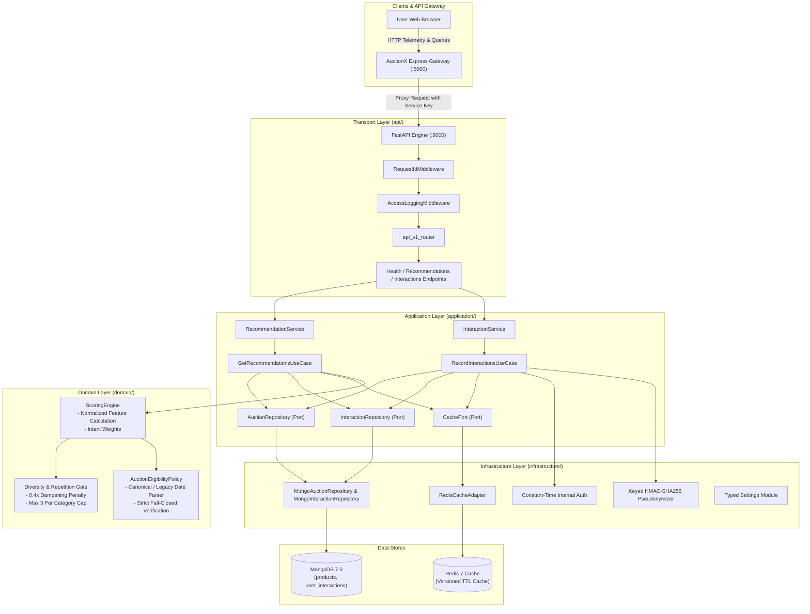

# AuctionX Recommendation Service — Target Architecture

## 1. Architectural Style & Mission

The AuctionX Recommendation Service is structured as a **domain-centric, layered modular monolith**. It provides real-time personalized candidate retrieval, multi-factor scoring, diversity enforcement, and telemetry ingestion for the AuctionX marketplace without introducing distributed locking, external message brokers, or heavy ML inference overhead to the core transaction flow.

---

## 2. Layer Responsibilities & Boundaries

### 2.1 API Transport Layer (`src/auctionx_recommendations/api/`)
- **FastAPI Routing**: Versioned routes (`/v1`) with transparent backward-compatibility aliases (`/health`, `/ready`, `/api/track`, `/api/recommendations`).
- **Middleware**: Injects request correlation IDs (`X-Request-ID` / `X-Correlation-ID`) and records structured JSON access logs.
- **Dependency Injection**: Supplies strongly typed use cases and infrastructure adapters to route handlers via `Depends()`.
- **Exception Handlers**: Converts domain-level business errors into standard HTTP status codes (400, 403, 404, 409, 503) without leaking database connection strings or stack traces.

### 2.2 Application Layer (`src/auctionx_recommendations/application/`)
- **Use Cases**:
  - `GetRecommendationsUseCase`: Orchestrates candidate retrieval across channels, collaborative affinity calculation, domain ranking, diversity filtering, and versioned Redis caching.
  - `RecordInteractionsUseCase`: Enforces schema validation, authoritative event gating (`bid`, `purchase`), product catalog visibility checks, sliding-window deduplication, and atomic cache invalidation.
- **Ports**: Abstract ABC interfaces decoupling application logic from concrete database drivers:
  - `AuctionRepository`
  - `InteractionRepository`
  - `CachePort`

### 2.3 Domain Layer (`src/auctionx_recommendations/domain/`)
- Pure business and ranking logic independent of FastAPI, MongoDB, Redis, or HTTP transport.
- **Auction Eligibility Policy**: Centralizes date parsing (`parse_iso_or_legacy_date`) and authoritative lifecycle resolution (`resolve_auction_lifecycle`).
- **Multi-Factor Scoring**: Calculates normalized sub-scores in `[0.0, 1.0]` across category affinity (0.35), collaborative filtering (0.25), popularity (0.15), freshness (0.15), and ending-soon urgency (0.10).
- **Repetition Dampening & Diversity**: Applies a 0.4x penalty to recently viewed items and enforces a maximum of 3 items per category in primary recommendation slots.

### 2.4 Infrastructure Layer (`src/auctionx_recommendations/infrastructure/`)
- **Config**: Typed `Settings` module resolving MongoDB URI, port, origins, and security keys.
- **Database**: Single managed PyMongo client lifecycle, connection pooling, and idempotent index management.
- **Cache**: Resilient `RedisCacheAdapter` providing bounded TTLs and non-blocking fallbacks when Redis is offline.
- **Security**: Constant-time `verify_internal_service_key` and keyed HMAC-SHA256 user pseudonymization.
