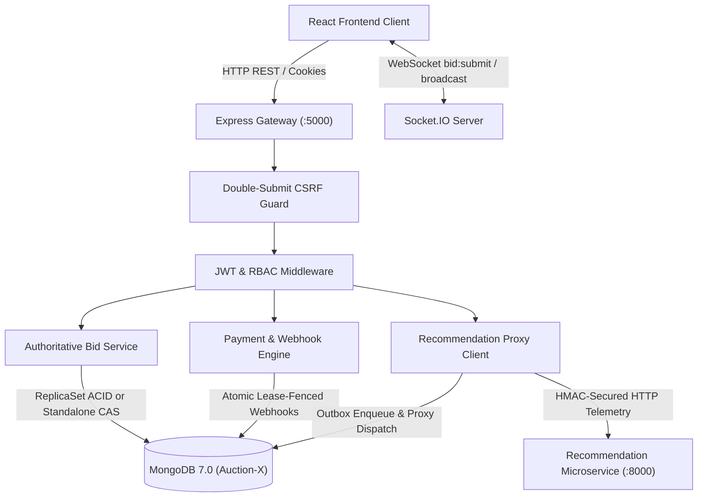
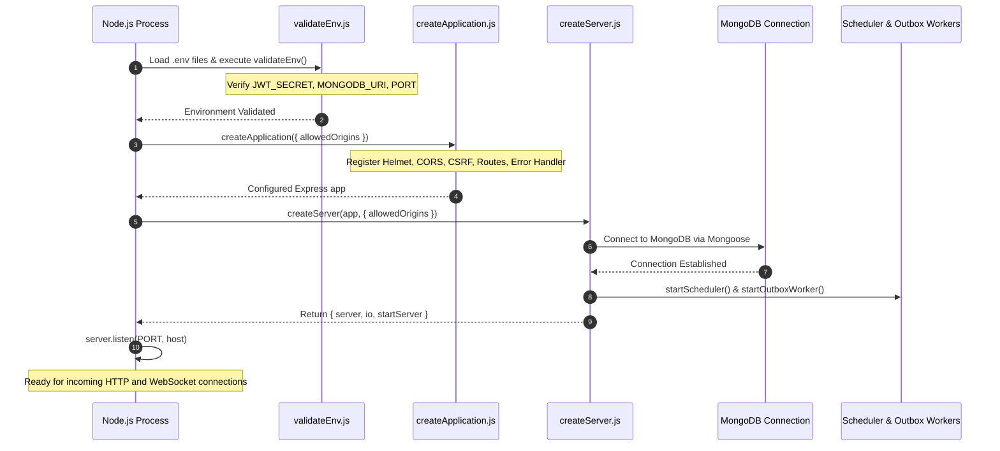
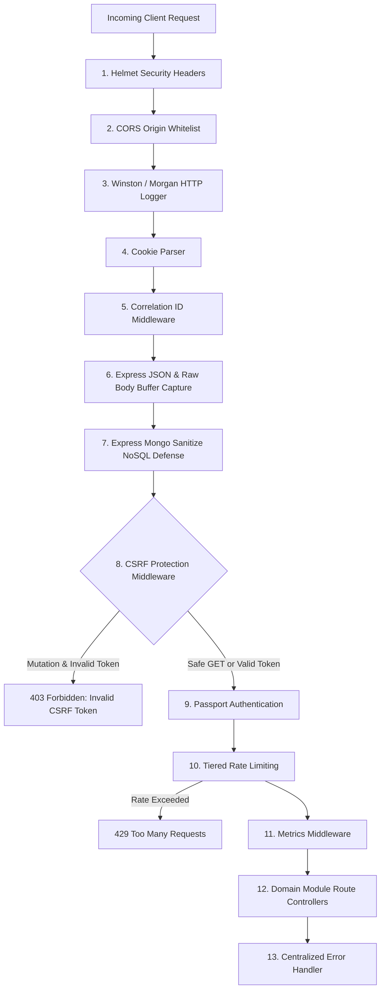
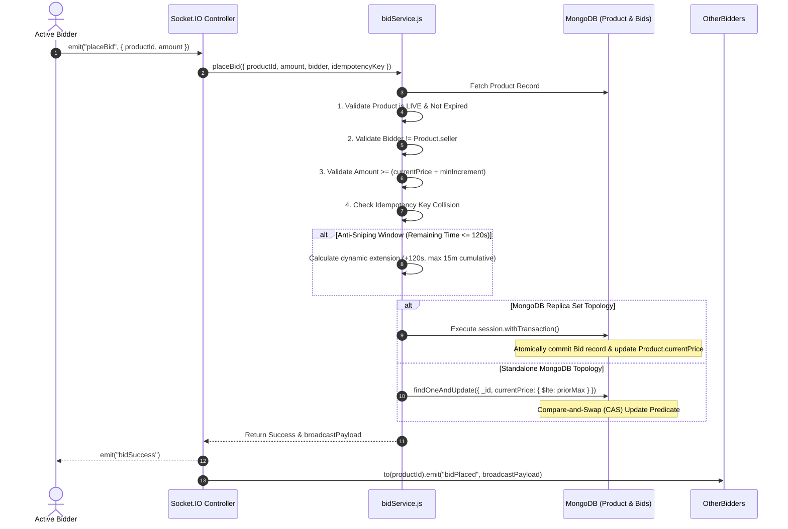
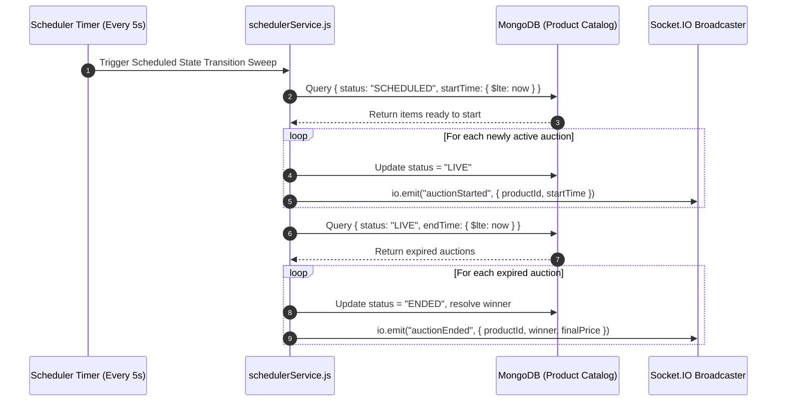
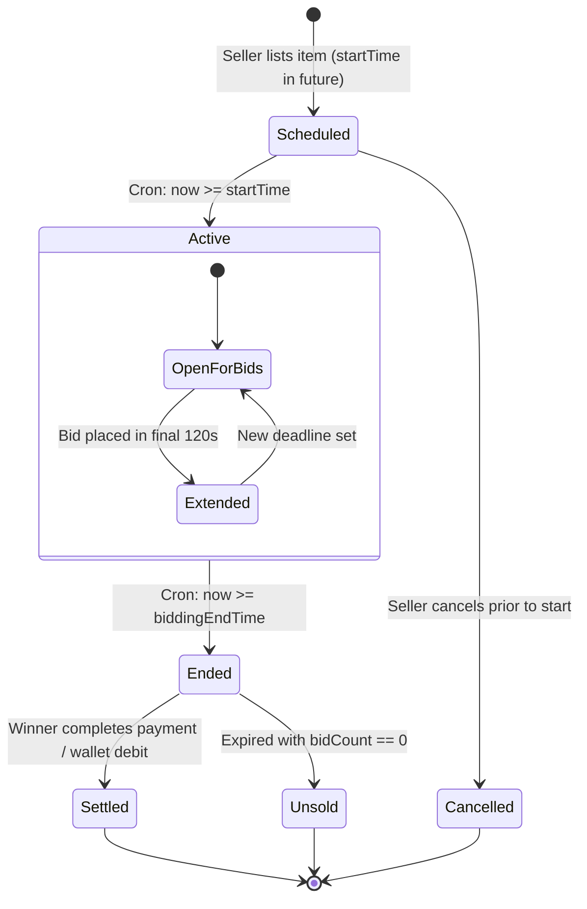

# AuctionX Backend Gateway & Core Services (`server/`)

The AuctionX backend is an enterprise-grade, modular Node.js and Express application acting as the central API gateway, transaction coordinator, real-time WebSocket hub, and persistence manager for the platform. It enforces server-authoritative state transitions, multi-document ACID transactions, atomic Compare-and-Swap (CAS) bidding predicates, anti-sniping dynamic soft-close extensions, idempotent payment settlements, and durable telemetry outbox queuing.

---

## Table of Contents

- [1. Overview & Service Boundaries](#1-overview--service-boundaries)
- [2. Technology Stack & Key Dependencies](#2-technology-stack--key-dependencies)
- [3. Modular Architecture & Directory Map](#3-modular-architecture--directory-map)
- [4. Application Lifecycle & Bootstrap Pipeline](#4-application-lifecycle--bootstrap-pipeline)
- [5. Middleware Execution Order & Ingress Security](#5-middleware-execution-order--ingress-security)
- [6. Comprehensive API Route Catalog & Endpoint Contracts](#6-comprehensive-api-route-catalog--endpoint-contracts)
- [7. Authentication, Session Tokens & Role-Based Access Control (RBAC)](#7-authentication-session-tokens--role-based-access-control-rbac)
- [8. Real-Time WebSocket Gateway (Socket.IO Architecture)](#8-real-time-websocket-gateway-socketio-architecture)
- [9. Bidding Engine & Concurrency Control](#9-bidding-engine--concurrency-control)
  - [Authoritative Bid Validation Rules](#authoritative-bid-validation-rules)
  - [Idempotent Bid Submissions](#idempotent-bid-submissions)
  - [Anti-Sniping Soft-Close Window Engine](#anti-sniping-soft-close-window-engine)
  - [Dual-Branch Concurrency (Replica Set vs. Standalone CAS)](#dual-branch-concurrency-replica-set-vs-standalone-cas)
- [10. Auction Scheduler & Lifecycle State Machine](#10-auction-scheduler--lifecycle-state-machine)
- [11. Payment Gateway, Webhook Deduplication & Accounting](#11-payment-gateway-webhook-deduplication--accounting)
  - [Razorpay Order Creation in Integer Paise](#razorpay-order-creation-in-integer-paise)
  - [Cryptographic Webhook Ingestion & Signature Checks](#cryptographic-webhook-ingestion--signature-checks)
  - [Lease-Fenced Webhook Deduplication Engine](#lease-fenced-webhook-deduplication-engine)
  - [Sequential Settlement & Self-Healing Convergence](#sequential-settlement--self-healing-convergence)
  - [Double-Entry Wallet Ledger & Transactions](#double-entry-wallet-ledger--transactions)
- [12. Recommendation Service Integration & Telemetry Outbox](#12-recommendation-service-integration--telemetry-outbox)
  - [Telemetry REST Proxy (`/api/track`)](#telemetry-rest-proxy-apitrack)
  - [Transactional Outbox Pattern (`RecommendationOutbox`)](#transactional-outbox-pattern-recommendationoutbox)
  - [Asynchronous Outbox Dispatch Worker](#asynchronous-outbox-dispatch-worker)
- [13. Media Ingestion, Buffer Inspection & Cloudinary Pipeline](#13-media-ingestion-buffer-inspection--cloudinary-pipeline)
- [14. Data Models, Canonical Schemas & Database Indexes](#14-data-models-canonical-schemas--database-indexes)
- [15. Observability, Structured Logging & Health Probes](#15-observability-structured-logging--health-probes)
- [16. Environment Variables & Safe Configuration](#16-environment-variables--safe-configuration)
- [17. Local Development & Operational Commands](#17-local-development--operational-commands)
- [18. Testing Pyramid & Verification Framework](#18-testing-pyramid--verification-framework)
- [19. Troubleshooting & Common Operational Failure Modes](#19-troubleshooting--common-operational-failure-modes)
- [20. Known Limitations & Production Hardening Boundaries](#20-known-limitations--production-hardening-boundaries)
- [21. Engineering Trade-Offs & Roadmap](#21-engineering-trade-offs--roadmap)
- [22. Subsystem Cross-References](#22-subsystem-cross-references)

---

## 1. Overview & Service Boundaries

The backend gateway isolates business rules, security boundaries, and data access into decoupled layers:
- **Express Application Gateway (`server.js`)**: Coordinates HTTP request pipelines, session verification, rate limiting, and RESTful routing across 18 modular domain packages.
- **Socket.IO Event Engine**: Manages real-time bidding rooms (`/`), connection authentication, and sub-second bid broadcasting.
- **Transactional Outbox Engine**: On MongoDB replica set deployments, user business events (`bid`, `purchase`) are enqueued to `recommendation_outbox` within the primary database transaction before asynchronous dispatch to the recommendation microservice.



---

## 2. Technology Stack & Key Dependencies

The backend subsystem is built on Node.js LTS and uses production-grade dependencies specified in `server/package.json`:

| Category | Package | Version | Purpose in AuctionX Backend |
| :--- | :--- | :--- | :--- |
| **Runtime Environment**| `node` | `>=20.9.0` | High-performance V8 JavaScript engine with native ES modules and crypto. |
| **Web Framework** | `express` | `^4.21.1` | HTTP routing, controller execution, and middleware chaining. |
| **Real-Time WebSockets**| `socket.io` | `^4.8.1` | Bid room namespaces, pub/sub broadcasting, transport heartbeat. |
| **Database ODM** | `mongoose` | `^8.7.2` | MongoDB object modeling, schema validation, transaction sessions. |
| **Security Headers** | `helmet` | `^8.1.0` | HTTP response headers (HSTS, CSP, X-Frame-Options, Sniffing). |
| **Input Sanitization** | `express-mongo-sanitize` | `^2.2.0` | Strips reserved MongoDB operator characters (`$` and `.`) from payloads. |
| **Rate Limiting** | `express-rate-limit` | `^7.5.0` | Tiered IP and account rate limiting against brute-force and DoS. |
| **Authentication** | `jsonwebtoken` | `^9.0.2` | Signed JWT session generation and cryptographic verification. |
| **Password Hashing** | `bcrypt` / `bcryptjs` | `^5.1.1` | Salted SHA-512 password hashing with 10 salt rounds. |
| **OAuth 2.0 Provider** | `passport` / `passport-google-oauth20` | `^0.7.0` | Google Identity federated authentication strategy. |
| **Media Processing** | `sharp` | `^0.35.5` | In-process native C++ pixel decoding, WebP transcoding, EXIF strip. |
| **Multipart Ingestion**| `multer` | `^1.4.5-lts.2` | Temporary disk storage for file uploads with size bounds. |
| **Cloud Media Storage**| `cloudinary` | `^2.6.0` | Off-site asset hosting, image transformations, public ID tracking. |
| **Payment REST Client**| `axios` | `^1.8.4` | Razorpay REST API communication, order creation, refunds. |
| **Email Dispatcher** | `nodemailer` | `^6.9.15` | SMTP email transport for OTPs, win notifications, and reports. |
| **PDF Rendering** | `pdfkit` | `^0.17.0` | Server-side invoice generation and receipts. |
| **Structured Logging** | `winston` / `morgan` | `^3.17.0` | JSON log emission, file transports, correlation ID tracking. |
| **Test Framework** | `jest` / `supertest` | `^30.5.2` | Test pyramid runner, HTTP endpoint assertion, mock transports. |

---

## 3. Modular Architecture & Directory Map

The backend source code is organized under `server/src/` into 18 bounded domain modules:

```
server/
├── config/                                # Legacy configuration fallbacks
├── migrations/                            # Database migration scripts
├── public/                                # Publicly served static assets
├── scripts/                               # Operational and diagnostic scripts
│   ├── administration/bootstrapAdmin.js   # Seed initial system administrator
│   ├── backup/backupAndRecoveryVerify.js  # DR and snapshot verification harness
│   └── data/seedDemoData.js               # Synthetic test catalog and user seeder
├── src/
│   ├── bootstrap/                         # System assembly and lifecycle
│   │   ├── application/createApplication.js # Express app assembly, middleware, routes
│   │   ├── server/createServer.js         # HTTP server, Socket.IO, background workers
│   │   └── shutdown/gracefulShutdown.js   # SIGTERM/SIGINT signal listeners, drain logic
│   ├── common/                            # Shared utilities and error primitives
│   │   ├── errors/errorHandler.js         # Centralized error middleware & AppError class
│   │   ├── types/                         # Common data type definitions
│   │   └── utilities/                     # Formatting, time calculation helpers
│   ├── config/                            # Environment and payment configuration
│   │   ├── environment/validateEnv.js     # Strict startup environment variable schema check
│   │   └── payments/razorpayConfig.js     # Razorpay API client initialization
│   ├── infrastructure/                    # Cross-cutting system infrastructure
│   │   ├── database/dbConnection.js       # Mongoose connection with retry backoff
│   │   ├── logging/loggerMiddleware.js    # Winston JSON logger and Morgan HTTP logger
│   │   ├── messaging/                     # Outbox models and recommendation tracking
│   │   ├── observability/                 # Health check (/api/health) and Prometheus metrics
│   │   ├── scheduling/schedulerService.js # 5-second recurring auction state cron worker
│   │   └── security/                      # Rate limiters, CSRF, Passport, Correlation IDs
│   └── modules/                           # 18 Modular Domain Subsystems
│       ├── admin/                         # Governance, auctions, disputes, finance, moderation
│       ├── analytics/                     # Aggregated system metrics and revenue reporting
│       ├── auctions/                      # Auction lifecycle controllers and routes
│       ├── authentication/                # User login, registration, password reset flows
│       ├── bidding/                       # Authoritative bid service, rules, and socket events
│       ├── chat/                          # Real-time user-to-seller chat messaging
│       ├── communication/                 # Privacy requests, contact forms, FAQs
│       ├── feedback/                      # Platform feedback and product review models
│       ├── integrations/                  # External protocol adaptors (GraphQL, SOAP)
│       ├── media/                         # Sharp image validator and Multer handlers
│       ├── orders/                        # Order creation, invoice generation, status checks
│       ├── payments/                      # Razorpay orders, webhook lease processing, wallet
│       ├── products/                      # Product catalog CRUD, categories, search queries
│       ├── public/                        # Public avatar storage and static fallbacks
│       ├── sellers/                       # Merchant accounts, onboarding, store inventories
│       ├── subscriptions/                 # Seller subscription plans and tier limits
│       ├── team/                          # Internal employee role delegations
│       └── users/                         # Buyer profile management, 2FA settings, favorites
├── tests/                                 # Multi-tier Jest test suites
│   ├── acceptance/                        # End-to-end user acceptance assertions
│   ├── blackbox/                          # Black-box API contract verification
│   ├── graybox/                           # Internal state inspection test suites
│   ├── integration/                       # Supertest API and database integration tests
│   ├── load/                              # Autocannon HTTP load and concurrency benchmarks
│   ├── nonfunctional/                     # Security, header, and rate limit verification
│   ├── performance/                       # Execution timing and database query benchmarks
│   ├── smoke/                             # Rapid health probe sanity tests
│   └── unit/                              # 28 suites / 360 passing unit test cases
├── package.json                           # Server package metadata and test scripts
└── server.js                              # Canonical bootstrap delegate entry point
```

---

## 4. Application Lifecycle & Bootstrap Pipeline

The application entry point `server/server.js` acts as a deterministic bootstrap delegate:



---

## 5. Middleware Execution Order & Ingress Security

Security and request-processing middleware execute in a strict, deterministic sequence:



### Rate Limiting Tiers (`src/infrastructure/security/rateLimiter.js`)
- **Authentication Limiter**: 15 requests per 15 minutes per IP on `/login`, `/register`, `/forgotpassword`.
- **Telemetry Limiter**: 60 requests per minute per IP on `/api/track` (relaxed to 1,000 in test mode).
- **Avatar Upload Limiter**: 10 uploads per 15 minutes per authenticated user account.
- **GraphQL Limiter**: 100 queries per 15 minutes per IP.

---

## 6. Comprehensive API Route Catalog & Endpoint Contracts

The Express gateway exposes modular endpoints organized into functional domain routes:

| Route Path | Method | Auth / Role | CSRF Protected | Description & Request/Response Contract |
| :--- | :--- | :--- | :--- | :--- |
| `/api/csrf-token` | `GET` | Public | No | Issues fresh cryptographically signed CSRF cookie and JSON token. |
| `/auth/google` | `GET` | Public | No | Passport.js Google OAuth 2.0 authorization redirect. |
| `/auth/google/callback` | `GET` | Public | No | Google OAuth 2.0 callback, profile exchange, and session cookie setting. |
| `/api/users/login` | `POST` | Public | Yes | Standard buyer authentication via email/password; returns JWT session cookie. |
| `/api/users/register` | `POST` | Public | Yes | New buyer account creation with input sanitization. |
| `/api/users/logout` | `POST` | Authenticated | Yes | Clears session cookies and invalidates client session state. |
| `/api/users/profile` | `GET` | `user` | No | Retrieves authenticated user profile, avatar, and verification details. |
| `/api/products` | `GET` | Public | No | Retrieves paginated auction listings with category and status filters. |
| `/api/products/:id` | `GET` | Public | No | Retrieves individual auction item details, price boundaries, and countdown. |
| `/api/seller/create-product`| `POST` | `seller` | Yes | Creates new auction listing with starting bid, scheduled start/end dates. |
| `/api/bids/place` | `POST` | `user` | Yes | Authoritative live bid submission: `{ productId, amount, idempotencyKey }`. |
| `/api/bids/history/:id` | `GET` | Public | No | Returns sorted bid ledger records for a specified auction item. |
| `/api/payment/orders` | `POST` | `user` | Yes | Creates server-authoritative Razorpay test-mode order in integer paise. |
| `/api/payment/verify` | `POST` | `user` | Yes | Validates client checkout signature HMAC-SHA256 (`order_id + \| + payment_id`). |
| `/api/payment/webhook` | `POST` | Public (HMAC) | No (Exempt) | Inbound Razorpay webhook receiver verified via `x-razorpay-signature`. |
| `/api/track` | `POST` | Public / Token | Yes | Ingests user telemetry events (`view`, `click`); proxies to FastAPI service. |
| `/api/recommendations` | `GET` | Public | No | Proxies personalized auction recommendations from Python microservice. |
| `/api/admin/users` | `GET` | `admin` | No | Governance user list with suspension and verification controls. |
| `/api/admin/disputes` | `GET` | `admin` | No | Mediation console for unresolved auction buyer/seller disputes. |
| `/api/admin/audit-logs` | `GET` | `admin` | No | System-wide immutable security and administrative audit log explorer. |
| `/api/health` | `GET` | Public | No | Liveness probe returning process status and uptime. |
| `/api/ready` | `GET` | Public | No | Readiness probe returning MongoDB connection state (`readyState === 1`). |
| `/api/test/e2e-readiness` | `GET` | Test Mode | No | E2E database safety fence verifying connection to `auctionx-e2e`. |

---

## 7. Authentication, Session Tokens & Role-Based Access Control (RBAC)

AuctionX implements an authorization model supporting three distinct operational roles:

```
[user]   --> Standard buyer: catalog browsing, placing bids, purchasing, wallet operations.
[seller] --> Merchant: creating product listings, viewing store revenue, managing orders.
[admin]  --> System operator: dispute resolution, user suspensions, audit logs, financials.
```

### Session Cookie Architecture
- **Buyer Sessions**: Serialized as signed JWTs stored in the `token` cookie (`httpOnly: true`, `sameSite: "Lax"`, `secure: process.env.NODE_ENV === "production"`).
- **Seller Sessions**: Managed via the distinct `sellerToken` cookie, preventing role confusion between buyer and merchant activities within the same browser.
- **Header Fallback**: Mobile clients or automated test runners can pass the token via standard HTTP `Authorization: Bearer <token>`.

### Google OAuth 2.0 Integration
Federated social login (`src/infrastructure/security/passportGoogleStrategy.js`) uses Passport.js:
1. Client redirects to `GET /auth/google`.
2. Google consent screen prompts user for `profile` and `email` scopes.
3. Callback `GET /auth/google/callback` retrieves Google profile ID, email, name, and profile picture.
4. If the user account does not exist, a new verified account is created.
5. The backend sets the session cookie and issues a 302 redirect back to the client application.

---

## 8. Real-Time WebSocket Gateway (Socket.IO Architecture)

Socket.IO operates in-process alongside Express on port 5000 (`src/bootstrap/server/createServer.js`):

### Room Architecture
To avoid global broadcast overhead, clients subscribe to isolated room namespaces:
- `joinProductRoom`: When a buyer views item `65a...`, their socket joins room `"65a..."`.
- State broadcasts (such as `bidPlaced`, `auctionExtended`, `auctionStarted`) are dispatched via `io.to(productId).emit(...)`, transmitting events strictly to clients actively observing that auction.

### WebSocket Event Protocol

| Event | Direction | Payload | Description |
| :--- | :--- | :--- | :--- |
| `joinProductRoom` | Client -> Server | `productId` | Subscribes socket connection to specific auction room. |
| `placeBid` | Client -> Server | `{ productId, amount, currentBid }` | Submits bid to authoritative validation engine. |
| `productData` | Server -> Client | Full Product object | Full state sync emitted on initial join or major reconciliation. |
| `bidPlaced` | Server -> Client | `{ productId, currentBid, bidderName, bidCount }` | Sub-second notification broadcast to room upon successful bid. |
| `auctionExtended` | Server -> Client | `{ productId, newEndTime, extensionDuration }` | Anti-sniping notification when deadline extends by +120s. |
| `auctionStarted` | Server -> Client | `{ productId, startTime }` | Scheduler broadcast when auction status transitions to `LIVE`. |
| `auctionEnded` | Server -> Client | `{ productId, winner, finalPrice }` | Broadcast when auction reaches deadline or is marked closed. |

---

## 9. Bidding Engine & Concurrency Control

The bid service (`server/src/modules/bidding/services/bidService.js`) enforces strict server-authoritative rules:



### Authoritative Bid Validation Rules
1. **Auction Status Invariant**: Product must have status `LIVE` or `Active`. Bids against `SCHEDULED`, `Closed`, `ENDED`, or `CANCELLED` auctions are rejected with HTTP 400.
2. **Temporal Validity**: Current time (`Date.now()`) must be between `startTime` and `biddingEndTime`.
3. **Self-Bidding Prevention**: Sellers are strictly prohibited from bidding on their own listings (`product.email !== bidder.email`).
4. **Minimum Increment Invariant**:
   - If `bidCount === 0`, the bid must be greater than or equal to `startingPrice`.
   - If `bidCount > 0`, the bid must be greater than or equal to `currentPrice + minIncrement` (default minimum increment: ₹50).

### Idempotent Bid Submissions
Network retries from mobile clients can submit duplicate bids. Clients supply an `idempotencyKey`:
- The service inspects `Bid.findOne({ productId, idempotencyKey })`.
- If an existing bid exists for that key, the system returns the original outcome without creating a secondary ledger entry.
- If a duplicate key is submitted with a different bid amount, the engine rejects it with HTTP 409 (`IDEMPOTENCY_PAYLOAD_MISMATCH`).

### Anti-Sniping Soft-Close Window Engine
To defeat automated sniping bots and ensure human counter-bidders have fair response windows:
- If a valid bid arrives within the final **120 seconds** (`EXTENSION_WINDOW_MS = 2 * 60 * 1000`) before `biddingEndTime`, the deadline dynamically extends by **120 seconds** (`EXTENSION_DURATION_MS = 2 * 60 * 1000`).
- Extensions are bounded by a cumulative cap of **15 minutes** (`MAX_CUMULATIVE_EXTENSION_MS = 15 * 60 * 1000`) from the original scheduled end time.

### Dual-Branch Concurrency (Replica Set vs. Standalone CAS)
Database atomicity adapts to the active database topology via `isReplicaSetTopology()`:
- **Branch A (Replica Set)**: Executes within `session.withTransaction()`. Both the `Bid` ledger insert and the `Product` state update commit atomically. If any write encounters a write conflict, the transaction rolls back cleanly.
- **Branch B (Standalone CAS Fallback)**: For standalone development instances where multi-document transactions are unavailable, the engine executes an atomic Compare-and-Swap query:
  ```javascript
  Product.findOneAndUpdate(
    { _id: productId, currentPrice: { $lte: maxAllowedPriorPrice } },
    { $set: { currentPrice: roundedAmount, highestBidder: bidder._id }, $inc: { bidCount: 1 } },
    { new: true }
  );
  ```
  If another concurrent bid increments `currentPrice` first, the CAS query matches zero documents, safely aborting the stale bid.

---

## 10. Auction Scheduler & Lifecycle State Machine

The scheduler worker (`src/infrastructure/scheduling/schedulerService.js`) executes a recurring cron interval every **5 seconds**:





---

## 11. Payment Gateway, Webhook Deduplication & Accounting

The payment engine (`server/src/modules/payments/services/paymentService.js`) guarantees financial idempotency:

### Razorpay Order Creation in Integer Paise
Floating-point arithmetic introduces severe financial discrepancies. AuctionX calculates all amounts in integer paise:
```javascript
// Integer paise calculation: ₹500.50 -> 50050 paise
const amountInPaise = Math.round(Number(amountInRupees) * 100);
```

### Cryptographic Webhook Ingestion & Signature Checks
Inbound webhooks from Razorpay deliver real-time settlement notifications. The route captures the **raw unparsed body buffer**:
```javascript
const expectedSignature = crypto
  .createHmac("sha256", process.env.RAZORPAY_WEBHOOK_SECRET)
  .update(rawBodyBuffer)
  .digest("hex");

const isValid = crypto.timingSafeEqual(
  Buffer.from(signature, "hex"),
  Buffer.from(expectedSignature, "hex")
);
```

### Lease-Fenced Webhook Deduplication Engine
Duplicate webhooks or worker crashes are guarded by atomic leases in the `WebhookEvent` collection:
1. **Deduplication Check**: Unique index on `eventId` drops duplicate inbound deliveries.
2. **Lease Acquisition**: Unprocessed events are claimed using atomic query filters:
   ```javascript
   WebhookEvent.findOneAndUpdate(
     { eventId, processingStatus: "PENDING", $or: [{ leaseExpiresAt: { $lt: new Date() } }, { leaseExpiresAt: null }] },
     { $set: { leaseExpiresAt: new Date(Date.now() + 10000) }, $inc: { leaseVersion: 1 } }
   );
   ```
3. If a background worker crashes mid-settlement, the 10-second lease expires, allowing recovery sweeps to resume execution safely without double-crediting.

### Sequential Settlement & Self-Healing Convergence
Settlement sequentially transitions documents:
1. `Order` status updated to `PAID`.
2. `Product` status updated to `SETTLED`.
3. `Payment` record created with status `CAPTURED`.
4. If a network interruption occurs between steps, periodic reconciliation tasks (`reconcilePaymentStates`) inspect un-converged states and complete pending transitions.

### Double-Entry Wallet Ledger & Transactions
User wallet adjustments are recorded in an append-only `Transaction` ledger:
- Credit operations (top-up, refunds) increment `user.amount` and create a `CREDIT` transaction record.
- Debit operations (bidding locks, purchases) verify balance (`user.amount >= debitAmount`), decrement the balance, and create a `DEBIT` transaction record.

---

## 12. Recommendation Service Integration & Telemetry Outbox

The recommendation architecture decouples heavy machine-learning candidate scoring from user-facing transaction paths:

```mermaid
graph LR
    subgraph "Express Gateway"
        TrackRoute["POST /api/track<br/>(Client Telemetry Proxy)"]
        LiveBid["Authoritative Live Bid<br/>(bidService.js)"]
        OutboxTable[("RecommendationOutbox<br/>Collection")]
        Worker["Outbox Dispatch Worker<br/>(5s Polling Interval)"]
    end

    subgraph "FastAPI Microservice"
        FastAPITrack["POST /api/track<br/>(Internal Key Protected)"]
        InteractionStore[("user_interactions<br/>MongoDB Store")]
    end

    TrackRoute -->|Direct Forwarding| FastAPITrack
    LiveBid -->|Atomic Enqueue (Replica Set)| OutboxTable
    OutboxTable --> Worker
    Worker -->|Batch Push with INTERNAL_SERVICE_KEY| FastAPITrack
    FastAPITrack --> InteractionStore
```

### Telemetry REST Proxy (`/api/track`)
- Proxies client interaction events (`view`, `click`, `impression`).
- Converts raw user emails into cryptographically keyed pseudonyms using HMAC-SHA256 (`RECOMMENDATION_HMAC_SECRET`).
- Rate limited to 60 requests per minute per IP.

### Transactional Outbox Pattern (`RecommendationOutbox`)
On MongoDB replica sets, authoritative business events (`bid`, `purchase`) are enqueued into the `RecommendationOutbox` collection within the primary transaction:
- **Resilience Invariant**: Outbox enqueue errors are caught gracefully so that recommendation engine downtime never fails or aborts live bidding or payment checkout.

### Asynchronous Outbox Dispatch Worker
A background sweeper runs every 5 seconds:
1. Claims up to 50 `PENDING` outbox records.
2. Dispatches events to FastAPI's `/api/track` endpoint, attaching `X-Internal-Service-Key: process.env.INTERNAL_SERVICE_KEY`.
3. On HTTP 200, marks records as `DELIVERED`. On failure, increments retry count with exponential backoff up to 5 attempts before marking `FAILED`.

---

## 13. Media Ingestion, Buffer Inspection & Cloudinary Pipeline

Image uploads are hardened against malicious payloads via a multi-stage validation pipeline (`src/modules/media/`):

1. **Multer Disk Ingestion**: Accepts multipart form data up to a strict 5MB limit.
2. **In-Process Magic-Byte Inspection**: `imageSignatureValidator.js` inspects the leading binary buffer bytes:
   - JPEG: `FF D8 FF`
   - PNG: `89 50 4E 47`
   - WebP: `52 49 46 46 ... 57 45 42 50`
   Any file extension mismatch causes immediate rejection with HTTP 400.
3. **Sharp Transcoding**: Re-encodes the image into WebP format, strips all EXIF/GPS metadata, and enforces maximum bounds of 4096px / 16.7M pixels.
4. **Cloudinary Dispatch & Cleanup**: Uploads sanitized buffer to Cloudinary CDN and unlinks the local temporary file in a `finally` block to prevent disk leakage.

---

## 14. Data Models, Canonical Schemas & Database Indexes

AuctionX uses Mongoose schemas designed for transactional consistency and high-speed indexing:

| Collection Name | Model Path | Primary Purpose | Critical Compound Indexes |
| :--- | :--- | :--- | :--- |
| `users` | `src/modules/users/models/user.js` | User profiles, auth hashes, wallet balance | `{ email: 1 }` (Unique), `{ role: 1 }` |
| `products` | `src/modules/products/models/productSchema.js` | Auction listings, prices, countdowns | `{ status: 1, endTime: 1 }`, `{ category: 1 }` |
| `bids` | `src/modules/bidding/models/bidSchema.js` | Authoritative bid ledger | `{ productId: 1, amount: -1 }`, `{ productId: 1, idempotencyKey: 1 }` (Unique) |
| `orders` | `src/modules/orders/models/order.js` | Settled auctions and fulfillment | `{ razorpayOrderId: 1 }`, `{ winnerId: 1 }` |
| `payments` | `src/modules/payments/models/payment.js` | Payment transaction records | `{ razorpayPaymentId: 1 }` (Unique), `{ orderId: 1 }` |
| `webhookevents`| `src/modules/payments/models/webhookEvent.js` | Deduplication leases for webhooks | `{ eventId: 1 }` (Unique), `{ processingStatus: 1, leaseExpiresAt: 1 }` |
| `recommendationoutboxes` | `src/infrastructure/messaging/models/recommendationOutbox.js` | Telemetry outbox queue | `{ status: 1, attempts: 1 }`, `{ eventId: 1 }` (Unique) |
| `transactions` | `src/modules/admin/finance/models/transaction.js` | Double-entry wallet ledger | `{ userId: 1, createdAt: -1 }` |

---

## 15. Observability, Structured Logging & Health Probes

### Structured Logging (`src/infrastructure/logging/loggerMiddleware.js`)
- Winston logger emits machine-readable JSON logs in production and colorized console logs in development.
- Tracks `correlationId`, `method`, `url`, `statusCode`, and `responseTimeMs`.

### Operational Endpoints
- `GET /api/health`: Liveness probe verifying server process responsiveness.
- `GET /api/ready`: Readiness probe verifying active MongoDB connection state (`readyState === 1`).
- `GET /api/metrics`: Prometheus-compatible metric counters (request counts, latency histograms).
- `GET /api/test/e2e-readiness`: Playwright test fence verifying active database name is `auctionx-e2e`.

---

## 16. Environment Variables & Safe Configuration

Configure `server/.env` based on `server/.env.example`:

| Variable Name | Required | Default / Format | Purpose |
| :--- | :--- | :--- | :--- |
| `PORT` | Optional | `5000` | HTTP port on which the Express server listens. |
| `NODE_ENV` | Optional | `development` | Runtime environment (`development`, `test`, `production`). |
| `MONGODB_URL` | **Required** | `mongodb://127.0.0.1:27017/Auction-X` | MongoDB connection URI. Use replica set for ACID transactions. |
| `JWT_SECRET` | **Required** | Cryptographic random string (min 32 chars) | HMAC secret for signing JWT session tokens. |
| `CLIENT_URL` | Optional | `http://localhost:3000` | Whitelisted frontend origin for CORS policies. |
| `RAZORPAY_KEY_ID` | Optional | `rzp_test_...` | Razorpay public key ID for test-mode order generation. |
| `RAZORPAY_KEY_SECRET` | Optional | String | Secret key for Razorpay API Basic Auth authentication. |
| `RAZORPAY_WEBHOOK_SECRET`| Optional | String | Secret key for verifying inbound webhook signatures. |
| `CLOUDINARY_CLOUD_NAME`| Optional | String | Cloudinary cloud account name for media uploads. |
| `CLOUDINARY_API_KEY` | Optional | String | Cloudinary API key. |
| `CLOUDINARY_API_SECRET`| Optional | String | Cloudinary API secret. |
| `INTERNAL_SERVICE_KEY` | **Required** | Cryptographic secret | Barrier key for authenticating requests to `recommendation_service`. |
| `RECOMMENDATION_HMAC_SECRET` | **Required** | Cryptographic secret | Key used to pseudonymize user emails before dispatch. |

---

## 17. Local Development & Operational Commands

All commands run from the `server/` directory:

```powershell
# Navigate to server directory
cd server

# Install all production and development dependencies
npm install

# Start development server with Nodemon hot reloading
npm run dev

# Start server in standard production mode
npm start

# Bootstrap initial system administrator account
npm run admin:bootstrap

# Seed synthetic demo products and test users
npm run seed:demo

# Clear synthetic demo data
npm run seed:demo:clear

# Verify database backup and disaster recovery snapshot integrity
npm run dr:verify
```

---

## 18. Testing Pyramid & Verification Framework

AuctionX features an extensive test pyramid implemented in Jest:

```powershell
# Execute core unit and concurrency test suites (360 tests)
npm run test:unit

# Execute integration API tests with live Mongoose connection
npm run test:integration

# Execute smoke test health verification (8 tests)
npm run test:smoke

# Execute user acceptance test scenarios
npm run test:acceptance

# Execute blackbox contract validation
npm run test:blackbox

# Execute graybox internal state inspection
npm run test:graybox

# Execute nonfunctional security and rate limit tests
npm run test:nonfunctional

# Execute performance and query timing benchmarks
npm run test:perf

# Execute HTTP load benchmarks via Autocannon
npm run test:load

# Execute all test suites across the repository
npm run test:all
```

---

## 19. Troubleshooting & Common Operational Failure Modes

### 1. MongoDB Transaction Error: "Transaction numbers are only allowed on a replica set"
- **Symptom**: Bidding or payment checkout fails with a Mongoose transaction error.
- **Root Cause**: MongoDB is running as a standalone node rather than a replica set.
- **Resolution**:
  - The application automatically falls back to atomic CAS operations on standalone instances.
  - To enable full multi-document transactions locally, initialize a single-node replica set:
    ```powershell
    mongod --dbpath <data_dir> --replSet rs0
    # In mongo shell:
    rs.initiate()
    ```

### 2. HTTP 403 "Invalid CSRF token" on API Endpoints
- **Symptom**: Postman or curl POST requests fail with 403 Forbidden.
- **Root Cause**: CSRF middleware requires an `X-CSRF-Token` header matching the `_csrf` cookie.
- **Resolution**: Fetch a token first via `GET /api/csrf-token`, extract the cookie, and attach it to `X-CSRF-Token`.

### 3. Webhook Signature Verification Failure
- **Symptom**: Razorpay webhooks return HTTP 400 "Invalid signature".
- **Root Cause**: Request body parser modified JSON whitespace before HMAC calculation.
- **Resolution**: Verify that the Express JSON middleware captures `req.rawBody` buffer before body parsing.

---

## 20. Known Limitations & Production Hardening Boundaries

1. **In-Memory Socket.IO State**: Current WebSocket rooms execute within Node.js process memory. Multi-container clustering requires configuring the `@socket.io/redis-adapter`.
2. **Scheduler Single-Leader Requirement**: The 5-second auction state cron runs in-process. Deploying multiple backend containers without leader election (e.g. Redlock) could cause duplicate state transitions.
3. **Outbox Batch Volume**: High-volume bidding spikes could lag the 50-item outbox sweeper; production setups should transition to Kafka or RabbitMQ.

---

## 21. Engineering Trade-Offs & Roadmap

- **MongoDB vs. SQL for Financial Ledger**: MongoDB was selected for unified developer ergonomics across catalog and bidding. Strict schema validation and transaction sessions are enforced to mirror relational ACID guarantees.
- **Clustered Socket.IO Migration**: Roadmap includes integrating Redis Pub/Sub to allow horizontal scaling of WebSocket gateways across container clusters.

---

## 22. Subsystem Cross-References

- **[Root Repository README](../README.md)**: Master architecture overview, security controls, and system-wide setup.
- **[Frontend Client README](../client/README.md)**: React 18 SPA architecture, Axios deduplication, and Socket.IO hooks.
- **[Playwright E2E README](../e2e/README.md)**: Browser-level automation suites verifying live bidding and admin workflows.
- **[AI Recommendation Microservice README](../recommendation_service/README.md)**: FastAPI ranking engine and telemetry contracts.
